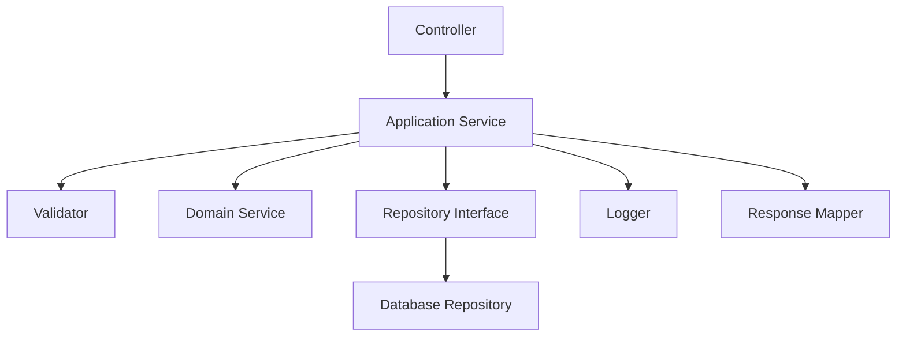
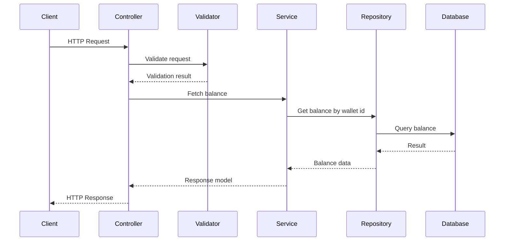
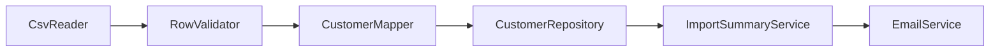

# Single Responsibility Principle (SRP) in C# — Interview Preparation Notes

## 1. Topic Overview

### What is Single Responsibility Principle?

**Single Responsibility Principle (SRP)** is one of the five **SOLID principles** of object-oriented design.

> **Definition:** A class, module, method, or component should have **one reason to change**.

In simple terms:

> A class should do **one main job**, and it should do it well.

### Why is SRP important?

SRP helps create code that is:

- Easier to understand
- Easier to test
- Easier to modify
- Easier to reuse
- Less likely to break when requirements change

### What problem does SRP solve?

Without SRP, classes often become **large, tightly coupled, and difficult to maintain**.

Example of a class doing too much:

- Reads request data
- Validates data
- Performs business logic
- Connects to database
- Logs errors
- Formats response
- Handles encryption/decryption

This creates a **God class**.

When one requirement changes, unrelated parts of the class may break.

### Where is SRP used in real-world projects?

SRP is used in:

- ASP.NET MVC / Web API controllers
- Service layer design
- Repository pattern
- Logging components
- Validation logic
- Payment processing systems
- File processing
- Background services
- Microservices
- Clean Architecture
- Domain-driven design

### Simple explanation

Imagine a restaurant.

- The **waiter** takes orders.
- The **chef** cooks food.
- The **cashier** handles billing.
- The **cleaner** cleans tables.

If one person does everything, the restaurant becomes inefficient.

Similarly, in software, each class should have a clear responsibility.

---

## 2. Core Concepts

## Must Know Concepts

### 2.1 Responsibility

#### Definition

A **responsibility** is a reason for a class or method to change.

#### Purpose

It helps identify what a class is actually responsible for.

#### Why it exists

Software changes over time. SRP reduces the impact of changes by separating responsibilities.

#### How it works

If a class has multiple responsibilities, split it into smaller classes.

#### Key points

- Responsibility is not just "what the class does".
- Responsibility means **why the class might change**.
- One class can have many methods but still one responsibility.
- One method can still violate SRP if it performs unrelated work.

#### Simple example

Bad:

```csharp
public class InvoiceService
{
    public void CalculateTotal()
    {
    }

    public void SaveToDatabase()
    {
    }

    public void SendEmail()
    {
    }
}
```

This class has three responsibilities:

1. Calculation
2. Persistence
3. Notification

Better:

```csharp
public class InvoiceCalculator
{
    public decimal CalculateTotal()
    {
        return 100;
    }
}

public class InvoiceRepository
{
    public void Save()
    {
    }
}

public class EmailService
{
    public void Send()
    {
    }
}
```

#### Real-world/project example

In a Web API project:

- Controller should handle HTTP request/response.
- Service should handle business logic.
- Repository should handle database access.
- Logger should handle logging.
- Validator should handle validation.

---

### 2.2 Reason to Change

#### Definition

A **reason to change** is a business, technical, or external requirement that forces code modification.

#### Purpose

It helps detect whether a class has too many responsibilities.

#### Why it exists

Classes should be affected by only one type of change.

#### Example

A `ReportManager` class may change because:

- Report calculation changed
- Report format changed
- Database schema changed
- Email delivery changed

That means it has too many reasons to change.

#### Better design

```csharp
public class ReportGenerator
{
    public string Generate()
    {
        return "Report Data";
    }
}

public class ReportFormatter
{
    public string Format(string report)
    {
        return report;
    }
}

public class ReportEmailSender
{
    public void Send(string report)
    {
    }
}
```

#### Key interview point

> SRP is not about having only one method. It is about having only one reason to change.

---

### 2.3 Cohesion

#### Definition

**Cohesion** means how closely related the members of a class are.

#### Purpose

High cohesion means the class has a focused purpose.

#### Why it exists

Highly cohesive classes are easier to understand and maintain.

#### Example of low cohesion

```csharp
public class Utility
{
    public void SendEmail()
    {
    }

    public void CalculateTax()
    {
    }

    public void SaveFile()
    {
    }
}
```

These methods are unrelated.

#### Example of high cohesion

```csharp
public class TaxCalculator
{
    public decimal CalculateIncomeTax(decimal income)
    {
        return income * 0.10m;
    }

    public decimal CalculateSalesTax(decimal amount)
    {
        return amount * 0.05m;
    }
}
```

All methods relate to tax calculation.

---

### 2.4 Coupling

#### Definition

**Coupling** means how dependent one class is on another.

#### Purpose

SRP reduces unnecessary coupling.

#### Why it exists

If one class depends on too many unrelated things, changes become risky.

#### Example of high coupling

```csharp
public class OrderProcessor
{
    private readonly SqlConnection _connection;
    private readonly SmtpClient _smtpClient;
    private readonly FileLogger _logger;

    public void Process()
    {
    }
}
```

This class depends on database, email, and logging.

#### Better approach

```csharp
public class OrderProcessor
{
    private readonly IOrderRepository _orderRepository;
    private readonly INotificationService _notificationService;

    public OrderProcessor(
        IOrderRepository orderRepository,
        INotificationService notificationService)
    {
        _orderRepository = orderRepository;
        _notificationService = notificationService;
    }

    public void Process()
    {
    }
}
```

---

### 2.5 Separation of Concerns

#### Definition

**Separation of Concerns** means dividing software into parts where each part handles a specific concern.

#### Relationship with SRP

SRP is a class-level application of Separation of Concerns.

#### Example

In ASP.NET Web API:

| Concern | Component |
|---|---|
| HTTP handling | Controller |
| Business rules | Service |
| Data access | Repository |
| Validation | Validator |
| Logging | Logger |
| Response formatting | Formatter |

---

## Good to Know Concepts

### 2.6 God Class

#### Definition

A **God class** is a class that knows too much or does too much.

#### Signs of a God class

- Very large class
- Many unrelated methods
- Many dependencies
- Hard to test
- Frequently modified
- Contains business logic, database logic, logging, validation, and formatting

#### Example

```csharp
public class CustomerManager
{
    public void ValidateCustomer()
    {
    }

    public void SaveCustomer()
    {
    }

    public void SendWelcomeEmail()
    {
    }

    public void GenerateCustomerReport()
    {
    }

    public void WriteLog()
    {
    }
}
```

#### Interview tip

> A God class is a common SRP violation and a strong sign that the design needs refactoring.

---

### 2.7 Thin Controller

#### Definition

A **thin controller** contains minimal logic and delegates work to services.

#### Purpose

Controllers should mainly handle HTTP concerns.

#### Bad controller responsibilities

- Business rules
- Database access
- Complex validation
- Encryption logic
- Logging details
- Response construction logic

#### Better controller responsibility

- Receive request
- Call service
- Return response

```csharp
public class BalanceController : ApiController
{
    private readonly IBalanceService _balanceService;

    public BalanceController(IBalanceService balanceService)
    {
        _balanceService = balanceService;
    }

    [HttpPost]
    public HttpResponseMessage FetchBalance(FetchBalanceRequest request)
    {
        FetchBalanceResponse response = _balanceService.FetchBalance(request);
        return Request.CreateResponse(HttpStatusCode.OK, response);
    }
}
```

---

### 2.8 Service Layer

#### Definition

A **service layer** contains business logic.

#### Purpose

It keeps controllers and repositories focused.

#### Example

```csharp
public class BalanceService
{
    private readonly IBalanceRepository _balanceRepository;

    public BalanceService(IBalanceRepository balanceRepository)
    {
        _balanceRepository = balanceRepository;
    }

    public FetchBalanceResponse FetchBalance(FetchBalanceRequest request)
    {
        if (string.IsNullOrEmpty(request.WalletId))
        {
            return new FetchBalanceResponse
            {
                ResponseCode = 400,
                ResponseMessage = "Wallet ID is required"
            };
        }

        return _balanceRepository.GetBalance(request.WalletId);
    }
}
```

---

## Advanced Concepts

### 2.9 SRP and Clean Architecture

#### Definition

In Clean Architecture, responsibilities are separated into layers.

#### Common layers

| Layer | Responsibility |
|---|---|
| Presentation | HTTP/UI handling |
| Application | Use cases |
| Domain | Business rules |
| Infrastructure | Database, file system, external APIs |

#### Example

```text
Controller -> Application Service -> Domain Model -> Repository Interface -> Database Repository
```

#### Key point

SRP helps enforce architectural boundaries.

---

### 2.10 SRP and Change Axes

#### Definition

A **change axis** is a category of change that affects code.

#### Examples

A payment class may change due to:

- Payment gateway rules
- Fraud rules
- Logging requirements
- Database schema
- Notification requirements

Each change axis should ideally be isolated.

#### Interview answer

> SRP is about separating different axes of change so that one change does not force unrelated modifications.

---

### 2.11 SRP and Testability

#### Definition

Classes that follow SRP are easier to unit test.

#### Why?

Because each class has a focused behavior.

#### Bad example

Testing this class requires database, email, and logging setup:

```csharp
public class UserRegistration
{
    public void Register()
    {
        // Validate user
        // Save user
        // Send email
        // Write log
    }
}
```

Better:

```csharp
public class UserRegistrationService
{
    private readonly IUserValidator _validator;
    private readonly IUserRepository _repository;
    private readonly IEmailService _emailService;

    public UserRegistrationService(
        IUserValidator validator,
        IUserRepository repository,
        IEmailService emailService)
    {
        _validator = validator;
        _repository = repository;
        _emailService = emailService;
    }

    public void Register(User user)
    {
        _validator.Validate(user);
        _repository.Save(user);
        _emailService.SendWelcomeEmail(user);
    }
}
```

The orchestration service still has one responsibility: **coordinate user registration**.

---

## 3. How It Works Internally

SRP is a design principle, not a runtime feature. The compiler does not enforce it.

### Architecture

A typical SRP-friendly architecture:



### Execution Flow

Example: Fetching account balance.



### What happens behind the scenes?

When SRP is applied:

1. The incoming request reaches the controller.
2. The controller handles HTTP-specific work.
3. Validation is delegated to a validator.
4. Business rules are handled by a service.
5. Data access is handled by a repository.
6. Logging is handled by a logger.
7. Response formatting is handled separately.

### Internal mechanisms

SRP is commonly implemented through:

- Interfaces
- Dependency injection
- Service layer
- Repository pattern
- Validators
- Mappers
- Domain services
- Strategy pattern
- Decorators for logging/caching

### Important implementation detail

A class can call other classes and still follow SRP.

Example:

```csharp
public class OrderCheckoutService
{
    private readonly IInventoryService _inventoryService;
    private readonly IPaymentService _paymentService;
    private readonly IOrderRepository _orderRepository;

    public OrderCheckoutService(
        IInventoryService inventoryService,
        IPaymentService paymentService,
        IOrderRepository orderRepository)
    {
        _inventoryService = inventoryService;
        _paymentService = paymentService;
        _orderRepository = orderRepository;
    }

    public void Checkout(Order order)
    {
        _inventoryService.Reserve(order);
        _paymentService.Charge(order);
        _orderRepository.Save(order);
    }
}
```

This class coordinates checkout. Its responsibility is not inventory, payment, or persistence individually.

---

## 4. Important Terminology

| Term | Meaning | Example |
|---|---|---|
| SRP | A class should have one reason to change | `InvoiceCalculator` only calculates invoice totals |
| Responsibility | A role or reason for change | Validation, persistence, formatting |
| Reason to change | A requirement that forces modification | Database schema change |
| Cohesion | How related class members are | `TaxCalculator` methods all calculate taxes |
| Coupling | Dependency between classes | Service depends on repository interface |
| God class | Class that does too much | `OrderManager` validates, saves, emails, logs |
| Separation of Concerns | Splitting software by concern | Controller, service, repository |
| Thin controller | Controller with minimal logic | Controller delegates to service |
| Service layer | Layer for business logic | `OrderService` |
| Repository | Data access abstraction | `CustomerRepository` |
| Validator | Validation logic component | `CustomerValidator` |
| Mapper | Converts one model to another | Entity to DTO mapper |
| Orchestration | Coordinating multiple steps | Checkout service |
| Refactoring | Improving structure without changing behavior | Extracting validation into separate class |
| Change axis | Category of change | UI change, database change, business rule change |

---

## 5. Important Comparisons

| Concept A | Concept B | Key Difference | When to Use |
|---|---|---|---|
| SRP | Separation of Concerns | SRP is class-level; SoC is broader architecture-level | Use both together |
| SRP | DRY | SRP separates responsibilities; DRY removes duplication | Use SRP for design, DRY for duplication |
| SRP | Low Coupling | SRP focuses on reasons to change; low coupling focuses on dependencies | Use both for maintainability |
| SRP | High Cohesion | SRP causes high cohesion; cohesion measures relatedness | Use cohesion to evaluate SRP |
| Thin Controller | Fat Controller | Thin controller delegates logic; fat controller contains business logic | Prefer thin controllers |
| Service | Repository | Service handles business rules; repository handles data access | Use service for logic, repository for persistence |
| Validator | Service | Validator checks input; service executes business use case | Use validator before business processing |
| Refactoring | Rewriting | Refactoring preserves behavior; rewriting changes implementation broadly | Prefer refactoring when behavior is stable |

### SRP vs DRY

Bad DRY application can hurt SRP.

Example:

```csharp
public class CommonHelper
{
    public void ValidateUser()
    {
    }

    public void FormatInvoice()
    {
    }

    public void SendSms()
    {
    }
}
```

This avoids duplication but creates an unrelated utility class.

> Interview tip: DRY should not be applied in a way that destroys clear responsibilities.

---

## 6. Practical Examples

## Example 1: Invoice Processing

### Problem

A single class calculates invoice total, saves invoice, and sends email.

### Bad code

```csharp
public class InvoiceProcessor
{
    public decimal CalculateTotal(decimal amount, decimal tax)
    {
        return amount + tax;
    }

    public void SaveInvoice()
    {
        // Save invoice to database
    }

    public void SendInvoiceEmail()
    {
        // Send invoice email
    }
}
```

### Problems

- Calculation change affects this class.
- Database change affects this class.
- Email change affects this class.
- Hard to test calculation without involving other concerns.

### Better solution

```csharp
public class InvoiceCalculator
{
    public decimal CalculateTotal(decimal amount, decimal tax)
    {
        return amount + tax;
    }
}

public class InvoiceRepository
{
    public void Save(Invoice invoice)
    {
        // Save invoice to database
    }
}

public class InvoiceEmailService
{
    public void Send(Invoice invoice)
    {
        // Send invoice email
    }
}

public class InvoiceService
{
    private readonly InvoiceCalculator _calculator;
    private readonly InvoiceRepository _repository;
    private readonly InvoiceEmailService _emailService;

    public InvoiceService(
        InvoiceCalculator calculator,
        InvoiceRepository repository,
        InvoiceEmailService emailService)
    {
        _calculator = calculator;
        _repository = repository;
        _emailService = emailService;
    }

    public void Process(Invoice invoice)
    {
        invoice.Total = _calculator.CalculateTotal(invoice.Amount, invoice.Tax);
        _repository.Save(invoice);
        _emailService.Send(invoice);
    }
}
```

### Why this approach?

Each class has a focused reason to change.

### Alternatives

- Use domain services
- Use command handlers
- Use mediator pattern

### Trade-offs

| Benefit | Cost |
|---|---|
| Easier testing | More classes |
| Better maintainability | More design effort |
| Clearer responsibilities | More dependency management |

---

## Example 2: ASP.NET Web API Controller

### Problem

A controller performs request parsing, validation, encryption, business logic, repository calls, logging, and response formatting.

### Better design

```csharp
public class BalanceController : ApiController
{
    private readonly IBalanceRequestReader _requestReader;
    private readonly IBalanceValidator _validator;
    private readonly IBalanceService _balanceService;
    private readonly IXmlResponseWriter _responseWriter;

    public BalanceController(
        IBalanceRequestReader requestReader,
        IBalanceValidator validator,
        IBalanceService balanceService,
        IXmlResponseWriter responseWriter)
    {
        _requestReader = requestReader;
        _validator = validator;
        _balanceService = balanceService;
        _responseWriter = responseWriter;
    }

    [HttpPost]
    public HttpResponseMessage FetchBalance(HttpRequestMessage request)
    {
        FetchBalanceRequest balanceRequest = _requestReader.Read(request);

        ValidationResult validationResult = _validator.Validate(balanceRequest);
        if (!validationResult.IsValid)
        {
            return _responseWriter.WriteError(validationResult.Message);
        }

        FetchBalanceResponse response = _balanceService.FetchBalance(balanceRequest);
        return _responseWriter.WriteSuccess(response);
    }
}
```

### Responsibilities

| Class | Responsibility |
|---|---|
| `BalanceController` | HTTP coordination |
| `IBalanceRequestReader` | Read request |
| `IBalanceValidator` | Validate request |
| `IBalanceService` | Business logic |
| `IBalanceRepository` | Data access |
| `IXmlResponseWriter` | XML response formatting |

### Why this approach?

It keeps the controller thin and testable.

---

## Example 3: File Import System

### Problem

A class reads CSV, validates rows, maps data, saves to DB, and sends summary email.

### SRP-friendly approach



### Classes

```csharp
public class CsvCustomerReader
{
    public IEnumerable<string[]> Read(string filePath)
    {
        return File.ReadAllLines(filePath)
            .Select(line => line.Split(','));
    }
}

public class CustomerValidator
{
    public bool IsValid(string[] row)
    {
        return row.Length >= 2 && !string.IsNullOrEmpty(row[0]);
    }
}

public class CustomerMapper
{
    public Customer Map(string[] row)
    {
        return new Customer
        {
            Name = row[0],
            Email = row[1]
        };
    }
}
```

### Trade-off

More classes, but each part can be tested and changed independently.

---

## 7. Interview Questions

## Beginner Questions

### Question 1

**Question:** What is Single Responsibility Principle?

**Short Interview Answer:**  
SRP means a class should have only one reason to change.

**Detailed Explanation:**  
A class should focus on one responsibility. If a class handles validation, database access, logging, and business logic, it has multiple reasons to change and violates SRP.

**Example:**  
A `CustomerRepository` should only handle customer data access, not email notifications.

**Possible Follow-up Question:**  
Does SRP mean a class can have only one method?

---

### Question 2

**Question:** Why is SRP important?

**Short Interview Answer:**  
It improves maintainability, readability, testability, and reduces the risk of breaking unrelated functionality.

**Detailed Explanation:**  
When responsibilities are separated, changes in one area affect fewer classes.

**Example:**  
Changing email logic should not require changing order calculation logic.

**Possible Follow-up Question:**  
Can SRP increase the number of classes?

---

### Question 3

**Question:** Does SRP mean one class should have one method?

**Short Interview Answer:**  
No. SRP means one reason to change, not one method.

**Detailed Explanation:**  
A class can have multiple methods if they all belong to the same responsibility.

**Example:**  
A `TaxCalculator` can have `CalculateIncomeTax`, `CalculateSalesTax`, and `CalculateCorporateTax`.

**Possible Follow-up Question:**  
How do you identify one responsibility?

---

## Intermediate Questions

### Question 4

**Question:** How do you identify SRP violation?

**Short Interview Answer:**  
Look for classes with unrelated methods, many dependencies, frequent changes for different reasons, and difficult unit tests.

**Detailed Explanation:**  
A class that validates input, saves to database, sends emails, and logs errors likely violates SRP.

**Example:**  
A controller containing business rules and SQL queries violates SRP.

**Possible Follow-up Question:**  
How would you refactor such a class?

---

### Question 5

**Question:** How does SRP improve unit testing?

**Short Interview Answer:**  
Classes with one responsibility are easier to isolate and test.

**Detailed Explanation:**  
If validation is in a separate class, it can be tested without database or HTTP dependencies.

**Example:**  
Testing `WalletValidator` does not require a database connection.

**Possible Follow-up Question:**  
Can too much SRP make testing harder?

---

### Question 6

**Question:** What is the relationship between SRP and dependency injection?

**Short Interview Answer:**  
Dependency injection helps apply SRP by allowing responsibilities to be separated into services and injected where needed.

**Detailed Explanation:**  
Instead of one class creating and managing all dependencies, it receives focused services through constructor injection.

**Example:**  
`OrderService` receives `IOrderRepository` and `IPaymentService`.

**Possible Follow-up Question:**  
Can SRP exist without dependency injection?

---

## Advanced Questions

### Question 7

**Question:** How is SRP different from Separation of Concerns?

**Short Interview Answer:**  
Separation of Concerns is a broader design idea, while SRP applies it mainly at class or module level.

**Detailed Explanation:**  
SoC separates application concerns across layers or modules. SRP ensures each class has one reason to change.

**Example:**  
MVC separates UI, logic, and data concerns. SRP ensures each class inside those layers is focused.

**Possible Follow-up Question:**  
Can a layered architecture still violate SRP?

---

### Question 8

**Question:** Can an orchestrator service follow SRP if it calls multiple services?

**Short Interview Answer:**  
Yes, if its single responsibility is coordinating one use case.

**Detailed Explanation:**  
Calling multiple services does not automatically violate SRP. The issue is whether the class owns multiple unrelated responsibilities.

**Example:**  
`CheckoutService` may call inventory, payment, and order services because its responsibility is checkout orchestration.

**Possible Follow-up Question:**  
When does orchestration become a God class?

---

### Question 9

**Question:** What are the trade-offs of applying SRP aggressively?

**Short Interview Answer:**  
It can lead to too many small classes, increased indirection, and more complex navigation.

**Detailed Explanation:**  
Over-engineering can make simple code harder to understand.

**Example:**  
Creating separate classes for every two-line operation may not be useful.

**Possible Follow-up Question:**  
How do you decide when to split a class?

---

## 8. Tricky Interview Questions

### Question: If a class has five methods, does it violate SRP?

**Answer:**  
Not necessarily. It violates SRP only if those methods represent different reasons to change.

---

### Question: Can a method violate SRP?

**Answer:**  
Yes. A method that validates input, saves data, sends email, and formats output has multiple responsibilities.

---

### Question: Is logging a separate responsibility?

**Answer:**  
Usually yes. Business classes should not contain detailed logging logic. Logging can be handled through decorators, middleware, filters, or injected logging abstractions.

---

### Question: Can too much SRP be bad?

**Answer:**  
Yes. Excessive splitting can create unnecessary complexity and make the code harder to follow.

---

### Question: Should every class have only one dependency?

**Answer:**  
No. SRP is about one reason to change, not one dependency.

---

### Question: Is a service that calls repository and email service violating SRP?

**Answer:**  
Not always. If it coordinates one business use case, it can still follow SRP.

---

### Question: Is a utility class an SRP violation?

**Answer:**  
Often yes, if it contains unrelated helper methods. Focused utility classes, such as `DateTimeProvider`, can be acceptable.

---

### Question: Does SRP improve performance?

**Answer:**  
Not directly. SRP improves maintainability and testability. Performance may improve indirectly because focused code is easier to optimize.

---

## 9. Scenario-Based Questions

## Scenario 1: Fat Controller

### Scenario

A Web API controller parses XML, decrypts data, validates input, calls repository, logs messages, and creates XML response.

### Approach

Split responsibilities into:

- Request parser
- Encryption service
- Validator
- Business service
- Repository
- Response formatter
- Logger

### Why it works

Each component changes for one reason.

### Trade-offs

- More classes
- More dependency setup
- Better testability and maintainability

### Alternatives

- Keep small logic in controller if application is simple
- Use filters for cross-cutting concerns
- Use middleware where available

### What interviewer is testing

- Ability to identify SRP violations
- Refactoring judgment
- Practical architecture understanding

---

## Scenario 2: Report Generation

### Scenario

A report class fetches data, calculates values, formats PDF, and emails the report.

### Solution

Create:

- `ReportDataProvider`
- `ReportCalculator`
- `ReportFormatter`
- `ReportEmailSender`
- `ReportService`

### What interviewer is testing

- Ability to separate change reasons
- Understanding of orchestration
- Awareness of trade-offs

---

## Scenario 3: Payment Processing

### Scenario

A payment class validates payment, charges card, saves transaction, sends receipt, and logs fraud events.

### Better design

- `PaymentValidator`
- `PaymentGateway`
- `TransactionRepository`
- `ReceiptService`
- `FraudDetectionService`
- `PaymentService`

### What interviewer is testing

- Real-world SRP application
- Service boundaries
- Domain logic separation

---

## 10. Real-World Usage

### Common use cases

SRP is commonly used in:

- Controllers
- Services
- Repositories
- Validators
- DTO mappers
- Email services
- Payment gateways
- Logging wrappers
- File processors
- Background jobs

### When to use SRP

Use SRP when:

- A class is growing too large
- A class has unrelated methods
- Unit testing is difficult
- Changes frequently break unrelated behavior
- Business logic is mixed with infrastructure logic

### When NOT to overuse SRP

Avoid excessive SRP when:

- The code is very small and unlikely to change
- Splitting creates unnecessary complexity
- The abstraction has no clear purpose
- It reduces readability

### Design considerations

- Keep controllers thin.
- Keep business rules in services or domain models.
- Keep data access in repositories.
- Keep validation separate.
- Use interfaces for replaceable dependencies.
- Avoid generic `Helper` or `Manager` classes.

### Scalability

SRP improves team scalability because different developers can work on separate components with less conflict.

### Reliability

Focused classes reduce accidental side effects.

### Maintainability

SRP makes code easier to modify safely.

---

## 11. Performance & Optimization

### Time complexity

SRP does not directly affect algorithmic time complexity.

Example:

- A sorting algorithm remains `O(n log n)` whether it is inside one class or separated.

### Space complexity

SRP may create more objects, but usually the memory impact is negligible.

### Performance considerations

Potential overhead:

- More objects
- More method calls
- More dependency injection setup

In most enterprise applications, this overhead is insignificant compared to:

- Database calls
- Network calls
- File I/O
- Serialization
- External API calls

### Optimization techniques

- Avoid unnecessary abstractions for trivial code.
- Use dependency injection wisely.
- Keep hot-path code simple.
- Measure performance before optimizing.
- Do not sacrifice clarity without evidence.

> Interview tip: SRP is primarily a maintainability principle, not a performance optimization technique.

---

## 12. Common Mistakes

### Conceptual mistakes

- Thinking SRP means one method per class.
- Thinking every responsibility requires an interface.
- Thinking more classes always means better design.
- Confusing SRP with DRY.
- Ignoring orchestration as a valid responsibility.

### Implementation mistakes

- Creating large `Manager` classes.
- Creating generic `Helper` classes.
- Putting SQL queries inside controllers.
- Mixing validation with persistence.
- Mixing formatting with business logic.
- Logging too much implementation detail inside business services.

### Interview mistakes

- Giving only textbook definition.
- Not explaining "reason to change".
- Not giving a practical example.
- Saying every class must do only one small operation.
- Not discussing trade-offs.

---

## 13. Best Practices

### 1. Design around reasons to change

Why it matters:

- It produces stable and maintainable classes.

### 2. Keep controllers thin

Why it matters:

- Controllers should handle HTTP, not business rules.

### 3. Put business logic in services or domain models

Why it matters:

- Business rules become reusable and testable.

### 4. Keep data access in repositories

Why it matters:

- Database changes do not affect business logic.

### 5. Avoid God classes

Why it matters:

- Large classes are difficult to test, debug, and modify.

### 6. Use meaningful class names

Why it matters:

- Names reveal responsibility.

Good:

- `PaymentValidator`
- `InvoiceCalculator`
- `CustomerRepository`

Bad:

- `CommonHelper`
- `MainManager`
- `Processor`

### 7. Refactor gradually

Why it matters:

- Large rewrites are risky.

### 8. Do not over-engineer

Why it matters:

- Too many tiny classes can reduce readability.

---

## 14. Interview Cheat Sheet

### Key definition

**SRP:** A class should have only one reason to change.

### Must remember

- SRP is about **reason to change**, not number of methods.
- SRP improves maintainability and testability.
- SRP reduces coupling and improves cohesion.
- A controller should not contain business logic.
- A repository should not contain business rules.
- A validator should not save data.
- A logger should not decide business outcomes.

### Common SRP violations

- Fat controller
- God class
- Utility class with unrelated methods
- Service containing database, email, validation, and formatting logic
- Business logic mixed with infrastructure logic

### Good examples

| Responsibility | Class |
|---|---|
| Validation | `OrderValidator` |
| Business logic | `OrderService` |
| Data access | `OrderRepository` |
| Email sending | `EmailService` |
| Mapping | `OrderMapper` |
| Logging | `ILogger` |

### Common questions

- What is SRP?
- Why is SRP useful?
- How do you identify SRP violation?
- Does SRP mean one method per class?
- How does SRP improve testing?
- What are the trade-offs?

---

## 15. Rapid-Fire Interview Questions

### 1. What is SRP?

A class should have one reason to change.

### 2. Is SRP about one method per class?

No. It is about one responsibility or one reason to change.

### 3. What is a God class?

A class that does too much and has many reasons to change.

### 4. Why does SRP improve testing?

Focused classes are easier to isolate and test.

### 5. What is a fat controller?

A controller containing business logic, validation, data access, or formatting logic.

### 6. What should a controller do?

Handle HTTP input/output and delegate business work.

### 7. What should a repository do?

Handle data access.

### 8. What should a service do?

Handle business logic or coordinate a use case.

### 9. Can a class have multiple dependencies and still follow SRP?

Yes, if it has one responsibility.

### 10. Can a method violate SRP?

Yes, if it performs unrelated tasks.

### 11. What is cohesion?

How closely related the members of a class are.

### 12. What is coupling?

The degree of dependency between classes.

### 13. Does SRP improve performance?

Not directly. It improves maintainability.

### 14. Can SRP be overused?

Yes. Too many tiny classes can create unnecessary complexity.

### 15. What is one sign of SRP violation?

A class changes for many unrelated reasons.

### 16. Is logging a separate responsibility?

Usually yes.

### 17. What is orchestration?

Coordinating multiple services to complete one use case.

### 18. Does orchestration violate SRP?

No, if coordination of one use case is the responsibility.

### 19. How does SRP relate to SOLID?

It is the first SOLID principle.

### 20. Best one-line SRP explanation?

A class should do one job and have one reason to change.

---

## 16. Mock Interview

This section is interactive.

Answer the question below. After your answer, the next response should:

- Rate the answer from **1–10**
- Explain what was correct
- Explain what was missed
- Correct mistakes
- Provide an ideal answer
- Ask the next question

### Mock Interview Question 1

What is the Single Responsibility Principle, and what does "one reason to change" mean?

---

## 17. Final Interview Revision

### 20–30 Most Important Things to Remember

1. **SRP means one reason to change.**
2. SRP does **not** mean one method per class.
3. A class can have multiple methods if they support the same responsibility.
4. A class can have multiple dependencies if it coordinates one use case.
5. SRP improves maintainability.
6. SRP improves testability.
7. SRP improves readability.
8. SRP reduces accidental side effects.
9. SRP helps prevent God classes.
10. Fat controllers usually violate SRP.
11. Controllers should handle HTTP concerns.
12. Services should handle business logic.
13. Repositories should handle data access.
14. Validators should handle validation.
15. Formatters should handle output formatting.
16. Loggers should handle logging.
17. SRP supports high cohesion.
18. SRP helps reduce unnecessary coupling.
19. SRP is closely related to Separation of Concerns.
20. SRP is not enforced by the compiler.
21. SRP is a design judgment, not a strict rule.
22. Do not over-engineer by creating too many tiny classes.
23. Use SRP when a class changes for unrelated reasons.
24. Use meaningful class names that describe responsibility.
25. Refactor gradually by extracting responsibilities.
26. Avoid generic names like `Helper`, `Manager`, and `Processor` when they hide mixed responsibilities.
27. SRP works well with dependency injection.
28. SRP helps teams work independently on different parts of a system.
29. SRP is especially important in long-term enterprise applications.
30. In interviews, always explain SRP using a practical example.

> Interview tip: The strongest SRP answer includes the phrase **"one reason to change"**, explains that it is **not one method per class**, and gives a practical example like separating controller, service, repository, and validator responsibilities.