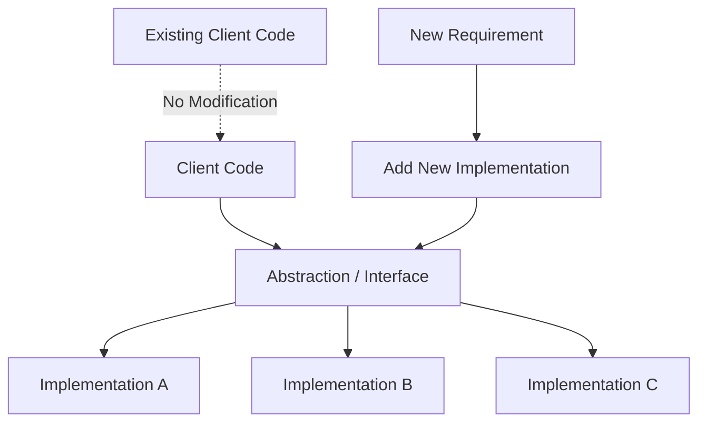
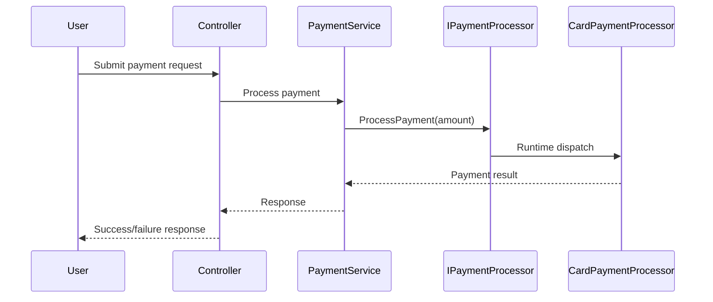

# Open Closed Principle in C# — Interview Preparation Notes

## 1. Topic Overview

### What Is the Open Closed Principle?

The **Open Closed Principle**, commonly called **OCP**, is one of the five **SOLID principles** of object-oriented design.

> **Definition:**  
> Software entities such as classes, modules, methods, and components should be **open for extension** but **closed for modification**.

In simple terms:

> You should be able to add new behavior without changing existing, tested code.

---

### Why Is It Important?

OCP helps create software that is:

- Easier to maintain
- Safer to extend
- Less likely to break existing functionality
- More testable
- Better structured for changing business requirements

---

### What Problem Does It Solve?

Without OCP, code often grows like this:

```csharp
public decimal CalculateDiscount(string customerType, decimal amount)
{
    if (customerType == "Regular")
    {
        return amount * 0.05m;
    }

    if (customerType == "Premium")
    {
        return amount * 0.10m;
    }

    if (customerType == "VIP")
    {
        return amount * 0.20m;
    }

    return 0;
}
```

Every time a new customer type is added, this method must be modified.

That creates risks:

- Existing logic may break
- Unit tests must be repeated
- Code becomes harder to read
- More `if`, `else`, and `switch` statements appear
- Business rules become tightly coupled

OCP solves this by moving changing behavior into separate extensible units.

---

### Where Is It Used in Real-World Projects?

OCP is commonly used in:

- Payment gateway integrations
- Notification systems
- Discount and pricing engines
- Logging frameworks
- Validation pipelines
- Report generation
- File processing systems
- Tax calculation systems
- Authentication providers
- Repository and service abstractions
- Strategy-based business rules
- Dependency Injection based architectures

---

### Very Simple Explanation

Imagine a mobile phone.

You can add new apps without modifying the phone operating system.

That is OCP.

The phone is **closed for modification**, but **open for extension** through apps.

In C#, a class should work the same way:

- Existing class should not need frequent changes
- New behavior should be added using new classes, interfaces, inheritance, composition, or patterns

---

## 2. Core Concepts

## Must Know Concepts

### 2.1 Open for Extension

#### Definition

A class or module is **open for extension** when new behavior can be added without rewriting existing code.

#### Purpose

To support future requirements with minimal risk.

#### Why It Exists

Business requirements change frequently. OCP allows adding new features safely.

#### How It Works

New behavior is added using:

- Interfaces
- Abstract classes
- Polymorphism
- Composition
- Strategy pattern
- Dependency Injection
- Decorator pattern
- Factory pattern

#### Key Points

- Extension usually means adding a new class
- Existing code should remain stable
- Extension points should be intentionally designed

#### Simple Example

```csharp
public interface IDiscountStrategy
{
    decimal CalculateDiscount(decimal amount);
}

public class RegularCustomerDiscount : IDiscountStrategy
{
    public decimal CalculateDiscount(decimal amount)
    {
        return amount * 0.05m;
    }
}

public class PremiumCustomerDiscount : IDiscountStrategy
{
    public decimal CalculateDiscount(decimal amount)
    {
        return amount * 0.10m;
    }
}
```

New discounts can be added by creating a new class.

#### Real-World Example

A payment system supports:

- Credit card payment
- UPI payment
- Wallet payment

Later, a new payment method like PayPal is added by creating a new class implementing `IPaymentProcessor`.

---

### 2.2 Closed for Modification

#### Definition

A class is **closed for modification** when its existing source code does not need to change for every new requirement.

#### Purpose

To protect working code from unnecessary changes.

#### Why It Exists

Changing existing code may introduce bugs in already-tested behavior.

#### How It Works

Existing classes depend on abstractions rather than concrete implementations.

#### Key Points

- Closed does not mean the code can never change
- Bug fixes may still require modification
- OCP mainly targets feature extension, not defect correction
- Stability increases when core logic depends on abstractions

#### Simple Example

```csharp
public class DiscountCalculator
{
    private readonly IDiscountStrategy discountStrategy;

    public DiscountCalculator(IDiscountStrategy discountStrategy)
    {
        this.discountStrategy = discountStrategy;
    }

    public decimal Calculate(decimal amount)
    {
        return discountStrategy.CalculateDiscount(amount);
    }
}
```

`DiscountCalculator` does not change when new discount types are added.

#### Real-World Example

A report export service depends on `IReportExporter`.

Adding a new PDF, Excel, or CSV exporter does not require changing the main report generation logic.

---

### 2.3 Abstraction

#### Definition

An **abstraction** defines what behavior is needed without specifying how it is implemented.

#### Purpose

To decouple high-level logic from low-level implementation details.

#### Why It Exists

Without abstraction, classes depend directly on concrete classes, making them harder to extend.

#### How It Works

In C#, abstractions are usually created with:

- `interface`
- `abstract class`
- delegates
- base classes

#### Key Points

- Interfaces are commonly used for OCP
- Abstractions should represent stable contracts
- Poor abstractions can make code more complex

#### Simple Example

```csharp
public interface INotificationSender
{
    void Send(string message);
}

public class EmailNotificationSender : INotificationSender
{
    public void Send(string message)
    {
        Console.WriteLine("Email sent: " + message);
    }
}

public class SmsNotificationSender : INotificationSender
{
    public void Send(string message)
    {
        Console.WriteLine("SMS sent: " + message);
    }
}
```

#### Real-World Example

An order system sends notifications after order placement.

Instead of hardcoding email logic, it depends on `INotificationSender`.

Later, SMS or WhatsApp can be added without changing the order service.

---

### 2.4 Polymorphism

#### Definition

**Polymorphism** allows different classes to be treated through the same interface or base type.

#### Purpose

To execute different behavior through a common contract.

#### Why It Exists

It allows runtime selection of behavior without large conditional blocks.

#### How It Works

A variable of interface type can hold any object implementing that interface.

#### Key Points

- Core mechanism behind OCP
- Replaces many `if`, `else`, and `switch` blocks
- Makes behavior interchangeable

#### Simple Example

```csharp
public interface IPaymentProcessor
{
    void ProcessPayment(decimal amount);
}

public class CardPaymentProcessor : IPaymentProcessor
{
    public void ProcessPayment(decimal amount)
    {
        Console.WriteLine("Card payment processed.");
    }
}

public class UpiPaymentProcessor : IPaymentProcessor
{
    public void ProcessPayment(decimal amount)
    {
        Console.WriteLine("UPI payment processed.");
    }
}
```

#### Real-World Example

At runtime, the application can choose the correct payment processor based on user selection.

---

### 2.5 Dependency Injection

#### Definition

**Dependency Injection**, or DI, is a technique where dependencies are provided to a class from outside instead of being created inside it.

#### Purpose

To reduce tight coupling and support extensibility.

#### Why It Exists

If a class creates its own dependencies using `new`, it becomes harder to replace or extend behavior.

#### How It Works

Dependencies are commonly passed through constructors.

#### Key Points

- Constructor injection is preferred
- DI works very well with OCP
- DI containers can resolve implementations automatically

#### Simple Example

```csharp
public class OrderService
{
    private readonly INotificationSender notificationSender;

    public OrderService(INotificationSender notificationSender)
    {
        this.notificationSender = notificationSender;
    }

    public void PlaceOrder()
    {
        notificationSender.Send("Order placed successfully.");
    }
}
```

#### Real-World Example

In ASP.NET Core, services are registered in the DI container:

```csharp
services.AddScoped<INotificationSender, EmailNotificationSender>();
```

Then `OrderService` receives the implementation automatically.

---

## Good to Know Concepts

### 2.6 Strategy Pattern

#### Definition

The **Strategy Pattern** defines a family of algorithms, encapsulates each one, and makes them interchangeable.

#### Purpose

To change behavior without changing the class that uses the behavior.

#### Why It Exists

It removes complex conditional logic.

#### How It Works

Each algorithm is implemented as a separate class behind a shared interface.

#### Key Points

- One of the most common ways to implement OCP
- Useful for pricing, discounts, validation, sorting, and payment logic
- Makes algorithms independently testable

#### Simple Example

```csharp
public interface IShippingCostCalculator
{
    decimal Calculate(decimal orderAmount);
}

public class StandardShippingCalculator : IShippingCostCalculator
{
    public decimal Calculate(decimal orderAmount)
    {
        return 50;
    }
}

public class ExpressShippingCalculator : IShippingCostCalculator
{
    public decimal Calculate(decimal orderAmount)
    {
        return 100;
    }
}
```

#### Real-World Example

An e-commerce platform supports multiple shipping providers.

Each provider has its own shipping calculation strategy.

---

### 2.7 Factory Pattern

#### Definition

The **Factory Pattern** creates objects without exposing object creation logic to the caller.

#### Purpose

To centralize object creation and reduce dependency on concrete classes.

#### Why It Exists

Even with OCP, some part of the system must decide which implementation to use.

#### How It Works

A factory returns an abstraction based on input or configuration.

#### Simple Example

```csharp
public class PaymentProcessorFactory
{
    public IPaymentProcessor Create(string paymentType)
    {
        if (paymentType == "Card")
        {
            return new CardPaymentProcessor();
        }

        if (paymentType == "UPI")
        {
            return new UpiPaymentProcessor();
        }

        throw new NotSupportedException("Payment type is not supported.");
    }
}
```

#### Important Note

This factory still needs modification when a new payment type is added.

A more advanced OCP-friendly factory uses registration or DI.

---

### 2.8 Decorator Pattern

#### Definition

The **Decorator Pattern** adds behavior to an object dynamically without changing the original class.

#### Purpose

To extend functionality while preserving existing behavior.

#### Why It Exists

Inheritance is not always flexible enough for combining behaviors.

#### How It Works

A decorator implements the same interface as the original class and wraps it.

#### Simple Example

```csharp
public interface IMessageSender
{
    void Send(string message);
}

public class EmailSender : IMessageSender
{
    public void Send(string message)
    {
        Console.WriteLine("Sending email: " + message);
    }
}

public class LoggingMessageSender : IMessageSender
{
    private readonly IMessageSender innerSender;

    public LoggingMessageSender(IMessageSender innerSender)
    {
        this.innerSender = innerSender;
    }

    public void Send(string message)
    {
        Console.WriteLine("Logging message.");
        innerSender.Send(message);
    }
}
```

#### Real-World Example

Add logging, retry, caching, or validation around an existing service without modifying it.

---

## Advanced Concepts

### 2.9 Plugin Architecture

#### Definition

A **plugin architecture** allows new features to be added as external modules.

#### Purpose

To extend applications without recompiling the core application.

#### Why It Exists

Large systems may need third-party or independently deployed extensions.

#### How It Works

The core system defines extension contracts. Plugins implement those contracts.

#### Real-World Example

Visual Studio extensions, browser extensions, and payment gateway plugins.

---

### 2.10 Reflection-Based Extension

#### Definition

Reflection can discover implementations dynamically at runtime.

#### Purpose

To load classes without hardcoding them.

#### Why It Exists

Useful for plugin systems and dynamic module loading.

#### Trade-Offs

- More flexible
- Slower than direct instantiation
- Harder to debug
- More complex
- Can fail at runtime if types are missing

---

### 2.11 OCP with Configuration

#### Definition

Behavior is selected through configuration rather than code changes.

#### Example

```json
{
  "NotificationProvider": "Email"
}
```

The application uses configuration to select the correct implementation.

#### Real-World Example

Switching between payment providers using `appsettings.json` or `Web.config`.

---

## 3. How It Works Internally

### Basic Architecture

OCP usually involves these components:

1. **Client class**
   - Uses functionality
2. **Abstraction**
   - Interface or abstract class
3. **Concrete implementations**
   - Classes with specific behavior
4. **Composition root**
   - Place where dependencies are wired
5. **Runtime dispatch**
   - Correct implementation method is called

---

### Mermaid Diagram



---

### Execution Flow

Example: Payment processing.



---

### What Happens Behind the Scenes?

When using an interface:

```csharp
IPaymentProcessor processor = new CardPaymentProcessor();
processor.ProcessPayment(100);
```

Internally:

1. The variable type is `IPaymentProcessor`
2. The actual object is `CardPaymentProcessor`
3. The CLR uses runtime dispatch
4. The correct implementation of `ProcessPayment` is executed
5. Caller does not need to know the concrete class

---

### Important Implementation Details

- OCP depends heavily on **stable abstractions**
- Too many abstractions can overcomplicate the design
- OCP should be applied where change is expected
- Not every class needs an interface
- Avoid abstracting too early
- Prefer composition over inheritance in most business logic

---

## 4. Important Terminology

| Term | Meaning | Example |
| ---- | ------- | ------- |
| Open Closed Principle | Code should be open for extension but closed for modification | Add new discount class without changing calculator |
| Extension | Adding new behavior | Add `VipDiscountStrategy` |
| Modification | Changing existing code | Editing `DiscountCalculator` for every customer type |
| Abstraction | Contract without implementation details | `IDiscountStrategy` |
| Interface | C# contract implemented by classes | `IPaymentProcessor` |
| Abstract Class | Base class with shared and abstract behavior | `PaymentProcessorBase` |
| Polymorphism | Same interface, different behavior | Card and UPI processors |
| Strategy Pattern | Encapsulates interchangeable algorithms | Different discount strategies |
| Factory Pattern | Creates objects based on logic | `PaymentProcessorFactory` |
| Decorator Pattern | Adds behavior by wrapping an object | Logging around notification sender |
| Dependency Injection | Provides dependencies from outside | Inject `INotificationSender` |
| Tight Coupling | Class depends directly on another concrete class | `new EmailSender()` inside service |
| Loose Coupling | Class depends on abstraction | Depends on `INotificationSender` |
| Composition | Building behavior using contained objects | Service uses injected strategy |
| Runtime Dispatch | Actual method chosen at runtime | Interface call invokes concrete method |
| Composition Root | Place where dependencies are registered | DI setup |
| Plugin | External extension module | Payment gateway plugin |

---

## 5. Important Comparisons

| Concept A | Concept B | Key Difference | When to Use |
| --------- | --------- | -------------- | ----------- |
| OCP | SRP | OCP focuses on extension; SRP focuses on one responsibility | Use both together |
| OCP | DIP | OCP is a design goal; DIP is a technique to achieve it | Use DIP to support OCP |
| Interface | Abstract Class | Interface defines contract; abstract class can share implementation | Interface for flexibility, abstract class for shared base logic |
| Strategy Pattern | Factory Pattern | Strategy handles behavior; factory creates objects | Strategy for algorithms, factory for creation |
| Inheritance | Composition | Inheritance extends through base class; composition uses contained objects | Prefer composition for flexible business rules |
| Polymorphism | Conditional Logic | Polymorphism delegates behavior; conditionals branch manually | Use polymorphism when behavior varies often |
| Decorator | Inheritance | Decorator adds behavior dynamically; inheritance is static | Use decorator for optional layered behavior |
| Modification | Extension | Modification changes existing code; extension adds new code | Prefer extension for new features |
| Overengineering | OCP | Overengineering adds abstractions without need; OCP adds extension points for expected change | Apply OCP where variation is likely |

---

## 6. Practical Examples

## Example 1: Discount Calculation

### Problem

A system calculates discounts for different customer types.

Bad implementation:

```csharp
public class DiscountCalculator
{
    public decimal Calculate(string customerType, decimal amount)
    {
        if (customerType == "Regular")
        {
            return amount * 0.05m;
        }

        if (customerType == "Premium")
        {
            return amount * 0.10m;
        }

        return 0;
    }
}
```

Every new customer type requires modifying this class.

---

### Approach

Use an interface and separate discount strategies.

---

### Solution

```csharp
public interface IDiscountStrategy
{
    decimal Calculate(decimal amount);
}

public class RegularDiscountStrategy : IDiscountStrategy
{
    public decimal Calculate(decimal amount)
    {
        return amount * 0.05m;
    }
}

public class PremiumDiscountStrategy : IDiscountStrategy
{
    public decimal Calculate(decimal amount)
    {
        return amount * 0.10m;
    }
}

public class DiscountCalculator
{
    private readonly IDiscountStrategy discountStrategy;

    public DiscountCalculator(IDiscountStrategy discountStrategy)
    {
        this.discountStrategy = discountStrategy;
    }

    public decimal Calculate(decimal amount)
    {
        return discountStrategy.Calculate(amount);
    }
}
```

---

### Why This Approach Was Chosen

- New discount types can be added as new classes
- Existing calculator remains unchanged
- Each strategy is independently testable

---

### Alternatives

- `switch` expression
- Dictionary of delegates
- Rule engine
- Database-driven discount rules

---

### Trade-Offs

| Benefit | Trade-Off |
| ------- | --------- |
| Easy extension | More classes |
| Better testing | Slightly more design upfront |
| Less risk | Requires abstraction |

---

## Example 2: Notification System

### Problem

Initially, the application sends only email notifications.

Later it must support SMS, push notifications, and WhatsApp.

---

### Approach

Create `INotificationSender`.

---

### Solution

```csharp
public interface INotificationSender
{
    void Send(string recipient, string message);
}

public class EmailNotificationSender : INotificationSender
{
    public void Send(string recipient, string message)
    {
        Console.WriteLine("Email sent to " + recipient);
    }
}

public class SmsNotificationSender : INotificationSender
{
    public void Send(string recipient, string message)
    {
        Console.WriteLine("SMS sent to " + recipient);
    }
}

public class NotificationService
{
    private readonly INotificationSender notificationSender;

    public NotificationService(INotificationSender notificationSender)
    {
        this.notificationSender = notificationSender;
    }

    public void Notify(string recipient, string message)
    {
        notificationSender.Send(recipient, message);
    }
}
```

---

### Why This Works

`NotificationService` does not care how the message is sent.

It only depends on the abstraction.

---

### Alternatives

- Use event-driven messaging
- Use a notification provider registry
- Use a third-party notification service

---

### Trade-Offs

- Good for known notification variations
- May become complex if each provider has very different requirements

---

## Example 3: Report Export

### Problem

A system exports reports to PDF. Later it must support Excel and CSV.

---

### Solution

```csharp
public interface IReportExporter
{
    byte[] Export(Report report);
}

public class PdfReportExporter : IReportExporter
{
    public byte[] Export(Report report)
    {
        return new byte[0];
    }
}

public class ExcelReportExporter : IReportExporter
{
    public byte[] Export(Report report)
    {
        return new byte[0];
    }
}

public class ReportService
{
    private readonly IReportExporter reportExporter;

    public ReportService(IReportExporter reportExporter)
    {
        this.reportExporter = reportExporter;
    }

    public byte[] GenerateReport(Report report)
    {
        return reportExporter.Export(report);
    }
}

public class Report
{
    public string Title { get; set; }
}
```

---

### Real-World Benefit

The report generation workflow stays stable while output formats can evolve independently.

---

## 7. Interview Questions

# Beginner Questions

## Question 1

### Question

What is the Open Closed Principle?

### Short Interview Answer

The Open Closed Principle says that software entities should be **open for extension but closed for modification**.

### Detailed Explanation

It means new behavior should be added by extending existing code, usually through interfaces, abstract classes, or polymorphism, instead of modifying already-tested code.

### Example

Add a new `VipDiscountStrategy` class instead of editing `DiscountCalculator`.

### Possible Follow-Up Question

How do interfaces help implement OCP?

---

## Question 2

### Question

Why is OCP important?

### Short Interview Answer

It reduces the risk of breaking existing functionality when adding new features.

### Detailed Explanation

Changing existing code may introduce regression bugs. OCP encourages adding new classes or implementations so the stable code remains untouched.

### Example

A payment service can support new payment methods without modifying the core payment flow.

### Possible Follow-Up Question

Can OCP increase code complexity?

---

## Question 3

### Question

Does OCP mean code should never be changed?

### Short Interview Answer

No. It means code should not need frequent modification for new behavior. Bug fixes and design improvements may still require changes.

### Detailed Explanation

OCP is about minimizing unnecessary changes to stable code. It does not forbid modification completely.

### Example

Fixing a calculation bug in an existing discount class is still valid.

### Possible Follow-Up Question

When is modifying existing code acceptable?

---

# Intermediate Questions

## Question 4

### Question

How can OCP be implemented in C#?

### Short Interview Answer

Using interfaces, abstract classes, polymorphism, dependency injection, and design patterns like Strategy, Factory, and Decorator.

### Detailed Explanation

C# supports OCP through abstractions. A class can depend on an interface and receive different implementations at runtime.

### Example

```csharp
public interface IPaymentProcessor
{
    void Process(decimal amount);
}
```

### Possible Follow-Up Question

Which design pattern is most commonly used for OCP?

---

## Question 5

### Question

How does the Strategy Pattern support OCP?

### Short Interview Answer

It allows new algorithms to be added as new strategy classes without changing the class that uses them.

### Detailed Explanation

The consuming class depends on a strategy interface. Each algorithm is implemented separately.

### Example

Discount calculation using `IDiscountStrategy`.

### Possible Follow-Up Question

When would you avoid Strategy Pattern?

---

## Question 6

### Question

What is the relationship between OCP and Dependency Inversion Principle?

### Short Interview Answer

DIP helps achieve OCP by making high-level modules depend on abstractions instead of concrete implementations.

### Detailed Explanation

OCP needs stable extension points. DIP provides those extension points through abstractions.

### Example

`OrderService` depends on `INotificationSender`, not `EmailNotificationSender`.

### Possible Follow-Up Question

Can OCP be implemented without DIP?

---

# Advanced Questions

## Question 7

### Question

What are the risks of overusing OCP?

### Short Interview Answer

Overusing OCP can lead to unnecessary abstractions, too many small classes, and harder navigation.

### Detailed Explanation

Not every variation needs an interface. If a behavior is unlikely to change, abstraction may add complexity without benefit.

### Example

Creating `IStringTrimmer` for a simple `Trim()` call would usually be overengineering.

### Possible Follow-Up Question

How do you decide where to apply OCP?

---

## Question 8

### Question

How does OCP work internally with polymorphism?

### Short Interview Answer

The caller invokes a method through an abstraction, and the runtime dispatches the call to the actual concrete implementation.

### Detailed Explanation

The variable may be declared as an interface, but the object has a concrete runtime type. The CLR invokes the method implementation from that runtime type.

### Example

```csharp
INotificationSender sender = new EmailNotificationSender();
sender.Send("Hello");
```

### Possible Follow-Up Question

Is runtime dispatch slower than direct calls?

---

## Question 9

### Question

Can a `switch` statement violate OCP?

### Short Interview Answer

Yes, if it must be modified every time a new type or behavior is added.

### Detailed Explanation

A `switch` over types or business categories often indicates behavior should be moved into separate classes.

### Example

A `switch` for payment type can be replaced with payment processor implementations.

### Possible Follow-Up Question

Are all `switch` statements bad?

---

## 8. Tricky Interview Questions

## Question 1

### Question

Is adding a new class always better than modifying existing code?

### Answer

No. Adding a new class is better only when the behavior represents a real extension point. For simple or unlikely changes, modifying existing code may be simpler and clearer.

---

## Question 2

### Question

Can OCP be achieved with only inheritance?

### Answer

Yes, but inheritance is not always ideal. Composition with interfaces is usually more flexible.

---

## Question 3

### Question

Does OCP eliminate all bugs?

### Answer

No. It reduces regression risk by avoiding changes to stable code, but new extensions can still contain bugs.

---

## Question 4

### Question

Can OCP make code harder to understand?

### Answer

Yes. Too many abstractions can make control flow harder to follow.

---

## Question 5

### Question

What if each implementation needs different input data?

### Answer

That may indicate the abstraction is not well-designed. You may need a richer request object, separate interfaces, or a different design.

---

## Question 6

### Question

Are `if` statements always a violation of OCP?

### Answer

No. `if` statements are normal. They violate OCP only when they represent frequently changing business behavior.

---

## Question 7

### Question

Can OCP conflict with YAGNI?

### Answer

Yes. OCP encourages extensibility, while YAGNI warns against adding flexibility before it is needed. Good design balances both.

---

## Question 8

### Question

What is the hidden cost of OCP?

### Answer

More abstractions, more classes, more dependency configuration, and sometimes more difficult debugging.

---

## 9. Scenario-Based Questions

## Scenario 1: New Payment Method

### Scenario

Your application supports card payment. Now the business wants UPI, wallet, and net banking.

### Approach

Create an `IPaymentProcessor` interface and separate implementations.

### Why It Works

The payment workflow depends on the interface, not specific payment logic.

### Trade-Offs

- More classes
- Easier testing
- Better extensibility

### Alternatives

- `switch` on payment type
- Payment provider SDK wrapper
- Plugin-based architecture

### What the Interviewer Is Testing

- Ability to identify changing behavior
- Use of abstraction
- Practical OCP application

---

## Scenario 2: Report Export Formats

### Scenario

A reporting system exports PDF. New formats are expected.

### Approach

Use `IReportExporter`.

### Why It Works

Each format has its own implementation.

### Trade-Offs

- Clean extension
- More files
- Need selection logic

### Alternatives

- Factory
- DI keyed service
- Configuration-based exporter selection

### What the Interviewer Is Testing

- Separation of concerns
- Extensible design
- Avoiding large conditional blocks

---

## Scenario 3: Validation Rules

### Scenario

A registration form has multiple validation rules that change frequently.

### Approach

Create multiple validation rule classes implementing `IValidationRule`.

### Why It Works

New validations can be added without modifying existing validation pipeline.

### Trade-Offs

- More classes
- Flexible rule composition
- Easier unit testing

### Alternatives

- FluentValidation
- Attribute-based validation
- Manual validation method

### What the Interviewer Is Testing

- Rule-based design
- Maintainability
- Practical trade-off analysis

---

## 10. Real-World Usage

### Common Use Cases

- Payment methods
- Notification channels
- Discount rules
- Tax calculation
- Authentication providers
- Export formats
- Logging providers
- Validation rules
- Data import processors
- Workflow engines

---

### When to Use OCP

Use OCP when:

- Business rules change often
- New variations are expected
- Existing code is stable and tested
- Multiple implementations share a common contract
- You want independent testing of behaviors

---

### When NOT to Use OCP

Avoid OCP when:

- The code is simple and unlikely to change
- Abstraction adds more complexity than value
- Requirements are unclear
- Only one implementation exists and no variation is expected
- You are prematurely designing for hypothetical future needs

---

### Design Considerations

- Identify what changes frequently
- Keep stable code separate from variable behavior
- Use interfaces only where useful
- Avoid giant interfaces
- Prefer small focused contracts
- Keep implementations independently testable

---

### Scalability

OCP improves scalability of code structure, not necessarily runtime performance.

It helps teams add features in parallel without constantly modifying the same class.

---

### Reliability

OCP improves reliability by reducing changes to existing tested code.

---

### Maintainability

OCP improves maintainability by organizing behavior into focused classes.

---

## 11. Performance & Optimization

### Time Complexity

OCP itself does not define time complexity.

The complexity depends on the algorithm used inside each implementation.

Example:

- A discount strategy may be `O(1)`
- A validation strategy may be `O(n)`
- A report exporter may be `O(n log n)`

---

### Space Complexity

OCP may create more objects, but the memory overhead is usually small.

---

### Performance Considerations

- Interface calls have tiny overhead
- DI resolution has some startup/runtime cost
- Reflection-based plugins can be slower
- Excessive object creation may matter in high-performance systems

---

### Bottlenecks

Common bottlenecks are usually not from OCP itself but from:

- Expensive implementation logic
- Database calls
- Network calls
- Reflection
- Poor caching
- Inefficient object lifetimes

---

### Optimization Techniques

- Use DI lifetimes correctly
- Cache expensive strategy lookup results
- Avoid reflection in hot paths
- Use dictionaries for strategy lookup
- Keep interfaces focused
- Avoid unnecessary abstraction layers

---

## 12. Common Mistakes

### Conceptual Mistakes

- Thinking OCP means code can never change
- Thinking every class needs an interface
- Confusing OCP with inheritance only
- Believing all `if` statements violate OCP
- Ignoring trade-offs

---

### Implementation Mistakes

- Creating too many tiny abstractions
- Using large interfaces with unrelated methods
- Using base classes when composition is better
- Hardcoding concrete classes inside services
- Creating factories that become huge `switch` blocks
- Not writing tests for each implementation

---

### Interview Mistakes

- Giving only textbook definitions
- Not providing real-world examples
- Not explaining trade-offs
- Saying OCP is always required
- Not linking OCP with SOLID, DI, and polymorphism

---

## 13. Best Practices

### 1. Identify Stable and Changing Parts

Separate stable workflow from changing behavior.

### 2. Depend on Abstractions

Use interfaces or abstract classes for behavior that varies.

### 3. Prefer Composition Over Inheritance

Composition is usually more flexible and less tightly coupled.

### 4. Keep Interfaces Small

Small interfaces are easier to implement, test, and extend.

### 5. Avoid Premature Abstraction

Do not create extension points for imaginary requirements.

### 6. Use Design Patterns Appropriately

Strategy, Decorator, Factory, and Template Method often support OCP.

### 7. Write Unit Tests Per Implementation

Each extension should be tested independently.

### 8. Keep Object Creation Separate

Use DI or factories instead of creating concrete dependencies inside business classes.

### 9. Avoid Giant Conditional Blocks

Repeated `switch` or `if-else` logic for business types is often a design smell.

### 10. Balance OCP with Simplicity

Good design is extensible but still understandable.

---

## 14. Interview Cheat Sheet

### Key Definition

**OCP:** Classes should be open for extension but closed for modification.

---

### Core Concepts

- Extension means adding new behavior
- Modification means changing existing source code
- Abstractions enable extension
- Polymorphism executes correct behavior at runtime
- DI helps inject implementations
- Strategy Pattern is a common OCP implementation

---

### Important Differences

| Topic | Remember |
| ----- | -------- |
| OCP vs DIP | DIP helps achieve OCP |
| OCP vs SRP | SRP separates responsibilities; OCP supports extension |
| Interface vs Abstract Class | Interface is contract; abstract class may share implementation |
| Strategy vs Factory | Strategy performs behavior; factory creates objects |
| OCP vs YAGNI | Balance extensibility with simplicity |

---

### Must-Remember Points

- OCP reduces regression risk
- Not every `if` violates OCP
- Not every class needs an interface
- Prefer abstractions for frequently changing behavior
- Avoid overengineering
- Use OCP where future variation is likely
- OCP improves maintainability, not automatically performance

---

## 15. Rapid-Fire Interview Questions

1. **What does OCP stand for?**  
   Open Closed Principle.

2. **What does OCP mean?**  
   Code should be open for extension but closed for modification.

3. **Which SOLID principle is OCP?**  
   The second SOLID principle.

4. **What does open for extension mean?**  
   New behavior can be added without changing existing code.

5. **What does closed for modification mean?**  
   Existing tested code should not require frequent changes for new behavior.

6. **Does OCP mean no code can ever be changed?**  
   No. Bug fixes and refactoring may still require changes.

7. **Which C# feature commonly supports OCP?**  
   Interfaces and polymorphism.

8. **Which design pattern is strongly related to OCP?**  
   Strategy Pattern.

9. **How does DI help OCP?**  
   It injects abstractions instead of hardcoded concrete classes.

10. **Are all `switch` statements bad?**  
    No. They are problematic only when they grow with changing business behavior.

11. **What is a common OCP violation?**  
    Modifying a method every time a new type or rule is added.

12. **What is the main benefit of OCP?**  
    Reduced regression risk and easier extension.

13. **What is a drawback of OCP?**  
    More abstractions and more classes.

14. **What is better for OCP: inheritance or composition?**  
    Usually composition.

15. **Can OCP be overused?**  
    Yes, it can lead to overengineering.

16. **What is an abstraction in OCP?**  
    A stable contract such as an interface.

17. **How does polymorphism support OCP?**  
    It allows different implementations to be used through the same abstraction.

18. **When should OCP be applied?**  
    When behavior is expected to vary or grow.

19. **When should OCP be avoided?**  
    When the code is simple and unlikely to change.

20. **What is a good interview example for OCP?**  
    Payment processors, discount strategies, or notification senders.

---

## 16. Mock Interview

> **Mock interview mode starts here.**  
> Answer the question below. After your answer, the interviewer should rate it, correct it, give an ideal answer, and ask the next question.

### Question 1 of 10 — Basic

What is the Open Closed Principle, and why is it important in C# application design?

---

## 17. Final Interview Revision

### 20–30 Most Important Things to Remember

1. OCP means **open for extension, closed for modification**.
2. It is the second principle in SOLID.
3. It reduces regression risk.
4. It helps add new features safely.
5. It is commonly implemented using interfaces.
6. Polymorphism is central to OCP.
7. Dependency Injection helps achieve OCP.
8. Strategy Pattern is one of the clearest OCP examples.
9. Decorator Pattern extends behavior without changing existing code.
10. Factory Pattern helps create implementations but can itself violate OCP if poorly designed.
11. OCP does not mean code can never change.
12. Bug fixes may still require modifying existing code.
13. Not every class needs an interface.
14. Not every `if` or `switch` violates OCP.
15. Repeated type-based conditionals are often an OCP smell.
16. Prefer composition over inheritance for flexible extension.
17. Keep abstractions small and focused.
18. Apply OCP where change is likely.
19. Avoid premature abstraction.
20. OCP improves maintainability more than performance.
21. Too much OCP can cause overengineering.
22. A good OCP design separates stable workflow from variable behavior.
23. New requirements should often result in new classes, not modified core logic.
24. OCP works best with SRP and DIP.
25. A stable abstraction is key to a good OCP design.
26. Real-world examples include payments, notifications, reports, discounts, and validations.
27. OCP makes unit testing easier because behaviors are isolated.
28. OCP supports team scalability by reducing conflicts in shared files.
29. Always explain trade-offs in interviews.
30. The best interview answer includes definition, reason, example, and limitation.

> **Interview Tip:**  
> Do not just say the definition. Always add a practical example such as payment processing, discount calculation, or notification sending.