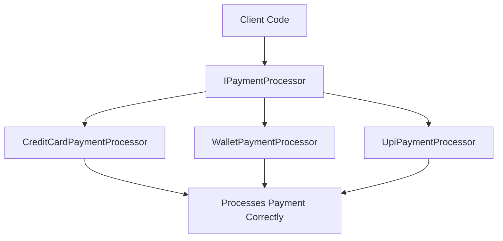
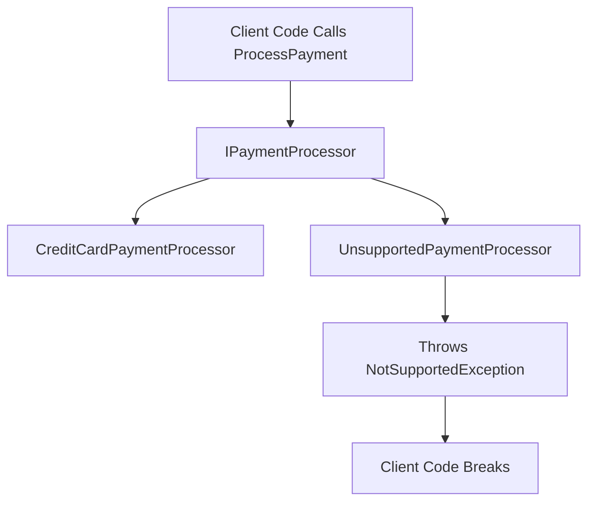

# Liskov Substitution Principle in C# — Interview Preparation Notes

## 1. Topic Overview

### What Is the Liskov Substitution Principle?

The **Liskov Substitution Principle**, commonly called **LSP**, is one of the five **SOLID** design principles.

It says:

> **Objects of a derived class should be replaceable wherever objects of the base class are expected, without breaking the correctness of the program.**

In simple terms:

> If class `Child` inherits from class `Parent`, then using `Child` in place of `Parent` should not surprise the code, break behavior, throw unexpected errors, or require special checks.

---

### Simple Explanation

Imagine a method expects a `Bird`.

```csharp
public void MakeBirdFly(Bird bird)
{
    bird.Fly();
}
```

If every `Bird` can fly, this is fine.

But if `Penguin` inherits from `Bird` and cannot fly:

```csharp
public class Penguin : Bird
{
    public override void Fly()
    {
        throw new NotSupportedException("Penguins cannot fly.");
    }
}
```

Then `Penguin` breaks the expectation that all `Bird` objects can fly.

That violates LSP.

---

### Why Is LSP Important?

LSP helps create code that is:

- **Predictable**
- **Reusable**
- **Maintainable**
- **Extensible**
- **Testable**
- Less dependent on fragile type checks
- Safer when using inheritance and polymorphism

---

### What Problem Does It Solve?

LSP solves the problem of **incorrect inheritance**.

Without LSP, code may look reusable because of inheritance, but it can break at runtime when a subclass behaves differently from what the base class promises.

Common problems LSP prevents:

- Subclasses throwing unexpected exceptions
- Subclasses weakening expected behavior
- Subclasses requiring special handling
- Incorrect use of inheritance
- Broken polymorphism
- Runtime bugs caused by misleading abstractions

---

### Where Is It Used in Real-World Projects?

LSP is used in:

- Domain model design
- Service abstractions
- Repository patterns
- Payment processing systems
- Notification systems
- File storage providers
- Authentication providers
- Validation frameworks
- Plugin architectures
- Unit-testable application layers
- Framework-level API design

Example:

```csharp
public interface IPaymentProcessor
{
    void ProcessPayment(decimal amount);
}
```

Different processors such as `CreditCardPaymentProcessor`, `UpiPaymentProcessor`, and `WalletPaymentProcessor` should all be usable wherever `IPaymentProcessor` is expected.

---

## 2. Core Concepts

## Must Know Concepts

---

### 2.1 Substitutability

#### Definition

**Substitutability** means a derived type can be used wherever its base type is expected without changing the correctness of the program.

#### Purpose

To make polymorphism reliable.

#### Why It Exists

Inheritance should represent a true behavioral relationship, not just shared properties or code reuse.

#### How It Works

If a method expects a base class or interface, it should not need to know the exact derived implementation.

```csharp
public void PrintArea(Shape shape)
{
    Console.WriteLine(shape.GetArea());
}
```

Any `Shape` implementation should work correctly.

#### Key Points

- Subclass behavior must match base class expectations.
- A subclass should not remove or weaken behavior.
- Client code should not require `if`, `switch`, or type checks for subclasses.

#### Simple Example

```csharp
public abstract class Shape
{
    public abstract double GetArea();
}

public class Circle : Shape
{
    public double Radius { get; }

    public Circle(double radius)
    {
        Radius = radius;
    }

    public override double GetArea()
    {
        return Math.PI * Radius * Radius;
    }
}

public class Rectangle : Shape
{
    public double Width { get; }
    public double Height { get; }

    public Rectangle(double width, double height)
    {
        Width = width;
        Height = height;
    }

    public override double GetArea()
    {
        return Width * Height;
    }
}
```

Both `Circle` and `Rectangle` correctly substitute `Shape`.

#### Real-World Example

A logging system:

```csharp
public interface ILogger
{
    void Log(string message);
}

public class FileLogger : ILogger
{
    public void Log(string message)
    {
        File.AppendAllText("log.txt", message);
    }
}

public class DatabaseLogger : ILogger
{
    public void Log(string message)
    {
        // Save message to database
    }
}
```

Any `ILogger` can be used without changing client code.

---

### 2.2 Behavioral Compatibility

#### Definition

A derived class must preserve the behavior expected from the base class.

#### Purpose

To ensure inheritance does not introduce surprising behavior.

#### Why It Exists

A subclass may compile correctly but still violate the contract of the base class.

#### How It Works

The subclass must respect:

- Expected inputs
- Expected outputs
- Expected side effects
- Expected exceptions
- Expected state transitions

#### Key Points

- LSP is mostly about behavior, not syntax.
- The compiler cannot fully enforce LSP.
- Unit tests and good design help enforce it.

#### Bad Example

```csharp
public class Bird
{
    public virtual void Fly()
    {
        Console.WriteLine("Flying");
    }
}

public class Penguin : Bird
{
    public override void Fly()
    {
        throw new NotSupportedException("Penguins cannot fly.");
    }
}
```

`Penguin` violates the behavior expected from `Bird`.

#### Better Design

```csharp
public abstract class Bird
{
    public string Name { get; set; }
}

public interface IFlyingBird
{
    void Fly();
}

public class Sparrow : Bird, IFlyingBird
{
    public void Fly()
    {
        Console.WriteLine("Sparrow flying");
    }
}

public class Penguin : Bird
{
    public void Swim()
    {
        Console.WriteLine("Penguin swimming");
    }
}
```

Now only flying birds implement `IFlyingBird`.

---

### 2.3 Base Class Contract

#### Definition

A **contract** is the set of promises made by a class or interface.

A contract includes:

- Method names
- Parameters
- Return values
- Valid input ranges
- Expected exceptions
- Side effects
- State changes

#### Purpose

To define what client code can safely expect.

#### Why It Exists

Client code depends on behavior, not just method signatures.

#### How It Works

If a base class says:

```csharp
public virtual decimal CalculateDiscount(decimal amount)
```

Client code expects:

- Valid discount value
- No unexpected exception for valid amount
- Meaningful result

#### Key Points

A derived class must not:

- Reject inputs accepted by the base class
- Return invalid results
- Throw unexpected exceptions
- Break invariants
- Change expected side effects

---

### 2.4 Preconditions and Postconditions

#### Definition

A **precondition** is what must be true before a method runs.

A **postcondition** is what must be true after a method completes.

#### Purpose

To describe behavioral rules.

#### LSP Rule

A subtype must not:

- Strengthen preconditions
- Weaken postconditions

#### Example: Violation by Strengthening Preconditions

```csharp
public class PaymentProcessor
{
    public virtual void Process(decimal amount)
    {
        if (amount <= 0)
        {
            throw new ArgumentException("Amount must be positive.");
        }

        Console.WriteLine("Payment processed");
    }
}

public class HighValuePaymentProcessor : PaymentProcessor
{
    public override void Process(decimal amount)
    {
        if (amount < 1000)
        {
            throw new ArgumentException("Amount must be at least 1000.");
        }

        Console.WriteLine("High value payment processed");
    }
}
```

The base class accepts any positive amount.

The subclass only accepts amounts greater than or equal to `1000`.

That violates LSP.

#### Better Design

```csharp
public interface IPaymentProcessor
{
    void Process(decimal amount);
}

public class StandardPaymentProcessor : IPaymentProcessor
{
    public void Process(decimal amount)
    {
        ValidatePositiveAmount(amount);
        Console.WriteLine("Standard payment processed");
    }

    private static void ValidatePositiveAmount(decimal amount)
    {
        if (amount <= 0)
        {
            throw new ArgumentException("Amount must be positive.");
        }
    }
}

public class HighValuePaymentProcessor
{
    public void ProcessHighValuePayment(decimal amount)
    {
        if (amount < 1000)
        {
            throw new ArgumentException("Amount must be at least 1000.");
        }

        Console.WriteLine("High value payment processed");
    }
}
```

The high-value behavior is modeled separately.

---

### 2.5 Invariants

#### Definition

An **invariant** is a rule that must always remain true for an object.

#### Purpose

To protect object correctness.

#### Example

A bank account balance must never be negative.

```csharp
public class BankAccount
{
    public decimal Balance { get; protected set; }

    public virtual void Withdraw(decimal amount)
    {
        if (amount <= 0)
        {
            throw new ArgumentException("Amount must be positive.");
        }

        if (Balance < amount)
        {
            throw new InvalidOperationException("Insufficient balance.");
        }

        Balance -= amount;
    }
}
```

A subclass must not break the invariant.

#### Bad Subclass

```csharp
public class OverdraftAccount : BankAccount
{
    public override void Withdraw(decimal amount)
    {
        Balance -= amount;
    }
}
```

This may allow negative balance, breaking the base invariant.

#### Better Design

If overdraft is valid, the base abstraction should explicitly support it.

```csharp
public abstract class Account
{
    public decimal Balance { get; protected set; }

    public abstract bool CanWithdraw(decimal amount);

    public void Withdraw(decimal amount)
    {
        if (!CanWithdraw(amount))
        {
            throw new InvalidOperationException("Withdrawal not allowed.");
        }

        Balance -= amount;
    }
}
```

---

## Good to Know Concepts

---

### 2.6 Inheritance vs Composition

#### Definition

**Inheritance** models an `is-a` relationship.

**Composition** models a `has-a` relationship.

#### Purpose

To avoid incorrect inheritance.

#### Key Point

Many LSP violations happen because inheritance is used only for code reuse.

#### Bad Example

```csharp
public class ReadOnlyCollection<T> : List<T>
{
    public new void Add(T item)
    {
        throw new NotSupportedException();
    }
}
```

A read-only collection is not safely substitutable for a mutable `List<T>`.

#### Better Design

Use composition:

```csharp
public class ReadOnlyItems<T>
{
    private readonly IReadOnlyList<T> items;

    public ReadOnlyItems(IReadOnlyList<T> items)
    {
        this.items = items;
    }

    public IReadOnlyList<T> Items
    {
        get { return items; }
    }
}
```

---

### 2.7 Interfaces and LSP

#### Definition

Interfaces define behavioral contracts without implementation.

#### Purpose

They help model smaller, safer abstractions.

#### Why It Exists

Large interfaces often force classes to implement methods they cannot support.

#### Example

Bad design:

```csharp
public interface IWorker
{
    void Work();
    void Eat();
}

public class RobotWorker : IWorker
{
    public void Work()
    {
        Console.WriteLine("Robot working");
    }

    public void Eat()
    {
        throw new NotSupportedException();
    }
}
```

Better design:

```csharp
public interface IWorker
{
    void Work();
}

public interface IEater
{
    void Eat();
}

public class HumanWorker : IWorker, IEater
{
    public void Work()
    {
        Console.WriteLine("Human working");
    }

    public void Eat()
    {
        Console.WriteLine("Human eating");
    }
}

public class RobotWorker : IWorker
{
    public void Work()
    {
        Console.WriteLine("Robot working");
    }
}
```

This also follows the **Interface Segregation Principle**.

---

### 2.8 Exception Compatibility

#### Definition

A subtype should not throw unexpected exceptions that the base type does not imply.

#### Purpose

To keep client code reliable.

#### Bad Example

```csharp
public class FileExporter
{
    public virtual void Export(string content)
    {
        Console.WriteLine(content);
    }
}

public class SecureFileExporter : FileExporter
{
    public override void Export(string content)
    {
        throw new UnauthorizedAccessException();
    }
}
```

If the base contract does not mention authorization failure, this behavior may surprise callers.

#### Better Design

Make the contract explicit:

```csharp
public interface IExporter
{
    ExportResult Export(string content);
}

public class ExportResult
{
    public bool Success { get; set; }
    public string ErrorMessage { get; set; }
}
```

---

## Advanced Concepts

---

### 2.9 Variance and LSP

#### Definition

Variance controls how generic types relate to inheritance.

C# supports:

- **Covariance** with `out`
- **Contravariance** with `in`

#### Purpose

To safely substitute generic types.

#### Example: Covariance

```csharp
IEnumerable<string> names = new List<string>();
IEnumerable<object> objects = names;
```

This works because `IEnumerable<out T>` is covariant.

#### Example: Contravariance

```csharp
Action<object> printObject = value => Console.WriteLine(value);
Action<string> printString = printObject;
```

This works because `Action<in T>` is contravariant.

#### Interview Point

Variance is related to LSP because it controls safe substitutability for generic types.

---

### 2.10 Design by Contract

#### Definition

**Design by Contract** is a design approach where classes explicitly define:

- Preconditions
- Postconditions
- Invariants

#### Purpose

To make behavioral expectations clear.

#### Relation to LSP

LSP can be understood through contract rules:

| Contract Rule | LSP Requirement |
| --- | --- |
| Preconditions | Subclass must not require more |
| Postconditions | Subclass must not guarantee less |
| Invariants | Subclass must preserve them |
| Exceptions | Subclass must not surprise callers |

---

## 3. How It Works Internally

### LSP and Runtime Polymorphism

LSP is not a runtime mechanism by itself.

It is a **design principle** that ensures runtime polymorphism works correctly.

### Execution Flow

```csharp
public void Process(IPaymentProcessor processor)
{
    processor.ProcessPayment(100);
}
```

At compile time:

- The compiler only knows `processor` is an `IPaymentProcessor`.

At runtime:

- The CLR dispatches the call to the actual object implementation.
- This may be `CreditCardPaymentProcessor`, `WalletPaymentProcessor`, or another implementation.

If every implementation respects the contract, polymorphism works correctly.

If one implementation violates the contract, the code may fail.

---

### Mermaid Diagram: Correct Substitution



---

### Mermaid Diagram: LSP Violation



---

### Internal Mechanisms Behind the Scenes

When using inheritance or interfaces:

1. Client code depends on a base type.
2. Runtime object may be any subtype.
3. Method dispatch chooses the actual implementation.
4. Caller expects the base contract to hold.
5. If the subtype changes behavior incompatibly, the caller breaks.

---

### Important Implementation Details

LSP is affected by:

- `virtual` methods
- `abstract` classes
- Interfaces
- Method overriding
- Generic variance
- Exception behavior
- Mutable state
- Side effects
- Class invariants

---

## 4. Important Terminology

| Term | Meaning | Example |
| --- | --- | --- |
| LSP | Derived types must be substitutable for base types | `Circle` can replace `Shape` |
| Substitutability | Ability to use subtype where base type is expected | `ILogger logger = new FileLogger()` |
| Base Class | Parent class inherited by another class | `Animal` |
| Derived Class | Class that inherits from a base class | `Dog : Animal` |
| Contract | Behavioral promise of a type | `ProcessPayment` processes valid amount |
| Precondition | Requirement before method execution | Amount must be positive |
| Postcondition | Guarantee after method execution | Payment is completed or failed clearly |
| Invariant | Rule always true for object state | Balance cannot be negative |
| Polymorphism | Same abstraction, different implementations | Multiple `ILogger` implementations |
| Override | Replace base virtual behavior in subclass | `override void Fly()` |
| Interface | Contract without implementation | `IPaymentProcessor` |
| Behavioral Compatibility | Subclass behaves according to base expectations | `FileLogger` logs messages |
| Exception Compatibility | Subclass does not throw unexpected exceptions | No surprise `NotSupportedException` |
| Covariance | Allows substituting more derived output types | `IEnumerable<string>` to `IEnumerable<object>` |
| Contravariance | Allows substituting less derived input types | `Action<object>` to `Action<string>` |

---

## 5. Important Comparisons

| Concept A | Concept B | Key Difference | When to Use |
| --- | --- | --- | --- |
| LSP | Inheritance | LSP is a rule for correct inheritance | Use LSP to validate inheritance |
| LSP | Polymorphism | Polymorphism allows substitution; LSP ensures it is safe | Use LSP when designing abstractions |
| Inheritance | Composition | Inheritance is `is-a`; composition is `has-a` | Prefer composition when behavior differs |
| Abstract Class | Interface | Abstract class can share state/implementation; interface defines contract | Use interface for capability-based design |
| Method Overriding | Method Hiding | Overriding changes virtual behavior; hiding uses `new` and depends on reference type | Prefer overriding for polymorphism |
| LSP | ISP | LSP ensures substitutable behavior; ISP keeps interfaces small | Use both together |
| Precondition | Postcondition | Precondition is before execution; postcondition is after execution | Use to reason about contracts |
| Covariance | Contravariance | Covariance is output substitution; contravariance is input substitution | Use in generic delegates/interfaces |

---

## 6. Practical Examples

## Example 1: Bird and Penguin

### Problem

A `Penguin` is a bird but cannot fly. If `Penguin` inherits from a `Bird` class with `Fly`, it violates LSP.

### Bad Solution

```csharp
public class Bird
{
    public virtual void Fly()
    {
        Console.WriteLine("Flying");
    }
}

public class Penguin : Bird
{
    public override void Fly()
    {
        throw new NotSupportedException();
    }
}
```

### Why It Is Bad

Any method expecting `Bird` may call `Fly`. Passing `Penguin` breaks the code.

### Better Solution

```csharp
public abstract class Bird
{
    public string Name { get; set; }
}

public interface IFlyingBird
{
    void Fly();
}

public class Sparrow : Bird, IFlyingBird
{
    public void Fly()
    {
        Console.WriteLine("Sparrow flying");
    }
}

public class Penguin : Bird
{
    public void Swim()
    {
        Console.WriteLine("Penguin swimming");
    }
}
```

### Why This Approach Was Chosen

The ability to fly is modeled as a separate capability.

### Alternatives

- Use composition with movement strategies.
- Use separate base classes like `FlyingBird` and `NonFlyingBird`.

### Trade-Offs

- More types are introduced.
- Design is more accurate and maintainable.

---

## Example 2: Rectangle and Square

### Problem

Mathematically, a square is a rectangle. But in mutable object-oriented design, substituting `Square` for `Rectangle` can break behavior.

### Bad Example

```csharp
public class Rectangle
{
    public virtual int Width { get; set; }
    public virtual int Height { get; set; }

    public int GetArea()
    {
        return Width * Height;
    }
}

public class Square : Rectangle
{
    public override int Width
    {
        set
        {
            base.Width = value;
            base.Height = value;
        }
    }

    public override int Height
    {
        set
        {
            base.Width = value;
            base.Height = value;
        }
    }
}
```

Client code:

```csharp
public static int CalculateArea(Rectangle rectangle)
{
    rectangle.Width = 5;
    rectangle.Height = 10;

    return rectangle.GetArea();
}
```

Expected result is `50`.

For `Square`, result becomes `100`.

This violates LSP.

### Better Solution

```csharp
public interface IShape
{
    int GetArea();
}

public class Rectangle : IShape
{
    public Rectangle(int width, int height)
    {
        Width = width;
        Height = height;
    }

    public int Width { get; }
    public int Height { get; }

    public int GetArea()
    {
        return Width * Height;
    }
}

public class Square : IShape
{
    public Square(int side)
    {
        Side = side;
    }

    public int Side { get; }

    public int GetArea()
    {
        return Side * Side;
    }
}
```

### Why This Works

Both types share the behavior of calculating area, but not mutable width/height behavior.

---

## Example 3: Payment Processor

### Problem

Different payment processors should work through one abstraction.

### Good Design

```csharp
public interface IPaymentProcessor
{
    PaymentResult Process(decimal amount);
}

public class PaymentResult
{
    public bool IsSuccess { get; set; }
    public string Message { get; set; }
}

public class CreditCardPaymentProcessor : IPaymentProcessor
{
    public PaymentResult Process(decimal amount)
    {
        if (amount <= 0)
        {
            return new PaymentResult
            {
                IsSuccess = false,
                Message = "Amount must be positive."
            };
        }

        return new PaymentResult
        {
            IsSuccess = true,
            Message = "Credit card payment processed."
        };
    }
}

public class WalletPaymentProcessor : IPaymentProcessor
{
    public PaymentResult Process(decimal amount)
    {
        if (amount <= 0)
        {
            return new PaymentResult
            {
                IsSuccess = false,
                Message = "Amount must be positive."
            };
        }

        return new PaymentResult
        {
            IsSuccess = true,
            Message = "Wallet payment processed."
        };
    }
}
```

### Why This Approach Was Chosen

All payment processors respect the same contract.

### Trade-Offs

- Some payment-specific features may need separate interfaces.
- A common result type improves consistency.

---

## 7. Interview Questions

# Beginner Questions

---

### Question 1

**Question:** What is the Liskov Substitution Principle?

**Short Interview Answer:**  
LSP says that a derived class should be usable wherever its base class is expected without breaking the program.

**Detailed Explanation:**  
If class `B` inherits from class `A`, then any code using `A` should work correctly when given `B`.

**Example:**  
A `FileLogger` should work wherever an `ILogger` is expected.

**Possible Follow-up Question:**  
How is LSP related to polymorphism?

---

### Question 2

**Question:** Why is LSP important?

**Short Interview Answer:**  
It ensures inheritance and polymorphism are safe, predictable, and maintainable.

**Detailed Explanation:**  
Without LSP, subclasses may break assumptions made by client code.

**Example:**  
A `Penguin` inheriting from `Bird` with a `Fly` method can break code.

**Possible Follow-up Question:**  
How can you fix the bird and penguin problem?

---

### Question 3

**Question:** Is LSP only about inheritance?

**Short Interview Answer:**  
No. It applies to inheritance, interfaces, polymorphism, and abstractions in general.

**Detailed Explanation:**  
Any implementation of an abstraction must respect its contract.

**Possible Follow-up Question:**  
Can interfaces also be violated?

---

# Intermediate Questions

---

### Question 4

**Question:** What is an example of an LSP violation in C#?

**Short Interview Answer:**  
A subclass overriding a base method and throwing `NotSupportedException` for behavior the base class supports is a common violation.

**Detailed Explanation:**  
The subclass is no longer safely substitutable because client code expects the method to work.

**Example:**

```csharp
public class Bird
{
    public virtual void Fly() { }
}

public class Penguin : Bird
{
    public override void Fly()
    {
        throw new NotSupportedException();
    }
}
```

**Possible Follow-up Question:**  
How would you redesign this?

---

### Question 5

**Question:** What does it mean to strengthen preconditions?

**Short Interview Answer:**  
It means a subclass requires stricter input conditions than the base class.

**Detailed Explanation:**  
If the base class accepts all positive amounts, the subclass cannot require the amount to be greater than `1000`.

**Possible Follow-up Question:**  
Why does strengthening preconditions violate LSP?

---

### Question 6

**Question:** What does it mean to weaken postconditions?

**Short Interview Answer:**  
It means a subclass provides fewer guarantees than the base class promised.

**Detailed Explanation:**  
If the base method guarantees a saved file exists after execution, the subclass cannot silently skip saving.

**Possible Follow-up Question:**  
How do postconditions affect API reliability?

---

# Advanced Questions

---

### Question 7

**Question:** How is LSP related to Design by Contract?

**Short Interview Answer:**  
LSP is essentially about preserving contracts in subclasses.

**Detailed Explanation:**  
A subtype must not strengthen preconditions, weaken postconditions, or break invariants.

**Possible Follow-up Question:**  
How can contracts be documented in C#?

---

### Question 8

**Question:** Can the compiler detect LSP violations?

**Short Interview Answer:**  
Usually no. The compiler checks type compatibility, but LSP is about behavioral compatibility.

**Detailed Explanation:**  
A subclass may compile but still behave incorrectly at runtime.

**Possible Follow-up Question:**  
How can tests help detect LSP violations?

---

### Question 9

**Question:** How does generic variance relate to LSP?

**Short Interview Answer:**  
Variance allows safe substitution between generic types when type usage is restricted to input or output positions.

**Detailed Explanation:**  
`IEnumerable<out T>` is covariant because it only produces values of `T`.

**Possible Follow-up Question:**  
Why is `List<T>` not covariant?

---

## 8. Tricky Interview Questions

### Question: If `Square` is mathematically a `Rectangle`, why can it violate LSP?

**Answer:**  
Because object-oriented substitutability depends on behavior, not mathematical classification. A mutable `Rectangle` allows width and height to change independently, but a `Square` does not.

---

### Question: Is throwing `NotImplementedException` always an LSP violation?

**Answer:**  
If the method is part of the base contract and client code expects it to work, yes. It means the subtype cannot fulfill the contract.

---

### Question: Can a subclass add extra validation?

**Answer:**  
Only if it does not reject inputs that the base type considers valid. Otherwise, it strengthens preconditions and violates LSP.

---

### Question: Can a subclass return a more specific type?

**Answer:**  
Yes, if the language and design support it safely. This is usually compatible because it strengthens the return guarantee.

---

### Question: Is LSP the same as “use interfaces”?

**Answer:**  
No. Interfaces help, but an interface implementation can still violate LSP if it behaves inconsistently with the contract.

---

## 9. Scenario-Based Questions

## Scenario 1: Notification System

### Scenario

You have:

```csharp
public interface INotificationSender
{
    void Send(string message);
}
```

Email, SMS, and Push notifications implement it. SMS cannot send messages longer than 160 characters.

### How to Approach It

Do not make SMS unexpectedly throw for long messages if the interface does not define that rule.

### Why the Solution Works

The contract should clearly define length constraints or return a result.

### Better Design

```csharp
public interface INotificationSender
{
    NotificationResult Send(string message);
}

public class NotificationResult
{
    public bool IsSuccess { get; set; }
    public string Reason { get; set; }
}
```

### Trade-Offs

- Slightly more complex API.
- More predictable behavior.

### What the Interviewer Is Testing

- Contract design
- Exception handling
- Interface correctness

---

## Scenario 2: File Storage Providers

### Scenario

An app supports local storage, Azure Blob Storage, and read-only archive storage.

```csharp
public interface IFileStorage
{
    void Save(string path, byte[] content);
    byte[] Read(string path);
    void Delete(string path);
}
```

Read-only archive storage cannot save or delete.

### Issue

If archive storage throws `NotSupportedException`, it violates LSP.

### Better Design

```csharp
public interface IReadableStorage
{
    byte[] Read(string path);
}

public interface IWritableStorage
{
    void Save(string path, byte[] content);
}

public interface IDeletableStorage
{
    void Delete(string path);
}
```

### What the Interviewer Is Testing

- Interface segregation
- Capability-based design
- Avoiding fake implementations

---

## 10. Real-World Usage

### Common Use Cases

- Replacing implementations behind interfaces
- Dependency injection
- Unit testing with mocks
- Plugin systems
- Repository abstractions
- Strategy pattern
- Payment gateways
- Logging providers
- Notification providers

---

### When to Use LSP

Use LSP when:

- Designing base classes
- Designing interfaces
- Creating class hierarchies
- Using dependency injection
- Replacing one implementation with another
- Building extensible systems

---

### When NOT to Use Inheritance

Avoid inheritance when:

- The subtype cannot fulfill all base behavior
- You only want code reuse
- The subclass needs to disable base methods
- The subclass throws `NotSupportedException`
- Client code needs type checks

---

### Design Considerations

- Prefer small interfaces.
- Avoid forcing unrelated behavior.
- Make contracts explicit.
- Prefer composition when behavior varies.
- Keep abstractions stable.
- Use meaningful return types.
- Avoid hidden side effects.

---

## 11. Performance & Optimization

LSP is primarily a design principle, not a performance optimization technique.

### Time Complexity

LSP does not directly affect algorithmic complexity.

### Space Complexity

LSP does not directly affect memory usage.

### Performance Considerations

Using interfaces and virtual methods may involve dynamic dispatch, but in most business applications this overhead is negligible.

### Bottlenecks

Poor LSP design can cause indirect performance issues:

- Excessive type checks
- Duplicated logic
- Fragile conditionals
- Defensive runtime checks
- Poor extensibility

### Optimization Techniques

- Use clear interfaces.
- Avoid unnecessary inheritance chains.
- Prefer composition where behavior varies.
- Keep abstractions narrow.
- Use sealed classes where extension is not intended.

---

## 12. Common Mistakes

### Conceptual Mistakes

- Thinking LSP means “subclass must compile.”
- Thinking inheritance means true substitutability.
- Thinking mathematical relationships always map to OOP inheritance.
- Ignoring behavior and focusing only on properties.

### Implementation Mistakes

- Throwing `NotSupportedException` in subclasses.
- Overriding methods with incompatible behavior.
- Adding stricter validation in subclasses.
- Returning unexpected results.
- Breaking base class invariants.
- Using inheritance only for code reuse.
- Creating large interfaces that not all classes can support.

### Interview Mistakes

- Explaining only the bird-penguin example.
- Not mentioning contracts.
- Not explaining preconditions and postconditions.
- Not connecting LSP with polymorphism.
- Not knowing how to fix violations.

---

## 13. Best Practices

### 1. Design Around Behavior, Not Just Data

Inheritance should represent compatible behavior.

### 2. Prefer Interfaces for Capabilities

Use interfaces like `IFlyable`, `IReadableStorage`, or `IPaymentProcessor`.

### 3. Keep Interfaces Small

Small interfaces reduce the chance of unsupported methods.

### 4. Avoid `NotSupportedException` in Implementations

It usually means the abstraction is wrong.

### 5. Do Not Strengthen Preconditions

A subclass should not require stricter input than the base type.

### 6. Do Not Weaken Postconditions

A subclass should provide at least the guarantees of the base type.

### 7. Preserve Invariants

Subclasses must not break rules maintained by the base class.

### 8. Prefer Composition Over Inheritance

Use composition when behavior is different but code reuse is desired.

### 9. Write Contract-Based Tests

Test all implementations against the same expected behavior.

### 10. Avoid Type Checks in Client Code

If client code frequently checks concrete types, the abstraction may be wrong.

---

## 14. Interview Cheat Sheet

### Key Definition

**LSP:** A subtype must be replaceable for its base type without breaking program correctness.

### Core Rules

- Do not strengthen preconditions.
- Do not weaken postconditions.
- Preserve invariants.
- Do not throw unexpected exceptions.
- Respect the base contract.
- Avoid unsupported behavior in subclasses.

### Common Examples

- Bird/Penguin
- Rectangle/Square
- Read-only collection inheriting from mutable collection
- Robot implementing `Eat`
- Read-only storage implementing `Save`

### Common Fixes

- Split interfaces.
- Use composition.
- Create capability-based abstractions.
- Make contracts explicit.
- Use result objects instead of surprise exceptions.

### Interview Tip

> Always explain LSP in terms of **behavioral compatibility**, not just inheritance syntax.

---

## 15. Rapid-Fire Interview Questions

1. **What is LSP?**  
   A derived type should be usable wherever its base type is expected without breaking behavior.

2. **Which SOLID principle is LSP?**  
   The `L` in SOLID.

3. **Is LSP checked by the compiler?**  
   Not fully. The compiler checks type compatibility, not behavioral correctness.

4. **What is a common LSP violation?**  
   A subclass throwing `NotSupportedException` for a base method.

5. **Can interfaces violate LSP?**  
   Yes, if implementations do not honor the interface contract.

6. **What is a precondition?**  
   A requirement before a method runs.

7. **Can subclasses strengthen preconditions?**  
   No.

8. **What is a postcondition?**  
   A guarantee after a method completes.

9. **Can subclasses weaken postconditions?**  
   No.

10. **What is an invariant?**  
    A rule that must always remain true for an object.

11. **Why is Rectangle/Square problematic?**  
    Mutable rectangle behavior does not match square behavior.

12. **How do you fix Bird/Penguin?**  
    Move `Fly` to an `IFlyingBird` interface.

13. **Is inheritance always bad?**  
    No, but it must model compatible behavior.

14. **What should you prefer when behavior differs?**  
    Composition or smaller interfaces.

15. **How is LSP related to polymorphism?**  
    LSP makes polymorphism safe.

16. **What is behavioral compatibility?**  
    A subtype behaves according to base type expectations.

17. **What is contract-based design?**  
    Designing around explicit preconditions, postconditions, and invariants.

18. **Why avoid large interfaces?**  
    They force classes to implement unsupported behavior.

19. **What is a sign of LSP violation?**  
    Frequent type checks or unsupported methods.

20. **How do tests help with LSP?**  
    Shared contract tests verify all implementations behave consistently.

---

## 16. Mock Interview

This mock interview should be done interactively.

Answer the first question below. After your answer, the interviewer should:

1. Rate your answer from **1–10**
2. Explain what was correct
3. Explain what was missing
4. Correct mistakes
5. Provide an ideal answer
6. Ask the next question

### Mock Interview Question 1

**What is the Liskov Substitution Principle, and why is it important in C#?**

> Answer this question first. The ideal answer should not be reviewed until after your attempt.

---

## 17. Final Interview Revision

### 25 Most Important Things to Remember

1. **LSP means safe substitutability.**
2. A derived class must behave consistently with its base class.
3. LSP is about **behavior**, not just inheritance syntax.
4. The compiler cannot fully detect LSP violations.
5. Subclasses must not strengthen preconditions.
6. Subclasses must not weaken postconditions.
7. Subclasses must preserve invariants.
8. Subclasses should not throw unexpected exceptions.
9. `NotSupportedException` in a subclass often signals a bad abstraction.
10. Interfaces can also be violated.
11. Large interfaces increase the chance of LSP violations.
12. Prefer small, capability-based interfaces.
13. Inheritance should model true behavioral `is-a` relationships.
14. Do not use inheritance only for code reuse.
15. Prefer composition when behavior varies.
16. The bird-penguin example demonstrates unsupported inherited behavior.
17. The rectangle-square example demonstrates broken mutable behavior.
18. LSP makes polymorphism reliable.
19. LSP supports maintainability and extensibility.
20. LSP is closely related to Design by Contract.
21. Base class contracts include inputs, outputs, exceptions, side effects, and state rules.
22. Type checks in client code may indicate a broken abstraction.
23. Dependency injection relies heavily on LSP.
24. Shared contract tests can validate substitutability.
25. In interviews, explain LSP using contracts, behavior, and practical redesigns.