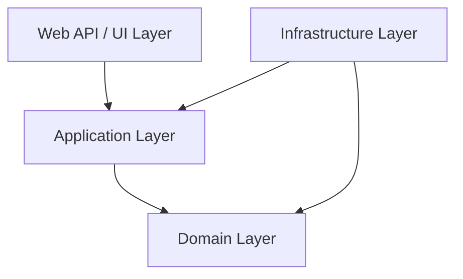
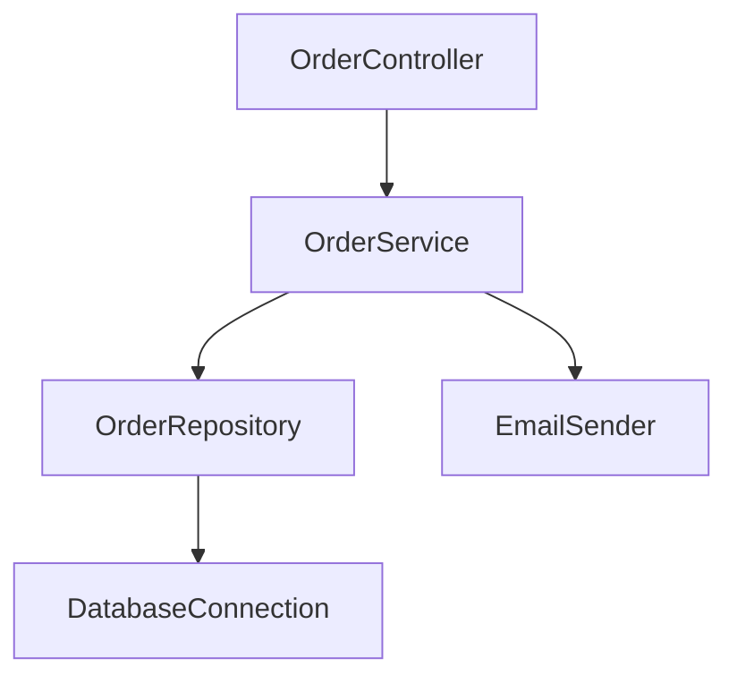

# Dependency Inversion Principle in C# - Interview Preparation Notes

## 1. Topic Overview

### What Is the Dependency Inversion Principle?

**Dependency Inversion Principle**, commonly called **DIP**, is one of the five **SOLID principles**.

It says:

> **High-level modules should not depend on low-level modules. Both should depend on abstractions.**  
> **Abstractions should not depend on details. Details should depend on abstractions.**

In simple words:

> A class should not directly depend on another concrete class. It should depend on an interface or abstraction.

---

### Simple Explanation

Imagine a `PaymentService` directly creates a `SqlPaymentRepository`.

That means `PaymentService` is tightly connected to SQL Server.

If tomorrow the application needs PostgreSQL, MongoDB, or an external API, the `PaymentService` must be changed.

Instead, `PaymentService` should depend on an interface:

```csharp
public interface IPaymentRepository
{
    void SavePayment(Payment payment);
}
```

Now `PaymentService` does not care whether the implementation uses SQL Server, Oracle, MongoDB, or an API.

---

### Why Is DIP Important?

DIP helps create code that is:

- **Loosely coupled**
- **Easier to test**
- **Easier to maintain**
- **Easier to extend**
- **More flexible**
- **Less dependent on implementation details**

---

### What Problem Does It Solve?

Without DIP:

- Classes directly create their dependencies.
- Business logic depends on infrastructure.
- Unit testing becomes difficult.
- Changing database, logger, email provider, or API client requires modifying business code.
- Code violates the **Open/Closed Principle**.

With DIP:

- Business logic depends on interfaces.
- Concrete implementations can be replaced easily.
- Testing becomes simple using mocks or fake implementations.
- Infrastructure details stay outside core business logic.

---

### Where Is It Used in Real-World Projects?

DIP is used in:

- Service-layer architecture
- Repository pattern
- Unit testing with mocks
- Logging abstractions
- Payment gateway integration
- Email/SMS providers
- External API clients
- Database access
- Clean Architecture
- Onion Architecture
- Hexagonal Architecture
- ASP.NET Core dependency injection
- .NET Framework applications using Autofac, Unity, Ninject, or manual dependency injection

---

## 2. Core Concepts

## Must Know

### 2.1 High-Level Module

#### Definition

A **high-level module** contains business rules or application logic.

#### Purpose

It represents the important behavior of the application.

#### Example

```csharp
public class OrderService
{
    public void PlaceOrder(Order order)
    {
        // Business logic
    }
}
```

#### Real-World Example

In a banking application:

- `FundTransferService`
- `LoanApprovalService`
- `KycVerificationService`

These classes contain business rules and should not depend directly on databases, APIs, or file systems.

---

### 2.2 Low-Level Module

#### Definition

A **low-level module** handles technical details such as database access, logging, file handling, email, or API calls.

#### Purpose

It performs infrastructure-related work.

#### Example

```csharp
public class SqlOrderRepository
{
    public void Save(Order order)
    {
        // Save order to SQL database
    }
}
```

#### Real-World Example

- SQL repository
- SMTP email sender
- File logger
- Redis cache provider
- HTTP API client

---

### 2.3 Abstraction

#### Definition

An **abstraction** is usually an interface or abstract class that defines what something can do without defining how it does it.

#### Example

```csharp
public interface IOrderRepository
{
    void Save(Order order);
}
```

#### Purpose

Abstractions separate business logic from implementation details.

#### Key Points

- Interfaces define contracts.
- Business classes depend on interfaces.
- Infrastructure classes implement interfaces.

---

### 2.4 Concrete Implementation

#### Definition

A **concrete implementation** is a real class that implements an abstraction.

#### Example

```csharp
public class SqlOrderRepository : IOrderRepository
{
    public void Save(Order order)
    {
        // SQL database logic
    }
}
```

#### Purpose

It provides the actual behavior behind an abstraction.

---

### 2.5 Dependency

#### Definition

A **dependency** is any object or service that a class needs to perform its work.

#### Example

`OrderService` needs `IOrderRepository` to save orders.

```csharp
public class OrderService
{
    private readonly IOrderRepository orderRepository;

    public OrderService(IOrderRepository orderRepository)
    {
        this.orderRepository = orderRepository;
    }
}
```

---

### 2.6 Dependency Injection

#### Definition

**Dependency Injection**, or **DI**, is a technique used to supply dependencies to a class from the outside.

#### Purpose

DI is a common way to implement DIP.

#### Example

```csharp
public class OrderService
{
    private readonly IOrderRepository orderRepository;

    public OrderService(IOrderRepository orderRepository)
    {
        this.orderRepository = orderRepository;
    }

    public void PlaceOrder(Order order)
    {
        this.orderRepository.Save(order);
    }
}
```

#### Key Point

DIP is a principle.  
DI is a technique used to apply the principle.

---

## Good to Know

### 2.7 Inversion of Control

#### Definition

**Inversion of Control**, or **IoC**, means a class does not control the creation of its dependencies. That responsibility is moved outside the class.

#### Example Without IoC

```csharp
public class OrderService
{
    private readonly SqlOrderRepository orderRepository = new SqlOrderRepository();
}
```

#### Example With IoC

```csharp
public class OrderService
{
    private readonly IOrderRepository orderRepository;

    public OrderService(IOrderRepository orderRepository)
    {
        this.orderRepository = orderRepository;
    }
}
```

#### Key Point

IoC is the broader concept.  
DI is one way to implement IoC.  
DIP is the design principle behind it.

---

### 2.8 Composition Root

#### Definition

The **composition root** is the place where dependencies are configured and object graphs are built.

#### Example

In ASP.NET Core, this is usually `Program.cs`.

In .NET Framework Web API, this might be:

- `Global.asax`
- `WebApiConfig`
- Autofac/Unity configuration class

#### Purpose

It centralizes dependency wiring.

---

### 2.9 Constructor Injection

#### Definition

Dependencies are supplied through the class constructor.

#### Example

```csharp
public class NotificationService
{
    private readonly IEmailSender emailSender;

    public NotificationService(IEmailSender emailSender)
    {
        this.emailSender = emailSender;
    }
}
```

#### Why It Is Preferred

- Makes dependencies explicit
- Supports immutability
- Easier to test
- Prevents partially constructed objects

---

### 2.10 Interface Segregation and DIP

DIP often works together with the **Interface Segregation Principle**.

Instead of one large interface:

```csharp
public interface IUserService
{
    void CreateUser();
    void DeleteUser();
    void SendEmail();
    void GenerateReport();
}
```

Prefer focused interfaces:

```csharp
public interface IUserRepository
{
    void CreateUser();
    void DeleteUser();
}

public interface IEmailSender
{
    void SendEmail();
}
```

---

## Advanced

### 2.11 Dependency Direction

In poorly designed systems:

```text
Business Logic -> SQL Database
Business Logic -> File System
Business Logic -> External APIs
```

With DIP:

```text
Business Logic -> Interfaces <- Infrastructure Implementations
```

The source-code dependency points toward abstractions, not details.

---

### 2.12 Stable Abstractions

DIP works best when abstractions are stable.

Bad abstraction:

```csharp
public interface ISqlUserRepository
{
    SqlDataReader GetUsers();
}
```

This leaks SQL details.

Better abstraction:

```csharp
public interface IUserRepository
{
    IEnumerable<User> GetUsers();
}
```

---

### 2.13 Dependency Inversion in Clean Architecture

In Clean Architecture:

- Domain layer defines interfaces.
- Infrastructure layer implements interfaces.
- Application layer depends on abstractions.
- Infrastructure depends inward on application/domain abstractions.



Important idea:

> Inner layers should not depend on outer layers.

---

## 3. How It Works Internally

### Basic Architecture

```mermaid
flowchart TD
    Controller[Controller] --> ServiceInterface[IOrderService]
    Service[OrderService] --> RepositoryInterface[IOrderRepository]
    Repository[SqlOrderRepository] --> Database[(Database)]

    ServiceInterface <|.. Service
    RepositoryInterface <|.. Repository
```

---

### Execution Flow

1. Application starts.
2. Dependency container is configured.
3. Interfaces are mapped to concrete implementations.
4. A controller or service requests a dependency.
5. The DI container creates the required object.
6. The container injects dependencies recursively.
7. Business logic calls abstractions.
8. Concrete implementations execute the actual work.

---

### Example Flow

```csharp
public interface IPaymentGateway
{
    bool Charge(decimal amount);
}

public class StripePaymentGateway : IPaymentGateway
{
    public bool Charge(decimal amount)
    {
        return true;
    }
}

public class PaymentService
{
    private readonly IPaymentGateway paymentGateway;

    public PaymentService(IPaymentGateway paymentGateway)
    {
        this.paymentGateway = paymentGateway;
    }

    public bool ProcessPayment(decimal amount)
    {
        return this.paymentGateway.Charge(amount);
    }
}
```

Execution:

```text
PaymentService -> IPaymentGateway -> StripePaymentGateway
```

`PaymentService` knows only about `IPaymentGateway`, not `StripePaymentGateway`.

---

### What Happens Behind the Scenes in a DI Container?

A DI container usually performs these steps:

1. Reads registered mappings.
2. Finds the requested type.
3. Selects a constructor.
4. Resolves constructor parameters.
5. Creates dependencies.
6. Creates the target object.
7. Manages object lifetime.
8. Disposes objects when appropriate.

---

### Object Graph Example



When `OrderController` is requested, the container may build the entire graph automatically.

---

## 4. Important Terminology

| Term | Meaning | Example |
| ---- | ------- | ------- |
| DIP | Principle that high-level modules should depend on abstractions | `OrderService` depends on `IOrderRepository` |
| DI | Technique for injecting dependencies from outside | Constructor injection |
| IoC | Control of object creation is moved outside the class | DI container creates services |
| Abstraction | Interface or abstract class | `ILogger` |
| Implementation | Concrete class that implements an abstraction | `FileLogger : ILogger` |
| High-level module | Business logic class | `PaymentService` |
| Low-level module | Infrastructure detail | `SqlPaymentRepository` |
| Coupling | Degree of dependency between classes | Direct `new SqlRepository()` creates tight coupling |
| Loose coupling | Classes depend on contracts, not concrete types | `IEmailSender` |
| Composition root | Place where dependencies are wired | `Program.cs`, `Global.asax` |
| Service lifetime | How long dependency instances live | Singleton, scoped, transient |
| Mock | Fake test implementation | Mock `IRepository` in unit tests |
| Constructor injection | Inject dependency through constructor | `OrderService(IRepository repository)` |
| Service locator | Pattern where class requests dependency from container | `container.Resolve<IService>()` |
| Object graph | Full tree of dependencies | Controller -> Service -> Repository |

---

## 5. Important Comparisons

| Concept A | Concept B | Key Difference | When to Use |
| --------- | --------- | -------------- | ----------- |
| DIP | DI | DIP is a principle; DI is an implementation technique | Use DIP for design, DI for wiring |
| DI | IoC | DI is one type of IoC | Use DI for dependency management |
| Interface | Abstract class | Interface defines contract; abstract class can share behavior | Use interface for contracts, abstract class for shared base behavior |
| Constructor injection | Property injection | Constructor injection requires dependency; property injection allows optional dependency | Prefer constructor injection |
| Manual DI | DI container | Manual DI wires objects manually; container automates it | Use manual for small apps, container for larger apps |
| Tight coupling | Loose coupling | Tight coupling depends on concrete classes; loose coupling depends on abstractions | Prefer loose coupling |
| Repository pattern | DIP | Repository is a pattern; DIP guides dependency direction | Use repository with DIP for persistence abstraction |
| Service locator | DI | Service locator hides dependencies; DI makes them explicit | Prefer DI |
| Mock | Stub | Mock verifies behavior; stub provides data | Use both in tests as needed |
| Singleton | Transient | Singleton reuses one instance; transient creates new instance each time | Use based on state and lifetime needs |

---

## 6. Practical Examples

## Example 1: Without DIP

### Problem

`OrderService` directly depends on `SqlOrderRepository`.

```csharp
public class SqlOrderRepository
{
    public void Save(Order order)
    {
        // Save to SQL database
    }
}

public class OrderService
{
    private readonly SqlOrderRepository orderRepository;

    public OrderService()
    {
        this.orderRepository = new SqlOrderRepository();
    }

    public void PlaceOrder(Order order)
    {
        this.orderRepository.Save(order);
    }
}
```

### Issues

- Hard to test
- Hard to replace SQL repository
- Business logic depends on infrastructure
- Violates DIP

---

## Example 2: With DIP

### Approach

Introduce an abstraction.

```csharp
public interface IOrderRepository
{
    void Save(Order order);
}

public class SqlOrderRepository : IOrderRepository
{
    public void Save(Order order)
    {
        // Save to SQL database
    }
}

public class OrderService
{
    private readonly IOrderRepository orderRepository;

    public OrderService(IOrderRepository orderRepository)
    {
        this.orderRepository = orderRepository;
    }

    public void PlaceOrder(Order order)
    {
        this.orderRepository.Save(order);
    }
}
```

### Why This Approach Was Chosen

- `OrderService` depends on abstraction.
- Repository implementation can change.
- Unit testing becomes easier.

### Alternatives

- Abstract base class
- Generic repository
- Mediator pattern
- Direct ORM usage for simple applications

### Trade-Offs

Pros:

- Flexible
- Testable
- Maintainable

Cons:

- More interfaces
- More setup
- Can be overused in small applications

---

## Example 3: Real-World Payment Gateway

### Problem

Application initially supports one payment provider, but future providers may be added.

### Solution

```csharp
public interface IPaymentGateway
{
    bool Charge(string customerId, decimal amount);
}

public class StripePaymentGateway : IPaymentGateway
{
    public bool Charge(string customerId, decimal amount)
    {
        return true;
    }
}

public class PayPalPaymentGateway : IPaymentGateway
{
    public bool Charge(string customerId, decimal amount)
    {
        return true;
    }
}

public class CheckoutService
{
    private readonly IPaymentGateway paymentGateway;

    public CheckoutService(IPaymentGateway paymentGateway)
    {
        this.paymentGateway = paymentGateway;
    }

    public bool Checkout(string customerId, decimal amount)
    {
        return this.paymentGateway.Charge(customerId, amount);
    }
}
```

### Why This Works

`CheckoutService` does not care which payment provider is used.

### Trade-Off

If only one payment provider will ever exist, the abstraction may be unnecessary.

---

## Example 4: Unit Testing With DIP

### Problem

Testing business logic should not require a real database.

### Solution

```csharp
public class FakeOrderRepository : IOrderRepository
{
    public bool WasSaved { get; private set; }

    public void Save(Order order)
    {
        this.WasSaved = true;
    }
}

public class OrderServiceTests
{
    public void PlaceOrder_ShouldSaveOrder()
    {
        var repository = new FakeOrderRepository();
        var service = new OrderService(repository);

        service.PlaceOrder(new Order());

        if (!repository.WasSaved)
        {
            throw new Exception("Order was not saved.");
        }
    }
}
```

### Why This Approach Was Chosen

- No real database needed
- Fast tests
- Predictable behavior
- Easy verification

---

## 7. Interview Questions

# Beginner Questions

## Question 1

### Question

What is the Dependency Inversion Principle?

### Short Interview Answer

Dependency Inversion Principle says high-level modules should not depend on low-level modules. Both should depend on abstractions.

### Detailed Explanation

Business logic should depend on interfaces, not concrete infrastructure classes. This reduces coupling and improves testability and maintainability.

### Example

`OrderService` should depend on `IOrderRepository`, not `SqlOrderRepository`.

### Possible Follow-up Question

How is DIP different from Dependency Injection?

---

## Question 2

### Question

Why should classes depend on interfaces?

### Short Interview Answer

Because interfaces decouple the class from specific implementations.

### Detailed Explanation

When a class depends on an interface, the implementation can be changed without modifying the consuming class.

### Example

`EmailService` can use either `SmtpEmailSender` or `SendGridEmailSender` through `IEmailSender`.

### Possible Follow-up Question

Can DIP be implemented without interfaces?

---

## Question 3

### Question

What problem does DIP solve?

### Short Interview Answer

It solves tight coupling between high-level business logic and low-level implementation details.

### Detailed Explanation

Without DIP, changing database, logger, or external provider may require changing business logic.

### Possible Follow-up Question

How does DIP improve unit testing?

---

# Intermediate Questions

## Question 4

### Question

What is the difference between DIP and DI?

### Short Interview Answer

DIP is a design principle. DI is a technique used to implement it.

### Detailed Explanation

DIP tells us to depend on abstractions. DI supplies those abstractions from outside the class.

### Example

Constructor injection is a DI technique that helps apply DIP.

### Possible Follow-up Question

Can you follow DIP without a DI container?

---

## Question 5

### Question

Why is constructor injection usually preferred?

### Short Interview Answer

Because it makes dependencies explicit and guarantees the object is created in a valid state.

### Detailed Explanation

Constructor injection ensures required dependencies are provided at creation time.

### Example

```csharp
public OrderService(IOrderRepository orderRepository)
{
    this.orderRepository = orderRepository;
}
```

### Possible Follow-up Question

When would property injection be acceptable?

---

## Question 6

### Question

What is a composition root?

### Short Interview Answer

The composition root is the place where dependencies are configured and object graphs are created.

### Detailed Explanation

It centralizes dependency registration and prevents dependency creation from being scattered across the codebase.

### Possible Follow-up Question

Where is the composition root in ASP.NET Core?

---

# Advanced Questions

## Question 7

### Question

Can too many interfaces be a bad thing?

### Short Interview Answer

Yes. Creating interfaces for every class without a real need can add unnecessary complexity.

### Detailed Explanation

Interfaces are valuable when there are multiple implementations, testing needs, or architectural boundaries. Otherwise, excessive abstraction can reduce readability.

### Possible Follow-up Question

How do you decide whether a class needs an interface?

---

## Question 8

### Question

How does DIP relate to Clean Architecture?

### Short Interview Answer

In Clean Architecture, inner layers define abstractions, and outer layers implement them.

### Detailed Explanation

Business logic remains independent of frameworks, databases, and external systems.

### Example

Application layer defines `IUserRepository`; infrastructure layer implements `SqlUserRepository`.

### Possible Follow-up Question

Why should infrastructure depend on application abstractions instead of the reverse?

---

## Question 9

### Question

What are the risks of badly designed abstractions?

### Short Interview Answer

Bad abstractions can leak implementation details and still create coupling.

### Detailed Explanation

An interface like `ISqlUserRepository` exposes SQL details and prevents true independence.

### Example

Bad:

```csharp
public interface IUserRepository
{
    SqlDataReader GetUsers();
}
```

Better:

```csharp
public interface IUserRepository
{
    IEnumerable<User> GetUsers();
}
```

### Possible Follow-up Question

What is a leaky abstraction?

---

## 8. Tricky Interview Questions

## Question 1

### Question

If a class depends on an interface, is it automatically following DIP?

### Answer

Not always. If the interface is designed around implementation details, DIP is still violated.

### Example

`ISqlOrderRepository` exposes SQL-specific concepts, so the high-level class is still indirectly coupled to SQL.

---

## Question 2

### Question

Does DIP mean every class needs an interface?

### Answer

No. Interfaces should be introduced where they provide value, such as testing, multiple implementations, or architectural separation.

---

## Question 3

### Question

Can DIP hurt performance?

### Answer

Usually the performance impact is negligible. The main cost may come from reflection-based DI containers during startup or object creation.

---

## Question 4

### Question

What happens if a dependency is not registered in the DI container?

### Answer

The application usually fails at runtime when the container tries to resolve the object.

---

## Question 5

### Question

Why is service locator considered an anti-pattern?

### Answer

Because it hides dependencies. The class looks like it has no dependencies, but internally requests them from a container.

---

## Question 6

### Question

Can static classes violate DIP?

### Answer

Yes. Static classes often create hidden dependencies that are hard to replace or mock.

---

## Question 7

### Question

Should domain entities depend on repositories?

### Answer

Usually no. Domain entities should focus on business state and behavior. Application services usually coordinate repositories.

---

## Question 8

### Question

Is DIP only for large projects?

### Answer

No, but its value increases as complexity grows. For very small applications, excessive abstraction may be unnecessary.

---

## 9. Scenario-Based Questions

## Scenario 1: Replace Database Provider

### Scenario

An application currently uses SQL Server, but the company wants to move some data to PostgreSQL.

### Approach

- Define repository interfaces.
- Keep business logic dependent on repository abstractions.
- Implement separate SQL Server and PostgreSQL repositories.
- Configure the desired implementation through DI.

### Why It Works

Business logic remains unchanged.

### Trade-Offs

- More abstraction
- More configuration
- Easier long-term maintenance

### Alternatives

- Direct ORM usage
- Database-specific service
- Adapter pattern

### What the Interviewer Is Testing

Understanding of decoupling and infrastructure independence.

---

## Scenario 2: Unit Testing Business Logic

### Scenario

A service validates orders and saves them to a database. Unit tests should not connect to the real database.

### Approach

Inject `IOrderRepository` and use a fake or mock implementation in tests.

### Why It Works

The service only depends on the repository contract.

### Trade-Offs

- Requires interface design
- Mock tests can become too implementation-focused

### Alternatives

- Integration tests with test database
- In-memory database
- Fake repository

### What the Interviewer Is Testing

Testing strategy and practical DIP usage.

---

## Scenario 3: Multiple Notification Providers

### Scenario

A system sends notifications using email today, but may use SMS and push notifications later.

### Approach

Create an abstraction:

```csharp
public interface INotificationSender
{
    void Send(string recipient, string message);
}
```

Implement:

- `EmailNotificationSender`
- `SmsNotificationSender`
- `PushNotificationSender`

### Why It Works

The consuming service does not depend on one notification mechanism.

### Trade-Offs

- More classes
- Provider-specific features may not fit one abstraction

### What the Interviewer Is Testing

Ability to design extensible abstractions.

---

## 10. Real-World Usage

### Common Use Cases

- Repository abstraction
- Logging abstraction
- Email provider abstraction
- Payment gateway abstraction
- Cache provider abstraction
- External API clients
- Message queue publishers
- File storage providers
- Authentication providers

---

### When to Use DIP

Use DIP when:

- Business logic depends on infrastructure
- You need unit testing
- Multiple implementations may exist
- External providers may change
- You want clean architecture boundaries
- You want maintainable long-term design

---

### When Not to Use DIP

Avoid unnecessary DIP when:

- Code is very small and unlikely to change
- Abstraction adds no value
- There is only one implementation and no testing need
- The abstraction simply duplicates the concrete class
- Overengineering would reduce clarity

---

### Design Considerations

- Keep abstractions focused.
- Avoid leaking implementation details.
- Do not create interfaces blindly.
- Prefer constructor injection.
- Register dependencies in one place.
- Be careful with lifetimes.
- Use meaningful interface names.

---

### Scalability

DIP improves scalability from a design perspective because new implementations can be added without changing core logic.

Example:

- Add Redis cache without changing business service.
- Add new payment provider without modifying checkout workflow.
- Add new notification provider without changing order processing.

---

### Reliability

DIP improves reliability by enabling:

- Mock testing
- Fault injection testing
- Retry wrapper implementations
- Circuit breaker decorators
- Alternate fallback implementations

---

### Maintainability

DIP makes systems easier to maintain because changes are isolated.

Example:

Changing from `SmtpEmailSender` to `SendGridEmailSender` should not require changing business logic.

---

## 11. Performance & Optimization

### Time Complexity

DIP itself does not usually affect algorithmic time complexity.

Example:

If saving an order is `O(1)` from the business layer perspective, using an interface does not change that.

---

### Space Complexity

DIP may add a small memory overhead due to:

- Additional objects
- DI container metadata
- Proxy/decorator objects

Usually this is negligible.

---

### Performance Considerations

Potential overhead sources:

- Reflection during dependency resolution
- Large object graphs
- Misconfigured lifetimes
- Creating expensive transient services repeatedly
- Excessive decorators or proxies

---

### Optimization Techniques

- Use singleton for stateless reusable services.
- Use scoped lifetime for request-specific services.
- Avoid resolving services repeatedly inside loops.
- Avoid service locator.
- Keep object graphs simple.
- Validate DI configuration at startup.
- Use lazy creation only when necessary.

---

### Bottlenecks

Common bottlenecks are usually not caused by DIP itself, but by implementations:

- Database calls
- Network calls
- File I/O
- Serialization
- Logging
- External APIs

---

## 12. Common Mistakes

### Conceptual Mistakes

- Thinking DIP and DI are the same.
- Thinking every class needs an interface.
- Thinking using an interface automatically means good design.
- Thinking DIP is only for unit testing.
- Thinking DIP requires a DI container.

---

### Implementation Mistakes

- Creating interfaces that expose implementation details.
- Using `new` inside high-level business classes.
- Injecting too many dependencies into one class.
- Using service locator.
- Misusing singleton for stateful services.
- Registering dependencies with wrong lifetime.
- Creating generic abstractions that are too broad.
- Making interfaces too large.

---

### Interview Mistakes

- Giving only textbook definitions.
- Not explaining practical benefits.
- Confusing IoC, DI, and DIP.
- Not mentioning testing.
- Not discussing trade-offs.
- Not explaining dependency direction.

---

## 13. Best Practices

### 1. Depend on Abstractions

High-level business logic should depend on interfaces or abstract contracts.

### 2. Prefer Constructor Injection

Constructor injection makes dependencies explicit and required.

### 3. Keep Interfaces Small

Small interfaces are easier to implement, test, and understand.

### 4. Avoid Leaky Abstractions

Do not expose SQL, HTTP, file, or framework-specific types unless they belong in the abstraction.

### 5. Centralize Dependency Registration

Use a composition root to wire dependencies.

### 6. Do Not Over-Abstract

Create abstractions when they provide real value.

### 7. Use Meaningful Names

Good:

```csharp
IOrderRepository
IEmailSender
IPaymentGateway
```

Poor:

```csharp
IOrderHelper
ICommonService
IManager
```

### 8. Match Dependency Lifetimes Correctly

Avoid injecting short-lived scoped services into singleton services.

### 9. Keep Business Logic Framework-Independent

Avoid making application services depend directly on framework-specific classes.

### 10. Test Through Abstractions

Use mocks, stubs, or fakes for dependencies.

---

## 14. Interview Cheat Sheet

### Key Definition

**DIP says high-level modules should not depend on low-level modules. Both should depend on abstractions.**

---

### Core Concepts

- High-level module = business logic
- Low-level module = infrastructure detail
- Abstraction = interface or abstract contract
- DI = technique to inject dependencies
- IoC = control of object creation is inverted
- Composition root = place where dependencies are wired

---

### Important Differences

| Topic | Key Point |
| ----- | --------- |
| DIP vs DI | Principle vs technique |
| DI vs IoC | DI is a form of IoC |
| Interface vs implementation | Contract vs actual behavior |
| Constructor vs property injection | Required vs optional dependency |
| Service locator vs DI | Hidden vs explicit dependency |

---

### Must-Remember Points

- DIP reduces tight coupling.
- DIP improves testability.
- DIP supports maintainability.
- DIP helps follow Open/Closed Principle.
- DI containers are optional.
- Bad abstractions can still violate DIP.
- Do not create interfaces without reason.
- Constructor injection is usually preferred.
- Business logic should not directly create infrastructure objects.
- Infrastructure should implement abstractions defined by higher-level layers.

---

## 15. Rapid-Fire Interview Questions

### 1. What does DIP stand for?

**Dependency Inversion Principle.**

### 2. What is the main rule of DIP?

**High-level modules and low-level modules should both depend on abstractions.**

### 3. Is DIP the same as DI?

**No. DIP is a principle; DI is a technique.**

### 4. What is a high-level module?

**A class containing business or application logic.**

### 5. What is a low-level module?

**A class handling infrastructure details such as database, logging, or external APIs.**

### 6. Why use interfaces?

**To decouple consumers from concrete implementations.**

### 7. What is constructor injection?

**Supplying dependencies through a class constructor.**

### 8. Why is constructor injection preferred?

**It makes required dependencies explicit and ensures valid object creation.**

### 9. What is IoC?

**Inversion of Control means object creation/control is moved outside the class.**

### 10. What is a DI container?

**A framework that creates objects and injects dependencies automatically.**

### 11. Can DIP be used without a DI container?

**Yes. Dependencies can be manually injected.**

### 12. What is a composition root?

**The central place where dependencies are registered and wired.**

### 13. What is tight coupling?

**When a class directly depends on another concrete class.**

### 14. What is loose coupling?

**When a class depends on abstractions instead of concrete implementations.**

### 15. What is a leaky abstraction?

**An abstraction that exposes implementation details.**

### 16. Does every class need an interface?

**No. Interfaces should provide real design or testing value.**

### 17. How does DIP help testing?

**Dependencies can be replaced with mocks, stubs, or fakes.**

### 18. What is service locator?

**A pattern where classes request dependencies from a container directly.**

### 19. Why is service locator discouraged?

**It hides dependencies and makes code harder to understand and test.**

### 20. What is the biggest benefit of DIP?

**Reduced coupling between business logic and implementation details.**

---

## 16. Mock Interview

> Answer the following question first. After your answer, continue interactively by asking for evaluation and the next question.

### Mock Interview Question 1

What is the Dependency Inversion Principle, and why is it useful in C# applications?

---

## 17. Final Interview Revision

### 20-30 Most Important Things to Remember

1. **DIP is one of the SOLID principles.**
2. **High-level modules should not depend on low-level modules.**
3. **Both high-level and low-level modules should depend on abstractions.**
4. **Abstractions should not depend on details.**
5. **Details should depend on abstractions.**
6. **DIP reduces tight coupling.**
7. **DIP improves testability.**
8. **DIP improves maintainability.**
9. **DIP supports extensibility.**
10. **Dependency Injection is a technique used to implement DIP.**
11. **DIP and DI are not the same.**
12. **IoC is a broader concept than DI.**
13. **Constructor injection is usually the preferred DI style.**
14. **Interfaces should represent stable contracts.**
15. **Avoid interfaces that leak implementation details.**
16. **Do not create interfaces for every class blindly.**
17. **Use abstractions at architectural boundaries.**
18. **Business logic should not directly create infrastructure dependencies.**
19. **Avoid using `new` for dependencies inside high-level services.**
20. **Use a composition root to configure dependencies.**
21. **DI containers are helpful but not mandatory.**
22. **Service locator hides dependencies and is usually discouraged.**
23. **DIP works well with Clean Architecture and Onion Architecture.**
24. **Infrastructure should implement abstractions defined by inner layers.**
25. **Wrong service lifetimes can cause runtime bugs.**
26. **Mocks and fakes are easier to use when DIP is followed.**
27. **Bad abstractions can be worse than no abstraction.**
28. **Use DIP when change, testing, or architectural separation matters.**
29. **Avoid overengineering simple code with unnecessary abstraction.**
30. **In interviews, explain DIP with a practical example, not only a definition.**