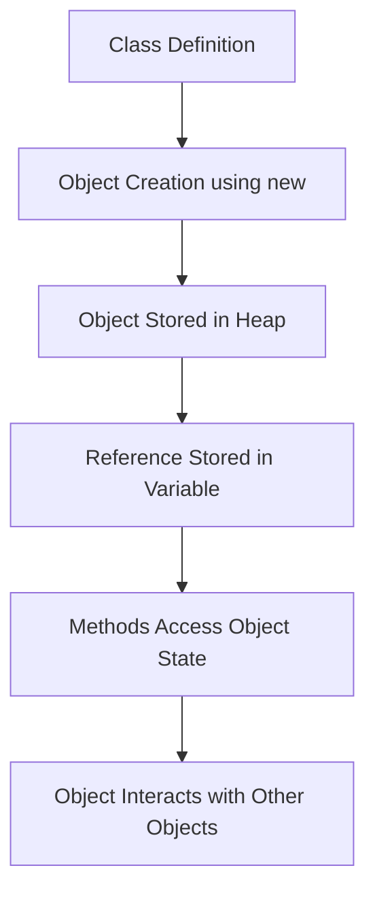
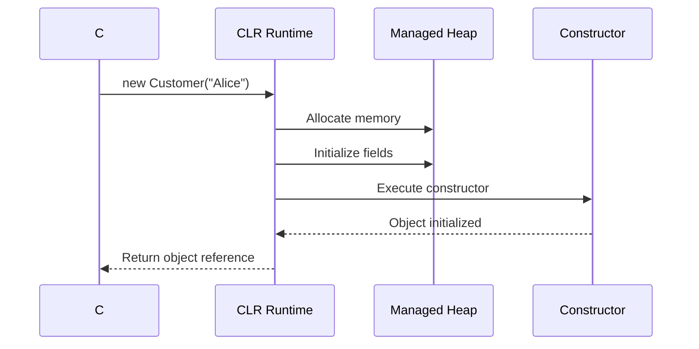
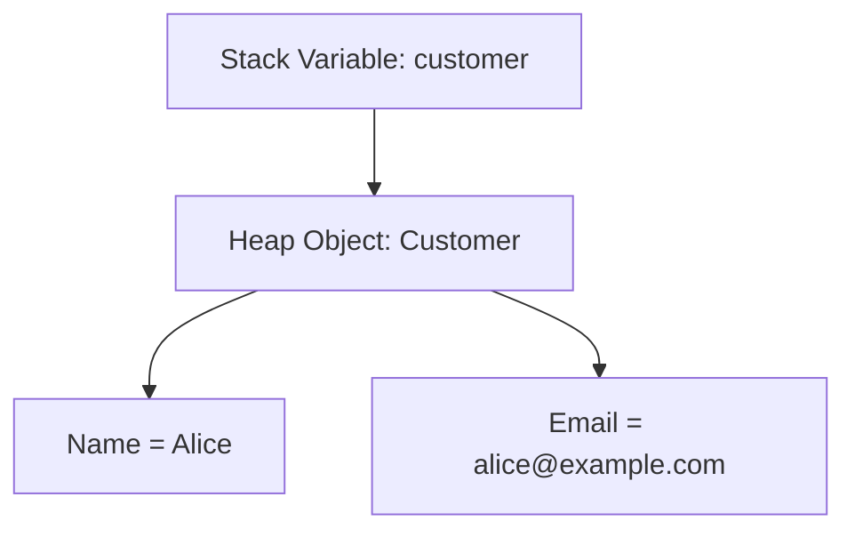

# OOP Principles in C# — Interview Preparation Notes

## 1. Topic Overview

### What is OOP?

**Object-Oriented Programming**, or **OOP**, is a programming style based on **objects**.

An object represents a real-world or logical entity that has:

- **State**: data/properties
- **Behavior**: methods/functions

Example:

```csharp
public class Customer
{
    public string Name { get; set; }

    public void PlaceOrder()
    {
        // Order placing behavior
    }
}
```

Here, `Customer` is a class, and an actual customer object has data and behavior.

---

### Very Simple Explanation

OOP is like modeling real-world things in code.

For example:

- A `Car` has properties like `Color`, `Model`, and `Speed`.
- A `Car` has behaviors like `Start()`, `Stop()`, and `Accelerate()`.

```csharp
public class Car
{
    public string Color { get; set; }

    public void Start()
    {
        Console.WriteLine("Car started");
    }
}
```

---

### Why is OOP Important?

OOP helps developers write code that is:

- Easier to understand
- Easier to reuse
- Easier to maintain
- Easier to extend
- Closer to real-world problem modeling

---

### What Problem Does OOP Solve?

Without OOP, large applications can become difficult to manage because data and behavior are scattered.

OOP solves this by grouping related data and behavior together.

Example:

Instead of separately managing customer name, customer email, customer address, and customer operations, OOP groups them inside a `Customer` class.

---

### Where is OOP Used in Real-World Projects?

OOP is used in almost every C# application, including:

- ASP.NET MVC/Web API applications
- Windows Forms applications
- WPF applications
- Console applications
- Enterprise applications
- Banking systems
- Insurance systems
- E-commerce systems
- Data access layers
- Business logic layers
- Domain models
- Service classes
- Repository classes

Example project structure:

```text
Controllers
Services
Repositories
Models
Entities
DTOs
Helpers
```

Most of these are implemented using classes and objects.

---

## 2. Core Concepts

# Must Know Concepts

---

## 2.1 Class

### Definition

A **class** is a blueprint or template used to create objects.

### Purpose

A class defines:

- Properties
- Methods
- Constructors
- Fields
- Events
- Behavior

### Why It Exists

A class helps group related data and behavior into a single reusable unit.

### How It Works

When a class is instantiated using `new`, an object is created in memory.

```csharp
public class Employee
{
    public int Id { get; set; }

    public string Name { get; set; }

    public void Work()
    {
        Console.WriteLine("Employee is working");
    }
}
```

```csharp
Employee employee = new Employee();
employee.Id = 1;
employee.Name = "John";
employee.Work();
```

### Key Points to Remember

- A class is a blueprint.
- An object is an instance of a class.
- A class can contain fields, properties, methods, constructors, and events.
- Classes support encapsulation, inheritance, and polymorphism.

### Simple Example

```csharp
public class Product
{
    public string Name { get; set; }

    public decimal Price { get; set; }
}
```

### Real-World Example

In an order management system:

```csharp
public class Order
{
    public int OrderId { get; set; }

    public decimal TotalAmount { get; set; }

    public void Confirm()
    {
        // Confirm order
    }
}
```

---

## 2.2 Object

### Definition

An **object** is an instance of a class.

### Purpose

Objects represent actual runtime entities.

### Why It Exists

Classes only describe structure. Objects hold actual data and execute behavior.

### How It Works

```csharp
Customer customer = new Customer();
```

The `new` keyword creates an object in memory.

### Key Points to Remember

- Object is created from a class.
- Each object has its own state.
- Multiple objects can be created from the same class.
- Objects interact by calling methods on each other.

### Simple Example

```csharp
public class Customer
{
    public string Name { get; set; }
}

Customer firstCustomer = new Customer();
firstCustomer.Name = "Alice";

Customer secondCustomer = new Customer();
secondCustomer.Name = "Bob";
```

### Real-World Example

Each row in a `Customers` database table may be represented as a `Customer` object in C#.

---

## 2.3 Encapsulation

### Definition

**Encapsulation** means wrapping data and methods together and controlling access to internal details.

### Purpose

Encapsulation protects object data from invalid or uncontrolled changes.

### Why It Exists

Without encapsulation, any code can directly modify object data and put it into an invalid state.

### How It Works

Encapsulation is implemented using:

- Access modifiers
- Private fields
- Public properties
- Methods that validate state

### Bad Example

```csharp
public class BankAccount
{
    public decimal Balance;
}
```

Problem:

```csharp
BankAccount account = new BankAccount();
account.Balance = -1000;
```

This allows invalid data.

### Better Example

```csharp
public class BankAccount
{
    private decimal _balance;

    public decimal Balance
    {
        get { return _balance; }
    }

    public void Deposit(decimal amount)
    {
        if (amount <= 0)
        {
            throw new ArgumentException("Deposit amount must be positive.");
        }

        _balance += amount;
    }

    public void Withdraw(decimal amount)
    {
        if (amount <= 0)
        {
            throw new ArgumentException("Withdrawal amount must be positive.");
        }

        if (amount > _balance)
        {
            throw new InvalidOperationException("Insufficient balance.");
        }

        _balance -= amount;
    }
}
```

### Key Points to Remember

- Keep fields private.
- Expose data safely through properties or methods.
- Protect object state.
- Encapsulation supports maintainability and validation.

### Real-World Example

A payment object should not allow direct modification of payment status without validation.

```csharp
public class Payment
{
    public string Status { get; private set; }

    public void MarkAsSuccessful()
    {
        Status = "Successful";
    }

    public void MarkAsFailed()
    {
        Status = "Failed";
    }
}
```

---

## 2.4 Abstraction

### Definition

**Abstraction** means hiding unnecessary implementation details and exposing only what is required.

### Purpose

Abstraction reduces complexity for the caller.

### Why It Exists

Users of a class should not need to know how everything works internally.

### How It Works

Abstraction is implemented using:

- Interfaces
- Abstract classes
- Public methods hiding private logic

### Example

```csharp
public interface IPaymentProcessor
{
    void ProcessPayment(decimal amount);
}

public class CreditCardPaymentProcessor : IPaymentProcessor
{
    public void ProcessPayment(decimal amount)
    {
        ValidateCard();
        ConnectToGateway();
        ChargeAmount(amount);
    }

    private void ValidateCard()
    {
        // Validate card
    }

    private void ConnectToGateway()
    {
        // Connect to gateway
    }

    private void ChargeAmount(decimal amount)
    {
        // Charge amount
    }
}
```

The caller only sees:

```csharp
paymentProcessor.ProcessPayment(100);
```

The internal steps are hidden.

### Key Points to Remember

- Abstraction hides complexity.
- Encapsulation hides data; abstraction hides implementation details.
- Interfaces and abstract classes are common abstraction tools.
- Abstraction helps loose coupling.

### Real-World Example

A service calls `IEmailService.SendEmail()` without knowing whether email is sent using SMTP, SendGrid, or another provider.

---

## 2.5 Inheritance

### Definition

**Inheritance** allows one class to acquire members of another class.

### Purpose

Inheritance enables code reuse and establishes an **is-a** relationship.

### Why It Exists

It helps avoid duplicate code when multiple classes share common behavior.

### How It Works

A derived class inherits from a base class using `:`.

```csharp
public class Vehicle
{
    public void Start()
    {
        Console.WriteLine("Vehicle started");
    }
}

public class Car : Vehicle
{
    public void Drive()
    {
        Console.WriteLine("Car is driving");
    }
}
```

Usage:

```csharp
Car car = new Car();
car.Start();
car.Drive();
```

### Key Points to Remember

- C# supports single class inheritance.
- A class can implement multiple interfaces.
- Use inheritance only for true **is-a** relationships.
- Prefer composition when behavior varies.

### Simple Example

```csharp
public class Animal
{
    public void Eat()
    {
        Console.WriteLine("Eating");
    }
}

public class Dog : Animal
{
    public void Bark()
    {
        Console.WriteLine("Barking");
    }
}
```

### Real-World Example

```csharp
public abstract class Employee
{
    public string Name { get; set; }

    public abstract decimal CalculateSalary();
}

public class FullTimeEmployee : Employee
{
    public override decimal CalculateSalary()
    {
        return 50000;
    }
}

public class ContractEmployee : Employee
{
    public override decimal CalculateSalary()
    {
        return 30000;
    }
}
```

---

## 2.6 Polymorphism

### Definition

**Polymorphism** means one interface or method can behave differently based on the actual object.

The word means **many forms**.

### Purpose

Polymorphism allows flexible and extensible behavior.

### Why It Exists

It allows code to work with a common base type or interface while executing different behavior at runtime.

### Types of Polymorphism in C#

| Type | Meaning | Example |
|---|---|---|
| Compile-time polymorphism | Method overloading/operator overloading | Same method name, different parameters |
| Runtime polymorphism | Method overriding using inheritance/interface | Derived class changes behavior |

---

### Compile-Time Polymorphism: Method Overloading

```csharp
public class Calculator
{
    public int Add(int first, int second)
    {
        return first + second;
    }

    public decimal Add(decimal first, decimal second)
    {
        return first + second;
    }

    public int Add(int first, int second, int third)
    {
        return first + second + third;
    }
}
```

### Runtime Polymorphism: Method Overriding

```csharp
public abstract class NotificationSender
{
    public abstract void Send(string message);
}

public class EmailSender : NotificationSender
{
    public override void Send(string message)
    {
        Console.WriteLine("Email sent: " + message);
    }
}

public class SmsSender : NotificationSender
{
    public override void Send(string message)
    {
        Console.WriteLine("SMS sent: " + message);
    }
}
```

Usage:

```csharp
NotificationSender sender = new EmailSender();
sender.Send("Order confirmed");

sender = new SmsSender();
sender.Send("Order confirmed");
```

### Key Points to Remember

- Overloading happens at compile time.
- Overriding happens at runtime.
- Runtime polymorphism requires inheritance or interfaces.
- `virtual`, `override`, and `abstract` are commonly used.
- Polymorphism supports Open/Closed Principle.

### Real-World Example

Payment system:

```csharp
public interface IPaymentProcessor
{
    void Pay(decimal amount);
}

public class CreditCardPaymentProcessor : IPaymentProcessor
{
    public void Pay(decimal amount)
    {
        Console.WriteLine("Paid using credit card");
    }
}

public class UpiPaymentProcessor : IPaymentProcessor
{
    public void Pay(decimal amount)
    {
        Console.WriteLine("Paid using UPI");
    }
}
```

---

# Good to Know Concepts

---

## 2.7 Access Modifiers

### Definition

Access modifiers define where a class member can be accessed from.

### Common Access Modifiers

| Modifier | Meaning |
|---|---|
| `public` | Accessible from anywhere |
| `private` | Accessible only inside the same class |
| `protected` | Accessible inside same class and derived classes |
| `internal` | Accessible within the same assembly |
| `protected internal` | Accessible from same assembly or derived classes |
| `private protected` | Accessible from derived classes in same assembly |

### Purpose

Access modifiers enforce encapsulation.

### Example

```csharp
public class Customer
{
    private int _id;

    public string Name { get; set; }

    protected void Validate()
    {
        // Validation logic
    }
}
```

### Interview Tip

> Use the most restrictive access modifier possible. Expose only what is necessary.

---

## 2.8 Constructor

### Definition

A **constructor** is a special method used to initialize an object.

### Purpose

It ensures an object starts in a valid state.

### Example

```csharp
public class Customer
{
    public Customer(string name)
    {
        Name = name;
    }

    public string Name { get; private set; }
}
```

### Types of Constructors

| Type | Description |
|---|---|
| Default constructor | Takes no parameters |
| Parameterized constructor | Takes parameters |
| Static constructor | Initializes static data |
| Private constructor | Prevents direct object creation |

### Real-World Example

```csharp
public class OrderService
{
    private readonly IOrderRepository _orderRepository;

    public OrderService(IOrderRepository orderRepository)
    {
        _orderRepository = orderRepository;
    }
}
```

Constructor injection is widely used in real projects.

---

## 2.9 Interface

### Definition

An **interface** defines a contract that a class must implement.

### Purpose

Interfaces allow loose coupling and polymorphism.

### Example

```csharp
public interface ILogger
{
    void Log(string message);
}

public class FileLogger : ILogger
{
    public void Log(string message)
    {
        // Write log to file
    }
}
```

### Key Points

- Interfaces define behavior, not implementation.
- A class can implement multiple interfaces.
- Interfaces are commonly used for dependency injection.
- Interfaces help with unit testing.

### Real-World Example

```csharp
public interface ICustomerRepository
{
    Customer GetById(int id);

    void Save(Customer customer);
}
```

---

## 2.10 Abstract Class

### Definition

An **abstract class** is a class that cannot be instantiated directly and may contain abstract and non-abstract members.

### Purpose

It provides a common base with shared behavior.

### Example

```csharp
public abstract class ReportGenerator
{
    public void Generate()
    {
        FetchData();
        FormatReport();
        Export();
    }

    protected abstract void FetchData();

    protected abstract void FormatReport();

    protected abstract void Export();
}
```

### Key Points

- Abstract classes can contain implementation.
- Abstract methods must be overridden.
- Use abstract classes when derived classes share common behavior.
- Use interfaces when only a contract is needed.

---

## 2.11 Composition

### Definition

**Composition** means building complex behavior by combining objects.

### Purpose

Composition promotes flexibility and avoids deep inheritance hierarchies.

### Example

```csharp
public class OrderService
{
    private readonly IEmailService _emailService;

    public OrderService(IEmailService emailService)
    {
        _emailService = emailService;
    }

    public void ConfirmOrder()
    {
        _emailService.SendEmail("Order confirmed");
    }
}
```

### Key Point

> Prefer composition over inheritance when behavior can change independently.

---

# Advanced Concepts

---

## 2.12 Static vs Instance Members

### Static Members

Static members belong to the type itself.

```csharp
public class AppSettings
{
    public static string ApplicationName = "MyApp";
}
```

Usage:

```csharp
string name = AppSettings.ApplicationName;
```

### Instance Members

Instance members belong to an object.

```csharp
public class Customer
{
    public string Name { get; set; }
}
```

### Key Difference

| Static | Instance |
|---|---|
| Shared across all users | Separate per object |
| Accessed by class name | Accessed by object |
| Lives for application lifetime | Lives while object is referenced |

---

## 2.13 Virtual, Override, Abstract, Sealed

| Keyword | Meaning |
|---|---|
| `virtual` | Method can be overridden |
| `override` | Method overrides base behavior |
| `abstract` | Must be implemented by derived class |
| `sealed` | Prevents inheritance or further overriding |

Example:

```csharp
public class Animal
{
    public virtual void Speak()
    {
        Console.WriteLine("Animal sound");
    }
}

public class Dog : Animal
{
    public override void Speak()
    {
        Console.WriteLine("Bark");
    }
}
```

---

## 2.14 Object Lifetime and Garbage Collection

### Definition

Objects are created in memory and later cleaned up by the .NET Garbage Collector.

### How It Works

1. Object is created using `new`.
2. Reference points to the object.
3. When no live references exist, the object becomes eligible for garbage collection.
4. Garbage Collector reclaims memory later.

```csharp
Customer customer = new Customer();
customer = null;
```

The object may now be eligible for garbage collection.

### Interview Tip

> Garbage collection is automatic, but unmanaged resources should be released using `IDisposable`.

---

## 2.15 Boxing and Unboxing

### Boxing

Converting a value type to `object`.

```csharp
int number = 10;
object boxed = number;
```

### Unboxing

Converting object back to value type.

```csharp
int unboxed = (int)boxed;
```

### Why It Matters

Boxing/unboxing can affect performance because it involves heap allocation and type conversion.

---

## 3. How OOP Works Internally

## 3.1 High-Level Architecture



---

## 3.2 Object Creation Flow

Example:

```csharp
Customer customer = new Customer("Alice");
```

### What Happens Internally?

1. CLR allocates memory for the object on the managed heap.
2. Fields are initialized to default values.
3. Constructor runs.
4. Reference to the object is returned.
5. Variable `customer` stores the object reference.



---

## 3.3 Method Call Execution

When a method is called:

```csharp
customer.PlaceOrder();
```

Internally:

1. Runtime finds the object reference.
2. Method call is resolved.
3. Object state is accessed through `this`.
4. Method executes.
5. Result returns to caller.

---

## 3.4 Runtime Polymorphism Internally

```csharp
Animal animal = new Dog();
animal.Speak();
```

Although the reference type is `Animal`, the actual object type is `Dog`.

The CLR uses runtime dispatch to call the overridden `Dog.Speak()` method.


### Key Point

Runtime polymorphism depends on the actual object type, not only the reference type.

---

## 3.5 Interface Dispatch

```csharp
ILogger logger = new FileLogger();
logger.Log("Message");
```

Internally:

1. Variable type is `ILogger`.
2. Actual object is `FileLogger`.
3. CLR maps the interface method to the implementation.
4. `FileLogger.Log()` executes.

---

## 3.6 Memory View



### Stack vs Heap

| Area | Stores |
|---|---|
| Stack | Local variables, value types, references |
| Heap | Objects created using `new` |

---

## 4. Important Terminology

| Term | Meaning | Example |
|---|---|---|
| Class | Blueprint for objects | `Customer` |
| Object | Instance of a class | `new Customer()` |
| Encapsulation | Protecting data using controlled access | Private fields with public methods |
| Abstraction | Hiding implementation details | `IPaymentProcessor` |
| Inheritance | Reusing behavior from base class | `Dog : Animal` |
| Polymorphism | Same contract, different behavior | `ILogger` with `FileLogger` |
| Method Overloading | Same method name, different parameters | `Add(int, int)` and `Add(decimal, decimal)` |
| Method Overriding | Derived class changes base behavior | `override Speak()` |
| Constructor | Initializes an object | `Customer(string name)` |
| Interface | Contract for behavior | `ILogger` |
| Abstract Class | Base class that cannot be instantiated | `abstract class Shape` |
| Access Modifier | Controls visibility | `private`, `public` |
| Field | Variable inside a class | `_balance` |
| Property | Controlled access to data | `Name { get; set; }` |
| Method | Behavior of a class | `CalculateTotal()` |
| Static Member | Belongs to class, not object | `Math.Max()` |
| Instance Member | Belongs to object | `customer.Name` |
| Constructor Injection | Passing dependency through constructor | `OrderService(IRepository repo)` |
| Coupling | Dependency between classes | Service depends on repository |
| Cohesion | How focused a class is | `EmailService` only sends emails |
| Composition | Class uses another class | `OrderService` uses `IEmailService` |
| Base Class | Parent class | `Animal` |
| Derived Class | Child class | `Dog` |
| Sealed Class | Class that cannot be inherited | `sealed class TokenValidator` |
| Boxing | Value type converted to object | `object obj = 10` |
| Unboxing | Object converted back to value type | `int x = (int)obj` |

---

## 5. Important Comparisons

| Concept A | Concept B | Key Difference | When to Use |
|---|---|---|---|
| Class | Object | Class is blueprint; object is runtime instance | Class for definition, object for usage |
| Encapsulation | Abstraction | Encapsulation hides data; abstraction hides complexity | Use both together |
| Inheritance | Composition | Inheritance is `is-a`; composition is `has-a` | Prefer composition for flexible behavior |
| Overloading | Overriding | Overloading is compile-time; overriding is runtime | Overload for parameter variation; override for behavior variation |
| Interface | Abstract Class | Interface defines contract; abstract class can share code | Interface for capability, abstract class for shared base |
| Static Class | Instance Class | Static has shared members; instance has per-object state | Static for stateless utilities |
| Field | Property | Field stores data; property controls access | Prefer properties for public access |
| Private | Protected | Private only same class; protected same and derived class | Use protected only if inheritance needs it |
| Virtual Method | Abstract Method | Virtual has default implementation; abstract has none | Virtual for optional override, abstract for mandatory override |
| Sealed | Abstract | Sealed prevents inheritance; abstract requires inheritance | Sealed for final type, abstract for base template |
| Reference Type | Value Type | Reference points to heap object; value directly stores data | Classes are reference types; structs are value types |
| Association | Aggregation | Association is relation; aggregation is weak ownership | Use aggregation when part can exist independently |
| Aggregation | Composition | Composition is strong ownership | Use composition when child lifecycle depends on parent |

---

## 6. Practical Examples

## Example 1: Banking System Encapsulation

### 1. Problem

A bank account should not allow invalid balance changes.

### 2. Approach

Use private fields and public methods with validation.

### 3. Solution

```csharp
public class BankAccount
{
    private decimal _balance;

    public decimal Balance
    {
        get { return _balance; }
    }

    public void Deposit(decimal amount)
    {
        if (amount <= 0)
        {
            throw new ArgumentException("Amount must be greater than zero.");
        }

        _balance += amount;
    }

    public void Withdraw(decimal amount)
    {
        if (amount <= 0)
        {
            throw new ArgumentException("Amount must be greater than zero.");
        }

        if (amount > _balance)
        {
            throw new InvalidOperationException("Insufficient funds.");
        }

        _balance -= amount;
    }
}
```

### 4. Why This Approach Was Chosen

- Protects internal state.
- Prevents invalid balance.
- Keeps business rules inside the object.

### 5. Alternatives

- Public field: simple but unsafe.
- Public setter: better than field but still risky unless validated.
- Separate validation service: useful for complex business rules.

### 6. Trade-Offs

- Slightly more code.
- Much safer object behavior.

---

## Example 2: Notification System Polymorphism

### 1. Problem

The application needs to send email, SMS, and push notifications.

### 2. Approach

Use an interface and multiple implementations.

### 3. Solution

```csharp
public interface INotificationSender
{
    void Send(string message);
}

public class EmailNotificationSender : INotificationSender
{
    public void Send(string message)
    {
        Console.WriteLine("Email sent: " + message);
    }
}

public class SmsNotificationSender : INotificationSender
{
    public void Send(string message)
    {
        Console.WriteLine("SMS sent: " + message);
    }
}

public class NotificationService
{
    private readonly INotificationSender _notificationSender;

    public NotificationService(INotificationSender notificationSender)
    {
        _notificationSender = notificationSender;
    }

    public void Notify(string message)
    {
        _notificationSender.Send(message);
    }
}
```

### 4. Why This Approach Was Chosen

- Supports runtime polymorphism.
- Easy to add new notification types.
- Reduces coupling.

### 5. Alternatives

- `if-else` or `switch`.
- Factory pattern.
- Event-driven notification system.

### 6. Trade-Offs

- More classes.
- Requires dependency configuration.
- Much easier to extend.

---

## Example 3: Employee Salary Calculation Using Inheritance

### 1. Problem

Different employee types calculate salary differently.

### 2. Approach

Use an abstract base class with derived implementations.

### 3. Solution

```csharp
public abstract class Employee
{
    public string Name { get; set; }

    public abstract decimal CalculateSalary();
}

public class PermanentEmployee : Employee
{
    public decimal MonthlySalary { get; set; }

    public override decimal CalculateSalary()
    {
        return MonthlySalary;
    }
}

public class ContractEmployee : Employee
{
    public decimal HourlyRate { get; set; }

    public int HoursWorked { get; set; }

    public override decimal CalculateSalary()
    {
        return HourlyRate * HoursWorked;
    }
}
```

### 4. Why This Approach Was Chosen

- Common employee abstraction.
- Different salary behavior per employee type.
- Runtime polymorphism.

### 5. Alternatives

- Strategy pattern for salary calculation.
- Separate salary calculator service.
- Switch based on employee type.

### 6. Trade-Offs

- Inheritance works if employee types truly share a base concept.
- Strategy pattern may be better if salary rules change frequently.

---

## 7. Interview Questions

# Beginner Questions

---

## Question 1

### Question

What is Object-Oriented Programming?

### Short Interview Answer

OOP is a programming approach that organizes code using objects, which combine data and behavior.

### Detailed Explanation

In OOP, real-world entities are modeled as classes and objects. A class is a blueprint, and an object is an instance of that class. OOP improves code reuse, maintainability, and modularity.

### Example

```csharp
public class Customer
{
    public string Name { get; set; }

    public void Buy()
    {
        Console.WriteLine("Customer bought an item.");
    }
}
```

### Possible Follow-up Question

What are the four main principles of OOP?

---

## Question 2

### Question

What are the four main principles of OOP?

### Short Interview Answer

The four main principles are **Encapsulation**, **Abstraction**, **Inheritance**, and **Polymorphism**.

### Detailed Explanation

- Encapsulation protects data.
- Abstraction hides implementation details.
- Inheritance allows code reuse.
- Polymorphism allows different behavior through the same interface.

### Example

A payment system can use `IPaymentProcessor` with different implementations like credit card and UPI.

### Possible Follow-up Question

Which principle is most useful for hiding implementation details?

---

## Question 3

### Question

What is the difference between a class and an object?

### Short Interview Answer

A class is a blueprint, while an object is an instance created from that blueprint.

### Detailed Explanation

A class defines structure and behavior. An object contains actual values and uses that behavior at runtime.

### Example

```csharp
Customer customer = new Customer();
```

`Customer` is the class. `customer` is the object reference.

### Possible Follow-up Question

Where is an object stored in memory?

---

# Intermediate Questions

---

## Question 1

### Question

What is the difference between abstraction and encapsulation?

### Short Interview Answer

Encapsulation hides internal data and protects object state, while abstraction hides implementation details and exposes only necessary behavior.

### Detailed Explanation

Encapsulation is achieved using access modifiers and properties. Abstraction is achieved using interfaces, abstract classes, and simplified public APIs.

### Example

Encapsulation:

```csharp
private decimal _balance;
```

Abstraction:

```csharp
public interface IPaymentProcessor
{
    void ProcessPayment(decimal amount);
}
```

### Possible Follow-up Question

Can abstraction and encapsulation be used together?

---

## Question 2

### Question

What is runtime polymorphism?

### Short Interview Answer

Runtime polymorphism occurs when a base class or interface reference calls a method implemented by the actual runtime object.

### Detailed Explanation

It is usually achieved through method overriding or interface implementation. The method to execute is decided at runtime.

### Example

```csharp
ILogger logger = new FileLogger();
logger.Log("Message");
```

Although the reference type is `ILogger`, the actual method executed is `FileLogger.Log()`.

### Possible Follow-up Question

How is runtime polymorphism different from method overloading?

---

## Question 3

### Question

When should you use an interface instead of an abstract class?

### Short Interview Answer

Use an interface when you need a contract without shared implementation. Use an abstract class when related classes need shared base behavior.

### Detailed Explanation

Interfaces are good for loose coupling and multiple capabilities. Abstract classes are useful when derived classes share common logic or state.

### Example

Use `ILogger` as an interface because many unrelated classes can log differently.

### Possible Follow-up Question

Can a class implement multiple interfaces in C#?

---

# Advanced Questions

---

## Question 1

### Question

How does virtual method dispatch work in C#?

### Short Interview Answer

When a virtual method is called through a base reference, the CLR determines the actual object type at runtime and calls the overridden method.

### Detailed Explanation

C# uses runtime dispatch for virtual and abstract methods. The actual method implementation is resolved based on the runtime type, not the compile-time reference type.

### Example

```csharp
Animal animal = new Dog();
animal.Speak();
```

If `Dog` overrides `Speak()`, `Dog.Speak()` is called.

### Possible Follow-up Question

Are non-virtual methods resolved at runtime?

---

## Question 2

### Question

Why is composition often preferred over inheritance?

### Short Interview Answer

Composition is more flexible because behavior can be changed by replacing composed objects rather than changing inheritance hierarchy.

### Detailed Explanation

Inheritance creates tight parent-child relationships. Composition allows objects to collaborate through interfaces and makes behavior easier to change.

### Example

Instead of `EmailOrderService : OrderService`, use `OrderService` with `INotificationSender`.

### Possible Follow-up Question

What is an example of inheritance causing design problems?

---

## Question 3

### Question

What happens internally when an object is created in C#?

### Short Interview Answer

Memory is allocated on the managed heap, fields are initialized, the constructor runs, and a reference to the object is returned.

### Detailed Explanation

The CLR manages object allocation. Reference variables point to heap objects. When no live references remain, the object becomes eligible for garbage collection.

### Example

```csharp
Customer customer = new Customer();
```

### Possible Follow-up Question

When does garbage collection happen?

---

## 8. Tricky Interview Questions

## Question 1

### Question

Does encapsulation mean making everything private?

### Answer

No. Encapsulation means controlling access appropriately. Internal data is usually private, but necessary behavior is exposed through public methods or properties.

---

## Question 2

### Question

Is abstraction the same as an interface?

### Answer

No. An interface is one way to achieve abstraction. Abstraction is the broader concept of hiding unnecessary implementation details.

---

## Question 3

### Question

Can inheritance reduce code quality?

### Answer

Yes. Poor inheritance can create tight coupling, fragile base classes, and incorrect `is-a` relationships.

---

## Question 4

### Question

Can polymorphism exist without inheritance?

### Answer

Yes. Interface-based polymorphism allows different classes to share the same contract without inheriting from the same base class.

---

## Question 5

### Question

Is method overloading runtime polymorphism?

### Answer

No. Method overloading is compile-time polymorphism because the compiler selects the method based on parameters.

---

## Question 6

### Question

Can a private method be overridden?

### Answer

No. Private methods are not inherited by derived classes, so they cannot be overridden.

---

## Question 7

### Question

Can constructors be inherited?

### Answer

No. Constructors are not inherited. A derived class can call a base constructor using `base(...)`.

---

## Question 8

### Question

Can an abstract class have a constructor?

### Answer

Yes. An abstract class can have a constructor, and it is called when a derived class object is created.

---

## Question 9

### Question

Can an interface have fields?

### Answer

No. Interfaces define contracts. In classic C#, interfaces do not contain instance fields.

---

## Question 10

### Question

Why should public fields usually be avoided?

### Answer

Public fields expose internal state directly and make validation or future changes harder. Public properties are preferred.

---

## 9. Scenario-Based Questions

## Scenario 1: Payment Gateway Design

### Scenario

A system supports credit card payments. Later, it must support wallet and bank transfer payments.

### How to Approach It

Use an `IPaymentProcessor` interface with separate implementations.

### Why the Solution Works

- Supports polymorphism.
- Avoids modifying existing payment service.
- Keeps payment methods independent.

### Trade-Offs

- More classes.
- Requires dependency management.

### Alternatives

- Switch statement based on payment type.
- Factory pattern.
- Strategy pattern.

### What the Interviewer Is Testing

- Abstraction
- Polymorphism
- Interface usage
- Extensible design

---

## Scenario 2: User Profile Validation

### Scenario

A `User` object should not allow invalid email addresses.

### How to Approach It

Use encapsulation with private setters or validation methods.

### Why the Solution Works

It protects the object from invalid state.

### Example

```csharp
public class User
{
    public string Email { get; private set; }

    public void SetEmail(string email)
    {
        if (string.IsNullOrWhiteSpace(email))
        {
            throw new ArgumentException("Email is required.");
        }

        Email = email;
    }
}
```

### Trade-Offs

- More validation code.
- Better data integrity.

### Alternatives

- External validator.
- Data annotations.
- Fluent validation library.

### What the Interviewer Is Testing

- Encapsulation
- Validation
- Domain modeling

---

## Scenario 3: Report Generation

### Scenario

Reports need to be exported as PDF, Excel, and CSV.

### How to Approach It

Use abstraction and polymorphism.

```csharp
public interface IReportExporter
{
    void Export();
}

public class PdfReportExporter : IReportExporter
{
    public void Export()
    {
        Console.WriteLine("PDF exported");
    }
}

public class ExcelReportExporter : IReportExporter
{
    public void Export()
    {
        Console.WriteLine("Excel exported");
    }
}
```

### Why the Solution Works

Each exporter handles its own format.

### Trade-Offs

- More types.
- Easier future extension.

### Alternatives

- Single class with `switch`.
- Factory plus strategy.
- Plugin-based export system.

### What the Interviewer Is Testing

- Polymorphism
- Open design
- Interface-based programming

---

## 10. Real-World Usage

### Common Use Cases

OOP is commonly used for:

- Entity modeling
- Service layer design
- Repository pattern
- Dependency injection
- Domain-driven design
- UI components
- Business rules
- API clients
- Logging
- Payment systems
- Notification systems

---

### Practical Examples

| Use Case | OOP Concept |
|---|---|
| `Customer`, `Order`, `Invoice` models | Classes and objects |
| `IRepository` | Abstraction |
| `OrderService` using `IEmailService` | Composition |
| `BaseController` | Inheritance |
| Multiple payment types | Polymorphism |
| Private fields with validation | Encapsulation |

---

### When to Use OOP

Use OOP when:

- The system has real-world entities.
- Business logic is complex.
- Code needs to be reused.
- Multiple behaviors share a common contract.
- Maintainability matters.
- Unit testing is needed.

---

### When NOT to Overuse OOP

Avoid excessive OOP when:

- The problem is very small.
- A simple function is enough.
- Abstraction adds more confusion than value.
- Too many inheritance levels are being created.
- Objects have no meaningful behavior.

---

### Design Considerations

- Keep classes focused.
- Avoid deep inheritance trees.
- Prefer meaningful names.
- Hide internal state.
- Program to interfaces where useful.
- Use composition for flexible behavior.
- Avoid unnecessary abstraction.

---

### Scalability

OOP improves **codebase scalability**, meaning teams can add features more safely.

It does not automatically improve runtime performance.

---

### Reliability

OOP improves reliability by:

- Keeping state controlled.
- Reducing duplicate logic.
- Isolating responsibilities.
- Making testing easier.

---

### Maintainability

OOP improves maintainability through:

- Modular classes
- Clear responsibilities
- Reusable components
- Extensible design
- Better separation of concerns

---

## 11. Performance & Optimization

### Time Complexity

OOP itself does not define algorithmic complexity.

For example:

```csharp
foreach (Customer customer in customers)
{
    Console.WriteLine(customer.Name);
}
```

This is still `O(n)` regardless of whether `Customer` is an object.

---

### Space Complexity

Objects require memory for:

- Fields
- Object header
- Type information
- References to other objects

Creating many objects can increase memory usage.

---

### Performance Considerations

| Feature | Possible Cost |
|---|---|
| Object creation | Heap allocation |
| Virtual calls | Runtime dispatch overhead |
| Interfaces | Interface dispatch overhead |
| Boxing | Heap allocation |
| Deep inheritance | Maintenance complexity, not usually runtime issue |

### Important Reality

In most business applications, OOP overhead is small compared to:

- Database calls
- Network calls
- File I/O
- Serialization
- External API calls

---

### Bottlenecks

Common bottlenecks are usually caused by:

- Too many unnecessary objects
- Excessive abstraction
- Boxing/unboxing
- Poor data structures
- Inefficient algorithms
- Database access inside loops

---

### Optimization Techniques

- Avoid unnecessary object creation in tight loops.
- Avoid boxing/unboxing in performance-critical code.
- Use interfaces wisely.
- Prefer simple design where abstraction is not needed.
- Profile before optimizing.
- Use appropriate collections.
- Dispose unmanaged resources properly.

> **Interview Tip:** OOP is mainly about maintainability and design. Performance depends more on algorithms, data access, memory usage, and I/O.

---

## 12. Common Mistakes

### Conceptual Misunderstandings

- Thinking OOP means only creating classes.
- Thinking inheritance is always good.
- Confusing abstraction with encapsulation.
- Thinking interfaces contain business logic.
- Thinking polymorphism only means method overloading.
- Thinking private fields are always enough for encapsulation.

---

### Implementation Mistakes

- Public fields instead of properties.
- Classes with too many responsibilities.
- Deep inheritance hierarchies.
- Using inheritance where composition is better.
- Creating interfaces for every class unnecessarily.
- Exposing collections directly.
- Not validating object state.
- Overusing static classes.
- Ignoring access modifiers.

---

### Incorrect Assumptions

- More classes always mean better OOP.
- Abstract classes are always better than interfaces.
- Inheritance always improves reuse.
- Static methods are always bad.
- OOP automatically makes code testable.

---

### Interview Mistakes

- Giving only textbook definitions.
- Not giving examples.
- Confusing overloading and overriding.
- Not explaining real-world use cases.
- Ignoring trade-offs.
- Not mentioning composition vs inheritance.

---

## 13. Best Practices

## 1. Keep Classes Focused

A class should have a clear purpose.

**Why it matters:**  
Focused classes are easier to understand, test, and maintain.

---

## 2. Encapsulate State

Keep fields private and expose controlled access.

**Why it matters:**  
This prevents invalid object states.

---

## 3. Prefer Composition Over Inheritance

Use objects working together instead of forcing parent-child relationships.

**Why it matters:**  
Composition is more flexible and less fragile.

---

## 4. Use Interfaces for Stable Contracts

Use interfaces where multiple implementations or testing flexibility are needed.

**Why it matters:**  
Interfaces reduce coupling.

---

## 5. Avoid Deep Inheritance

Avoid long chains like:

```text
BaseEntity -> UserEntity -> AdminUser -> SuperAdminUser
```

**Why it matters:**  
Deep inheritance is hard to understand and modify.

---

## 6. Use Meaningful Class and Method Names

Names should clearly describe responsibility.

**Why it matters:**  
Readable code reduces maintenance cost.

---

## 7. Keep Constructors Simple

Avoid heavy logic inside constructors.

**Why it matters:**  
Constructors should initialize objects, not perform expensive operations.

---

## 8. Make Invalid States Difficult

Design objects so invalid data cannot easily exist.

**Why it matters:**  
This reduces bugs.

---

## 9. Avoid Overengineering

Do not create abstractions without a real need.

**Why it matters:**  
Unnecessary abstraction makes code harder to follow.

---

## 10. Follow SOLID Principles

SOLID builds on OOP principles.

**Why it matters:**  
It improves maintainability, extensibility, and testability.

---

## 14. Interview Cheat Sheet

### Key Definitions

| Concept | Definition |
|---|---|
| Class | Blueprint for objects |
| Object | Instance of a class |
| Encapsulation | Protecting data through controlled access |
| Abstraction | Hiding implementation details |
| Inheritance | Reusing behavior through parent-child relationship |
| Polymorphism | Same contract, different behavior |
| Interface | Contract implemented by classes |
| Abstract Class | Base class with shared and/or abstract behavior |
| Composition | Building behavior by combining objects |

---

### Core Concepts

- **Class**: Defines structure.
- **Object**: Runtime instance.
- **Encapsulation**: Protects data.
- **Abstraction**: Hides complexity.
- **Inheritance**: Reuses common behavior.
- **Polymorphism**: Enables flexible behavior.
- **Interface**: Defines contract.
- **Abstract class**: Provides base structure and shared logic.
- **Composition**: Uses other objects to build behavior.

---

### Important Differences

| Difference | Remember |
|---|---|
| Class vs Object | Blueprint vs instance |
| Encapsulation vs Abstraction | Data hiding vs implementation hiding |
| Overloading vs Overriding | Compile-time vs runtime |
| Interface vs Abstract Class | Contract vs shared base |
| Inheritance vs Composition | Is-a vs has-a |
| Static vs Instance | Shared by type vs specific to object |

---

### Common Questions

- What are the four pillars of OOP?
- What is encapsulation?
- What is abstraction?
- What is inheritance?
- What is polymorphism?
- Difference between overloading and overriding?
- Difference between interface and abstract class?
- Why prefer composition over inheritance?
- How does object creation work internally?
- What is runtime polymorphism?

---

### Must-Remember Points

- OOP models software using objects.
- The four pillars are encapsulation, abstraction, inheritance, and polymorphism.
- Encapsulation protects object state.
- Abstraction simplifies usage.
- Inheritance should represent a valid `is-a` relationship.
- Polymorphism supports flexible behavior.
- Interfaces are useful for contracts and loose coupling.
- Composition is often safer than inheritance.
- OOP improves maintainability more than raw performance.

---

## 15. Rapid-Fire Interview Questions

## 1. What is OOP?

OOP is a programming approach that organizes code around objects containing data and behavior.

## 2. What are the four pillars of OOP?

Encapsulation, Abstraction, Inheritance, and Polymorphism.

## 3. What is a class?

A class is a blueprint used to create objects.

## 4. What is an object?

An object is an instance of a class.

## 5. What is encapsulation?

Encapsulation is protecting data by controlling access to it.

## 6. What is abstraction?

Abstraction hides implementation details and exposes only necessary behavior.

## 7. What is inheritance?

Inheritance allows a class to reuse members of another class.

## 8. What is polymorphism?

Polymorphism allows the same method or interface to behave differently depending on the object.

## 9. What is method overloading?

Method overloading means same method name with different parameters.

## 10. What is method overriding?

Method overriding means a derived class provides a new implementation of a base class virtual or abstract method.

## 11. Is overloading compile-time or runtime polymorphism?

Compile-time polymorphism.

## 12. Is overriding compile-time or runtime polymorphism?

Runtime polymorphism.

## 13. Can C# support multiple class inheritance?

No. C# supports single class inheritance but multiple interface implementation.

## 14. What is an interface?

An interface is a contract that defines methods or properties a class must implement.

## 15. What is an abstract class?

An abstract class is a base class that cannot be instantiated directly.

## 16. When should you use an interface?

Use an interface when you need a contract, loose coupling, or multiple implementations.

## 17. When should you use an abstract class?

Use an abstract class when related classes need shared base behavior.

## 18. What is composition?

Composition means a class contains and uses other objects to perform work.

## 19. Why prefer composition over inheritance?

Composition is more flexible and avoids fragile inheritance hierarchies.

## 20. What is the main benefit of OOP?

The main benefit is writing maintainable, reusable, and extensible code.

---

## 16. Mock Interview

This section is interactive.

I will ask **10 questions one at a time**, starting from basic and gradually increasing in difficulty.

After you answer, I will:

- Rate your answer from **1–10**
- Tell you what you got right
- Tell you what you missed
- Correct any mistakes
- Give you an ideal interview answer
- Ask the next question

## Mock Interview Question 1

**What are the four main principles of OOP, and can you briefly explain each one?**

> Answer this question, and I will evaluate it before asking Question 2.

---

## 17. Final Interview Revision

## 30 Most Important Things to Remember Before an Interview

1. **OOP means organizing code using objects.**
2. **A class is a blueprint.**
3. **An object is an instance of a class.**
4. **The four pillars of OOP are encapsulation, abstraction, inheritance, and polymorphism.**
5. **Encapsulation protects data from invalid access.**
6. **Abstraction hides unnecessary implementation details.**
7. **Inheritance enables reuse through parent-child relationships.**
8. **Polymorphism allows one contract to have many behaviors.**
9. **Overloading is compile-time polymorphism.**
10. **Overriding is runtime polymorphism.**
11. **Use `virtual` to allow overriding.**
12. **Use `override` to replace base behavior.**
13. **Use `abstract` when derived classes must implement behavior.**
14. **Use `sealed` to prevent inheritance.**
15. **Interfaces define contracts.**
16. **Abstract classes can contain shared implementation.**
17. **C# supports single class inheritance.**
18. **C# supports multiple interface implementation.**
19. **Composition means using objects inside other objects.**
20. **Prefer composition over inheritance when behavior changes independently.**
21. **Use private fields and public methods/properties for encapsulation.**
22. **Avoid public fields in most business classes.**
23. **Constructors initialize objects.**
24. **Objects are usually allocated on the managed heap.**
25. **References point to objects.**
26. **Garbage Collector cleans unused managed objects.**
27. **Boxing converts value types to object.**
28. **Unboxing converts object back to value type.**
29. **Good OOP improves maintainability, reuse, and testability.**
30. **Strong interview answers include definitions, examples, use cases, and trade-offs.**

> **Final Interview Tip:**  
> When answering OOP questions, avoid only giving definitions. Explain the principle, show a small C# example, mention where it is used in real projects, and include one trade-off.