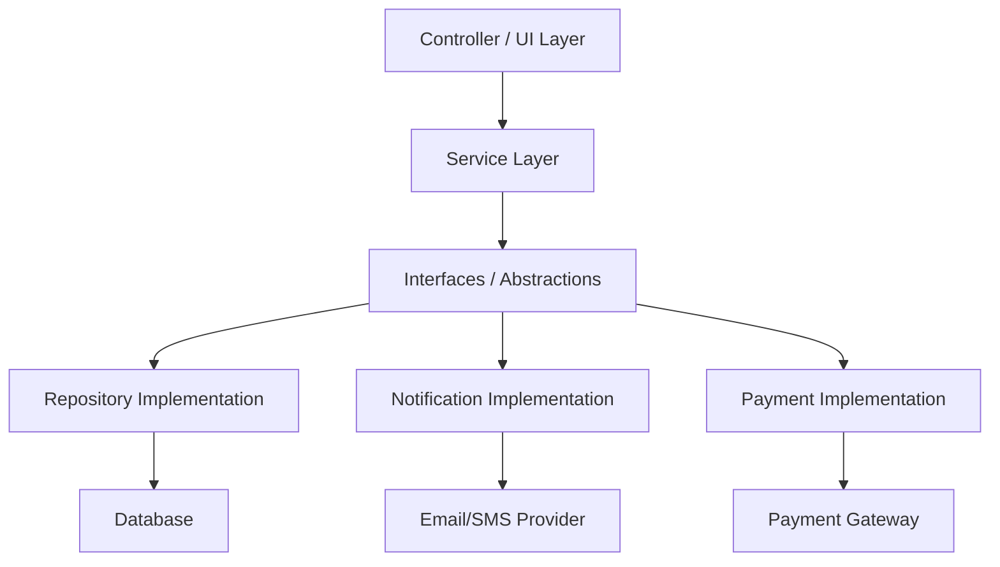
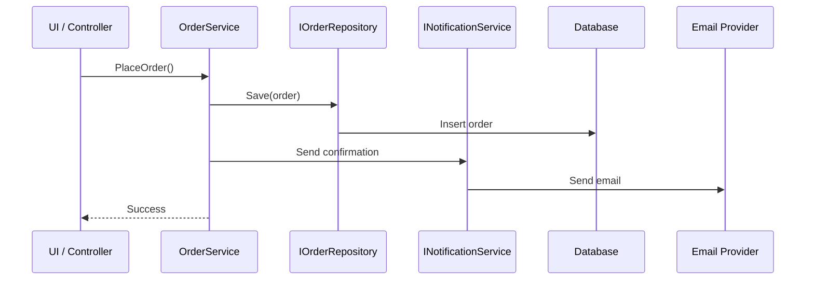
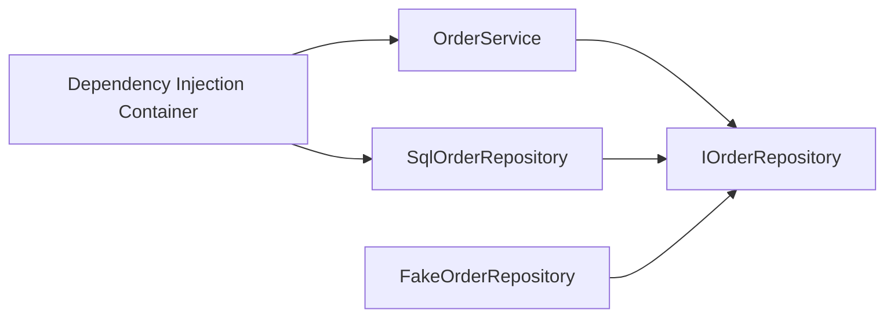

# SOLID Principles in C# — Interview Preparation Notes

## 1. Topic Overview

### What are SOLID Principles?

**SOLID** is a set of five object-oriented design principles used to create software that is:

- Easier to maintain
- Easier to test
- Easier to extend
- Less tightly coupled
- More understandable

SOLID stands for:

| Letter | Principle | Meaning |
|---|---|---|
| S | **Single Responsibility Principle** | A class should have only one reason to change |
| O | **Open/Closed Principle** | Code should be open for extension but closed for modification |
| L | **Liskov Substitution Principle** | Derived classes should be replaceable for their base classes |
| I | **Interface Segregation Principle** | Prefer small, focused interfaces over large, general interfaces |
| D | **Dependency Inversion Principle** | Depend on abstractions, not concrete implementations |

### Simple Explanation

In simple terms, SOLID helps you write code where:

- Each class does one clear job.
- New features can be added without breaking old code.
- Child classes behave correctly when used in place of parent classes.
- Interfaces do not force classes to implement methods they do not need.
- High-level business logic does not depend directly on low-level details.

### Why is SOLID Important?

SOLID is important because real-world applications change constantly.

Examples:

- Business rules change.
- New payment providers are added.
- Logging mechanisms change.
- Databases are replaced.
- APIs evolve.
- Testing requirements increase.

Without SOLID, code often becomes:

- Difficult to modify
- Hard to test
- Highly coupled
- Fragile
- Repetitive
- Error-prone

### What Problem Does SOLID Solve?

SOLID solves common design problems such as:

- One class doing too many things
- Repeated `if-else` or `switch` logic
- Tight coupling between classes
- Difficult unit testing
- Inheritance misuse
- Large interfaces
- Code changes causing unexpected bugs

### Where is SOLID Used in Real Projects?

SOLID is commonly used in:

- ASP.NET MVC/Web API applications
- Windows services
- Enterprise applications
- Clean Architecture
- Domain-Driven Design
- Microservices
- Repository pattern
- Service layer design
- Dependency Injection
- Unit-testable business logic
- Payment, notification, logging, and validation systems

---

## 2. Core Concepts

## Must Know Concepts

---

## S — Single Responsibility Principle

### Definition

The **Single Responsibility Principle** says:

> A class should have only one reason to change.

This means a class should focus on one responsibility or one part of the system.

### Purpose

The purpose is to reduce complexity and make code easier to understand, test, and maintain.

### Why It Exists

When a class has multiple responsibilities, a change in one responsibility can accidentally break another.

Example responsibilities:

- Business validation
- Database access
- Email sending
- Logging
- Report generation

These should not all be inside one class.

### Bad Example

```csharp
public class InvoiceService
{
    public void CreateInvoice()
    {
        // Create invoice
    }

    public void SaveToDatabase()
    {
        // Save invoice to database
    }

    public void SendEmail()
    {
        // Send invoice email
    }

    public void GeneratePdf()
    {
        // Generate PDF
    }
}
```

### Problem

`InvoiceService` has too many reasons to change:

- Invoice rules change
- Database changes
- Email provider changes
- PDF format changes

### Better Example

```csharp
public class InvoiceService
{
    private readonly InvoiceRepository _repository;
    private readonly EmailService _emailService;
    private readonly PdfGenerator _pdfGenerator;

    public InvoiceService(
        InvoiceRepository repository,
        EmailService emailService,
        PdfGenerator pdfGenerator)
    {
        _repository = repository;
        _emailService = emailService;
        _pdfGenerator = pdfGenerator;
    }

    public void CreateInvoice()
    {
        // Business logic for invoice creation
    }
}

public class InvoiceRepository
{
    public void Save()
    {
        // Save invoice to database
    }
}

public class EmailService
{
    public void Send()
    {
        // Send email
    }
}

public class PdfGenerator
{
    public void Generate()
    {
        // Generate PDF
    }
}
```

### Key Points to Remember

- One class should have one main responsibility.
- SRP is about **reasons to change**, not just number of methods.
- A class can have multiple methods if they support the same responsibility.
- SRP improves testing and maintainability.

### Real-World Example

In an e-commerce system:

| Responsibility | Class |
|---|---|
| Order processing | `OrderService` |
| Order persistence | `OrderRepository` |
| Payment processing | `PaymentService` |
| Email notification | `EmailNotificationService` |
| Invoice generation | `InvoiceGenerator` |

---

## O — Open/Closed Principle

### Definition

The **Open/Closed Principle** says:

> Software entities should be open for extension but closed for modification.

This means you should be able to add new behavior without changing existing tested code.

### Purpose

To avoid modifying working code whenever a new feature is added.

### Why It Exists

Frequent modification of existing code can introduce bugs.

### Bad Example

```csharp
public class DiscountCalculator
{
    public decimal CalculateDiscount(string customerType, decimal amount)
    {
        if (customerType == "Regular")
        {
            return amount * 0.05m;
        }

        if (customerType == "Premium")
        {
            return amount * 0.10m;
        }

        if (customerType == "Gold")
        {
            return amount * 0.20m;
        }

        return 0;
    }
}
```

### Problem

Every time a new customer type is added, this class must be modified.

### Better Example

```csharp
public interface IDiscountStrategy
{
    decimal CalculateDiscount(decimal amount);
}

public class RegularCustomerDiscount : IDiscountStrategy
{
    public decimal CalculateDiscount(decimal amount)
    {
        return amount * 0.05m;
    }
}

public class PremiumCustomerDiscount : IDiscountStrategy
{
    public decimal CalculateDiscount(decimal amount)
    {
        return amount * 0.10m;
    }
}

public class GoldCustomerDiscount : IDiscountStrategy
{
    public decimal CalculateDiscount(decimal amount)
    {
        return amount * 0.20m;
    }
}

public class DiscountCalculator
{
    public decimal CalculateDiscount(IDiscountStrategy discountStrategy, decimal amount)
    {
        return discountStrategy.CalculateDiscount(amount);
    }
}
```

### Key Points to Remember

- Avoid modifying stable code for every new requirement.
- Use interfaces, abstract classes, inheritance, composition, and polymorphism.
- OCP is commonly implemented using the **Strategy Pattern**.
- Too much abstraction too early can make code unnecessarily complex.

### Real-World Example

Payment processing:

```csharp
public interface IPaymentProcessor
{
    void ProcessPayment(decimal amount);
}

public class CreditCardPaymentProcessor : IPaymentProcessor
{
    public void ProcessPayment(decimal amount)
    {
        // Process credit card payment
    }
}

public class UpiPaymentProcessor : IPaymentProcessor
{
    public void ProcessPayment(decimal amount)
    {
        // Process UPI payment
    }
}

public class PaymentService
{
    public void Pay(IPaymentProcessor paymentProcessor, decimal amount)
    {
        paymentProcessor.ProcessPayment(amount);
    }
}
```

Adding `WalletPaymentProcessor` does not require changing `PaymentService`.

---

## L — Liskov Substitution Principle

### Definition

The **Liskov Substitution Principle** says:

> Objects of a derived class should be replaceable wherever objects of the base class are expected, without breaking the application.

### Purpose

To ensure inheritance is used correctly.

### Why It Exists

Inheritance can create incorrect relationships if child classes do not truly behave like their parent class.

### Bad Example

```csharp
public class Bird
{
    public virtual void Fly()
    {
        // Flying behavior
    }
}

public class Sparrow : Bird
{
    public override void Fly()
    {
        // Sparrow can fly
    }
}

public class Penguin : Bird
{
    public override void Fly()
    {
        throw new NotSupportedException("Penguins cannot fly.");
    }
}
```

### Problem

A `Penguin` is a bird, but it cannot fly. If code expects every `Bird` to fly, substituting `Penguin` breaks behavior.

### Better Example

```csharp
public abstract class Bird
{
    public string Name { get; set; }
}

public interface IFlyingBird
{
    void Fly();
}

public class Sparrow : Bird, IFlyingBird
{
    public void Fly()
    {
        // Sparrow flying behavior
    }
}

public class Penguin : Bird
{
    // Penguin does not implement IFlyingBird
}
```

### Key Points to Remember

- A derived class must not break expected behavior of the base class.
- Do not force child classes to support behavior they cannot perform.
- Avoid throwing `NotSupportedException` for inherited behavior.
- LSP is about behavioral correctness, not only syntax.

### Real-World Example

Bad design:

```csharp
public abstract class ReadOnlyRepository
{
    public abstract object GetById(int id);

    public virtual void Save(object entity)
    {
        throw new NotSupportedException();
    }
}
```

Better design:

```csharp
public interface IReadRepository
{
    object GetById(int id);
}

public interface IWriteRepository
{
    void Save(object entity);
}
```

---

## I — Interface Segregation Principle

### Definition

The **Interface Segregation Principle** says:

> Clients should not be forced to depend on methods they do not use.

### Purpose

To keep interfaces small, focused, and role-specific.

### Why It Exists

Large interfaces create unnecessary dependencies and force classes to implement irrelevant methods.

### Bad Example

```csharp
public interface IWorker
{
    void Work();

    void Eat();

    void Sleep();
}

public class HumanWorker : IWorker
{
    public void Work()
    {
    }

    public void Eat()
    {
    }

    public void Sleep()
    {
    }
}

public class RobotWorker : IWorker
{
    public void Work()
    {
    }

    public void Eat()
    {
        throw new NotSupportedException();
    }

    public void Sleep()
    {
        throw new NotSupportedException();
    }
}
```

### Better Example

```csharp
public interface IWorkable
{
    void Work();
}

public interface IEatable
{
    void Eat();
}

public interface ISleepable
{
    void Sleep();
}

public class HumanWorker : IWorkable, IEatable, ISleepable
{
    public void Work()
    {
    }

    public void Eat()
    {
    }

    public void Sleep()
    {
    }
}

public class RobotWorker : IWorkable
{
    public void Work()
    {
    }
}
```

### Key Points to Remember

- Prefer small interfaces.
- Interfaces should represent client needs.
- Avoid “fat interfaces.”
- ISP improves flexibility and testability.

### Real-World Example

Instead of:

```csharp
public interface IRepository
{
    object GetById(int id);

    void Add(object entity);

    void Update(object entity);

    void Delete(int id);

    IEnumerable<object> GetAll();

    void BulkInsert(IEnumerable<object> entities);
}
```

Use focused interfaces:

```csharp
public interface IReadRepository
{
    object GetById(int id);

    IEnumerable<object> GetAll();
}

public interface IWriteRepository
{
    void Add(object entity);

    void Update(object entity);

    void Delete(int id);
}

public interface IBulkRepository
{
    void BulkInsert(IEnumerable<object> entities);
}
```

---

## D — Dependency Inversion Principle

### Definition

The **Dependency Inversion Principle** says:

> High-level modules should not depend on low-level modules. Both should depend on abstractions.

Also:

> Abstractions should not depend on details. Details should depend on abstractions.

### Purpose

To reduce tight coupling and make code easier to test and change.

### Why It Exists

If business logic directly creates concrete dependencies, it becomes hard to replace, mock, or test them.

### Bad Example

```csharp
public class OrderService
{
    private readonly SqlOrderRepository _repository;

    public OrderService()
    {
        _repository = new SqlOrderRepository();
    }

    public void PlaceOrder()
    {
        _repository.Save();
    }
}

public class SqlOrderRepository
{
    public void Save()
    {
        // Save to SQL Server
    }
}
```

### Problem

`OrderService` is tightly coupled to `SqlOrderRepository`.

### Better Example

```csharp
public interface IOrderRepository
{
    void Save();
}

public class SqlOrderRepository : IOrderRepository
{
    public void Save()
    {
        // Save to SQL Server
    }
}

public class OrderService
{
    private readonly IOrderRepository _repository;

    public OrderService(IOrderRepository repository)
    {
        _repository = repository;
    }

    public void PlaceOrder()
    {
        _repository.Save();
    }
}
```

### Key Points to Remember

- Depend on interfaces or abstractions.
- Do not instantiate dependencies directly inside business logic.
- DIP is commonly implemented using **Dependency Injection**.
- DIP enables unit testing using mocks or fakes.

### Real-World Example

```csharp
public interface INotificationService
{
    void Send(string message);
}

public class EmailNotificationService : INotificationService
{
    public void Send(string message)
    {
        // Send email
    }
}

public class SmsNotificationService : INotificationService
{
    public void Send(string message)
    {
        // Send SMS
    }
}

public class OrderService
{
    private readonly INotificationService _notificationService;

    public OrderService(INotificationService notificationService)
    {
        _notificationService = notificationService;
    }

    public void ConfirmOrder()
    {
        _notificationService.Send("Order confirmed.");
    }
}
```

---

# 3. How SOLID Works Internally

## Architecture View

SOLID encourages separating software into clear layers and abstractions.



### Explanation

- UI depends on service layer.
- Service layer contains business logic.
- Service layer depends on abstractions.
- Concrete implementations are replaceable.
- External systems are isolated.

---

## Execution Flow Example



### Behind the Scenes

1. The caller invokes a high-level service.
2. The service executes business logic.
3. The service calls abstractions such as `IOrderRepository`.
4. Runtime provides concrete implementations.
5. Business logic does not know whether data is saved to SQL Server, Oracle, API, or file.
6. This makes the service easier to test and extend.

---

## Dependency Injection and DIP



### Internal Mechanism

Dependency Injection works by:

1. Registering interface-to-class mappings.
2. Creating objects at runtime.
3. Injecting required dependencies through constructors.
4. Managing object lifetime.
5. Allowing tests to inject fake implementations.

Example:

```csharp
public class OrderService
{
    private readonly IOrderRepository _repository;

    public OrderService(IOrderRepository repository)
    {
        _repository = repository;
    }
}
```

The object creation is moved outside `OrderService`.

---

# 4. Important Terminology

| Term | Meaning | Example |
|---|---|---|
| SOLID | Five object-oriented design principles | SRP, OCP, LSP, ISP, DIP |
| SRP | A class should have one responsibility | `EmailService` only sends emails |
| OCP | Extend behavior without modifying existing code | Add new discount strategy |
| LSP | Child class should replace parent safely | `Sparrow` can replace `Bird` if behavior is valid |
| ISP | Use small interfaces | `IReadable`, `IWritable` |
| DIP | Depend on abstractions | `IRepository` instead of `SqlRepository` |
| Abstraction | Interface or abstract class hiding details | `IPaymentGateway` |
| Coupling | Degree of dependency between classes | `OrderService` directly using `SqlRepository` |
| Cohesion | How focused a class is | High cohesion means one clear purpose |
| Dependency Injection | Passing dependencies from outside | Constructor injection |
| Polymorphism | Same interface, different behavior | Multiple `IPaymentProcessor` implementations |
| Strategy Pattern | Encapsulates interchangeable algorithms | Discount calculation |
| Fat Interface | Interface with too many unrelated methods | `IUserService` with login, payment, reporting |
| Composition | Building behavior by combining objects | Service uses repository |
| Inheritance | Reusing behavior through parent-child relationship | `BaseRepository` |
| Mock | Fake object used in tests | Mock `IEmailService` |
| Concrete Class | Actual implementation class | `SqlOrderRepository` |
| High-Level Module | Business logic component | `OrderService` |
| Low-Level Module | Technical implementation detail | Database repository |
| Contract | Expected behavior exposed by abstraction | Interface method definitions |

---

# 5. Important Comparisons

| Concept A | Concept B | Key Difference | When to Use |
|---|---|---|---|
| SRP | ISP | SRP focuses on class responsibility; ISP focuses on interface responsibility | Use SRP for class design, ISP for interface design |
| OCP | DIP | OCP enables extension; DIP reduces dependency on concrete classes | Use both together for flexible design |
| LSP | Inheritance | LSP validates correct inheritance behavior | Use inheritance only when substitution is safe |
| Interface | Abstract Class | Interface defines contract; abstract class can share common code | Use interface for capability, abstract class for shared base behavior |
| Composition | Inheritance | Composition uses objects; inheritance uses parent-child relationship | Prefer composition for flexibility |
| Dependency Injection | Dependency Inversion | DI is a technique; DIP is a principle | Use DI to implement DIP |
| Tight Coupling | Loose Coupling | Tight coupling depends on concrete details; loose coupling depends on abstractions | Prefer loose coupling in business logic |
| Cohesion | Coupling | Cohesion is internal focus; coupling is external dependency | Aim for high cohesion and low coupling |
| Strategy Pattern | Factory Pattern | Strategy changes behavior; Factory creates objects | Use Strategy for algorithms, Factory for object creation |
| Overengineering | Good Design | Overengineering adds unnecessary abstraction | Apply SOLID where change is likely |

---

# 6. Practical Examples

## Example 1: Notification System

### Problem

An application initially sends only email notifications. Later, it needs SMS and WhatsApp notifications.

### Bad Approach

```csharp
public class NotificationService
{
    public void Send(string type, string message)
    {
        if (type == "Email")
        {
            // Send email
        }
        else if (type == "Sms")
        {
            // Send SMS
        }
        else if (type == "WhatsApp")
        {
            // Send WhatsApp
        }
    }
}
```

### Issue

Every new notification type requires modifying `NotificationService`.

### SOLID Approach

```csharp
public interface INotificationSender
{
    void Send(string message);
}

public class EmailSender : INotificationSender
{
    public void Send(string message)
    {
        // Send email
    }
}

public class SmsSender : INotificationSender
{
    public void Send(string message)
    {
        // Send SMS
    }
}

public class NotificationService
{
    private readonly INotificationSender _notificationSender;

    public NotificationService(INotificationSender notificationSender)
    {
        _notificationSender = notificationSender;
    }

    public void Notify(string message)
    {
        _notificationSender.Send(message);
    }
}
```

### Why This Approach Was Chosen

- Follows OCP by allowing new senders.
- Follows DIP by depending on `INotificationSender`.
- Easier to test.

### Alternatives

- Use `switch` statements.
- Use reflection-based plugin loading.
- Use event-driven messaging.

### Trade-Offs

- More classes are created.
- Slightly more setup is required.
- Better maintainability for changing systems.

---

## Example 2: Report Export System

### Problem

A report must be exported to PDF, Excel, and CSV.

### Solution

```csharp
public interface IReportExporter
{
    void Export(Report report);
}

public class PdfReportExporter : IReportExporter
{
    public void Export(Report report)
    {
        // Export as PDF
    }
}

public class ExcelReportExporter : IReportExporter
{
    public void Export(Report report)
    {
        // Export as Excel
    }
}

public class CsvReportExporter : IReportExporter
{
    public void Export(Report report)
    {
        // Export as CSV
    }
}

public class ReportService
{
    public void ExportReport(IReportExporter exporter, Report report)
    {
        exporter.Export(report);
    }
}

public class Report
{
    public string Title { get; set; }
}
```

### SOLID Principles Used

| Principle | Usage |
|---|---|
| SRP | Exporters handle only export format |
| OCP | New formats can be added |
| DIP | Service depends on abstraction |
| ISP | Interface is small and focused |

---

# 7. Interview Questions

## Beginner Questions

### Question 1

**Question:** What are SOLID principles?

**Short Interview Answer:**  
SOLID is a set of five object-oriented design principles that help create maintainable, flexible, and testable software.

**Detailed Explanation:**  
SOLID stands for Single Responsibility, Open/Closed, Liskov Substitution, Interface Segregation, and Dependency Inversion. These principles reduce coupling, improve cohesion, and make applications easier to modify.

**Example:**  
Using `IPaymentProcessor` allows adding new payment methods without changing existing payment logic.

**Possible Follow-up Question:**  
Which SOLID principle is most related to Dependency Injection?

---

### Question 2

**Question:** What is the Single Responsibility Principle?

**Short Interview Answer:**  
A class should have only one reason to change.

**Detailed Explanation:**  
A class should focus on one responsibility. If a class handles business logic, database access, and email sending, it violates SRP.

**Example:**  
Separate `OrderService`, `OrderRepository`, and `EmailService`.

**Possible Follow-up Question:**  
Can a class have multiple methods and still follow SRP?

---

### Question 3

**Question:** What is the Open/Closed Principle?

**Short Interview Answer:**  
A class should be open for extension but closed for modification.

**Detailed Explanation:**  
New behavior should be added by creating new classes or implementations rather than changing existing tested code.

**Example:**  
Add a new `IDiscountStrategy` implementation instead of modifying `DiscountCalculator`.

**Possible Follow-up Question:**  
Which design pattern commonly supports OCP?

---

## Intermediate Questions

### Question 1

**Question:** How does Dependency Injection support SOLID?

**Short Interview Answer:**  
Dependency Injection supports DIP by providing dependencies from outside instead of creating them directly inside a class.

**Detailed Explanation:**  
A class depending on interfaces is loosely coupled. DI supplies concrete implementations at runtime, making the class easier to test and modify.

**Example:**

```csharp
public class OrderService
{
    private readonly IOrderRepository _repository;

    public OrderService(IOrderRepository repository)
    {
        _repository = repository;
    }
}
```

**Possible Follow-up Question:**  
What are constructor injection, property injection, and method injection?

---

### Question 2

**Question:** How can you identify a violation of SRP?

**Short Interview Answer:**  
If a class has multiple unrelated reasons to change, it likely violates SRP.

**Detailed Explanation:**  
Look for classes that handle validation, persistence, logging, formatting, and communication together.

**Example:**  
A `UserService` that creates users, sends emails, writes logs, and generates reports violates SRP.

**Possible Follow-up Question:**  
Can splitting classes too much become a problem?

---

### Question 3

**Question:** How does LSP differ from simple inheritance?

**Short Interview Answer:**  
Inheritance is a language feature, while LSP is a behavioral rule that ensures derived classes can safely replace base classes.

**Detailed Explanation:**  
A child class should not weaken expectations, throw unexpected exceptions, or break assumptions of the base type.

**Example:**  
A `Penguin` should not inherit a `Fly()` method from `Bird`.

**Possible Follow-up Question:**  
How do you fix an LSP violation?

---

## Advanced Questions

### Question 1

**Question:** Can SOLID lead to overengineering?

**Short Interview Answer:**  
Yes. Applying SOLID without considering actual change requirements can create unnecessary abstractions and complexity.

**Detailed Explanation:**  
SOLID should be applied where flexibility, testability, and maintainability are needed. Not every class requires an interface.

**Example:**  
Creating `IStringHelper`, `StringHelper`, and `StringHelperFactory` for simple formatting may be unnecessary.

**Possible Follow-up Question:**  
How do you decide when abstraction is worth it?

---

### Question 2

**Question:** What is the relationship between OCP and polymorphism?

**Short Interview Answer:**  
Polymorphism helps implement OCP by allowing new behavior through new implementations of a common abstraction.

**Detailed Explanation:**  
Instead of using `if-else`, different classes implement the same interface and provide different behavior.

**Example:**  
`CreditCardPaymentProcessor`, `UpiPaymentProcessor`, and `WalletPaymentProcessor` implement `IPaymentProcessor`.

**Possible Follow-up Question:**  
Can OCP be achieved without inheritance?

---

### Question 3

**Question:** How can DIP improve unit testing?

**Short Interview Answer:**  
DIP allows classes to depend on abstractions, so tests can inject mocks or fake implementations.

**Detailed Explanation:**  
Instead of using a real database or email service, tests can pass fake objects that simulate behavior.

**Example:**

```csharp
public class FakeOrderRepository : IOrderRepository
{
    public bool SaveCalled { get; private set; }

    public void Save()
    {
        SaveCalled = true;
    }
}
```

**Possible Follow-up Question:**  
What is the difference between a mock, stub, and fake?

---

# 8. Tricky Interview Questions

## Question 1

**Question:** Does SRP mean a class should have only one method?

**Answer:**  
No. SRP means a class should have one reason to change, not one method.

## Question 2

**Question:** Is using interfaces always required for SOLID?

**Answer:**  
No. Interfaces are useful, especially for DIP and OCP, but unnecessary interfaces can cause overengineering.

## Question 3

**Question:** Can inheritance violate SOLID?

**Answer:**  
Yes. Poor inheritance can violate LSP if derived classes cannot safely replace base classes.

## Question 4

**Question:** Is a `switch` statement always a violation of OCP?

**Answer:**  
No. A small stable `switch` may be acceptable. It becomes a problem when it changes frequently for new behavior.

## Question 5

**Question:** What happens if a class depends directly on concrete implementations?

**Answer:**  
It becomes tightly coupled, harder to test, and harder to change.

## Question 6

**Question:** Can a class follow SRP but violate DIP?

**Answer:**  
Yes. A class may have one responsibility but still directly depend on concrete implementations.

## Question 7

**Question:** Can too many small interfaces be bad?

**Answer:**  
Yes. Excessive interface splitting can make the design harder to understand.

## Question 8

**Question:** Is Dependency Injection the same as Dependency Inversion?

**Answer:**  
No. DIP is a design principle. DI is a technique used to implement it.

---

# 9. Scenario-Based Questions

## Scenario 1: Adding New Payment Methods

### Scenario

An application currently supports credit card payments. It now needs UPI, wallet, and net banking.

### Approach

Create an `IPaymentProcessor` interface and separate implementations.

### Why It Works

- New payment types can be added without changing existing service logic.
- Payment service depends on abstraction.

### Trade-Offs

- More classes.
- Need object creation or DI configuration.

### Alternatives

- Use `switch` logic.
- Use a factory pattern.
- Use external payment orchestration.

### What Interviewer Is Testing

- OCP
- DIP
- Strategy Pattern
- Extensibility

---

## Scenario 2: Large Repository Interface

### Scenario

A repository interface contains methods for reading, writing, deleting, bulk importing, exporting, and auditing.

### Approach

Split into smaller interfaces:

- `IReadRepository`
- `IWriteRepository`
- `IBulkRepository`
- `IAuditRepository`

### Why It Works

Classes depend only on methods they use.

### Trade-Offs

- More interfaces.
- Requires thoughtful naming.

### Alternatives

- Keep one interface if application is small and stable.
- Use generic repository carefully.

### What Interviewer Is Testing

- ISP
- Interface design
- Avoiding fat interfaces

---

## Scenario 3: Difficult Unit Testing

### Scenario

`OrderService` creates `SqlConnection`, sends email, and writes logs directly.

### Approach

Introduce abstractions:

- `IOrderRepository`
- `IEmailService`
- `ILogger`

Inject them into `OrderService`.

### Why It Works

Testing can use fake implementations.

### Trade-Offs

- Requires dependency setup.
- More design upfront.

### Alternatives

- Integration tests with real infrastructure.
- Service locator, though usually less preferred.

### What Interviewer Is Testing

- DIP
- Testability
- Coupling

---

# 10. Real-World Usage

## Common Use Cases

- Payment gateway integration
- Notification systems
- Report generation
- Logging frameworks
- Data access layers
- API clients
- Validation engines
- Background job processors
- Authentication providers

## When to Use SOLID

Use SOLID when:

- Code is expected to change.
- Multiple implementations are likely.
- Unit testing is important.
- Business logic is complex.
- External dependencies exist.
- Multiple teams work on the same codebase.

## When NOT to Overuse SOLID

Avoid excessive SOLID abstraction when:

- Code is simple and unlikely to change.
- You are writing small scripts.
- Abstractions do not add value.
- Interfaces have only one implementation with no testing need.
- The design becomes harder to understand than the problem.

## Design Considerations

- Prefer high cohesion.
- Prefer low coupling.
- Keep abstractions meaningful.
- Avoid premature abstraction.
- Use composition over inheritance where possible.
- Design around business behavior, not technical layers only.

## Scalability

SOLID helps scalability of codebase maintainability, not necessarily runtime performance.

It supports:

- Easier feature additions
- Parallel development
- Safer refactoring
- Better test coverage

## Reliability

SOLID improves reliability because:

- Smaller classes are easier to test.
- Changes are isolated.
- Dependencies can be mocked.
- Business rules are easier to validate.

## Maintainability

SOLID strongly improves maintainability by making responsibilities clear and dependencies replaceable.

---

# 11. Performance & Optimization

## Time Complexity

SOLID itself does not define algorithmic complexity.

Example:

- A bad design and a SOLID design may both have `O(n)` time complexity.
- SOLID mainly affects maintainability, testability, and flexibility.

## Space Complexity

SOLID can create more objects and classes, but the memory overhead is usually minor in business applications.

## Performance Considerations

Potential costs:

- More abstraction layers
- More interface dispatch
- More dependency injection setup
- More object allocations

Usually these costs are negligible compared to:

- Database calls
- Network calls
- File I/O
- Serialization
- External API calls

## Bottlenecks

SOLID-related bottlenecks are usually not runtime bottlenecks. They are often design bottlenecks:

- Too many abstractions
- Hard-to-follow dependency graphs
- Overuse of inheritance
- Poor interface boundaries

## Optimization Techniques

- Avoid unnecessary interfaces.
- Use abstractions at stable boundaries.
- Keep dependency graphs simple.
- Prefer constructor injection.
- Avoid service locator anti-pattern.
- Profile before optimizing runtime concerns.

> **Interview Tip:** SOLID is primarily about design quality, not raw performance optimization.

---

# 12. Common Mistakes

## Conceptual Mistakes

- Thinking SRP means one method per class.
- Thinking every class needs an interface.
- Thinking inheritance automatically means good reuse.
- Thinking Dependency Injection and Dependency Inversion are identical.
- Thinking SOLID must always be applied fully everywhere.

## Implementation Mistakes

- Creating fat interfaces.
- Throwing `NotSupportedException` in derived classes.
- Using large `switch` statements for frequently changing behavior.
- Directly creating dependencies with `new` inside business services.
- Mixing business logic with data access logic.
- Creating abstractions with unclear purpose.

## Interview Mistakes

- Reciting definitions without examples.
- Not explaining trade-offs.
- Not knowing practical use cases.
- Confusing OCP with immutability.
- Confusing DIP with dependency injection containers.
- Ignoring overengineering concerns.

---

# 13. Best Practices

## 1. Keep Classes Focused

A class should represent one clear responsibility.

**Why it matters:**  
Focused classes are easier to test and change.

## 2. Depend on Abstractions at Boundaries

Use interfaces for external systems like databases, APIs, and email services.

**Why it matters:**  
External dependencies are likely to change and are hard to test directly.

## 3. Prefer Composition Over Inheritance

Use objects working together instead of deep inheritance trees.

**Why it matters:**  
Composition is more flexible and avoids LSP issues.

## 4. Keep Interfaces Small

Design interfaces around client needs.

**Why it matters:**  
Small interfaces reduce unnecessary dependencies.

## 5. Avoid Premature Abstraction

Do not create interfaces just because SOLID exists.

**Why it matters:**  
Unnecessary abstractions increase complexity.

## 6. Use Constructor Injection

Pass required dependencies through constructors.

**Why it matters:**  
It makes dependencies explicit and supports testing.

## 7. Avoid Service Locator

Do not hide dependencies behind global lookup services.

**Why it matters:**  
Hidden dependencies make code harder to understand and test.

## 8. Refactor Toward SOLID Gradually

Apply SOLID when code starts changing or becoming hard to test.

**Why it matters:**  
Practical design evolves with requirements.

---

# 14. Interview Cheat Sheet

## Key Definitions

- **SRP:** One class, one reason to change.
- **OCP:** Extend behavior without modifying existing code.
- **LSP:** Derived classes must be safely substitutable for base classes.
- **ISP:** Do not force clients to depend on unused methods.
- **DIP:** Depend on abstractions, not concrete classes.

## Core Concepts

- High cohesion
- Low coupling
- Abstraction
- Polymorphism
- Dependency Injection
- Composition
- Interface design
- Testability

## Important Differences

| Concept | Difference |
|---|---|
| DIP vs DI | DIP is a principle; DI is an implementation technique |
| SRP vs ISP | SRP applies to classes; ISP applies to interfaces |
| OCP vs DIP | OCP focuses on extension; DIP focuses on dependency direction |
| Inheritance vs Composition | Inheritance is parent-child; composition is object collaboration |

## Must-Remember Points

- SOLID is not about creating more classes blindly.
- SOLID improves maintainability and testability.
- Use abstractions where change is expected.
- Do not violate LSP with unsupported inherited behavior.
- Keep interfaces role-specific.
- Constructor injection is preferred for required dependencies.

---

# 15. Rapid-Fire Interview Questions

## 1. What does SOLID stand for?

Single Responsibility, Open/Closed, Liskov Substitution, Interface Segregation, and Dependency Inversion.

## 2. What is SRP?

A class should have only one reason to change.

## 3. What is OCP?

Software should be open for extension but closed for modification.

## 4. What is LSP?

Derived classes should be replaceable for their base classes without breaking behavior.

## 5. What is ISP?

Clients should not be forced to depend on methods they do not use.

## 6. What is DIP?

High-level modules should depend on abstractions, not low-level concrete classes.

## 7. Is Dependency Injection the same as DIP?

No. DI is a technique used to implement DIP.

## 8. Which SOLID principle helps unit testing most directly?

DIP, because dependencies can be mocked or replaced.

## 9. Which principle discourages fat interfaces?

ISP.

## 10. Which principle is violated by a class doing logging, validation, and database access?

SRP.

## 11. Which principle is violated by throwing `NotSupportedException` in a derived class?

LSP.

## 12. Which principle helps avoid repeated modification of existing code?

OCP.

## 13. Can SOLID cause overengineering?

Yes, if abstractions are added without real need.

## 14. Is a large interface always bad?

Not always, but it is bad if clients are forced to implement unused methods.

## 15. What is high cohesion?

A class has closely related responsibilities.

## 16. What is low coupling?

Classes have minimal dependency on each other’s concrete details.

## 17. What design pattern commonly supports OCP?

Strategy Pattern.

## 18. What is constructor injection?

Providing dependencies through a class constructor.

## 19. Should every class have an interface?

No. Interfaces should exist when they provide real flexibility or testability.

## 20. What is the best simple summary of SOLID?

SOLID helps write flexible, maintainable, and testable object-oriented code.

---

# 16. Mock Interview

This section is interactive.

I will ask **10 questions one at a time**, starting from basic and gradually increasing in difficulty.

After you answer, I will:

- Rate your answer from **1–10**
- Tell you what you got right
- Tell you what you missed
- Correct any mistakes
- Give an ideal interview answer
- Ask the next question

## Mock Interview Question 1

**What does SOLID stand for, and why is it important in C# application design?**

> Answer this question, and I will evaluate it before asking Question 2.

---

# 17. Final Interview Revision

## 20–30 Most Important Things to Remember

1. **SOLID is a design guideline, not a strict rulebook.**
2. **SRP means one reason to change, not one method per class.**
3. **OCP means new behavior should be added without modifying stable code.**
4. **LSP ensures inheritance is behaviorally correct.**
5. **ISP prevents large, unfocused interfaces.**
6. **DIP says depend on abstractions, not concrete implementations.**
7. **Dependency Injection is a technique for implementing DIP.**
8. **Constructor injection is usually preferred for required dependencies.**
9. **Avoid directly creating dependencies inside business logic.**
10. **Use interfaces for external systems and interchangeable behavior.**
11. **Do not create interfaces blindly for every class.**
12. **SOLID improves maintainability, testability, and flexibility.**
13. **SOLID does not automatically improve runtime performance.**
14. **Overusing SOLID can lead to unnecessary complexity.**
15. **Prefer composition over inheritance when behavior varies.**
16. **A derived class should not remove or break expected base behavior.**
17. **Avoid `NotSupportedException` in child classes for inherited methods.**
18. **Small interfaces are easier to implement and test.**
19. **OCP is often implemented using polymorphism and Strategy Pattern.**
20. **SRP improves cohesion.**
21. **DIP reduces coupling.**
22. **ISP improves client-specific design.**
23. **LSP prevents fragile inheritance hierarchies.**
24. **SOLID is most useful in changing, complex, or long-lived systems.**
25. **Simple stable code does not always need heavy abstraction.**
26. **Use SOLID to isolate business rules from infrastructure details.**
27. **Mocking and unit testing become easier with abstractions.**
28. **A good SOLID answer should include examples and trade-offs.**
29. **The interviewer expects practical reasoning, not just definitions.**
30. **The best design is simple, understandable, testable, and adaptable.**

> **Final Interview Tip:**  
> When answering SOLID questions, always explain the principle, give a small example, mention the problem it solves, and discuss trade-offs. That shows practical understanding instead of memorized theory.