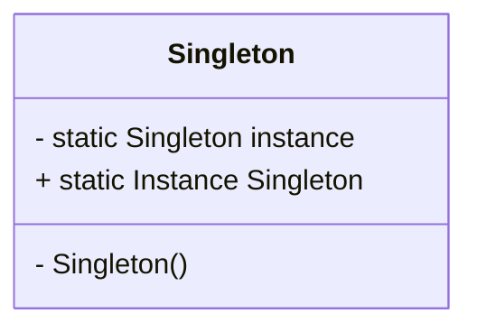
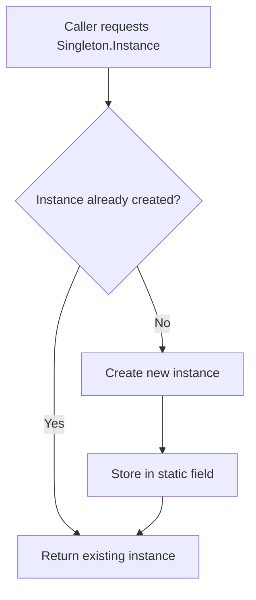
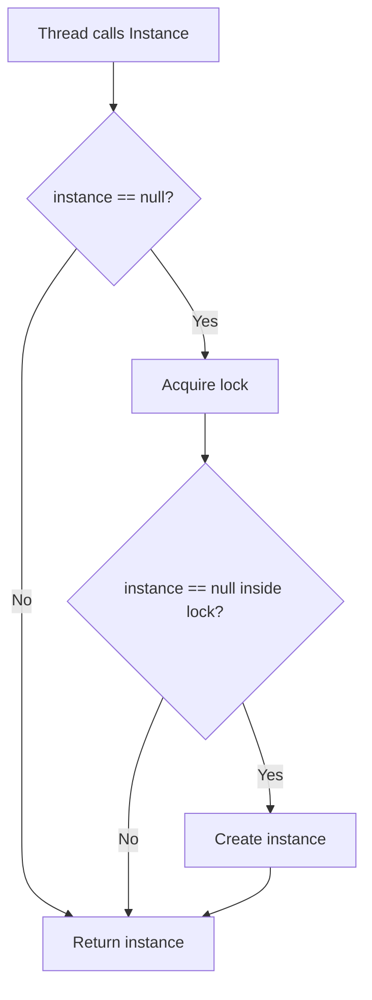

# Singleton Design Pattern in C# — Interview Preparation Notes

## 1. Topic Overview

### What is the Singleton Design Pattern?

The **Singleton Design Pattern** is a **creational design pattern** that ensures a class has **only one instance** throughout the application and provides a **global access point** to that instance.

### Simple Explanation

A Singleton is like having **one shared printer** in an office.

- Everyone can access it.
- Only one printer instance exists.
- The printer is created once and reused.

In C#, a Singleton is commonly used when exactly **one shared object** should exist, such as:

- Application configuration
- Logging service
- Cache manager
- Database connection factory
- Feature flag provider

> **Interview Tip:** A Singleton controls object creation and guarantees a single shared instance.

---

### Why Is It Important?

Singleton is important because it:

- Prevents unnecessary object creation.
- Ensures centralized access to shared resources.
- Helps maintain consistent state.
- Reduces memory usage for expensive objects.
- Provides controlled access to global services.

---

### What Problem Does It Solve?

It solves the problem of having **multiple instances** of a class when only one should exist.

Example problems:

- Multiple loggers writing inconsistently.
- Multiple configuration objects loading the same file repeatedly.
- Multiple cache managers holding different cache states.
- Multiple resource managers competing for the same resource.

---

### Where Is It Used in Real-World Projects?

Common real-world usages:

- Logging framework instance
- Application settings/configuration manager
- In-memory cache
- Dependency Injection singleton service
- Database connection pool manager
- Thread pool manager
- File system watcher
- API client with shared configuration

---

## 2. Core Concepts

## Must Know Concepts

### 2.1 Single Instance

#### Definition

A Singleton class allows only **one object instance** to be created.

#### Purpose

To ensure consistent access to shared state or shared behavior.

#### Why It Exists

Some objects should logically exist only once in an application.

#### How It Works

- Constructor is made `private`.
- A static field stores the single instance.
- A public static property exposes the instance.

#### Key Points

- The constructor must not be public.
- The instance is usually stored in a static field.
- Access is provided through a static property or method.

#### Simple Example

```csharp
public sealed class AppSettings
{
    private static readonly AppSettings instance = new AppSettings();

    private AppSettings()
    {
    }

    public static AppSettings Instance
    {
        get
        {
            return instance;
        }
    }

    public string ApplicationName { get; set; }
}
```

#### Real-World Example

A configuration manager loads settings once and shares them across the application.

---

### 2.2 Private Constructor

#### Definition

A **private constructor** prevents external classes from creating objects using `new`.

#### Purpose

To control object creation inside the Singleton class.

#### Why It Exists

Without a private constructor, anyone could create multiple instances.

#### Example

```csharp
public sealed class Logger
{
    private Logger()
    {
    }
}
```

#### Key Point

> **Interview Tip:** The private constructor is what prevents external instantiation.

---

### 2.3 Static Instance

#### Definition

A static field belongs to the class itself, not to an object.

#### Purpose

To store the single shared Singleton object.

#### Example

```csharp
private static readonly Logger instance = new Logger();
```

#### Key Point

Static members are shared across all callers within the same application domain.

---

### 2.4 Global Access Point

#### Definition

A Singleton exposes a public static property or method to access the single instance.

#### Example

```csharp
public static Logger Instance
{
    get
    {
        return instance;
    }
}
```

#### Purpose

To allow controlled access to the single instance.

---

### 2.5 Sealed Class

#### Definition

A `sealed` class cannot be inherited.

#### Purpose

To prevent subclassing from breaking the Singleton guarantee.

#### Example

```csharp
public sealed class Logger
{
}
```

#### Why It Matters

If inheritance is allowed, derived classes might create additional instances or alter behavior.

> **Interview Tip:** In C#, Singleton classes are often marked `sealed`.

---

## Good to Know Concepts

### 2.6 Eager Initialization

#### Definition

The Singleton instance is created when the class is loaded.

#### Example

```csharp
public sealed class Logger
{
    private static readonly Logger instance = new Logger();

    private Logger()
    {
    }

    public static Logger Instance
    {
        get
        {
            return instance;
        }
    }
}
```

#### Advantages

- Simple
- Thread-safe by CLR type initialization
- No locking needed

#### Disadvantages

- Instance is created even if never used.

#### When to Use

Use when the object is lightweight or definitely needed.

---

### 2.7 Lazy Initialization

#### Definition

The Singleton instance is created only when it is first requested.

#### Example

```csharp
public sealed class Logger
{
    private static Logger instance;
    private static readonly object syncLock = new object();

    private Logger()
    {
    }

    public static Logger Instance
    {
        get
        {
            if (instance == null)
            {
                lock (syncLock)
                {
                    if (instance == null)
                    {
                        instance = new Logger();
                    }
                }
            }

            return instance;
        }
    }
}
```

#### Advantages

- Saves resources if the object is never used.
- Useful for expensive initialization.

#### Disadvantages

- Requires thread-safety handling.
- More complex than eager initialization.

---

### 2.8 Thread Safety

#### Definition

Thread safety means multiple threads can access the Singleton without creating multiple instances.

#### Why It Exists

In multithreaded applications, two threads may try to create the instance at the same time.

#### Problem Example

```csharp
public sealed class Logger
{
    private static Logger instance;

    private Logger()
    {
    }

    public static Logger Instance
    {
        get
        {
            if (instance == null)
            {
                instance = new Logger();
            }

            return instance;
        }
    }
}
```

This is **not thread-safe**.

Two threads can both see `instance == null` and create two objects.

---

### 2.9 `Lazy<T>`

#### Definition

`Lazy<T>` provides built-in lazy initialization.

#### Purpose

It simplifies thread-safe lazy Singleton implementation.

#### Example

```csharp
public sealed class Logger
{
    private static readonly Lazy<Logger> lazyInstance = new Lazy<Logger>(() => new Logger());

    private Logger()
    {
    }

    public static Logger Instance
    {
        get
        {
            return lazyInstance.Value;
        }
    }
}
```

#### Key Points

- `Lazy<T>` creates the object only when `.Value` is accessed.
- By default, `Lazy<T>` is thread-safe.
- It is one of the cleanest Singleton implementations in C#.

> **Interview Tip:** In modern C#, `Lazy<T>` is usually preferred for lazy Singleton creation.

---

## Advanced Concepts

### 2.10 Double-Checked Locking

#### Definition

Double-checked locking checks if the instance is null before and after acquiring a lock.

#### Purpose

To avoid locking every time the Singleton is accessed.

#### Example

```csharp
public sealed class Logger
{
    private static volatile Logger instance;
    private static readonly object syncLock = new object();

    private Logger()
    {
    }

    public static Logger Instance
    {
        get
        {
            if (instance == null)
            {
                lock (syncLock)
                {
                    if (instance == null)
                    {
                        instance = new Logger();
                    }
                }
            }

            return instance;
        }
    }
}
```

#### Key Points

- The first check avoids unnecessary locking.
- The second check prevents duplicate creation.
- `volatile` helps prevent instruction reordering issues.

---

### 2.11 Static Constructor Singleton

#### Definition

Uses a static constructor to control type initialization.

#### Example

```csharp
public sealed class Logger
{
    private static readonly Logger instance;

    static Logger()
    {
        instance = new Logger();
    }

    private Logger()
    {
    }

    public static Logger Instance
    {
        get
        {
            return instance;
        }
    }
}
```

#### Key Points

- Static constructors are executed once per application domain.
- CLR guarantees thread safety for static constructor execution.
- Useful when initialization logic is needed.

---

### 2.12 Singleton and Dependency Injection

#### Definition

Modern applications often use Dependency Injection containers to manage Singleton lifetimes.

#### Example

```csharp
services.AddSingleton<ILoggerService, LoggerService>();
```

#### Purpose

The DI container creates one instance and reuses it.

#### Key Points

- Better testability than manual Singleton.
- Avoids hard-coded global access.
- Preferred in ASP.NET Core and modern .NET applications.

---

### 2.13 Singleton Problems

#### Common Problems

- Hidden global state
- Harder unit testing
- Tight coupling
- Concurrency issues
- Lifetime management issues
- Difficult mocking
- Can violate Single Responsibility Principle if overused

> **Interview Tip:** Singleton is useful, but overusing it can make code hard to test and maintain.

---

## 3. How It Works Internally

### Basic Architecture

A Singleton usually contains:

1. A private static field
2. A private constructor
3. A public static access property
4. Optional locking or lazy initialization



---

### Execution Flow



---

### Thread-Safe Lazy Flow



---

### What Happens Behind the Scenes?

#### Eager Singleton

```csharp
private static readonly Logger instance = new Logger();
```

- CLR loads the type.
- Static fields are initialized.
- The Singleton object is created.
- The same object is returned for every call.

#### Lazy Singleton Using `Lazy<T>`

```csharp
private static readonly Lazy<Logger> lazyInstance = new Lazy<Logger>(() => new Logger());
```

- `Lazy<T>` object is created first.
- Actual `Logger` object is not created yet.
- When `.Value` is accessed, `Logger` is created.
- Future calls return the same object.

---

### Important Implementation Details

- Static initialization in C# is thread-safe.
- Private constructors prevent external object creation.
- `Lazy<T>` handles locking internally.
- Double-checked locking must be implemented carefully.
- Singleton guarantees one instance per process or application domain, not necessarily one globally across machines.

---

## 4. Important Terminology

| Term | Meaning | Example |
| ---- | ------- | ------- |
| Singleton | Pattern that allows only one instance of a class | `Logger.Instance` |
| Instance | Object created from a class | `new Logger()` |
| Static Field | Field shared by the class itself | `private static Logger instance` |
| Private Constructor | Constructor inaccessible outside the class | `private Logger()` |
| Lazy Initialization | Create object only when needed | `Lazy<T>` |
| Eager Initialization | Create object when class loads | `static readonly instance` |
| Thread Safety | Safe access from multiple threads | `lock`, `Lazy<T>` |
| Lock | Synchronization mechanism | `lock (syncLock)` |
| Double-Checked Locking | Checks instance before and inside lock | `if (instance == null)` twice |
| Global State | Shared state accessible globally | Singleton cache |
| Dependency Injection | External object lifetime management | `AddSingleton` |
| Lifetime | Duration an object exists | Singleton lifetime |
| AppDomain | Isolation boundary in .NET Framework | One Singleton per AppDomain |
| CLR | Common Language Runtime | Handles type initialization |
| Static Constructor | Constructor for static initialization | `static Logger()` |

---

## 5. Important Comparisons

| Concept A | Concept B | Key Difference | When to Use |
| --------- | --------- | -------------- | ----------- |
| Singleton | Static Class | Singleton can implement interfaces and be passed as dependency; static class cannot | Use Singleton when object identity, interfaces, or DI matter |
| Eager Singleton | Lazy Singleton | Eager creates immediately; lazy creates on first use | Eager for lightweight objects, lazy for expensive objects |
| Singleton | Dependency Injection Singleton | Manual Singleton uses global access; DI Singleton is container-managed | Prefer DI in modern applications |
| Singleton | Factory Pattern | Singleton controls single instance; Factory controls object creation | Use Factory when multiple object types may be created |
| Singleton | Transient Service | Singleton reuses one instance; transient creates new instance each time | Use Singleton for shared stateless services |
| Singleton | Scoped Service | Singleton lives for app lifetime; scoped lives for one request/scope | Use scoped for request-specific data |
| Lock-Based Singleton | `Lazy<T>` Singleton | Lock-based is manual; `Lazy<T>` is built-in | Prefer `Lazy<T>` for simplicity |
| Singleton | Global Variable | Singleton controls creation; global variable only exposes shared data | Singleton is safer but still global-like |

---

### Singleton vs Static Class

#### Singleton Example

```csharp
public interface ILoggerService
{
    void Log(string message);
}

public sealed class LoggerService : ILoggerService
{
    private static readonly LoggerService instance = new LoggerService();

    private LoggerService()
    {
    }

    public static LoggerService Instance
    {
        get
        {
            return instance;
        }
    }

    public void Log(string message)
    {
        Console.WriteLine(message);
    }
}
```

#### Static Class Example

```csharp
public static class Logger
{
    public static void Log(string message)
    {
        Console.WriteLine(message);
    }
}
```

#### Key Difference

- Singleton can implement interfaces.
- Singleton can be passed as an object.
- Singleton can support inheritance-like polymorphism through interfaces.
- Static classes are simpler but less flexible.

---

## 6. Practical Examples

## Example 1: Logger Singleton

### 1. Problem

The application needs a single logging object used by multiple classes.

### 2. Approach

Create one shared logger instance.

### 3. Solution

```csharp
public sealed class Logger
{
    private static readonly Lazy<Logger> lazyInstance = new Lazy<Logger>(() => new Logger());

    private Logger()
    {
    }

    public static Logger Instance
    {
        get
        {
            return lazyInstance.Value;
        }
    }

    public void Log(string message)
    {
        Console.WriteLine(DateTime.Now + " - " + message);
    }
}
```

Usage:

```csharp
Logger.Instance.Log("Application started.");
```

### 4. Why This Approach?

- Only one logger exists.
- Thread-safe through `Lazy<T>`.
- Easy global access.

### 5. Alternatives

- Static logger class
- Dependency-injected logger
- External logging framework

### 6. Trade-Offs

| Advantage | Disadvantage |
| --------- | ------------ |
| Simple access | Harder to mock |
| One shared instance | Global state |
| Thread-safe with `Lazy<T>` | Can create tight coupling |

---

## Example 2: Configuration Manager

### Problem

Configuration should be loaded once and reused.

### Solution

```csharp
public sealed class ConfigurationManager
{
    private static readonly Lazy<ConfigurationManager> lazyInstance =
        new Lazy<ConfigurationManager>(() => new ConfigurationManager());

    private ConfigurationManager()
    {
        ApplicationName = "Payment API";
        TimeoutInSeconds = 30;
    }

    public static ConfigurationManager Instance
    {
        get
        {
            return lazyInstance.Value;
        }
    }

    public string ApplicationName { get; private set; }

    public int TimeoutInSeconds { get; private set; }
}
```

Usage:

```csharp
string appName = ConfigurationManager.Instance.ApplicationName;
int timeout = ConfigurationManager.Instance.TimeoutInSeconds;
```

### Why This Works

- Configuration is initialized once.
- Every caller sees the same values.
- Avoids repeated file/database reads.

---

## Example 3: Cache Manager

### Problem

Multiple services need access to a shared in-memory cache.

### Solution

```csharp
using System.Collections.Concurrent;

public sealed class CacheManager
{
    private static readonly Lazy<CacheManager> lazyInstance =
        new Lazy<CacheManager>(() => new CacheManager());

    private readonly ConcurrentDictionary<string, object> cache;

    private CacheManager()
    {
        cache = new ConcurrentDictionary<string, object>();
    }

    public static CacheManager Instance
    {
        get
        {
            return lazyInstance.Value;
        }
    }

    public void Set(string key, object value)
    {
        cache[key] = value;
    }

    public object Get(string key)
    {
        object value;
        cache.TryGetValue(key, out value);
        return value;
    }
}
```

### Why This Approach?

- One shared cache.
- `ConcurrentDictionary` supports thread-safe access.
- Avoids duplicated cached values.

### Trade-Off

Singleton cache can grow indefinitely if eviction is not handled.

---

## 7. Interview Questions

# Beginner Questions

## Question 1

### Question

What is the Singleton Design Pattern?

### Short Interview Answer

Singleton is a creational design pattern that ensures a class has only one instance and provides a global access point to it.

### Detailed Explanation

It controls object creation by making the constructor private and exposing a static instance.

### Example

```csharp
public sealed class Logger
{
    private static readonly Logger instance = new Logger();

    private Logger()
    {
    }

    public static Logger Instance
    {
        get
        {
            return instance;
        }
    }
}
```

### Possible Follow-up Question

Why should the constructor be private?

---

## Question 2

### Question

Why do we use Singleton?

### Short Interview Answer

We use Singleton when exactly one shared instance should exist, such as for logging, configuration, or caching.

### Detailed Explanation

It prevents unnecessary object creation and provides centralized access to shared resources.

### Example

A configuration manager can load settings once and expose them globally.

### Possible Follow-up Question

What are the disadvantages of Singleton?

---

## Question 3

### Question

How do you prevent multiple objects from being created?

### Short Interview Answer

By making the constructor private and exposing only one static instance.

### Detailed Explanation

External code cannot call `new`, so object creation is controlled inside the class.

### Possible Follow-up Question

Can reflection still create an instance?

---

# Intermediate Questions

## Question 4

### Question

Is this Singleton thread-safe?

```csharp
public sealed class Logger
{
    private static Logger instance;

    private Logger()
    {
    }

    public static Logger Instance
    {
        get
        {
            if (instance == null)
            {
                instance = new Logger();
            }

            return instance;
        }
    }
}
```

### Short Interview Answer

No, it is not thread-safe.

### Detailed Explanation

Two threads can enter the `if (instance == null)` block at the same time and create two instances.

### Possible Follow-up Question

How would you make it thread-safe?

---

## Question 5

### Question

What is the best way to implement Singleton in C#?

### Short Interview Answer

Using `Lazy<T>` is usually the cleanest and safest approach.

### Detailed Explanation

`Lazy<T>` provides lazy initialization and thread safety by default.

### Example

```csharp
public sealed class Logger
{
    private static readonly Lazy<Logger> lazyInstance =
        new Lazy<Logger>(() => new Logger());

    private Logger()
    {
    }

    public static Logger Instance
    {
        get
        {
            return lazyInstance.Value;
        }
    }
}
```

### Possible Follow-up Question

When would eager initialization be better?

---

## Question 6

### Question

What is double-checked locking?

### Short Interview Answer

It is a technique where the instance is checked before and after acquiring a lock to reduce locking overhead.

### Detailed Explanation

The first check avoids locking after the instance is created. The second check prevents duplicate creation when multiple threads enter at the same time.

### Possible Follow-up Question

Why might `volatile` be used?

---

# Advanced Questions

## Question 7

### Question

Does Singleton guarantee one instance across multiple servers?

### Short Interview Answer

No. Singleton guarantees one instance only within a process or application domain.

### Detailed Explanation

In distributed systems, each server or process has its own memory, so each will have its own Singleton instance.

### Example

If an application runs on three servers, each server may have one Singleton instance.

### Possible Follow-up Question

How do you manage shared state across servers?

---

## Question 8

### Question

Why can Singleton make unit testing difficult?

### Short Interview Answer

Because it introduces global state and tight coupling, making dependencies harder to replace or mock.

### Detailed Explanation

Code that directly calls `Logger.Instance` depends on a concrete global object instead of an abstraction.

### Better Approach

Use Dependency Injection with singleton lifetime.

### Possible Follow-up Question

How would you refactor a Singleton for testability?

---

## Question 9

### Question

Can Singleton be broken?

### Short Interview Answer

Yes, it can be broken by reflection, serialization, cloning, or multiple application domains if not handled carefully.

### Detailed Explanation

Reflection can access private constructors. Serialization can create a new object during deserialization unless controlled.

### Possible Follow-up Question

How can you protect Singleton from reflection?

---

## Question 10

### Question

What is the difference between Singleton and DI singleton lifetime?

### Short Interview Answer

Manual Singleton is controlled by the class itself; DI singleton is controlled by the dependency injection container.

### Detailed Explanation

DI singleton improves testability and decoupling because consumers depend on interfaces, not global static access.

### Possible Follow-up Question

Which one is preferred in modern applications?

---

## 8. Tricky Interview Questions

### Question 1

#### Why is a private constructor necessary?

A private constructor prevents external code from creating new instances using `new`.

---

### Question 2

#### Is Singleton always bad?

No. Singleton is useful when exactly one instance is required, but it becomes problematic when used as hidden global state.

---

### Question 3

#### Is a static class the same as Singleton?

No. A static class cannot implement interfaces, cannot be passed as an object, and cannot be lazily instantiated in the same object-oriented way.

---

### Question 4

#### Can Singleton cause memory leaks?

Yes. Since Singleton lives for the application lifetime, objects it references may also stay alive and not be garbage collected.

---

### Question 5

#### Is `lock` always required?

No. Eager static initialization and `Lazy<T>` are thread-safe without manually writing locks.

---

### Question 6

#### What happens if Singleton constructor throws an exception?

The instance will not be created successfully. With static initialization, the type may become unusable in that application domain because type initialization failed.

---

### Question 7

#### Why is Singleton not ideal for request-specific data?

Because Singleton is shared across all requests and users. Request-specific data should use scoped lifetime.

---

### Question 8

#### Can Singleton contain mutable state?

It can, but it must be handled carefully with synchronization because multiple threads may access it.

---

### Question 9

#### What is the hidden cost of Singleton?

Tight coupling, difficult testing, hidden dependencies, and long-lived memory usage.

---

### Question 10

#### Does Singleton improve performance?

Sometimes. It avoids repeated object creation, but if implemented with unnecessary locking or mutable shared state, it can create bottlenecks.

---

## 9. Scenario-Based Questions

## Scenario 1: Logging Service

### Scenario

An application has many services that need to write logs.

### Approach

Use a Singleton logger or a DI singleton logger.

### Why It Works

Logging is a cross-cutting concern and one shared logger is usually enough.

### Trade-Offs

- Manual Singleton is simple.
- DI singleton is more testable.

### Alternatives

- Static logger
- Third-party logging framework
- DI-based logger abstraction

### What the Interviewer Is Testing

- Understanding of shared services
- Singleton lifetime
- Testability trade-offs

---

## Scenario 2: User Session Data

### Scenario

An interviewer asks whether user session data should be stored in a Singleton.

### Correct Answer

No.

### Why?

Singleton is shared across users and requests. User-specific data should be scoped per user/session/request.

### Better Alternatives

- Session storage
- Scoped service
- Distributed cache
- Database

### What the Interviewer Is Testing

Whether you understand Singleton lifetime and shared state risks.

---

## Scenario 3: Distributed Cache

### Scenario

A system runs on five servers. You use a Singleton in-memory cache.

### Problem

Each server has its own cache instance.

### Solution

Use a distributed cache such as Redis.

### Why It Works

Redis stores shared data outside the application process.

### Trade-Offs

| Option | Trade-Off |
| ------ | --------- |
| Singleton memory cache | Fast but local to one process |
| Distributed cache | Shared but network-dependent |

### What the Interviewer Is Testing

Understanding that Singleton is not distributed.

---

## Scenario 4: Expensive API Client

### Scenario

A service creates an expensive external API client repeatedly.

### Approach

Use one shared instance or DI singleton if the client is thread-safe.

### Why It Works

Avoids repeated initialization and connection overhead.

### Caution

Only use Singleton if the API client is thread-safe.

---

## 10. Real-World Usage

### Common Use Cases

- Logging
- Configuration
- Caching
- Metrics collection
- Feature flags
- Connection factories
- Object pools
- Application-wide service registry

---

### When to Use Singleton

Use Singleton when:

- Exactly one instance is required.
- The object is expensive to create.
- Shared state is intentional.
- The object is stateless or thread-safe.
- Lifetime should match the application lifetime.

---

### When NOT to Use Singleton

Avoid Singleton when:

- Data is user-specific.
- Data is request-specific.
- The object holds mutable shared state without synchronization.
- You need easy unit testing.
- You are using it only to avoid passing dependencies.
- The object needs controlled disposal per operation/request.

---

### Design Considerations

- Is the object thread-safe?
- Does it hold mutable state?
- Does it need disposal?
- Is global access acceptable?
- Can Dependency Injection solve this better?
- Will the app run on multiple servers?
- Does it make testing harder?

---

### Scalability

Singleton scales well for stateless services but poorly for shared mutable state.

### Reliability

A faulty Singleton can affect the whole application because every caller uses the same instance.

### Maintainability

Manual Singleton can reduce maintainability if overused. DI-managed singletons are usually cleaner.

---

## 11. Performance & Optimization

### Time Complexity

| Operation | Complexity |
| --------- | ---------- |
| Access existing Singleton | `O(1)` |
| Create Singleton instance | `O(1)` generally |
| Lock acquisition | `O(1)` but may block |

---

### Space Complexity

| Implementation | Space Complexity |
| -------------- | ---------------- |
| Singleton instance | `O(1)` |
| Singleton with cache | Depends on stored data |

---

### Performance Considerations

- Eager initialization has no access-time lock overhead.
- `Lazy<T>` has minimal overhead after initialization.
- Locking on every access can reduce performance under high concurrency.
- Mutable Singleton state can create contention.
- Singleton caches can consume memory for the application lifetime.

---

### Bottlenecks

- Global lock contention
- Large memory retention
- Shared mutable state
- Long-running initialization
- Blocking I/O inside Singleton methods

---

### Optimization Techniques

- Prefer immutable or stateless Singletons.
- Use `Lazy<T>` for expensive initialization.
- Avoid locking after initialization.
- Use concurrent collections for shared data.
- Avoid storing request-specific data.
- Dispose resources properly when possible.

---

## 12. Common Mistakes

### Conceptual Mistakes

- Thinking Singleton means one instance across all servers.
- Thinking Singleton and static class are identical.
- Assuming Singleton automatically makes code thread-safe.
- Using Singleton for user-specific state.
- Using Singleton to hide poor dependency design.

---

### Implementation Mistakes

- Public constructor.
- Missing thread safety.
- Locking on public objects like `typeof(Logger)`.
- Storing mutable state without synchronization.
- Not marking class as `sealed`.
- Not handling serialization/reflection edge cases.
- Creating too many Singletons unnecessarily.

---

### Interview Mistakes

- Saying Singleton is always good.
- Saying Singleton is always bad.
- Ignoring thread safety.
- Not mentioning testability issues.
- Not explaining `Lazy<T>`.
- Not distinguishing Singleton from DI singleton.

---

## 13. Best Practices

### 1. Prefer `Lazy<T>` for Manual Singleton

It is simple, lazy, and thread-safe.

---

### 2. Use Dependency Injection When Possible

DI improves testability and avoids hard-coded global access.

---

### 3. Keep Singleton Stateless or Immutable

Mutable shared state creates concurrency bugs.

---

### 4. Make the Constructor Private

Prevents external object creation.

---

### 5. Mark the Class as `sealed`

Prevents inheritance-based misuse.

---

### 6. Avoid Singleton for Request/User Data

Singleton lives too long and is shared globally.

---

### 7. Be Careful with Resource Disposal

A Singleton may hold files, sockets, or database connections for a long time.

---

### 8. Do Not Overuse Singleton

Singleton can become hidden global state.

---

### 9. Use Thread-Safe Collections for Shared Data

Use types like `ConcurrentDictionary<TKey, TValue>` when needed.

---

### 10. Document Why Singleton Is Needed

Make the reason clear for future maintainers.

---

## 14. Interview Cheat Sheet

### Key Definition

**Singleton** ensures a class has only one instance and provides a global access point.

### Core Rules

- Constructor should be `private`.
- Instance should be static.
- Access should be controlled.
- Thread safety matters.
- Prefer `Lazy<T>` or DI singleton.
- Avoid mutable shared state.

### Best C# Implementation

```csharp
public sealed class Logger
{
    private static readonly Lazy<Logger> lazyInstance =
        new Lazy<Logger>(() => new Logger());

    private Logger()
    {
    }

    public static Logger Instance
    {
        get
        {
            return lazyInstance.Value;
        }
    }
}
```

### Important Differences

| Topic | Remember |
| ----- | -------- |
| Singleton vs Static Class | Singleton is object-oriented and can implement interfaces |
| Singleton vs DI Singleton | DI singleton is container-managed |
| Eager vs Lazy | Eager creates immediately, lazy creates on first use |
| Singleton vs Scoped | Singleton is app-wide, scoped is request-wide |

### Common Questions

- What is Singleton?
- Why private constructor?
- Is Singleton thread-safe?
- What is `Lazy<T>`?
- What are Singleton disadvantages?
- Singleton vs static class?
- Singleton vs dependency injection singleton?

### Must-Remember Points

- Singleton is one instance per process/application domain.
- It is not one instance across servers.
- It can hurt testability.
- It must be thread-safe.
- It should not store user-specific data.

---

## 15. Rapid-Fire Interview Questions

1. **What is Singleton?**  
   A pattern that ensures only one instance of a class exists.

2. **Which category of design pattern is Singleton?**  
   Creational design pattern.

3. **Why is the constructor private?**  
   To prevent external object creation.

4. **What keyword prevents inheritance?**  
   `sealed`.

5. **Is a basic lazy Singleton thread-safe?**  
   No, not without synchronization.

6. **What is the cleanest C# lazy Singleton approach?**  
   `Lazy<T>`.

7. **Does Singleton work across multiple servers?**  
   No, only within a process/application domain.

8. **Can Singleton make testing harder?**  
   Yes, because it creates global state and tight coupling.

9. **What is eager initialization?**  
   Creating the instance when the class loads.

10. **What is lazy initialization?**  
    Creating the instance only when first used.

11. **What is double-checked locking?**  
    Checking for null before and after acquiring a lock.

12. **Why use `volatile` in double-checked locking?**  
    To reduce risks from instruction reordering and visibility issues.

13. **Singleton vs static class?**  
    Singleton is an object and can implement interfaces; static class cannot.

14. **Can Singleton hold mutable state?**  
    Yes, but it must be synchronized carefully.

15. **Should user session data be stored in Singleton?**  
    No.

16. **What is a DI singleton?**  
    A single instance managed by a dependency injection container.

17. **What is a common Singleton use case?**  
    Logging or configuration.

18. **Can reflection break Singleton?**  
    Yes, if private constructors are accessed reflectively.

19. **What is the main disadvantage of Singleton?**  
    Hidden global state and reduced testability.

20. **When should Singleton be avoided?**  
    When data is request-specific, user-specific, or highly mutable.

---

## 16. Mock Interview

This section is interactive.

Answer the question below. After your answer, the interviewer should:

- Rate the answer from **1–10**
- Explain what was correct
- Explain what was missing
- Correct mistakes
- Provide an ideal answer
- Ask the next question

### Question 1 of 10

What is the Singleton Design Pattern, and why would you use it?

> Reply with your answer, and the mock interview can continue one question at a time.

---

## 17. Final Interview Revision

### 20–30 Most Important Things to Remember

1. Singleton is a **creational design pattern**.
2. It ensures **only one instance** of a class exists.
3. It provides a **global access point**.
4. The constructor should be **private**.
5. The instance is usually stored in a **static field**.
6. The class is often marked **sealed**.
7. Singleton can be **eager** or **lazy**.
8. Eager initialization is simple and thread-safe.
9. Lazy initialization creates the object only when needed.
10. Basic lazy Singleton is **not thread-safe**.
11. `Lazy<T>` is the preferred C# lazy Singleton approach.
12. Static constructors are executed once and are thread-safe.
13. Double-checked locking reduces lock overhead.
14. Singleton is usually one instance per **process/application domain**.
15. Singleton is not shared automatically across servers.
16. Singleton can introduce hidden global state.
17. Singleton can make unit testing difficult.
18. Dependency Injection singleton is often better than manual Singleton.
19. Avoid Singleton for user-specific or request-specific data.
20. Mutable Singleton state requires synchronization.
21. Singleton and static class are not the same.
22. Singleton can implement interfaces; static classes cannot.
23. Singleton should not be used just to avoid passing dependencies.
24. Singleton can cause memory retention if it holds references too long.
25. Reflection and serialization can break Singleton if not handled.
26. Prefer stateless or immutable Singletons.
27. Use concurrent collections for shared mutable data.
28. In distributed systems, use external shared storage for shared state.
29. Always explain trade-offs in interviews.
30. The best interview answer mentions **single instance, private constructor, static access, thread safety, and testability trade-offs**.

---

# Final One-Line Interview Answer

A **Singleton** is a creational design pattern that ensures a class has only one instance and provides a global access point to it; in C#, it is commonly implemented using a private constructor and a static instance, preferably with `Lazy<T>` or Dependency Injection for thread safety and maintainability.