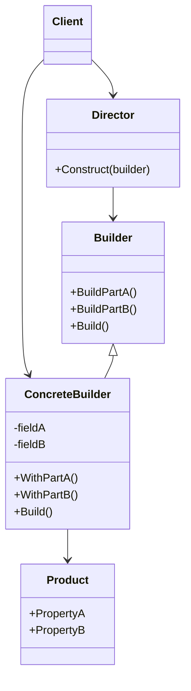
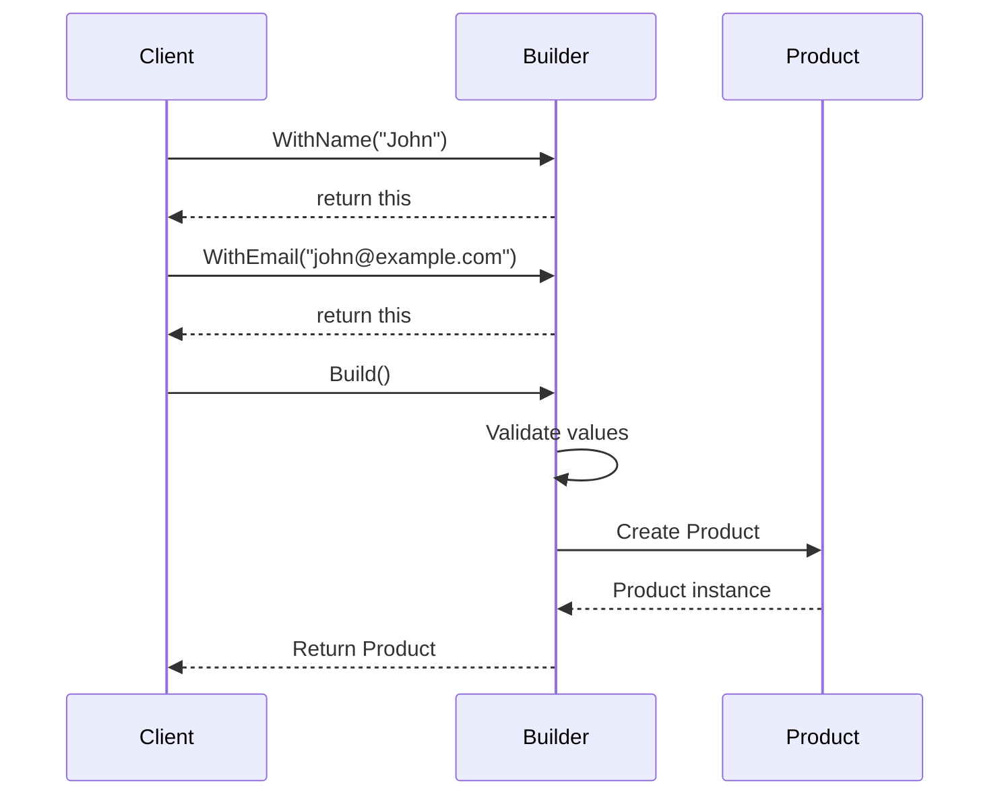

# Builder Design Pattern in C# — Interview Preparation Notes

## 1. Topic Overview

### What is the Builder Design Pattern?

The **Builder Design Pattern** is a **creational design pattern** used to construct complex objects step by step.

Instead of creating an object using a large constructor with many parameters, the Builder pattern separates the construction logic from the final object.

### Simple Explanation

Imagine ordering a burger:

- You choose bread.
- You choose patty.
- You choose cheese.
- You choose sauces.
- You choose extras.

The final burger is created step by step. You do not pass everything into one huge constructor.

That is the Builder pattern.

### Why Is It Important?

The Builder pattern is important because it helps create objects that:

- Have many optional fields.
- Require step-by-step construction.
- Need validation before creation.
- Should be immutable after creation.
- Have multiple valid construction variations.

### What Problem Does It Solve?

It solves problems caused by:

- Large constructors.
- Too many optional parameters.
- Confusing object creation.
- Constructor overload explosion.
- Invalid partially constructed objects.
- Poor readability.

Example of a problematic constructor:

```csharp
var report = new Report("Sales", true, false, "PDF", true, null, 10, "Admin");
```

It is hard to understand what each argument means.

With Builder:

```csharp
var report = new ReportBuilder()
    .WithTitle("Sales")
    .WithFormat("PDF")
    .IncludeSummary()
    .CreatedBy("Admin")
    .Build();
```

This is much clearer.

### Where Is It Used in Real-World Projects?

Common usage areas:

- Creating configuration objects.
- Building HTTP requests.
- Creating test data.
- Building domain entities.
- Creating SQL queries.
- Creating reports.
- Building UI components.
- Object construction in fluent APIs.
- Immutable object creation.

Examples in .NET:

- `StringBuilder`
- `HostBuilder`
- `WebApplicationBuilder`
- `ConfigurationBuilder`
- `DbContextOptionsBuilder`
- `HttpRequestMessage` builders in custom APIs

---

## 2. Core Concepts

## Must Know Concepts

### 2.1 Builder

#### Definition

A **Builder** is an object responsible for constructing another object step by step.

#### Purpose

To hide complex construction logic behind readable methods.

#### Why It Exists

Because constructors become difficult to manage when objects have many parameters.

#### How It Works

The builder stores temporary construction values and exposes methods to set those values.

Finally, `Build()` creates the target object.

#### Key Points

- Builder usually has methods like `WithName()`, `WithAge()`, `AddItem()`.
- It often returns `this` to support fluent chaining.
- The final method is usually called `Build()`.
- It improves readability and maintainability.

#### Simple Example

```csharp
public class User
{
    public string Name { get; }
    public string Email { get; }

    public User(string name, string email)
    {
        Name = name;
        Email = email;
    }
}

public class UserBuilder
{
    private string name;
    private string email;

    public UserBuilder WithName(string name)
    {
        this.name = name;
        return this;
    }

    public UserBuilder WithEmail(string email)
    {
        this.email = email;
        return this;
    }

    public User Build()
    {
        return new User(name, email);
    }
}
```

Usage:

```csharp
var user = new UserBuilder()
    .WithName("John")
    .WithEmail("john@example.com")
    .Build();
```

#### Real-World Example

Building an API request object:

```csharp
var request = new ApiRequestBuilder()
    .WithUrl("https://api.example.com/users")
    .WithMethod("POST")
    .WithHeader("Authorization", "Bearer token")
    .WithBody(userJson)
    .Build();
```

---

### 2.2 Product

#### Definition

The **Product** is the final object created by the builder.

#### Purpose

It represents the completed result.

#### How It Works

The builder collects required data and then creates the product in `Build()`.

#### Key Points

- The product may be mutable or immutable.
- Immutable products are common with Builder.
- The product should not know all builder logic unless using a nested builder.

#### Example

```csharp
public class Invoice
{
    public string CustomerName { get; }
    public decimal Amount { get; }

    public Invoice(string customerName, decimal amount)
    {
        CustomerName = customerName;
        Amount = amount;
    }
}
```

Here, `Invoice` is the product.

---

### 2.3 Fluent Interface

#### Definition

A **Fluent Interface** allows method chaining by returning the current object.

#### Purpose

To make object construction readable like natural language.

#### Example

```csharp
var invoice = new InvoiceBuilder()
    .ForCustomer("ABC Corp")
    .WithAmount(5000)
    .Build();
```

#### Key Points

- Fluent interface is not the same as Builder.
- Builder often uses fluent interface.
- Fluent API improves readability.

---

### 2.4 `Build()` Method

#### Definition

The `Build()` method creates and returns the final object.

#### Purpose

To centralize object creation and validation.

#### Example

```csharp
public Invoice Build()
{
    if (string.IsNullOrWhiteSpace(customerName))
    {
        throw new InvalidOperationException("Customer name is required.");
    }

    return new Invoice(customerName, amount);
}
```

#### Key Points

- Performs final validation.
- Returns the completed product.
- Should not return a partially invalid object.

---

## Good to Know Concepts

### 2.5 Director

#### Definition

A **Director** controls the order of construction steps.

#### Purpose

To reuse common construction sequences.

#### Why It Exists

Sometimes the same object can be built in multiple predefined ways.

#### Example

```csharp
public class ReportDirector
{
    public Report BuildMonthlyReport(ReportBuilder builder)
    {
        return builder
            .WithTitle("Monthly Report")
            .WithFormat("PDF")
            .IncludeSummary()
            .Build();
    }
}
```

#### Key Points

- Director is optional.
- Modern C# code often skips Director.
- Useful when construction steps are standardized.

---

### 2.6 Required vs Optional Fields

#### Definition

Required fields must exist before the object is built. Optional fields may have defaults.

#### Example

```csharp
public class EmailBuilder
{
    private readonly string to;
    private string subject = string.Empty;
    private string body = string.Empty;

    public EmailBuilder(string to)
    {
        this.to = to;
    }

    public EmailBuilder WithSubject(string subject)
    {
        this.subject = subject;
        return this;
    }

    public EmailBuilder WithBody(string body)
    {
        this.body = body;
        return this;
    }

    public Email Build()
    {
        return new Email(to, subject, body);
    }
}
```

#### Key Points

- Put required values in the builder constructor.
- Use builder methods for optional values.
- Validate required values before creating the product.

---

### 2.7 Immutable Objects with Builder

#### Definition

An immutable object cannot be changed after it is created.

#### Purpose

To improve safety, predictability, and thread-safety.

#### Example

```csharp
public class PaymentRequest
{
    public string AccountNumber { get; }
    public decimal Amount { get; }
    public string Currency { get; }

    public PaymentRequest(string accountNumber, decimal amount, string currency)
    {
        AccountNumber = accountNumber;
        Amount = amount;
        Currency = currency;
    }
}
```

Builder:

```csharp
public class PaymentRequestBuilder
{
    private string accountNumber;
    private decimal amount;
    private string currency = "USD";

    public PaymentRequestBuilder WithAccountNumber(string accountNumber)
    {
        this.accountNumber = accountNumber;
        return this;
    }

    public PaymentRequestBuilder WithAmount(decimal amount)
    {
        this.amount = amount;
        return this;
    }

    public PaymentRequestBuilder WithCurrency(string currency)
    {
        this.currency = currency;
        return this;
    }

    public PaymentRequest Build()
    {
        if (string.IsNullOrWhiteSpace(accountNumber))
        {
            throw new InvalidOperationException("Account number is required.");
        }

        if (amount <= 0)
        {
            throw new InvalidOperationException("Amount must be greater than zero.");
        }

        return new PaymentRequest(accountNumber, amount, currency);
    }
}
```

---

## Advanced Concepts

### 2.8 Step Builder Pattern

#### Definition

The **Step Builder Pattern** forces construction steps to happen in a specific order using interfaces.

#### Purpose

To prevent invalid object creation at compile time.

#### Example

```csharp
public interface IAccountStep
{
    IAmountStep WithAccountNumber(string accountNumber);
}

public interface IAmountStep
{
    IBuildStep WithAmount(decimal amount);
}

public interface IBuildStep
{
    PaymentRequest Build();
}

public class PaymentRequestStepBuilder : IAccountStep, IAmountStep, IBuildStep
{
    private string accountNumber;
    private decimal amount;

    private PaymentRequestStepBuilder()
    {
    }

    public static IAccountStep Create()
    {
        return new PaymentRequestStepBuilder();
    }

    public IAmountStep WithAccountNumber(string accountNumber)
    {
        this.accountNumber = accountNumber;
        return this;
    }

    public IBuildStep WithAmount(decimal amount)
    {
        this.amount = amount;
        return this;
    }

    public PaymentRequest Build()
    {
        return new PaymentRequest(accountNumber, amount, "USD");
    }
}
```

Usage:

```csharp
var request = PaymentRequestStepBuilder
    .Create()
    .WithAccountNumber("123456")
    .WithAmount(100)
    .Build();
```

#### Key Point

The user cannot call `Build()` before required steps are completed.

---

### 2.9 Nested Builder

#### Definition

A builder class can be nested inside the product class.

#### Purpose

To keep the builder close to the object it creates.

#### Example

```csharp
public class Customer
{
    public string Name { get; }
    public string Email { get; }

    private Customer(string name, string email)
    {
        Name = name;
        Email = email;
    }

    public class Builder
    {
        private string name;
        private string email;

        public Builder WithName(string name)
        {
            this.name = name;
            return this;
        }

        public Builder WithEmail(string email)
        {
            this.email = email;
            return this;
        }

        public Customer Build()
        {
            return new Customer(name, email);
        }
    }
}
```

Usage:

```csharp
var customer = new Customer.Builder()
    .WithName("Alice")
    .WithEmail("alice@example.com")
    .Build();
```

---

## 3. How It Works Internally

### Architecture

The Builder pattern usually contains these parts:

1. **Product** — final object.
2. **Builder** — constructs the product.
3. **Concrete Builder** — actual builder implementation.
4. **Director** — optional class that controls construction sequence.
5. **Client** — code that uses the builder.

### Mermaid Class Diagram



### Execution Flow



### Step-by-Step Internal Working

1. Client creates the builder.
2. Client calls builder methods to set values.
3. Builder stores temporary state.
4. Client calls `Build()`.
5. Builder validates the state.
6. Builder creates the final object.
7. Builder returns the completed object.

### Behind the Scenes

The builder is usually just a wrapper around constructor parameters.

Instead of this:

```csharp
var user = new User("John", "john@example.com", true, "Admin", DateTime.Now);
```

The builder internally stores values:

```csharp
private string name;
private string email;
private bool isActive;
private string role;
private DateTime createdDate;
```

Then creates the object:

```csharp
return new User(name, email, isActive, role, createdDate);
```

---

## 4. Important Terminology

| Term | Meaning | Example |
| ---- | ------- | ------- |
| Builder | Object that constructs another object step by step | `UserBuilder` |
| Product | Final object created by builder | `User`, `Invoice`, `Report` |
| Fluent Interface | Method chaining style | `.WithName().WithEmail().Build()` |
| Director | Optional class that defines construction sequence | `ReportDirector` |
| Concrete Builder | Actual implementation of builder | `PdfReportBuilder` |
| Build Method | Final method that returns product | `Build()` |
| Immutable Object | Object whose state cannot change after creation | Read-only properties |
| Step Builder | Builder that enforces construction order | `INameStep`, `IEmailStep` |
| Telescoping Constructor | Constructor with many overloads | `new User(a, b, c, d)` |
| Object Initialization | Setting properties after construction | `new User { Name = "John" }` |
| Optional Parameter | Constructor parameter with default value | `bool isActive = true` |
| Validation | Checking object state before creation | Throw exception in `Build()` |

---

## 5. Important Comparisons

| Concept A | Concept B | Key Difference | When to Use |
| --------- | --------- | -------------- | ----------- |
| Builder | Constructor | Builder is readable for complex objects; constructor is simple | Use constructor for simple required values |
| Builder | Object Initializer | Builder can validate and enforce rules; object initializer simply assigns properties | Use builder for complex validation |
| Builder | Factory Method | Factory chooses which object to create; Builder controls how to create it step by step | Use factory for object selection |
| Builder | Abstract Factory | Abstract Factory creates families of objects; Builder creates one complex object | Use Abstract Factory for related object families |
| Builder | Fluent Interface | Fluent interface is syntax style; Builder is a design pattern | Builder may use fluent interface |
| Builder | Prototype | Prototype clones an existing object; Builder creates from steps | Use Prototype when copying existing objects |
| Builder | Optional Parameters | Optional parameters work for simple cases; Builder scales better | Use Builder when there are many options |

### Builder vs Factory

| Builder | Factory |
| ------- | ------- |
| Focuses on construction steps | Focuses on object creation decision |
| Used for complex objects | Used when object type varies |
| Often uses `Build()` | Often uses `Create()` |
| May expose many configuration methods | Usually hides object selection logic |

Example:

```csharp
// Factory
var paymentProcessor = PaymentProcessorFactory.Create("CreditCard");

// Builder
var paymentRequest = new PaymentRequestBuilder()
    .WithAccountNumber("123")
    .WithAmount(100)
    .Build();
```

---

## 6. Practical Examples

## Example 1: Building an Email Message

### Problem

An email message may have:

- To address
- CC
- BCC
- Subject
- Body
- Attachments
- Priority

Using a constructor would become unreadable.

### Approach

Use a builder to configure only the needed parts.

### Solution

```csharp
using System.Collections.Generic;

public class EmailMessage
{
    public string To { get; }
    public string Subject { get; }
    public string Body { get; }
    public List<string> Cc { get; }
    public List<string> Attachments { get; }

    public EmailMessage(string to, string subject, string body, List<string> cc, List<string> attachments)
    {
        To = to;
        Subject = subject;
        Body = body;
        Cc = cc;
        Attachments = attachments;
    }
}

public class EmailMessageBuilder
{
    private string to;
    private string subject = string.Empty;
    private string body = string.Empty;
    private readonly List<string> cc = new List<string>();
    private readonly List<string> attachments = new List<string>();

    public EmailMessageBuilder To(string to)
    {
        this.to = to;
        return this;
    }

    public EmailMessageBuilder WithSubject(string subject)
    {
        this.subject = subject;
        return this;
    }

    public EmailMessageBuilder WithBody(string body)
    {
        this.body = body;
        return this;
    }

    public EmailMessageBuilder AddCc(string email)
    {
        cc.Add(email);
        return this;
    }

    public EmailMessageBuilder AddAttachment(string filePath)
    {
        attachments.Add(filePath);
        return this;
    }

    public EmailMessage Build()
    {
        if (string.IsNullOrWhiteSpace(to))
        {
            throw new System.InvalidOperationException("Recipient is required.");
        }

        return new EmailMessage(
            to,
            subject,
            body,
            new List<string>(cc),
            new List<string>(attachments));
    }
}
```

Usage:

```csharp
var email = new EmailMessageBuilder()
    .To("user@example.com")
    .WithSubject("Invoice")
    .WithBody("Please find the invoice attached.")
    .AddCc("manager@example.com")
    .AddAttachment("invoice.pdf")
    .Build();
```

### Why This Approach Was Chosen

- Better readability.
- Avoids long constructors.
- Supports optional fields.
- Allows validation before object creation.

### Alternatives

- Constructor with optional parameters.
- Object initializer.
- Factory method.

### Trade-Offs

- More code.
- Additional builder class.
- May be overkill for simple objects.

---

## Example 2: Building a Report

### Problem

A report can be generated in multiple formats with different options.

### Solution

```csharp
public class Report
{
    public string Title { get; }
    public string Format { get; }
    public bool IncludeSummary { get; }
    public bool IncludeCharts { get; }

    public Report(string title, string format, bool includeSummary, bool includeCharts)
    {
        Title = title;
        Format = format;
        IncludeSummary = includeSummary;
        IncludeCharts = includeCharts;
    }
}

public class ReportBuilder
{
    private string title;
    private string format = "PDF";
    private bool includeSummary;
    private bool includeCharts;

    public ReportBuilder WithTitle(string title)
    {
        this.title = title;
        return this;
    }

    public ReportBuilder WithFormat(string format)
    {
        this.format = format;
        return this;
    }

    public ReportBuilder IncludeSummary()
    {
        includeSummary = true;
        return this;
    }

    public ReportBuilder IncludeCharts()
    {
        includeCharts = true;
        return this;
    }

    public Report Build()
    {
        if (string.IsNullOrWhiteSpace(title))
        {
            throw new System.InvalidOperationException("Report title is required.");
        }

        return new Report(title, format, includeSummary, includeCharts);
    }
}
```

Usage:

```csharp
var report = new ReportBuilder()
    .WithTitle("Monthly Sales")
    .WithFormat("PDF")
    .IncludeSummary()
    .IncludeCharts()
    .Build();
```

---

## 7. Interview Questions

## Beginner Questions

### Question 1

**Question:** What is the Builder Design Pattern?

**Short Interview Answer:**  
The Builder pattern is a creational pattern used to construct complex objects step by step, separating construction logic from the final object.

**Detailed Explanation:**  
It is useful when an object has many optional parameters or requires validation before creation. Instead of using long constructors, the builder provides readable methods and creates the object using `Build()`.

**Example:**

```csharp
var user = new UserBuilder()
    .WithName("John")
    .WithEmail("john@example.com")
    .Build();
```

**Possible Follow-up Question:**  
Why not just use a constructor?

---

### Question 2

**Question:** What problem does the Builder pattern solve?

**Short Interview Answer:**  
It solves the problem of complex object creation, especially when constructors have many parameters.

**Detailed Explanation:**  
Large constructors are hard to read, easy to misuse, and difficult to maintain. Builder improves readability and allows validation.

**Possible Follow-up Question:**  
What is constructor telescoping?

---

### Question 3

**Question:** What is the role of the `Build()` method?

**Short Interview Answer:**  
`Build()` creates and returns the final object.

**Detailed Explanation:**  
It usually validates the builder state and then passes collected values to the product constructor.

**Possible Follow-up Question:**  
Should validation happen in builder or product?

---

## Intermediate Questions

### Question 4

**Question:** When should you use the Builder pattern?

**Short Interview Answer:**  
Use it when creating complex objects with many optional parameters, validation rules, or step-by-step construction.

**Detailed Explanation:**  
It is useful for configuration objects, request objects, reports, test data, and immutable domain objects.

**Possible Follow-up Question:**  
When should you avoid it?

---

### Question 5

**Question:** Builder vs Factory — what is the difference?

**Short Interview Answer:**  
Factory focuses on choosing which object to create. Builder focuses on how to construct a complex object step by step.

**Detailed Explanation:**  
A factory may return different subclasses. A builder usually creates one type of object but with different configurations.

**Example:**

```csharp
var processor = PaymentProcessorFactory.Create("Card");

var request = new PaymentRequestBuilder()
    .WithAmount(100)
    .WithCurrency("USD")
    .Build();
```

**Possible Follow-up Question:**  
Can Factory and Builder be used together?

---

### Question 6

**Question:** How does Builder help with immutable objects?

**Short Interview Answer:**  
The builder collects values mutably, then creates an immutable object with read-only properties.

**Detailed Explanation:**  
This gives flexible construction while keeping the final object safe from modification.

**Possible Follow-up Question:**  
Is Builder itself immutable?

---

## Advanced Questions

### Question 7

**Question:** What is the Step Builder pattern?

**Short Interview Answer:**  
Step Builder uses interfaces to enforce object construction order at compile time.

**Detailed Explanation:**  
Each method returns the next required interface, preventing the caller from skipping mandatory steps.

**Possible Follow-up Question:**  
What is the downside of Step Builder?

---

### Question 8

**Question:** Is Builder pattern thread-safe?

**Short Interview Answer:**  
Usually no. Builders are mutable and should not be shared across threads.

**Detailed Explanation:**  
Because builders store temporary state, concurrent modifications can cause incorrect results.

**Possible Follow-up Question:**  
How can you make it thread-safe?

---

### Question 9

**Question:** What are the disadvantages of Builder?

**Short Interview Answer:**  
It adds extra code, extra classes, and can be overkill for simple objects.

**Detailed Explanation:**  
For objects with only a few required fields, constructors or object initializers may be simpler.

**Possible Follow-up Question:**  
How do you decide if Builder is worth using?

---

## 8. Tricky Interview Questions

### Question: Is Builder always better than constructors?

**Answer:**  
No. Constructors are better for simple objects with a small number of required parameters. Builder is useful when construction becomes complex.

---

### Question: Can Builder create invalid objects?

**Answer:**  
Yes, if validation is missing in `Build()`. A good builder should validate required fields and business rules before returning the product.

---

### Question: Should the product class expose public setters?

**Answer:**  
Usually no if the goal is immutability. Prefer read-only properties and constructor initialization.

---

### Question: What happens if `Build()` is called multiple times?

**Answer:**  
It depends on implementation. It may create multiple equivalent objects using the same builder state. This is acceptable if intentional.

---

### Question: Can Builder be used with dependency injection?

**Answer:**  
Yes, but carefully. Builders that require services can be registered in DI. However, avoid turning builders into service locators.

---

### Question: Is `StringBuilder` an example of the Builder pattern?

**Answer:**  
Conceptually yes. It builds a string step by step, although it is not a textbook GoF Builder with Director and Product classes.

---

### Question: Is fluent chaining required for Builder?

**Answer:**  
No. Fluent chaining is common but not required. Builder can work with regular setter-like methods.

---

### Question: Can Builder and Factory be combined?

**Answer:**  
Yes. A factory can create a suitable builder, or a builder can use factories internally to create parts.

---

## 9. Scenario-Based Questions

### Scenario 1: Complex Payment Request

#### Scenario

You need to build a payment request with required account number and amount, plus optional currency, metadata, and callback URL.

#### Approach

Use Builder with required validation.

#### Why It Works

The builder makes the construction readable and prevents missing required data.

#### Trade-Offs

More code, but better safety and clarity.

#### Alternative

Use constructor with optional parameters.

#### What Interviewer Is Testing

- Understanding of optional vs required data.
- Validation placement.
- Readability.

---

### Scenario 2: Test Data Creation

#### Scenario

Unit tests need many variations of a `Customer` object.

#### Approach

Use a test data builder.

```csharp
var customer = new CustomerBuilder()
    .WithName("Test Customer")
    .WithEmail("test@example.com")
    .Build();
```

#### Why It Works

It reduces duplicated test setup and improves readability.

#### Trade-Offs

Test builders must be maintained as models evolve.

#### What Interviewer Is Testing

- Practical usage of Builder beyond production code.
- Test maintainability.

---

### Scenario 3: Enforcing Construction Order

#### Scenario

An object must always be created with `AccountNumber` first, then `Amount`, then optional values.

#### Approach

Use Step Builder.

#### Why It Works

Compile-time interfaces prevent invalid method order.

#### Trade-Offs

More interfaces and more complexity.

#### What Interviewer Is Testing

- Advanced Builder knowledge.
- Compile-time safety.

---

## 10. Real-World Usage

### Common Use Cases

- API request construction.
- Report generation.
- Configuration setup.
- Email/message creation.
- Test object creation.
- Complex domain objects.
- Query builders.
- UI component builders.

### When to Use Builder

Use Builder when:

- Object has many optional fields.
- Object construction is complex.
- Readability matters.
- Validation is needed.
- Immutable objects are preferred.
- Multiple object variations exist.

### When NOT to Use Builder

Avoid Builder when:

- Object has only 2–3 simple fields.
- Constructor is already clear.
- No validation is needed.
- It creates unnecessary boilerplate.
- Object is just a data transfer object with simple initialization.

### Design Considerations

- Keep builder focused.
- Validate in `Build()`.
- Avoid business logic overload.
- Prefer immutable products.
- Avoid sharing builder instances across threads.
- Use clear method names.

### Scalability

Builder improves code scalability by making future optional parameters easier to add without breaking existing calls.

### Reliability

Validation in `Build()` improves reliability by preventing invalid objects.

### Maintainability

Builder improves maintainability by centralizing construction logic.

---

## 11. Performance & Optimization

### Time Complexity

Usually:

```text
O(n)
```

Where `n` is the number of fields, child objects, or collection items being built.

For simple objects, it is effectively:

```text
O(1)
```

### Space Complexity

Usually:

```text
O(n)
```

Because builder stores temporary state.

### Performance Considerations

- Builder creates an additional object.
- Fluent method calls have minimal overhead.
- Copying collections can add cost.
- Validation may add processing.
- Usually not a performance problem.

### Bottlenecks

Potential bottlenecks:

- Large collection copying.
- Expensive validation.
- Reusing mutable builders incorrectly.
- Creating builders in very tight loops.

### Optimization Techniques

- Use constructors for simple high-performance paths.
- Avoid unnecessary defensive copies if safe.
- Reuse immutable defaults.
- Keep validation efficient.
- Avoid reflection-heavy builders unless necessary.

> Interview Tip: Builder is usually chosen for readability and maintainability, not raw performance.

---

## 12. Common Mistakes

### Conceptual Mistakes

- Thinking Builder is only method chaining.
- Confusing Builder with Factory.
- Using Builder for every object.
- Ignoring validation.
- Making the product mutable unnecessarily.

### Implementation Mistakes

- Forgetting to validate required fields.
- Returning internal mutable collections directly.
- Sharing one builder instance across threads.
- Making `Build()` return null.
- Putting unrelated business workflows inside builder.
- Creating a builder with unclear method names.

### Interview Mistakes

- Not explaining the problem Builder solves.
- Saying Builder is always better than constructors.
- Not mentioning trade-offs.
- Not knowing Builder vs Factory.
- Not discussing immutability.

---

## 13. Best Practices

### 1. Use Builder Only for Complex Object Creation

Builder adds code. Use it only when it improves clarity.

### 2. Validate in `Build()`

This prevents invalid product objects.

### 3. Prefer Immutable Products

Use read-only properties to make final objects safer.

### 4. Use Clear Method Names

Prefer:

```csharp
WithAmount(100)
```

over:

```csharp
SetAmount(100)
```

### 5. Do Not Expose Builder Internals

Keep builder fields private.

### 6. Avoid Reusing Builders Accidentally

A builder has mutable state. Reuse can cause bugs.

### 7. Use Step Builder Only When Needed

Step Builder improves safety but increases complexity.

### 8. Copy Mutable Collections

Avoid exposing internal builder collections directly.

### 9. Keep Builder Focused

The builder should construct objects, not execute business processes.

### 10. Make Required Fields Obvious

Put required fields in the builder constructor or enforce them through Step Builder.

---

## 14. Interview Cheat Sheet

### Key Definition

The **Builder Design Pattern** is a creational pattern that constructs complex objects step by step and separates construction logic from representation.

### Core Concepts

- Builder
- Product
- Fluent interface
- `Build()` method
- Director
- Immutable object
- Step Builder

### Must-Remember Differences

| Topic | Key Point |
| ----- | --------- |
| Builder vs Constructor | Builder is better for many optional fields |
| Builder vs Factory | Factory decides what to create; Builder controls how to create |
| Builder vs Object Initializer | Builder can validate and enforce rules |
| Fluent API vs Builder | Fluent API is style; Builder is pattern |

### Common Questions

- What problem does Builder solve?
- When should Builder be used?
- What is the role of `Build()`?
- Builder vs Factory?
- What are Builder disadvantages?
- How does Builder support immutability?

### Must-Remember Points

- Builder is useful for complex construction.
- It improves readability.
- It helps avoid telescoping constructors.
- It often supports immutable objects.
- Validation should happen before returning the product.
- It can be overkill for simple objects.
- Builders are usually mutable and not thread-safe.

---

## 15. Rapid-Fire Interview Questions

### 1. What type of design pattern is Builder?

**Answer:** Creational design pattern.

### 2. What does Builder create?

**Answer:** Complex objects step by step.

### 3. What is the final method usually called?

**Answer:** `Build()`.

### 4. What problem does Builder solve?

**Answer:** Complex and unreadable object construction.

### 5. What is a telescoping constructor?

**Answer:** Multiple overloaded constructors with increasing parameters.

### 6. Is fluent chaining mandatory?

**Answer:** No, but it is commonly used.

### 7. Is Builder good for immutable objects?

**Answer:** Yes, it allows flexible construction and immutable final objects.

### 8. Is Builder thread-safe by default?

**Answer:** No, because builders usually store mutable state.

### 9. What is the Product?

**Answer:** The final object created by the builder.

### 10. What is the Director?

**Answer:** Optional class that controls the construction sequence.

### 11. Builder vs Factory?

**Answer:** Builder controls construction steps; Factory chooses object type.

### 12. When should Builder be avoided?

**Answer:** For simple objects with few parameters.

### 13. Where should validation happen?

**Answer:** Usually in `Build()` and sometimes also inside the product constructor.

### 14. Can `Build()` be called multiple times?

**Answer:** Yes, if the implementation supports it.

### 15. What is Step Builder?

**Answer:** A builder that enforces construction order using interfaces.

### 16. What is a fluent interface?

**Answer:** A chaining style where methods return `this`.

### 17. Does Builder improve performance?

**Answer:** Not usually; it improves readability and maintainability.

### 18. Can Builder be used in tests?

**Answer:** Yes, test data builders are common.

### 19. Can Builder and Factory be combined?

**Answer:** Yes.

### 20. What is the main disadvantage of Builder?

**Answer:** Extra code and complexity.

---

## 16. Mock Interview

This section is interactive.

Answer the question below. After your answer, the interviewer should:

1. Rate the answer from **1–10**.
2. Explain what was correct.
3. Explain what was missing.
4. Correct mistakes.
5. Provide an ideal answer.
6. Ask the next question.

### Mock Interview Question 1

**What is the Builder Design Pattern, and what problem does it solve?**

> Reply with your answer, and the mock interview can continue one question at a time.

---

## 17. Final Interview Revision

### 20–30 Most Important Things to Remember

1. Builder is a **creational design pattern**.
2. It constructs complex objects **step by step**.
3. It separates object construction from object representation.
4. It solves the problem of long, confusing constructors.
5. It helps avoid **telescoping constructors**.
6. The final object is called the **Product**.
7. The builder usually exposes a `Build()` method.
8. Builder often uses a **fluent interface**.
9. Fluent interface and Builder are related but not the same.
10. Builder is useful when there are many optional parameters.
11. Builder is useful when validation is required before object creation.
12. Builder works well with immutable objects.
13. Builders are usually mutable.
14. Builders are usually not thread-safe.
15. Builder is not always better than constructors.
16. For simple objects, constructors are usually better.
17. Builder and Factory solve different problems.
18. Factory decides **what** object to create.
19. Builder controls **how** an object is created.
20. The Director is optional in modern C# usage.
21. Step Builder enforces construction order at compile time.
22. Step Builder improves safety but adds complexity.
23. Validation should usually happen in `Build()`.
24. Avoid exposing mutable internal collections.
25. Do not put unrelated business logic in a builder.
26. Builder improves readability and maintainability.
27. Builder can be overkill for DTOs or simple models.
28. Test Data Builder is useful in unit testing.
29. Real-world .NET examples include `StringBuilder`, `ConfigurationBuilder`, and `HostBuilder`.
30. In interviews, always explain the problem, the solution, trade-offs, and when not to use it.