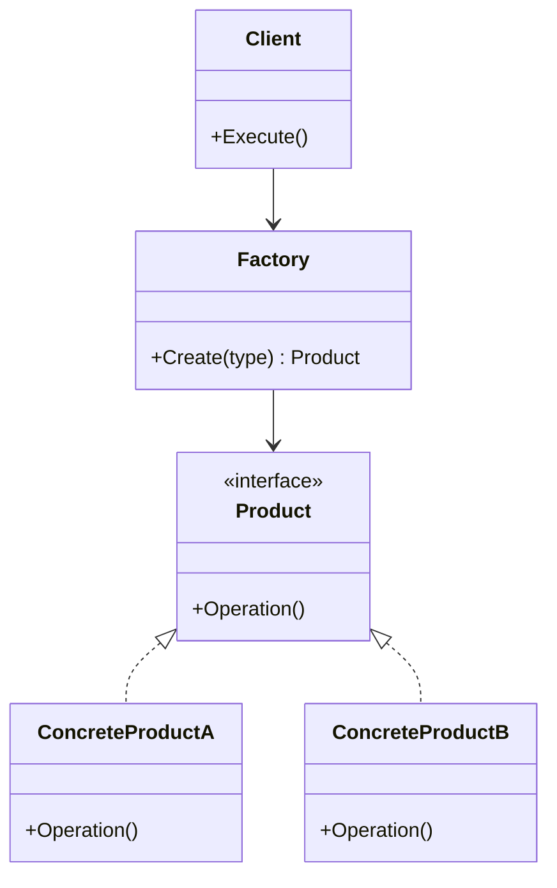
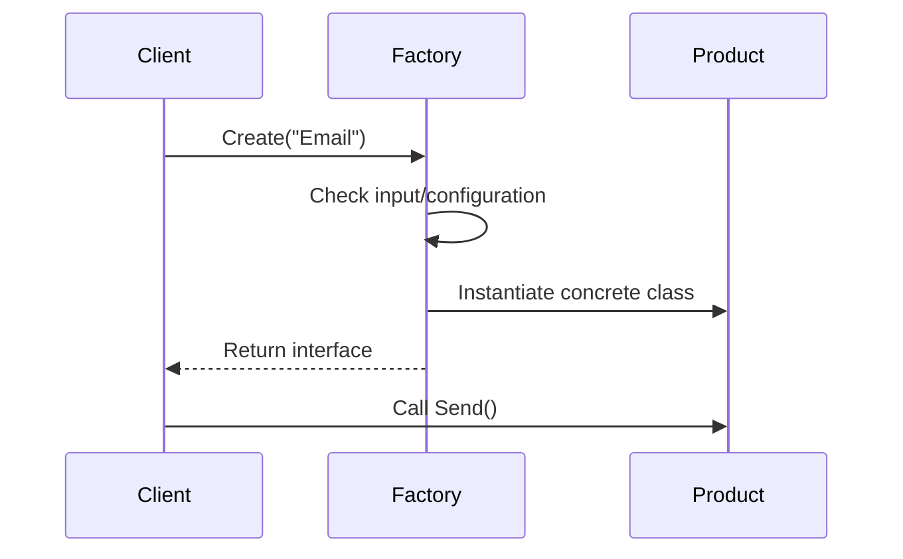

# Factory Design Pattern — Interview Preparation Notes

## 1. Topic Overview

### What is the Factory Design Pattern?

The **Factory Design Pattern** is a **creational design pattern** used to create objects without exposing the object creation logic to the client code.

Instead of creating objects directly using `new`, the client asks a **factory** to create the required object.

### Simple Explanation

Imagine ordering food at a restaurant.

You do not go into the kitchen and cook the food yourself. You tell the waiter what you want, and the kitchen prepares it.

In software:

- The **client** asks for an object.
- The **factory** decides which concrete class to create.
- The client works with an interface or base class.

### Why Is It Important?

The Factory Pattern is important because it:

- Reduces tight coupling between client code and concrete classes.
- Centralizes object creation logic.
- Makes code easier to extend.
- Improves maintainability.
- Supports the **Open/Closed Principle**.

### What Problem Does It Solve?

Without a factory, code often looks like this:

```csharp
IPaymentProcessor processor;

if (paymentType == "CreditCard")
{
    processor = new CreditCardPaymentProcessor();
}
else if (paymentType == "UPI")
{
    processor = new UpiPaymentProcessor();
}
else
{
    processor = new CashPaymentProcessor();
}
```

This creates problems:

- Client code knows about all concrete classes.
- Object creation logic is repeated.
- Adding a new type requires changing multiple places.
- Testing becomes harder.

A factory solves this by moving object creation logic into one place.

### Where Is It Used in Real-World Projects?

Factory Pattern is commonly used in:

- Payment gateway selection
- Notification services
- Logging providers
- Database provider creation
- API client creation
- Report generation
- File parser selection
- Encryption/decryption strategy creation
- Dependency injection containers
- Framework internals

Example:

```csharp
IPaymentProcessor processor = PaymentProcessorFactory.Create("UPI");
processor.ProcessPayment();
```

The client does not care which class is created internally.

---

## 2. Core Concepts

## Must Know

### 2.1 Product

#### Definition

A **Product** is the interface or abstract class that defines the behavior expected from objects created by the factory.

#### Purpose

It allows client code to depend on abstraction instead of concrete implementation.

#### Why It Exists

Without a common product type, the client would need to know each concrete class.

#### How It Works

All concrete products implement the same interface or inherit from the same abstract class.

#### Key Points

- Represents what the factory returns.
- Usually an interface or abstract class.
- Enables polymorphism.

#### Simple Example

```csharp
public interface INotificationService
{
    void Send(string message);
}
```

#### Real-World Example

In a banking system:

```csharp
public interface IPaymentProcessor
{
    void Process(decimal amount);
}
```

Different implementations may be:

- `CreditCardPaymentProcessor`
- `UpiPaymentProcessor`
- `NetBankingPaymentProcessor`

---

### 2.2 Concrete Product

#### Definition

A **Concrete Product** is an actual class created by the factory.

#### Purpose

It provides specific implementation of the product interface.

#### Why It Exists

Different business cases require different behavior.

#### How It Works

Concrete products implement the common product interface.

#### Key Points

- Actual object returned by the factory.
- Client usually does not instantiate it directly.
- Hidden behind abstraction.

#### Simple Example

```csharp
public class EmailNotificationService : INotificationService
{
    public void Send(string message)
    {
        Console.WriteLine("Email sent: " + message);
    }
}
```

#### Real-World Example

```csharp
public class UpiPaymentProcessor : IPaymentProcessor
{
    public void Process(decimal amount)
    {
        Console.WriteLine("Processing UPI payment: " + amount);
    }
}
```

---

### 2.3 Factory

#### Definition

A **Factory** is a class or method responsible for creating objects.

#### Purpose

It hides creation logic from client code.

#### Why It Exists

Object creation may involve conditions, configuration, dependencies, validation, or setup logic.

#### How It Works

The client sends input to the factory. The factory decides which concrete object to return.

#### Key Points

- Centralizes object creation.
- Returns abstraction.
- Helps reduce duplicate `if-else` or `switch` creation logic.

#### Simple Example

```csharp
public static class NotificationFactory
{
    public static INotificationService Create(string type)
    {
        switch (type)
        {
            case "Email":
                return new EmailNotificationService();

            case "Sms":
                return new SmsNotificationService();

            default:
                throw new ArgumentException("Invalid notification type");
        }
    }
}
```

#### Real-World Example

```csharp
IPaymentProcessor processor = PaymentProcessorFactory.Create(paymentType);
processor.Process(amount);
```

---

### 2.4 Client

#### Definition

The **Client** is the code that needs an object but does not create it directly.

#### Purpose

The client uses the object through an abstraction.

#### Why It Exists

The client should focus on business logic, not object creation.

#### How It Works

The client calls the factory and receives a product interface.

#### Key Points

- Does not know concrete class details.
- Depends on interface.
- Easier to test and extend.

#### Simple Example

```csharp
INotificationService service = NotificationFactory.Create("Email");
service.Send("Welcome");
```

#### Real-World Example

A controller may ask a factory for a service based on request type.

---

## Good to Know

### 2.5 Simple Factory

#### Definition

A **Simple Factory** is a class with a method that creates objects based on input.

#### Purpose

It centralizes object creation.

#### Why It Exists

It avoids scattered object creation logic.

#### How It Works

Usually implemented with `if-else` or `switch`.

#### Key Points

- Not an official Gang of Four pattern.
- Very commonly used.
- Simple and practical.

#### Example

```csharp
public static class PaymentProcessorFactory
{
    public static IPaymentProcessor Create(string paymentType)
    {
        switch (paymentType)
        {
            case "CreditCard":
                return new CreditCardPaymentProcessor();

            case "UPI":
                return new UpiPaymentProcessor();

            default:
                throw new ArgumentException("Unsupported payment type");
        }
    }
}
```

#### Real-World Example

Selecting a file parser:

```csharp
IFileParser parser = FileParserFactory.Create(".csv");
```

---

### 2.6 Factory Method Pattern

#### Definition

The **Factory Method Pattern** defines an interface for object creation but lets subclasses decide which class to instantiate.

#### Purpose

It delegates object creation to subclasses.

#### Why It Exists

Sometimes the base class knows when an object is needed, but subclasses know which object should be created.

#### How It Works

A base creator class defines a factory method. Subclasses override it.

#### Key Points

- Official Gang of Four design pattern.
- Uses inheritance.
- Subclasses decide concrete product.

#### Example

```csharp
public abstract class ReportGenerator
{
    public void Generate()
    {
        IReport report = CreateReport();
        report.Generate();
    }

    protected abstract IReport CreateReport();
}

public class PdfReportGenerator : ReportGenerator
{
    protected override IReport CreateReport()
    {
        return new PdfReport();
    }
}

public class ExcelReportGenerator : ReportGenerator
{
    protected override IReport CreateReport()
    {
        return new ExcelReport();
    }
}
```

#### Real-World Example

Different report generators:

- `PdfReportGenerator`
- `ExcelReportGenerator`
- `CsvReportGenerator`

---

### 2.7 Abstract Factory Pattern

#### Definition

The **Abstract Factory Pattern** creates families of related objects without specifying their concrete classes.

#### Purpose

It ensures related objects are created together consistently.

#### Why It Exists

Sometimes multiple related objects must be compatible.

#### How It Works

An abstract factory interface defines multiple creation methods.

#### Key Points

- Used for families of objects.
- Higher-level than Factory Method.
- Useful when products must work together.

#### Example

```csharp
public interface IUiFactory
{
    IButton CreateButton();

    ITextBox CreateTextBox();
}

public class WindowsUiFactory : IUiFactory
{
    public IButton CreateButton()
    {
        return new WindowsButton();
    }

    public ITextBox CreateTextBox()
    {
        return new WindowsTextBox();
    }
}

public class MacUiFactory : IUiFactory
{
    public IButton CreateButton()
    {
        return new MacButton();
    }

    public ITextBox CreateTextBox()
    {
        return new MacTextBox();
    }
}
```

#### Real-World Example

Creating UI components for different platforms:

- Windows button + Windows textbox
- macOS button + macOS textbox

---

## Advanced

### 2.8 Factory with Dependency Injection

#### Definition

A factory can be combined with **Dependency Injection** to create objects with dependencies.

#### Purpose

It avoids manually constructing complex objects.

#### Why It Exists

Real-world objects often require dependencies such as:

- Logger
- Repository
- Configuration
- HTTP client
- Database connection

#### How It Works

The factory receives dependencies through constructor injection and passes them to concrete products.

#### Key Points

- Improves testability.
- Avoids service locator misuse.
- Common in enterprise applications.

#### Example

```csharp
public class PaymentProcessorFactory
{
    private readonly ILogger _logger;

    public PaymentProcessorFactory(ILogger logger)
    {
        _logger = logger;
    }

    public IPaymentProcessor Create(string paymentType)
    {
        switch (paymentType)
        {
            case "UPI":
                return new UpiPaymentProcessor(_logger);

            case "Card":
                return new CardPaymentProcessor(_logger);

            default:
                throw new ArgumentException("Unsupported payment type");
        }
    }
}
```

---

### 2.9 Factory with Registration Dictionary

#### Definition

A factory can use a dictionary to map keys to object creation functions.

#### Purpose

It avoids large `switch` statements.

#### Why It Exists

Large factories become hard to maintain when many types exist.

#### How It Works

A dictionary stores mappings from keys to constructors or factory delegates.

#### Example

```csharp
public class NotificationFactory
{
    private readonly Dictionary<string, Func<INotificationService>> _services;

    public NotificationFactory()
    {
        _services = new Dictionary<string, Func<INotificationService>>
        {
            { "Email", () => new EmailNotificationService() },
            { "Sms", () => new SmsNotificationService() }
        };
    }

    public INotificationService Create(string type)
    {
        if (!_services.ContainsKey(type))
        {
            throw new ArgumentException("Unsupported notification type");
        }

        return _services[type]();
    }
}
```

#### Key Points

- Easier to extend.
- Cleaner than long `switch`.
- Still needs careful validation.

---

## 3. How It Works Internally

### Architecture

The Factory Pattern usually contains:

1. **Product Interface**
2. **Concrete Product Classes**
3. **Factory**
4. **Client**



### Execution Flow



### Step-by-Step Internal Working

1. Client needs an object.
2. Client calls factory method.
3. Factory receives input.
4. Factory evaluates input.
5. Factory creates the correct concrete object.
6. Factory returns object as an interface or base type.
7. Client uses the returned object polymorphically.

### What Happens Behind the Scenes?

When this code runs:

```csharp
INotificationService service = NotificationFactory.Create("Email");
```

Internally:

1. The string `"Email"` is passed to the factory.
2. The factory matches it against known types.
3. It creates `EmailNotificationService`.
4. It returns it as `INotificationService`.
5. The client calls methods without knowing the concrete class.

### Important Implementation Details

- The factory should usually return an abstraction.
- Concrete creation logic should stay inside the factory.
- Avoid exposing unnecessary implementation details.
- Avoid making factories too large.
- For many object types, prefer registration-based factories or dependency injection.

---

## 4. Important Terminology

| Term | Meaning | Example |
| ---- | ------- | ------- |
| **Factory** | Class or method responsible for creating objects | `PaymentProcessorFactory` |
| **Product** | Interface or abstract class returned by factory | `IPaymentProcessor` |
| **Concrete Product** | Actual implementation created by factory | `UpiPaymentProcessor` |
| **Client** | Code that asks factory for object | Controller or service |
| **Simple Factory** | Factory using conditional logic to create objects | `Create(string type)` |
| **Factory Method** | Pattern where subclasses decide which object to create | `CreateReport()` |
| **Abstract Factory** | Pattern for creating families of related objects | `IUiFactory` |
| **Creator** | Base class that defines factory method | `ReportGenerator` |
| **Concrete Creator** | Subclass that implements factory method | `PdfReportGenerator` |
| **Polymorphism** | Treating different objects through a common interface | `IPaymentProcessor.Process()` |
| **Loose Coupling** | Reducing dependency on concrete classes | Client depends on interface |
| **Open/Closed Principle** | Open for extension, closed for modification | Add new processor with minimal changes |
| **Object Creation Logic** | Code responsible for constructing objects | `new EmailService()` |
| **Dependency Injection** | Supplying dependencies externally | Injecting logger into factory |
| **Registration Factory** | Factory using dictionary registrations | `Dictionary<string, Func<T>>` |

---

## 5. Important Comparisons

| Concept A | Concept B | Key Difference | When to Use |
| --------- | --------- | -------------- | ----------- |
| Simple Factory | Factory Method | Simple Factory uses one class with conditions; Factory Method uses inheritance | Use Simple Factory for straightforward object creation |
| Factory Method | Abstract Factory | Factory Method creates one product; Abstract Factory creates families of products | Use Abstract Factory when related objects must be created together |
| Factory Pattern | Builder Pattern | Factory creates object in one step; Builder creates complex object step by step | Use Builder for complex construction |
| Factory Pattern | Singleton Pattern | Factory controls object creation; Singleton controls number of instances | Use Singleton when only one instance should exist |
| Factory Pattern | Dependency Injection | Factory manually creates objects; DI container resolves dependencies automatically | Use DI for application-wide dependency management |
| Factory Pattern | Strategy Pattern | Factory creates objects; Strategy defines interchangeable behavior | Often used together |
| Constructor | Factory Method | Constructor always creates same class; factory can return different classes | Use factory when creation varies |
| `new` Keyword | Factory | `new` directly couples code to class; factory hides concrete type | Use factory when creation logic is non-trivial |

### Factory vs Builder

| Factory | Builder |
| ------- | ------- |
| Creates object in one method call | Creates object step by step |
| Good for selecting implementation | Good for complex object construction |
| Hides concrete type | Hides construction process |
| Example: `PaymentFactory.Create("UPI")` | Example: `OrderBuilder.AddItem().SetAddress().Build()` |

### Factory vs Dependency Injection

| Factory | Dependency Injection |
| ------- | -------------------- |
| Explicit object creation | External container creates objects |
| Useful for runtime selection | Useful for dependency management |
| Can contain business selection logic | Usually configuration-based |
| Client may call factory directly | Client receives dependency automatically |

> **Interview Tip:** Factory and Dependency Injection are not enemies. A DI container is often a powerful factory behind the scenes.

---

## 6. Practical Examples

## Example 1: Payment Processor Factory

### 1. Problem

An application supports multiple payment methods:

- Credit card
- UPI
- Net banking

The system needs to choose the correct processor at runtime.

### 2. Approach

Create a common interface and use a factory to return the correct implementation.

### 3. Solution

```csharp
using System;

public interface IPaymentProcessor
{
    void Process(decimal amount);
}

public class CreditCardPaymentProcessor : IPaymentProcessor
{
    public void Process(decimal amount)
    {
        Console.WriteLine("Processing credit card payment: " + amount);
    }
}

public class UpiPaymentProcessor : IPaymentProcessor
{
    public void Process(decimal amount)
    {
        Console.WriteLine("Processing UPI payment: " + amount);
    }
}

public static class PaymentProcessorFactory
{
    public static IPaymentProcessor Create(string paymentType)
    {
        switch (paymentType)
        {
            case "CreditCard":
                return new CreditCardPaymentProcessor();

            case "UPI":
                return new UpiPaymentProcessor();

            default:
                throw new ArgumentException("Unsupported payment type");
        }
    }
}

public class PaymentService
{
    public void Pay(string paymentType, decimal amount)
    {
        IPaymentProcessor processor = PaymentProcessorFactory.Create(paymentType);
        processor.Process(amount);
    }
}
```

### 4. Why This Approach Was Chosen

- Client does not directly instantiate processor classes.
- Creation logic is centralized.
- Adding a new processor is easier.

### 5. Alternatives

- Direct `new`
- Dependency injection
- Strategy pattern with DI
- Reflection-based factory

### 6. Trade-Offs

| Benefit | Trade-Off |
| ------- | --------- |
| Centralized creation | Factory can grow large |
| Easy client code | Still needs modification for new types |
| Better abstraction | May hide errors until runtime |

---

## Example 2: Notification Service Factory

### 1. Problem

A system must send notifications through different channels:

- Email
- SMS
- Push notification

### 2. Approach

Use a factory to create the correct notification service.

### 3. Solution

```csharp
using System;

public interface INotificationService
{
    void Send(string message);
}

public class EmailNotificationService : INotificationService
{
    public void Send(string message)
    {
        Console.WriteLine("Email: " + message);
    }
}

public class SmsNotificationService : INotificationService
{
    public void Send(string message)
    {
        Console.WriteLine("SMS: " + message);
    }
}

public class PushNotificationService : INotificationService
{
    public void Send(string message)
    {
        Console.WriteLine("Push: " + message);
    }
}

public static class NotificationFactory
{
    public static INotificationService Create(string channel)
    {
        switch (channel)
        {
            case "Email":
                return new EmailNotificationService();

            case "Sms":
                return new SmsNotificationService();

            case "Push":
                return new PushNotificationService();

            default:
                throw new ArgumentException("Invalid notification channel");
        }
    }
}
```

### 4. Why This Approach Was Chosen

The notification sender only needs to call `Send`. It does not care about the channel-specific implementation.

### 5. Alternatives

- Inject all notification services and select manually.
- Use dictionary registration.
- Use configuration-based resolution.

### 6. Trade-Offs

- Simple factory is easy to understand.
- Large number of notification types may require dictionary-based registration.

---

## Example 3: File Parser Factory

### 1. Problem

An import service supports multiple file formats:

- CSV
- XML
- JSON

### 2. Approach

Create a parser factory based on file extension.

### 3. Solution

```csharp
using System;

public interface IFileParser
{
    void Parse(string fileContent);
}

public class CsvFileParser : IFileParser
{
    public void Parse(string fileContent)
    {
        Console.WriteLine("Parsing CSV");
    }
}

public class XmlFileParser : IFileParser
{
    public void Parse(string fileContent)
    {
        Console.WriteLine("Parsing XML");
    }
}

public class JsonFileParser : IFileParser
{
    public void Parse(string fileContent)
    {
        Console.WriteLine("Parsing JSON");
    }
}

public static class FileParserFactory
{
    public static IFileParser Create(string extension)
    {
        switch (extension.ToLowerInvariant())
        {
            case ".csv":
                return new CsvFileParser();

            case ".xml":
                return new XmlFileParser();

            case ".json":
                return new JsonFileParser();

            default:
                throw new NotSupportedException("Unsupported file type");
        }
    }
}
```

### 4. Why This Approach Was Chosen

Each parser has different parsing logic, but the import service can treat them uniformly.

### 5. Alternatives

- Reflection-based parser loading
- Plugin architecture
- Strategy pattern

### 6. Trade-Offs

- Factory is clear and explicit.
- Adding many file types may require registration-based extensibility.

---

## 7. Interview Questions

## Beginner Questions

### Question 1

**Question:** What is the Factory Design Pattern?

**Short Interview Answer:**  
The Factory Design Pattern is a creational pattern that encapsulates object creation logic and returns objects through an interface or base class.

**Detailed Explanation:**  
Instead of creating objects directly using `new`, the client asks a factory to create the required object. This reduces coupling and centralizes creation logic.

**Example:**

```csharp
IPaymentProcessor processor = PaymentProcessorFactory.Create("UPI");
```

**Possible Follow-up Question:**  
Why should client code avoid directly creating concrete classes?

---

### Question 2

**Question:** Why do we use the Factory Pattern?

**Short Interview Answer:**  
We use it to hide object creation logic, reduce coupling, improve maintainability, and support runtime object selection.

**Detailed Explanation:**  
If object creation depends on input, configuration, or conditions, putting that logic in many places makes the code hard to maintain. A factory centralizes this logic.

**Example:**  
Payment processor selection based on payment type.

**Possible Follow-up Question:**  
What happens if the factory becomes too large?

---

### Question 3

**Question:** What problem does Factory Pattern solve?

**Short Interview Answer:**  
It solves the problem of scattered and tightly coupled object creation logic.

**Detailed Explanation:**  
Without a factory, many classes may directly instantiate concrete classes. This makes changes harder when new implementations are introduced.

**Example:**  
Replacing `new EmailService()` with `NotificationFactory.Create("Email")`.

**Possible Follow-up Question:**  
Does Factory Pattern eliminate all coupling?

---

### Question 4

**Question:** Is Simple Factory an official design pattern?

**Short Interview Answer:**  
No. Simple Factory is not an official Gang of Four pattern, but it is widely used in practice.

**Detailed Explanation:**  
Simple Factory usually uses a static method or class to return different concrete implementations based on input.

**Example:**  
`PaymentProcessorFactory.Create(paymentType)`.

**Possible Follow-up Question:**  
How is Simple Factory different from Factory Method?

---

### Question 5

**Question:** What should a factory return?

**Short Interview Answer:**  
A factory should usually return an interface or abstract base class.

**Detailed Explanation:**  
Returning an abstraction keeps the client independent of concrete implementations.

**Example:**

```csharp
public static IPaymentProcessor Create(string type)
```

**Possible Follow-up Question:**  
What is the downside of returning concrete classes?

---

## Intermediate Questions

### Question 1

**Question:** How does the Factory Pattern support the Open/Closed Principle?

**Short Interview Answer:**  
It supports extension by allowing new implementations to be added with minimal changes to client code.

**Detailed Explanation:**  
The client depends on an interface. When a new implementation is added, client code usually does not change. However, a simple factory may still need modification.

**Example:**  
Adding `WalletPaymentProcessor` does not require changing payment service logic.

**Possible Follow-up Question:**  
Does Simple Factory fully satisfy Open/Closed Principle?

---

### Question 2

**Question:** What is the difference between Factory Method and Abstract Factory?

**Short Interview Answer:**  
Factory Method creates one type of product using inheritance. Abstract Factory creates families of related products.

**Detailed Explanation:**  
Factory Method delegates object creation to subclasses. Abstract Factory provides multiple creation methods for related products.

**Example:**  
Factory Method: `CreateReport()`  
Abstract Factory: `CreateButton()` and `CreateTextBox()`

**Possible Follow-up Question:**  
When would you use Abstract Factory over Factory Method?

---

### Question 3

**Question:** Can Factory Pattern be used with Dependency Injection?

**Short Interview Answer:**  
Yes. A factory can receive dependencies through DI and use them while creating objects.

**Detailed Explanation:**  
In real applications, created objects often need dependencies such as logging, configuration, or repositories.

**Example:**  
`PaymentProcessorFactory` receives `ILogger` and passes it to processors.

**Possible Follow-up Question:**  
When should you use DI instead of a custom factory?

---

### Question 4

**Question:** What are the disadvantages of Factory Pattern?

**Short Interview Answer:**  
It can introduce extra complexity, large factory classes, runtime errors, and hidden dependencies if poorly designed.

**Detailed Explanation:**  
If every object creation is wrapped in a factory unnecessarily, the code becomes over-engineered.

**Example:**  
A factory for a single class with no variation is usually unnecessary.

**Possible Follow-up Question:**  
How do you prevent a factory from becoming a God class?

---

### Question 5

**Question:** How can you avoid large `switch` statements in factories?

**Short Interview Answer:**  
Use dictionary-based registration, dependency injection, or a plugin-style approach.

**Detailed Explanation:**  
A dictionary can map keys to creation delegates, making the factory cleaner and easier to extend.

**Example:**

```csharp
Dictionary<string, Func<IParser>> parsers;
```

**Possible Follow-up Question:**  
What is the downside of dictionary-based factories?

---

## Advanced Questions

### Question 1

**Question:** Does the Factory Pattern always improve testability?

**Short Interview Answer:**  
Not always. It improves testability when it returns abstractions, but static factories can make testing harder.

**Detailed Explanation:**  
Static factories are difficult to mock. Instance factories injected through interfaces are easier to test.

**Example:**  
Prefer `IPaymentProcessorFactory` for unit testing.

**Possible Follow-up Question:**  
How would you mock a factory?

---

### Question 2

**Question:** How is a DI container related to Factory Pattern?

**Short Interview Answer:**  
A DI container acts like a configurable factory that creates and injects objects.

**Detailed Explanation:**  
DI containers manage object construction, lifetime, and dependencies. They are more powerful than simple factories.

**Example:**  
Resolving `IPaymentService` from a container.

**Possible Follow-up Question:**  
When is a custom factory still needed if DI exists?

---

### Question 3

**Question:** What are hidden trade-offs of using factories?

**Short Interview Answer:**  
Factories can hide complexity, delay errors until runtime, and create maintenance issues if they contain too much logic.

**Detailed Explanation:**  
A factory should create objects, not become a business rule engine.

**Example:**  
A payment factory should not perform complete payment validation.

**Possible Follow-up Question:**  
Where should business rules be placed instead?

---

### Question 4

**Question:** How would you design a factory for runtime extensibility?

**Short Interview Answer:**  
Use registration-based creation, configuration, reflection, or dependency injection.

**Detailed Explanation:**  
Instead of hardcoding all concrete types, register implementations dynamically.

**Example:**  
Plugins register parsers during startup.

**Possible Follow-up Question:**  
What risks come with reflection-based factories?

---

### Question 5

**Question:** Can Factory Pattern violate SOLID principles?

**Short Interview Answer:**  
Yes, if poorly designed. Large factories can violate Single Responsibility and Open/Closed Principle.

**Detailed Explanation:**  
A factory that knows too much or changes frequently becomes a maintenance problem.

**Example:**  
One factory creating unrelated objects like payments, reports, and notifications.

**Possible Follow-up Question:**  
How would you refactor such a factory?

---

## 8. Tricky Interview Questions

### Question 1

**Question:** If Factory Pattern reduces coupling, why does the factory still depend on concrete classes?

**Answer:**  
The dependency is moved from client code into one centralized location. The factory still knows concrete classes, but the rest of the application does not.

---

### Question 2

**Question:** Does Factory Pattern remove the need for `new`?

**Answer:**  
No. It moves `new` into the factory. Objects still need to be instantiated somewhere.

---

### Question 3

**Question:** Is using a factory always better than using constructors directly?

**Answer:**  
No. If object creation is simple and does not vary, direct constructors are clearer.

---

### Question 4

**Question:** What happens if an invalid type is passed to a factory?

**Answer:**  
The factory should handle it explicitly, usually by throwing a clear exception or returning a safe default if appropriate.

---

### Question 5

**Question:** Can a factory return the same instance every time?

**Answer:**  
Yes. A factory can return new instances, cached instances, singleton instances, or pooled instances depending on design requirements.

---

### Question 6

**Question:** Is a static factory bad?

**Answer:**  
Not always. Static factories are simple, but they can be harder to mock and replace in tests.

---

### Question 7

**Question:** Can Factory Pattern be overused?

**Answer:**  
Yes. Creating factories for every simple class adds unnecessary abstraction and complexity.

---

### Question 8

**Question:** Does Simple Factory follow Open/Closed Principle?

**Answer:**  
Partially. It protects client code, but the factory itself usually changes when adding new types.

---

### Question 9

**Question:** Can a factory contain business logic?

**Answer:**  
It should contain object selection logic, not heavy business logic. Business rules should remain in domain or service classes.

---

### Question 10

**Question:** Why return an interface from a factory?

**Answer:**  
Returning an interface hides concrete implementation and allows interchangeable objects.

---

## 9. Scenario-Based Questions

## Scenario 1: Multiple Payment Methods

### Scenario

An application supports credit card payments. Now it must support UPI and wallet payments.

### How to Approach It

1. Define `IPaymentProcessor`.
2. Create one implementation per payment type.
3. Create a factory to select implementation.
4. Use the interface in payment service.

### Why the Solution Works

The payment service stays independent of concrete payment classes.

### Trade-Offs

- Simple and maintainable.
- Factory must change when new payment methods are added.

### Alternatives

- Strategy pattern with DI
- Configuration-based provider selection
- Plugin-based architecture

### What the Interviewer Is Testing

- Abstraction
- Runtime selection
- SOLID understanding

---

## Scenario 2: File Import System

### Scenario

A system imports CSV files. New requirements add XML and JSON support.

### How to Approach It

Use `IFileParser` and `FileParserFactory`.

### Why the Solution Works

Each parser has isolated parsing logic.

### Trade-Offs

- Easy to test individual parsers.
- Factory grows as formats increase.

### Alternatives

- Reflection-based parser discovery
- Extension method mapping
- DI container registration

### What the Interviewer Is Testing

- Maintainability
- Extensibility
- Separation of concerns

---

## Scenario 3: UI Component Factory

### Scenario

An application needs platform-specific UI components for Windows and macOS.

### How to Approach It

Use Abstract Factory.

### Why the Solution Works

It ensures all UI components belong to the same platform family.

### Trade-Offs

- Strong consistency.
- More classes and interfaces.

### Alternatives

- Theme configuration
- Component registry
- Dependency injection

### What the Interviewer Is Testing

- Difference between Factory Method and Abstract Factory
- Object family creation

---

## Scenario 4: Notification Provider Selection

### Scenario

Notification type is decided from user preference.

### How to Approach It

Use a factory that maps user preference to notification service.

### Why the Solution Works

The notification sender does not depend on email, SMS, or push classes.

### Trade-Offs

- Clear runtime selection.
- Invalid preferences must be handled carefully.

### Alternatives

- Strategy pattern
- Chain of responsibility
- Event-driven notification pipeline

### What the Interviewer Is Testing

- Runtime polymorphism
- Error handling
- Practical design

---

## 10. Real-World Usage

### Common Use Cases

Factory Pattern is commonly used for:

- Creating service implementations
- Selecting payment providers
- Creating API clients
- Choosing serializers
- Selecting database providers
- Creating validators
- Creating parsers
- Creating report exporters
- Selecting encryption providers

### When to Use It

Use Factory Pattern when:

- Object creation depends on runtime input.
- Object creation logic is complex.
- Multiple implementations share the same interface.
- Client code should not know concrete classes.
- Creation logic is repeated.
- Objects need setup before use.

### When NOT to Use It

Avoid Factory Pattern when:

- There is only one simple class.
- Object creation is obvious.
- No abstraction is needed.
- It adds unnecessary complexity.
- Dependency injection already solves the problem cleanly.

### Design Considerations

- Return abstractions.
- Keep factories focused.
- Avoid large conditional blocks.
- Validate input clearly.
- Avoid mixing business logic with creation logic.
- Consider DI for dependency-heavy objects.

### Scalability

Factories can scale well if:

- They use registration-based creation.
- They are split by domain.
- They avoid massive `switch` statements.
- They are combined with DI.

### Reliability

Factories improve reliability when they:

- Validate invalid types.
- Fail fast with clear errors.
- Avoid returning null.
- Create fully initialized objects.

### Maintainability

Factories improve maintainability by:

- Centralizing creation logic.
- Reducing duplicate construction code.
- Making object selection explicit.

---

## 11. Performance & Optimization

### Time Complexity

For a simple `switch` factory:

| Operation | Complexity |
| --------- | ---------- |
| Object selection | Usually `O(1)` or `O(n)` depending on implementation |
| Object creation | Depends on constructor complexity |

For dictionary-based factory:

| Operation | Complexity |
| --------- | ---------- |
| Lookup | Average `O(1)` |
| Object creation | Depends on object |

### Space Complexity

Usually low.

Additional memory may be used for:

- Registration dictionaries
- Cached instances
- Dependency references
- Object pools

### Performance Considerations

- Object creation can be expensive if constructors do heavy work.
- Reflection-based factories are slower than direct construction.
- Static factories are fast but less flexible.
- Dictionary factories are usually efficient.
- Caching can improve performance for expensive reusable objects.

### Bottlenecks

Common bottlenecks include:

- Heavy constructor logic
- Reflection
- Repeated initialization
- External resource creation
- Large conditional logic
- Thread contention in shared factories

### Optimization Techniques

- Use dictionary lookup instead of long `switch`.
- Cache reusable stateless objects.
- Use object pooling for expensive objects.
- Avoid reflection unless needed.
- Keep constructors lightweight.
- Use lazy initialization when appropriate.

> **Interview Tip:** The Factory Pattern itself is not usually a performance bottleneck. The real cost usually comes from what the factory creates.

---

## 12. Common Mistakes

### Conceptual Mistakes

- Thinking Factory Pattern eliminates `new`.
- Confusing Factory Method with Abstract Factory.
- Assuming every class needs a factory.
- Thinking Simple Factory fully satisfies Open/Closed Principle.
- Treating factory as a business rule engine.

### Implementation Mistakes

- Returning concrete classes instead of interfaces.
- Returning `null` for unsupported types.
- Creating one giant factory for unrelated objects.
- Using static factories everywhere.
- Not validating input.
- Hiding too much logic inside the factory.
- Making factory methods too complex.

### Incorrect Assumptions

- Factory Pattern always improves code.
- Factory Pattern always improves testing.
- Factory Pattern replaces dependency injection.
- Abstract Factory is always better than Simple Factory.
- Reflection-based factories are always flexible and safe.

### Interview Mistakes

- Giving only textbook definitions.
- Not explaining practical use cases.
- Not mentioning trade-offs.
- Confusing Factory Method and Simple Factory.
- Forgetting to mention loose coupling.

### Things Candidates Frequently Forget

- Factory is a creational pattern.
- It should usually return abstraction.
- Static factories can hurt testability.
- Factory Method uses inheritance.
- Abstract Factory creates related object families.

---

## 13. Best Practices

### 1. Return Interfaces or Abstract Classes

This reduces dependency on concrete implementations.

### 2. Keep Factories Focused

A factory should create related objects only.

### 3. Avoid Returning Null

Throw meaningful exceptions or return a safe default.

### 4. Avoid Business Logic in Factories

Factories should decide what to create, not process business rules.

### 5. Use Dependency Injection for Complex Dependencies

If created objects need dependencies, inject them into the factory.

### 6. Prefer Instance Factories for Testability

Instance factories can be mocked more easily than static factories.

### 7. Use Dictionary Registration for Many Types

This avoids large `switch` statements.

### 8. Validate Inputs Clearly

Invalid type names should fail with clear messages.

### 9. Avoid Overengineering

Do not create factories for simple object creation.

### 10. Document Supported Types

Factories with runtime keys should clearly document valid keys.

---

## 14. Interview Cheat Sheet

### Key Definitions

- **Factory Pattern:** Encapsulates object creation logic.
- **Product:** Interface or base class returned by the factory.
- **Concrete Product:** Actual implementation created.
- **Factory Method:** Subclasses decide which object to create.
- **Abstract Factory:** Creates families of related objects.

### Core Concepts

- Encapsulation of object creation
- Loose coupling
- Polymorphism
- Runtime object selection
- Centralized construction logic

### Important Differences

| Topic | Key Point |
| ----- | --------- |
| Simple Factory | One factory method with conditions |
| Factory Method | Uses inheritance |
| Abstract Factory | Creates related object families |
| Builder | Step-by-step object construction |
| DI | Container-based object creation |

### Must-Remember Points

- Factory is a **creational pattern**.
- It hides concrete class creation.
- It usually returns an interface.
- It reduces client coupling.
- It can be overused.
- Simple Factory is practical but not official GoF.
- Factory Method is official GoF.
- Abstract Factory is for related families of objects.

### Common Questions

- What problem does Factory Pattern solve?
- Difference between Factory Method and Abstract Factory?
- Is Simple Factory a design pattern?
- How does Factory Pattern support SOLID?
- What are the disadvantages?

---

## 15. Rapid-Fire Interview Questions

### 1. What type of design pattern is Factory?

Factory is a **creational design pattern**.

### 2. What does Factory Pattern encapsulate?

It encapsulates **object creation logic**.

### 3. What should a factory usually return?

An interface or abstract class.

### 4. Does Factory Pattern remove `new`?

No. It moves `new` into the factory.

### 5. What is Simple Factory?

A class or method that creates objects based on input.

### 6. Is Simple Factory an official GoF pattern?

No, but it is commonly used.

### 7. What is Factory Method?

A pattern where subclasses decide which concrete class to instantiate.

### 8. What is Abstract Factory?

A pattern used to create families of related objects.

### 9. Factory Method vs Abstract Factory?

Factory Method creates one product. Abstract Factory creates related product families.

### 10. Factory vs Builder?

Factory creates an object in one step. Builder constructs complex objects step by step.

### 11. Factory vs Strategy?

Factory creates objects. Strategy defines interchangeable behavior.

### 12. Main benefit of Factory Pattern?

Loose coupling and centralized creation logic.

### 13. Main disadvantage of Factory Pattern?

Extra complexity and possible large factory classes.

### 14. Can factories be static?

Yes, but static factories are harder to mock.

### 15. Can factories use dependency injection?

Yes, and it is common in real applications.

### 16. Should factory return null for invalid input?

Usually no. Prefer clear exceptions.

### 17. Does Factory Pattern improve testability?

It can, especially when using interfaces and injectable factories.

### 18. When should Factory Pattern not be used?

When object creation is simple and does not vary.

### 19. What SOLID principle is closely related?

Open/Closed Principle and Dependency Inversion Principle.

### 20. Can a factory cache objects?

Yes, if objects are reusable and safe to share.

---

## 16. Mock Interview

This section is interactive.

I will ask **10 questions one at a time**, starting from basic and gradually increasing in difficulty.

After you answer each question, I will:

- Rate your answer from **1–10**
- Tell you what you got right
- Tell you what you missed
- Correct mistakes
- Give an ideal interview answer
- Ask the next question

### Mock Interview Question 1

**What is the Factory Design Pattern, and why is it used?**

> Reply with your answer, and the evaluation will continue with Question 2.

---

## 17. Final Interview Revision

### 20–30 Most Important Things to Remember

1. Factory Pattern is a **creational design pattern**.
2. It hides object creation logic from client code.
3. It helps reduce coupling.
4. It usually returns an interface or abstract class.
5. The client should not know concrete implementation details.
6. Simple Factory is practical but not an official GoF pattern.
7. Factory Method is an official GoF pattern.
8. Factory Method lets subclasses decide which object to create.
9. Abstract Factory creates families of related objects.
10. Factory Pattern is useful when object creation depends on runtime input.
11. It is commonly used in payments, notifications, parsers, loggers, and API clients.
12. It improves maintainability by centralizing creation logic.
13. It supports polymorphism.
14. It supports loose coupling.
15. It can partially support Open/Closed Principle.
16. Simple Factory may still require modification when adding new types.
17. Large factories can violate Single Responsibility Principle.
18. Avoid putting heavy business logic inside factories.
19. Static factories are simple but harder to test.
20. Instance factories are better for dependency injection and mocking.
21. Dictionary-based factories can replace large `switch` statements.
22. Reflection-based factories are flexible but can be slower and riskier.
23. A factory should not return `null` for unsupported types.
24. Use clear exceptions for invalid factory inputs.
25. Do not overuse factories for simple object creation.
26. Factory and Strategy patterns are often used together.
27. Dependency Injection containers behave like advanced factories.
28. Builder is better for complex step-by-step object construction.
29. Abstract Factory is best when related objects must be compatible.
30. In interviews, always explain the practical problem Factory Pattern solves.

> **Final Interview Tip:** Do not only define the Factory Pattern. Explain the problem, the structure, a real-world use case, and the trade-offs.