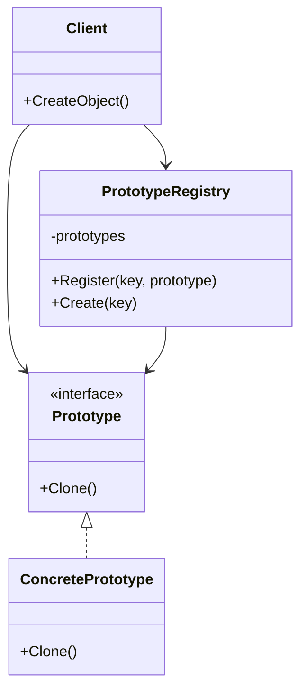
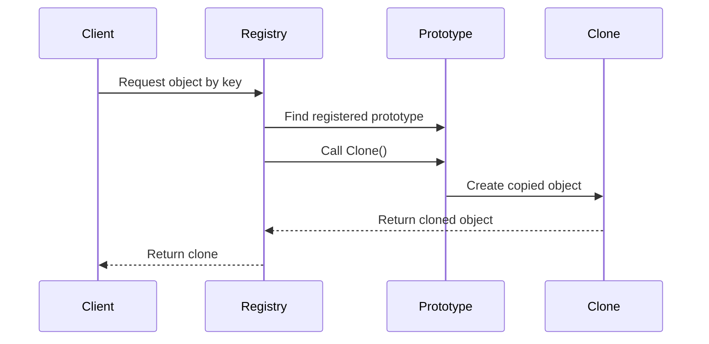

# Prototype Design Pattern in C# - Interview Preparation Notes

## 1. Topic Overview

### What is the Prototype Design Pattern?

The **Prototype Design Pattern** is a **creational design pattern** that creates new objects by **copying an existing object**, called a **prototype**, instead of creating objects from scratch using constructors.

In simple terms:

> Instead of building a new object step by step every time, you create one sample object and clone it whenever you need a similar object.

### Why Is It Important?

The Prototype pattern is important because it helps when:

- Object creation is **expensive**
- Object construction is **complex**
- Many similar objects are needed
- You want to avoid repeating initialization logic
- Runtime object configuration needs to be reused

### What Problem Does It Solve?

It solves the problem of **costly or repetitive object creation**.

For example, if creating a report template requires loading fonts, styles, headers, permissions, and layout settings, creating it repeatedly from scratch is inefficient. Instead, create one prototype and clone it.

### Where Is It Used in Real-World Projects?

Common real-world usage includes:

- Document/template cloning
- Game object spawning
- UI component duplication
- Workflow configuration copying
- Report generation
- Object snapshots
- Caching preconfigured objects
- Domain object duplication with modifications

### Simple Explanation

Imagine you have a fully formatted resume template. Instead of creating a new resume layout every time, you copy the existing template and only change the name, email, and experience.

That is the Prototype pattern.

---

## 2. Core Concepts

## Must Know Concepts

### 2.1 Prototype

#### Definition

A **Prototype** is an existing object that is used as a base to create new objects by cloning.

#### Purpose

To provide a reusable object that can be copied.

#### Why It Exists

It avoids expensive or repetitive object construction.

#### How It Works

The prototype exposes a cloning method, usually named `Clone`, which returns a copy of itself.

#### Key Points

- Prototype is the source object.
- New objects are created by copying it.
- The copy may be shallow or deep.
- The client does not need to know the object's construction details.

#### Simple Example

```csharp
public class Document
{
    public string Title { get; set; }

    public Document Clone()
    {
        return new Document
        {
            Title = this.Title
        };
    }
}
```

#### Real-World Example

A company may keep a prototype invoice template. Every new invoice is cloned from the template and customized with customer details.

---

### 2.2 Clone Method

#### Definition

A method that creates and returns a copy of an object.

#### Purpose

To encapsulate object-copying logic inside the class itself.

#### Why It Exists

The object usually knows best how it should be copied.

#### How It Works

The method copies the object's fields and properties into a new instance.

#### Key Points

- Usually named `Clone`.
- Can return the concrete type.
- Can perform shallow or deep copy.
- Should clearly define copy behavior.

#### Simple Example

```csharp
public class UserProfile
{
    public string Name { get; set; }
    public string Email { get; set; }

    public UserProfile Clone()
    {
        return new UserProfile
        {
            Name = this.Name,
            Email = this.Email
        };
    }
}
```

#### Real-World Example

A user profile template can be cloned when creating profiles for employees in the same department.

---

### 2.3 Shallow Copy

#### Definition

A **shallow copy** copies the object itself but does not deeply copy referenced objects.

#### Purpose

To create a quick copy when referenced objects can be shared safely.

#### Why It Exists

It is fast and memory-efficient.

#### How It Works

Value-type fields are copied. Reference-type fields still point to the same objects.

#### Key Points

- Fast
- Simple
- Risky if the object has mutable reference-type fields
- Changes to shared nested objects affect both original and clone

#### Simple Example

```csharp
public class Address
{
    public string City { get; set; }
}

public class Customer
{
    public string Name { get; set; }
    public Address Address { get; set; }

    public Customer ShallowClone()
    {
        return (Customer)this.MemberwiseClone();
    }
}
```

#### Important Behavior

```csharp
Customer original = new Customer
{
    Name = "Alice",
    Address = new Address { City = "New York" }
};

Customer clone = original.ShallowClone();
clone.Address.City = "Chicago";

// original.Address.City is also "Chicago"
```

#### Real-World Example

Shallow copy may be acceptable for immutable shared configuration objects.

---

### 2.4 Deep Copy

#### Definition

A **deep copy** copies the object and all nested referenced objects.

#### Purpose

To create a completely independent object graph.

#### Why It Exists

To prevent accidental mutation of shared nested objects.

#### How It Works

Each referenced object is also cloned recursively.

#### Key Points

- Safer than shallow copy for mutable objects
- More expensive
- Requires explicit handling of nested objects
- Can be complex for large object graphs

#### Simple Example

```csharp
public class Address
{
    public string City { get; set; }

    public Address Clone()
    {
        return new Address
        {
            City = this.City
        };
    }
}

public class Customer
{
    public string Name { get; set; }
    public Address Address { get; set; }

    public Customer DeepClone()
    {
        return new Customer
        {
            Name = this.Name,
            Address = this.Address == null ? null : this.Address.Clone()
        };
    }
}
```

#### Real-World Example

Deep copy is useful when cloning an order with independent line items, shipping address, and discount details.

---

### 2.5 `MemberwiseClone`

#### Definition

`MemberwiseClone` is a protected method from `System.Object` that creates a shallow copy of the current object.

#### Purpose

To provide built-in shallow copy behavior in .NET.

#### Why It Exists

Every object in .NET inherits from `object`, so this method gives a basic copying mechanism.

#### How It Works

It creates a new object and copies all fields from the current object.

#### Key Points

- It is `protected`.
- It performs only shallow copy.
- It cannot be called directly from outside the class.
- Useful as a starting point for clone methods.

#### Example

```csharp
public class Product
{
    public string Name { get; set; }
    public decimal Price { get; set; }

    public Product Clone()
    {
        return (Product)this.MemberwiseClone();
    }
}
```

#### Real-World Example

Use `MemberwiseClone` when the class has only primitive, string, enum, or immutable fields.

---

## Good to Know Concepts

### 2.6 `ICloneable`

#### Definition

`ICloneable` is a .NET interface with a single method:

```csharp
object Clone();
```

#### Purpose

To provide a common cloning contract.

#### Why It Exists

It was introduced as a general-purpose cloning interface.

#### Key Problem

`ICloneable` does not specify whether cloning is shallow or deep.

#### Key Points

- Avoid using it in public APIs when clone behavior is ambiguous.
- Prefer strongly typed clone methods.
- If used, document whether the copy is shallow or deep.

#### Example

```csharp
public class ReportTemplate : ICloneable
{
    public string Title { get; set; }

    public object Clone()
    {
        return new ReportTemplate
        {
            Title = this.Title
        };
    }
}
```

#### Interview Tip

> `ICloneable` is often discussed in interviews because it looks useful but is considered ambiguous due to unclear shallow/deep copy semantics.

---

### 2.7 Copy Constructor

#### Definition

A **copy constructor** creates a new object from an existing object.

#### Purpose

To copy object state in a clear and type-safe way.

#### Why It Exists

It makes cloning explicit and avoids ambiguity.

#### How It Works

The constructor accepts another instance of the same type and copies its values.

#### Example

```csharp
public class Employee
{
    public string Name { get; set; }
    public string Department { get; set; }

    public Employee()
    {
    }

    public Employee(Employee source)
    {
        Name = source.Name;
        Department = source.Department;
    }
}
```

#### Real-World Example

Copy constructors are useful in domain models where object duplication rules must be explicit.

---

### 2.8 Prototype Registry

#### Definition

A **Prototype Registry** stores preconfigured prototype objects and returns clones when requested.

#### Purpose

To centralize prototype management.

#### Why It Exists

Clients should not need to know how to configure prototype objects.

#### How It Works

The registry keeps a dictionary of named prototypes.

#### Example

```csharp
using System;
using System.Collections.Generic;

public interface IReportPrototype
{
    IReportPrototype Clone();
}

public class ReportTemplate : IReportPrototype
{
    public string Name { get; set; }
    public string Header { get; set; }

    public IReportPrototype Clone()
    {
        return new ReportTemplate
        {
            Name = this.Name,
            Header = this.Header
        };
    }
}

public class ReportRegistry
{
    private readonly Dictionary<string, IReportPrototype> prototypes =
        new Dictionary<string, IReportPrototype>();

    public void Register(string key, IReportPrototype prototype)
    {
        prototypes[key] = prototype;
    }

    public IReportPrototype Create(string key)
    {
        if (!prototypes.ContainsKey(key))
        {
            throw new InvalidOperationException("Prototype not found.");
        }

        return prototypes[key].Clone();
    }
}
```

#### Real-World Example

A reporting system can store prototypes for invoice reports, audit reports, and compliance reports.

---

## Advanced Concepts

### 2.9 Object Graph Cloning

#### Definition

Object graph cloning means copying an object and all related nested objects.

#### Purpose

To create a fully independent copy of complex data structures.

#### Why It Exists

Real-world objects often reference many other objects.

#### Key Challenges

- Circular references
- Shared references
- Large memory usage
- Identity preservation
- Lazy-loaded data

#### Example

An `Order` may contain:

- Customer
- Billing address
- Shipping address
- Order items
- Discounts
- Tax details

A deep clone must decide which of these should be copied and which should remain shared.

---

### 2.10 Clone Customization

#### Definition

Clone customization means changing some values while cloning.

#### Purpose

To create a similar object with specific differences.

#### Example

```csharp
public class EmailTemplate
{
    public string Subject { get; set; }
    public string Body { get; set; }

    public EmailTemplate CloneForRecipient(string recipientName)
    {
        return new EmailTemplate
        {
            Subject = this.Subject,
            Body = this.Body.Replace("{Name}", recipientName)
        };
    }
}
```

#### Real-World Example

Cloning a notification template and replacing placeholders with user-specific values.

---

## 3. How It Works Internally

### Architecture

The Prototype pattern usually contains:

1. **Prototype Interface**
   - Declares a clone operation.

2. **Concrete Prototype**
   - Implements cloning logic.

3. **Client**
   - Requests a clone instead of calling `new`.

4. **Prototype Registry**
   - Optional component that stores reusable prototypes.

### Mermaid Class Diagram



### Execution Flow



### Step-by-Step Internal Working

1. A prototype object is created and configured.
2. The prototype is stored or passed to the client.
3. The client asks for a new object.
4. Instead of constructing a new object manually, the clone method is called.
5. The clone method creates a copy.
6. The copied object is returned.
7. The client modifies the copied object if needed.

### What Happens Behind the Scenes?

For shallow copy:

- A new object instance is allocated.
- Field values are copied.
- Reference-type fields point to the same nested objects.

For deep copy:

- A new object instance is allocated.
- Primitive fields are copied.
- Nested objects are also cloned.
- The clone receives independent nested objects.

---

## 4. Important Terminology

| Term | Meaning | Example |
| ---- | ------- | ------- |
| Prototype | Existing object used as a base for cloning | Report template |
| Clone | New object copied from prototype | New invoice from template |
| Shallow Copy | Copies object but shares nested references | Two customers share same address object |
| Deep Copy | Copies object and nested objects | Order and order items fully copied |
| `MemberwiseClone` | Built-in .NET shallow copy method | `(Product)this.MemberwiseClone()` |
| `ICloneable` | .NET cloning interface | `object Clone()` |
| Copy Constructor | Constructor that copies another object | `new Employee(existingEmployee)` |
| Prototype Registry | Stores named prototypes | `"InvoiceReport"` prototype |
| Object Graph | Object plus all referenced objects | Order with customer and items |
| Mutable Object | Object whose state can change | `List<T>` |
| Immutable Object | Object whose state cannot change | `string` |
| Creational Pattern | Pattern focused on object creation | Prototype, Factory, Singleton |

---

## 5. Important Comparisons

| Concept A | Concept B | Key Difference | When to Use |
| --------- | --------- | -------------- | ----------- |
| Prototype | Factory Method | Prototype clones existing objects; Factory creates new objects through creation logic | Use Prototype when copying configured objects is easier |
| Prototype | Builder | Prototype copies ready objects; Builder constructs step by step | Use Builder for complex construction from scratch |
| Shallow Copy | Deep Copy | Shallow shares nested references; deep copies nested objects | Use deep copy when clone must be independent |
| `ICloneable` | Strongly Typed Clone | `ICloneable` returns `object`; typed clone returns concrete type | Prefer typed clone for clarity |
| Copy Constructor | Clone Method | Constructor is explicit; clone is polymorphic-friendly | Use clone for pattern-based designs |
| Prototype Registry | Direct Cloning | Registry centralizes prototypes; direct cloning requires known object | Use registry when many prototypes exist |

### Prototype vs Factory Method

Prototype:

```csharp
var newReport = existingReport.Clone();
```

Factory Method:

```csharp
var newReport = reportFactory.CreateReport();
```

Use Prototype when:

- A configured object already exists.
- Creation is expensive.
- Object variations are runtime-driven.

Use Factory Method when:

- Creation logic depends on type or input.
- Objects should be built fresh.
- No existing object should be copied.

---

## 6. Practical Examples

## Example 1: Cloning a Report Template

### Problem

A reporting system has multiple report templates with headers, footers, and layout configuration. Creating each report from scratch is repetitive.

### Approach

Create a prototype report template and clone it.

### Solution

```csharp
using System.Collections.Generic;

public class ReportTemplate
{
    public string Title { get; set; }
    public string Header { get; set; }
    public List<string> Sections { get; set; }

    public ReportTemplate Clone()
    {
        return new ReportTemplate
        {
            Title = this.Title,
            Header = this.Header,
            Sections = new List<string>(this.Sections)
        };
    }
}
```

### Why This Approach Was Chosen

- Avoids repeated setup.
- Keeps template creation centralized.
- Allows each cloned report to customize sections independently.

### Alternatives

- Factory Method
- Builder Pattern
- Manual object construction

### Trade-Offs

- Clone logic must be maintained.
- Deep copy is needed for mutable lists.
- Incorrect cloning can cause shared state bugs.

---

## Example 2: Game Enemy Spawning

### Problem

A game needs to spawn many enemies with the same base properties.

### Approach

Create a configured enemy prototype and clone it.

### Solution

```csharp
public class Enemy
{
    public string Type { get; set; }
    public int Health { get; set; }
    public int Damage { get; set; }

    public Enemy Clone()
    {
        return new Enemy
        {
            Type = this.Type,
            Health = this.Health,
            Damage = this.Damage
        };
    }
}
```

### Why This Approach Was Chosen

- Fast object creation.
- Reduces duplicate setup logic.
- Supports runtime-configured enemy types.

### Alternatives

- Factory Method
- Object Pool
- Builder Pattern

### Trade-Offs

- Prototype handles copying only.
- Object Pool is better if object allocation itself is expensive.
- Deep copy may be needed for nested AI behavior configuration.

---

## Example 3: Deep Cloning an Order

### Problem

An e-commerce system needs to duplicate an order as a draft reorder.

### Approach

Clone the order and its order items.

### Solution

```csharp
using System.Collections.Generic;
using System.Linq;

public class OrderItem
{
    public string ProductCode { get; set; }
    public int Quantity { get; set; }

    public OrderItem Clone()
    {
        return new OrderItem
        {
            ProductCode = this.ProductCode,
            Quantity = this.Quantity
        };
    }
}

public class Order
{
    public string CustomerId { get; set; }
    public List<OrderItem> Items { get; set; }

    public Order CloneAsDraft()
    {
        return new Order
        {
            CustomerId = this.CustomerId,
            Items = this.Items == null
                ? new List<OrderItem>()
                : this.Items.Select(item => item.Clone()).ToList()
        };
    }
}
```

### Why This Approach Was Chosen

The new draft order should not share mutable line items with the original order.

### Alternatives

- Rebuild order from database
- Use serialization-based cloning
- Use mapping library

### Trade-Offs

- Manual deep cloning is verbose.
- Serialization cloning can be slower.
- Mapping tools require configuration.

---

## 7. Interview Questions

# Beginner Questions

## Question 1

### Question

What is the Prototype Design Pattern?

### Short Interview Answer

The Prototype pattern is a creational design pattern that creates new objects by cloning existing objects instead of constructing them from scratch.

### Detailed Explanation

It is useful when object creation is expensive or complex. A prototype object acts as a template, and new objects are created by copying it.

### Example

```csharp
public class Document
{
    public string Title { get; set; }

    public Document Clone()
    {
        return new Document { Title = this.Title };
    }
}
```

### Possible Follow-up Question

What is the difference between shallow copy and deep copy?

---

## Question 2

### Question

Why is the Prototype pattern useful?

### Short Interview Answer

It reduces object creation cost and avoids duplicating complex initialization logic.

### Detailed Explanation

If an object requires many setup steps, external resources, or runtime configuration, cloning a preconfigured instance is often simpler and faster.

### Example

A report template can be cloned instead of rebuilding layout settings every time.

### Possible Follow-up Question

When should Prototype not be used?

---

## Question 3

### Question

What type of design pattern is Prototype?

### Short Interview Answer

Prototype is a **creational design pattern**.

### Detailed Explanation

Creational patterns deal with object creation. Prototype creates objects by copying existing instances.

### Possible Follow-up Question

Name other creational design patterns.

---

# Intermediate Questions

## Question 4

### Question

What is the difference between shallow copy and deep copy?

### Short Interview Answer

A shallow copy copies the top-level object but shares nested references. A deep copy copies the object and its nested objects.

### Detailed Explanation

In shallow copy, changes to nested mutable objects affect both original and clone. In deep copy, the clone has independent nested objects.

### Example

```csharp
Customer clone = original.ShallowClone();
clone.Address.City = "Chicago";
```

If `Address` is shared, the original customer's address also changes.

### Possible Follow-up Question

How would you implement deep copy in C#?

---

## Question 5

### Question

What is `MemberwiseClone` in C#?

### Short Interview Answer

`MemberwiseClone` is a protected method from `object` that creates a shallow copy of the current object.

### Detailed Explanation

It copies value-type fields directly and copies reference values for reference-type fields, meaning nested objects are shared.

### Example

```csharp
public Product Clone()
{
    return (Product)this.MemberwiseClone();
}
```

### Possible Follow-up Question

Why is `MemberwiseClone` not enough for deep copy?

---

## Question 6

### Question

Should you use `ICloneable` in C#?

### Short Interview Answer

Usually avoid it in public APIs because it does not specify whether cloning is shallow or deep.

### Detailed Explanation

The ambiguity can cause bugs. A better approach is to use a strongly typed clone method with documented behavior.

### Example

```csharp
public Customer DeepClone()
{
    return new Customer();
}
```

### Possible Follow-up Question

How would you design a clear cloning contract?

---

# Advanced Questions

## Question 7

### Question

How do you handle circular references during deep cloning?

### Short Interview Answer

Use a tracking dictionary to map original objects to cloned objects and reuse existing clones when a cycle is detected.

### Detailed Explanation

Without tracking, recursive deep cloning may cause infinite recursion.

### Example

If `Employee.Manager` points to another employee and that employee references back, cloning recursively can loop forever.

### Possible Follow-up Question

How do serializers handle circular references?

---

## Question 8

### Question

How does Prototype differ from Factory Method?

### Short Interview Answer

Prototype creates objects by cloning existing instances, while Factory Method creates objects using creation logic.

### Detailed Explanation

Factory Method is useful when the system decides which type to instantiate. Prototype is useful when configured object instances already exist and should be copied.

### Example

- Prototype: clone a configured report template.
- Factory: create a report based on report type.

### Possible Follow-up Question

Can Prototype and Factory be used together?

---

## Question 9

### Question

What are the risks of using Prototype in domain models?

### Short Interview Answer

The main risks are accidentally copying identity fields, sharing mutable nested objects, and duplicating invalid domain state.

### Detailed Explanation

For example, cloning an `Order` should usually not copy the same `OrderId`. The clone may need a new identity and reset status.

### Possible Follow-up Question

How would you clone an entity safely?

---

## 8. Tricky Interview Questions

## Question 1

### Question

If `MemberwiseClone` copies an object, why can changes in the clone affect the original?

### Answer

Because `MemberwiseClone` performs a shallow copy. Nested reference-type fields still point to the same objects.

---

## Question 2

### Question

Is string copied deeply or shared during shallow copy?

### Answer

The string reference is copied, but this is usually safe because `string` is immutable in .NET.

---

## Question 3

### Question

Can Prototype violate encapsulation?

### Answer

Yes, if cloning exposes or incorrectly copies internal mutable state. Clone logic should preserve invariants and avoid leaking shared references.

---

## Question 4

### Question

Is deep copy always better than shallow copy?

### Answer

No. Deep copy is safer for mutable nested objects but costs more memory and CPU. Shallow copy is fine when nested objects are immutable or intentionally shared.

---

## Question 5

### Question

What happens if a cloned object keeps the same database identity?

### Answer

It may cause data integrity issues, duplicate key errors, or accidental updates to the original record. Identity fields should often be reset during cloning.

---

## Question 6

### Question

Why is serialization-based cloning not always recommended?

### Answer

It can be slower, may require all objects to be serializable, can skip non-serialized fields, and may not preserve complex runtime behavior correctly.

---

## Question 7

### Question

Can Prototype be used with dependency-injected services?

### Answer

Yes, but services should usually not be deep-cloned. Dependencies are often shared references, while stateful data should be copied carefully.

---

## 9. Scenario-Based Questions

## Scenario 1: Report Template System

### Scenario

A system generates multiple reports with the same layout but different data.

### Approach

Use Prototype for report layout and clone it for each report instance.

### Why It Works

The expensive layout setup is reused.

### Trade-Offs

- Template changes must be managed carefully.
- Mutable collections should be deep-copied.

### Alternatives

- Builder Pattern
- Factory Method

### What the Interviewer Is Testing

Understanding of when cloning is better than constructing.

---

## Scenario 2: E-Commerce Reorder Feature

### Scenario

A customer wants to reorder a previous order.

### Approach

Clone the previous order as a new draft order.

### Why It Works

Most item data can be reused.

### Trade-Offs

- Must reset order ID.
- Must recheck prices and availability.
- Must not copy payment transaction IDs.

### Alternatives

- Create new order from product IDs.
- Use a service to rebuild the order.

### What the Interviewer Is Testing

Awareness of domain rules and cloning dangers.

---

## Scenario 3: Game Object Spawning

### Scenario

A game needs to spawn many similar enemies.

### Approach

Create enemy prototypes and clone them.

### Why It Works

Configured enemy objects can be reused quickly.

### Trade-Offs

- Runtime state must be reset.
- Shared AI configuration may or may not be desired.

### Alternatives

- Factory Pattern
- Object Pool Pattern

### What the Interviewer Is Testing

Understanding of performance and object lifecycle.

---

## 10. Real-World Usage

### Common Use Cases

- Template duplication
- Report generation
- Game development
- Configuration cloning
- Workflow definitions
- UI control duplication
- Reorder and duplicate-document features

### When to Use Prototype

Use it when:

- Object creation is expensive.
- Objects have many configuration steps.
- You need similar objects with minor differences.
- Runtime prototypes are known.
- You want to reduce constructor complexity.

### When NOT to Use Prototype

Avoid it when:

- Object creation is simple.
- Object identity is important and hard to reset.
- Deep cloning is too complex.
- Shared references can cause bugs.
- Constructors or factories are clearer.

### Design Considerations

- Decide shallow vs deep copy.
- Document clone behavior.
- Reset identity fields when needed.
- Avoid cloning external resources blindly.
- Be careful with mutable nested collections.
- Preserve domain invariants.

### Scalability

Prototype can improve scalability when object setup is expensive, but excessive deep cloning can increase memory pressure.

### Reliability

Reliable clone logic must avoid shared mutable state unless sharing is intentional.

### Maintainability

Clone logic should be centralized and tested because new fields may be forgotten during cloning.

---

## 11. Performance & Optimization

### Time Complexity

| Clone Type | Time Complexity |
| ---------- | --------------- |
| Shallow Copy | Usually O(1) to O(n fields) |
| Deep Copy | O(n object graph size) |

### Space Complexity

| Clone Type | Space Complexity |
| ---------- | ---------------- |
| Shallow Copy | Low |
| Deep Copy | Higher, depends on object graph |

### Performance Considerations

- `MemberwiseClone` is fast.
- Manual cloning is predictable.
- Serialization cloning is usually slower.
- Deep cloning large graphs can be expensive.
- Cloning collections creates additional memory allocations.

### Bottlenecks

- Large nested object graphs
- Circular reference handling
- Repeated deep cloning
- Cloning large collections
- Serialization overhead

### Optimization Techniques

- Use shallow copy for immutable nested objects.
- Deep-copy only mutable state.
- Share read-only configuration.
- Reset only necessary fields.
- Use object pooling when allocation cost is high.
- Avoid serialization cloning in hot paths.

---

## 12. Common Mistakes

### Conceptual Mistakes

- Thinking Prototype always means deep copy.
- Thinking `ICloneable` guarantees deep copy.
- Assuming `MemberwiseClone` copies everything independently.
- Confusing Prototype with Factory Method.

### Implementation Mistakes

- Forgetting to clone nested mutable objects.
- Copying database IDs.
- Copying timestamps incorrectly.
- Copying status fields that should be reset.
- Not updating clone logic when new fields are added.
- Throwing away domain validation during cloning.

### Interview Mistakes

- Not explaining shallow vs deep copy.
- Not mentioning `MemberwiseClone`.
- Not discussing `ICloneable` ambiguity.
- Ignoring object identity issues.
- Saying deep copy is always better.

---

## 13. Best Practices

### 1. Prefer Strongly Typed Clone Methods

Use:

```csharp
public Customer Clone()
```

Instead of:

```csharp
public object Clone()
```

Why it matters:

- Avoids casting.
- Makes the API clearer.
- Reduces ambiguity.

---

### 2. Clearly Document Clone Behavior

State whether the clone is shallow, deep, or partially deep.

Why it matters:

- Prevents shared-state bugs.
- Helps future maintainers.

---

### 3. Be Careful with Mutable References

Clone lists, dictionaries, and custom mutable objects when independence is required.

Why it matters:

- Avoids unexpected changes in the original object.

---

### 4. Reset Identity and Runtime State

Do not blindly copy IDs, database keys, or transaction references.

Why it matters:

- Prevents data corruption and duplicate identity issues.

---

### 5. Avoid Public `ICloneable` Unless Behavior Is Documented

Why it matters:

- `ICloneable` does not define shallow or deep copy behavior.

---

### 6. Test Clone Behavior

Write tests for:

- Basic values
- Nested objects
- Collections
- Identity reset
- Mutation independence

Why it matters:

- Clone bugs are often subtle.

---

## 14. Interview Cheat Sheet

### Key Definition

**Prototype** is a creational design pattern that creates new objects by cloning existing objects.

### Core Concepts

- Prototype object
- Clone method
- Shallow copy
- Deep copy
- `MemberwiseClone`
- Copy constructor
- Prototype registry

### Important Differences

| Topic | Key Point |
| ----- | --------- |
| Shallow Copy | Shares nested references |
| Deep Copy | Copies nested objects |
| Prototype | Clones existing object |
| Factory | Creates new object using logic |
| Builder | Builds complex object step by step |

### Must-Remember Points

- Prototype is useful for expensive or complex object creation.
- `MemberwiseClone` performs shallow copy.
- `ICloneable` is ambiguous.
- Deep copy is safer but more expensive.
- Cloning domain entities requires careful identity handling.
- Immutable nested objects can be shared safely.
- Clone behavior should be documented and tested.

---

## 15. Rapid-Fire Interview Questions

1. **What is Prototype pattern?**  
   A creational pattern that creates objects by cloning existing objects.

2. **What problem does Prototype solve?**  
   It avoids expensive or repetitive object creation.

3. **What is a prototype object?**  
   An existing object used as a template for cloning.

4. **What is shallow copy?**  
   A copy where nested reference objects are shared.

5. **What is deep copy?**  
   A copy where nested objects are also copied.

6. **What does `MemberwiseClone` do?**  
   It creates a shallow copy of the current object.

7. **Is `MemberwiseClone` public?**  
   No, it is protected.

8. **What is the issue with `ICloneable`?**  
   It does not specify shallow or deep cloning.

9. **When should Prototype be used?**  
   When object creation is complex, costly, or repetitive.

10. **When should Prototype be avoided?**  
    When simple construction is clearer or cloning creates identity issues.

11. **Can Prototype and Factory be used together?**  
    Yes, a factory can return clones of registered prototypes.

12. **Is deep copy always better?**  
    No, it is more expensive and not always necessary.

13. **What is a Prototype Registry?**  
    A store of named prototype objects used to create clones.

14. **What is the biggest risk of shallow copy?**  
    Shared mutable nested state.

15. **What should happen to IDs during cloning?**  
    They should often be reset or regenerated.

16. **Are strings safe in shallow copy?**  
    Usually yes, because strings are immutable.

17. **What pattern is often compared with Prototype?**  
    Factory Method.

18. **Can cloning break encapsulation?**  
    Yes, if internal mutable state is shared incorrectly.

19. **What is object graph cloning?**  
    Cloning an object and all objects it references.

20. **How do you handle circular references in deep copy?**  
    Use a dictionary to track already-cloned objects.

---

## 16. Mock Interview

This section is interactive.

I will ask **10 questions one at a time**, starting from basic and increasing in difficulty.

After you answer, I will:

- Rate your answer from **1-10**
- Tell you what you got right
- Tell you what you missed
- Correct mistakes
- Provide an ideal interview answer
- Ask the next question

### Mock Interview Question 1

**What is the Prototype Design Pattern, and what problem does it solve?**

> Reply with your answer, and I will evaluate it before asking question 2.

---

## 17. Final Interview Revision

### 20-30 Things to Remember Before an Interview

1. Prototype is a **creational design pattern**.
2. It creates objects by **cloning existing objects**.
3. The existing object is called the **prototype**.
4. It is useful when object creation is **expensive or complex**.
5. It reduces repeated initialization logic.
6. The main operation is usually called `Clone`.
7. Cloning can be **shallow** or **deep**.
8. A shallow copy shares nested reference objects.
9. A deep copy copies nested objects too.
10. `MemberwiseClone` creates a shallow copy.
11. `MemberwiseClone` is protected and inherited from `object`.
12. `ICloneable` has ambiguous semantics.
13. Prefer strongly typed clone methods over `ICloneable`.
14. Copy constructors are another clear cloning approach.
15. Prototype differs from Factory because it copies existing objects.
16. Prototype differs from Builder because Builder constructs step by step.
17. Prototype Registry stores reusable prototype instances.
18. Deep cloning large object graphs can be expensive.
19. Circular references can break naive deep cloning.
20. Use a tracking dictionary for complex deep cloning with cycles.
21. Be careful with mutable collections.
22. Immutable objects can often be shared safely.
23. Do not blindly copy database IDs.
24. Do not blindly copy transaction or runtime state.
25. Clone behavior should be documented.
26. Clone logic should be tested.
27. Prototype is useful for templates, reports, game objects, and document duplication.
28. Avoid Prototype when simple constructors or factories are clearer.
29. Deep copy is not always better than shallow copy.
30. In interviews, always explain the trade-off between safety, performance, and complexity.