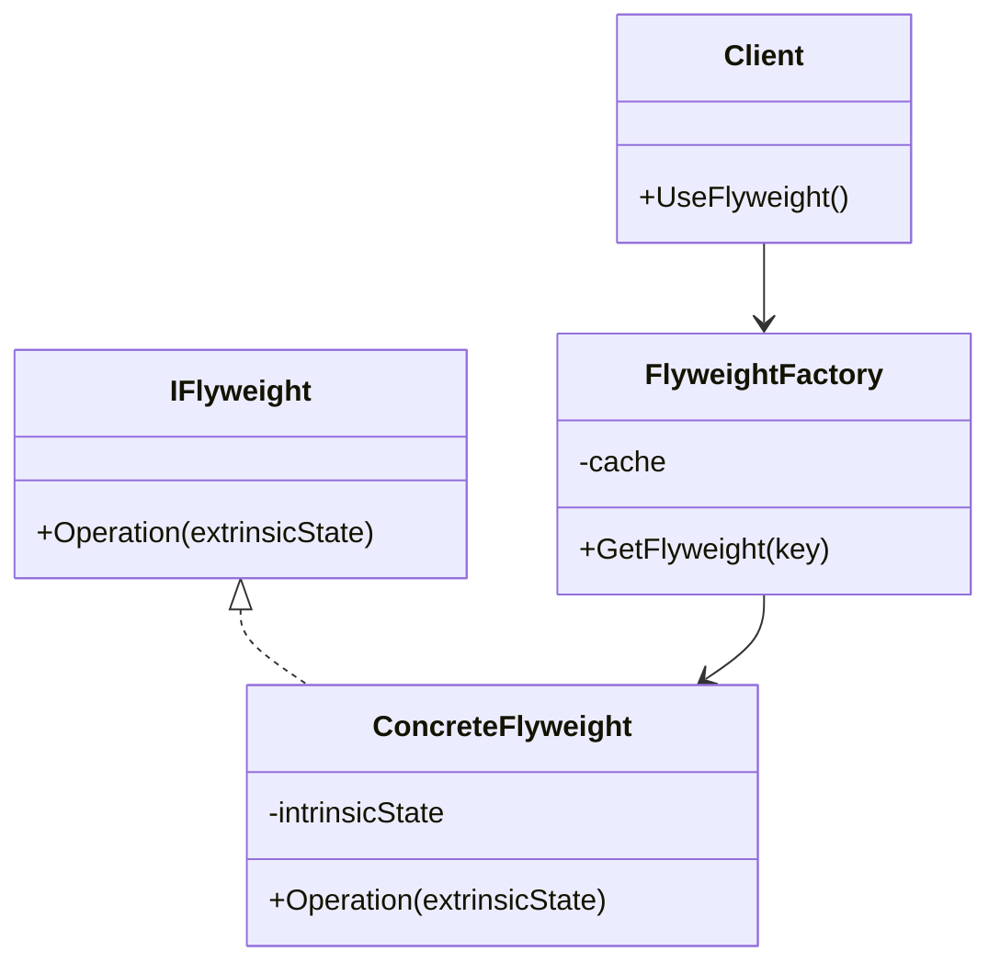
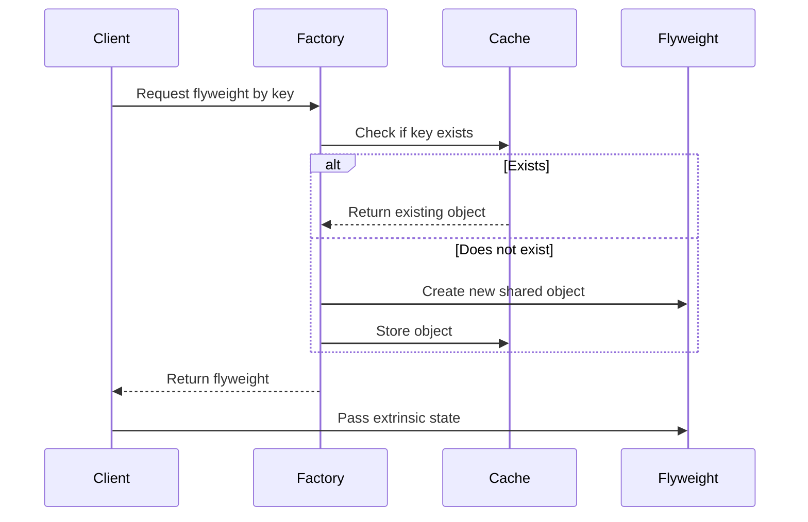

# Flyweight Design Pattern in C# — Interview Preparation Notes

## 1. Topic Overview

### What Is the Flyweight Design Pattern?

The **Flyweight Design Pattern** is a **structural design pattern** that reduces memory usage by sharing common object data instead of creating many duplicate objects.

It is useful when an application needs to create a **large number of similar objects**.

### Simple Explanation

Imagine a text editor showing millions of characters.

Instead of creating one full object for every letter like:

- `A` with font data
- another `A` with the same font data
- another `A` with the same font data

The application shares the common data for the letter `A` and keeps only the changing data, such as position, outside the object.

> **Simple idea:** Reuse shared objects instead of creating duplicate objects.

### Why Is It Important?

The Flyweight pattern is important because it helps:

- Reduce memory usage
- Improve performance
- Avoid creating duplicate objects
- Improve scalability when handling many similar objects

### What Problem Does It Solve?

It solves the problem of **object explosion**.

Without Flyweight:

```text
10,000 trees = 10,000 full tree objects
```

With Flyweight:

```text
10,000 trees = shared tree type objects + unique position data
```

### Where Is It Used in Real-World Projects?

Common real-world uses include:

- Text editors
- Game development
- Graphics rendering
- Caching systems
- UI frameworks
- Icon/image management
- Database metadata caching
- Object pools
- Compiler symbol tables

---

## 2. Core Concepts

## Must Know Concepts

### 2.1 Flyweight Object

#### Definition

A **Flyweight object** is a shared object that stores reusable, common data.

#### Purpose

To avoid creating multiple objects with the same internal data.

#### Why It Exists

Many applications create many similar objects. If each object stores duplicate data, memory usage increases unnecessarily.

#### How It Works

The Flyweight object stores only the **shared state**.

Changing data is passed from outside when needed.

#### Key Points

- Shared between multiple clients
- Usually immutable
- Stores intrinsic state
- Does not store context-specific state

#### Simple Example

A character `A` in a text editor can be shared.

```text
Shared: character value = "A"
External: position = row 5, column 10
```

#### Real-World Example

A game may have thousands of trees. Tree type, texture, and color can be shared. Position and size can be external.

---

### 2.2 Intrinsic State

#### Definition

**Intrinsic state** is the data that is common and shareable between objects.

#### Purpose

To store reusable data inside the Flyweight object.

#### Why It Exists

It allows multiple objects to share the same data instead of duplicating it.

#### How It Works

The intrinsic state is stored inside the Flyweight object and usually does not change.

#### Key Points

- Shared
- Internal
- Usually immutable
- Same across many objects

#### Simple Example

For a tree:

```text
Tree type
Texture
Color
Shape
```

#### Real-World Example

In a document editor, font family and character symbol may be intrinsic data.

---

### 2.3 Extrinsic State

#### Definition

**Extrinsic state** is the data that changes per object and must be supplied from outside.

#### Purpose

To keep unique object-specific data outside the shared Flyweight object.

#### Why It Exists

If changing data were stored inside the shared object, sharing would become unsafe or incorrect.

#### How It Works

The client passes extrinsic state to the Flyweight method during operation.

#### Key Points

- Not shared
- Provided by the client
- Context-specific
- Stored outside the Flyweight object

#### Simple Example

For a tree:

```text
X position
Y position
Height
Current health
```

#### Real-World Example

In a text editor, the character `A` can be shared, but each character’s position is different.

---

### 2.4 Flyweight Factory

#### Definition

A **Flyweight Factory** creates and manages Flyweight objects.

#### Purpose

To ensure shared objects are reused instead of recreated.

#### Why It Exists

Without a factory, clients may create duplicate objects manually.

#### How It Works

The factory checks whether a Flyweight object already exists.

- If yes, it returns the existing object.
- If no, it creates one, stores it, and returns it.

#### Key Points

- Central place for object reuse
- Usually uses dictionary/cache internally
- Controls object creation
- Prevents duplicates

#### Simple Example

```text
GetTreeType("Oak") returns existing Oak type if already created.
```

#### Real-World Example

A font factory may return existing font objects instead of creating new ones repeatedly.

---

## Good to Know Concepts

### 2.5 Object Sharing

#### Definition

Object sharing means multiple parts of the application use the same instance.

#### Purpose

To save memory and reduce object creation overhead.

#### Key Points

- Works best with immutable objects
- Requires careful state separation
- Can introduce bugs if shared objects are mutable

---

### 2.6 Immutability

#### Definition

An immutable object cannot be changed after creation.

#### Purpose

Immutability makes shared Flyweight objects safe.

#### Why It Exists

If multiple clients share the same object, one client should not accidentally affect others.

#### Example

```csharp
public sealed class TreeType
{
    public string Name { get; }
    public string Color { get; }

    public TreeType(string name, string color)
    {
        Name = name;
        Color = color;
    }
}
```

---

### 2.7 Cache Key

#### Definition

A **cache key** uniquely identifies a Flyweight object.

#### Purpose

To allow the factory to find and reuse existing Flyweight instances.

#### Example

```text
"Oak_Green_RoughTexture"
```

---

## Advanced Concepts

### 2.8 Managed Flyweight

A **managed Flyweight** is created and controlled by a factory.

Most common production implementations use this approach.

---

### 2.9 Unmanaged Flyweight

An **unmanaged Flyweight** is created directly by clients.

This is less common because it can lead to duplicate objects.

---

### 2.10 Thread-Safe Flyweight Factory

In multi-threaded applications, the factory must prevent duplicate creation when multiple threads request the same Flyweight simultaneously.

In C#, this is commonly handled using:

- `ConcurrentDictionary<TKey, TValue>`
- `lock`
- `Lazy<T>`

---

## 3. How It Works Internally

### Architecture

The Flyweight pattern usually has these components:

1. **Flyweight Interface**
2. **Concrete Flyweight**
3. **Flyweight Factory**
4. **Client**
5. **Extrinsic State**



### Execution Flow



### Step-by-Step Internal Working

1. Client identifies shared data.
2. Client asks the factory for a Flyweight object.
3. Factory checks internal cache.
4. If object exists, factory returns it.
5. If object does not exist, factory creates and stores it.
6. Client passes unique/extrinsic data to the Flyweight method.
7. Flyweight performs operation using:
   - Intrinsic state from itself
   - Extrinsic state from the client

### Behind the Scenes

Internally, the pattern relies on:

- A cache or dictionary
- Shared immutable objects
- Externalized unique state
- Controlled object creation

---

## 4. Important Terminology

| Term | Meaning | Example |
| ---- | ------- | ------- |
| Flyweight | Shared reusable object | Shared `TreeType` object |
| Intrinsic State | Internal shared state | Tree color, texture |
| Extrinsic State | External unique state | Tree position |
| Flyweight Factory | Creates and reuses Flyweights | `TreeTypeFactory` |
| Object Sharing | Multiple clients use same object | Same font object reused |
| Cache Key | Identifier for shared object | `"Arial_12_Bold"` |
| Immutable Object | Object that cannot change after creation | Read-only font style |
| Structural Pattern | Pattern concerned with object composition | Flyweight, Adapter, Decorator |
| Object Explosion | Too many similar objects created | Millions of character objects |
| Memory Optimization | Reducing memory consumption | Reusing shared objects |

---

## 5. Important Comparisons

| Concept A | Concept B | Key Difference | When to Use |
| --------- | --------- | -------------- | ----------- |
| Flyweight | Singleton | Flyweight can have many shared instances; Singleton has one instance | Use Flyweight for many reusable objects |
| Flyweight | Object Pool | Flyweight shares objects; Object Pool reuses temporary objects | Use Object Pool for expensive reusable resources |
| Flyweight | Prototype | Flyweight reuses existing objects; Prototype clones objects | Use Prototype when object copying is needed |
| Intrinsic State | Extrinsic State | Intrinsic is shared; extrinsic is unique | Separate common and unique data |
| Flyweight | Cache | Cache stores data for reuse; Flyweight is a design pattern using caching | Use Flyweight when object structure matters |
| Flyweight | Factory Method | Factory Method creates objects; Flyweight Factory reuses objects | Use Flyweight Factory to prevent duplication |

### Flyweight vs Singleton

| Flyweight | Singleton |
| --------- | --------- |
| Multiple shared objects may exist | Only one instance exists |
| Uses keys to identify objects | Usually global access |
| Optimizes memory for many similar objects | Controls single instance creation |

> **Interview Tip:** Flyweight is not the same as Singleton. Flyweight may manage many shared objects.

### Flyweight vs Object Pool

| Flyweight | Object Pool |
| --------- | ----------- |
| Shared object is usually immutable | Pooled object is usually mutable |
| Same object may be used by many clients | Object is borrowed and returned |
| Reduces duplicate state | Reduces expensive allocation |

---

## 6. Practical Examples

## Example 1: Tree Rendering in a Game

### Problem

A game needs to render 100,000 trees. Each tree has:

- Type
- Color
- Texture
- X position
- Y position

Creating full objects for every tree wastes memory.

### Approach

Separate:

- Shared data: type, color, texture
- Unique data: position

### Solution

```csharp
public sealed class TreeType
{
    private readonly string name;
    private readonly string color;
    private readonly string texture;

    public TreeType(string name, string color, string texture)
    {
        this.name = name;
        this.color = color;
        this.texture = texture;
    }

    public void Draw(int x, int y)
    {
        Console.WriteLine("Drawing {0} tree at ({1}, {2}) with color {3} and texture {4}",
            name,
            x,
            y,
            color,
            texture);
    }
}

public sealed class TreeTypeFactory
{
    private readonly Dictionary<string, TreeType> treeTypes = new Dictionary<string, TreeType>();

    public TreeType GetTreeType(string name, string color, string texture)
    {
        string key = name + "_" + color + "_" + texture;

        TreeType treeType;
        if (!treeTypes.TryGetValue(key, out treeType))
        {
            treeType = new TreeType(name, color, texture);
            treeTypes[key] = treeType;
        }

        return treeType;
    }
}

public sealed class Tree
{
    private readonly int x;
    private readonly int y;
    private readonly TreeType treeType;

    public Tree(int x, int y, TreeType treeType)
    {
        this.x = x;
        this.y = y;
        this.treeType = treeType;
    }

    public void Draw()
    {
        treeType.Draw(x, y);
    }
}
```

### Why This Approach Was Chosen

Because tree type data is repeated many times and can be shared safely.

### Alternatives

- Create full tree objects
- Use object pooling
- Use database-backed references
- Use ECS architecture in game systems

### Trade-Offs

| Benefit | Trade-Off |
| ------- | --------- |
| Saves memory | More complex design |
| Reduces duplicate objects | Requires state separation |
| Improves scalability | Factory must be managed carefully |

---

## Example 2: Text Editor Character Rendering

### Problem

A document may contain millions of characters. Storing font, style, and glyph data per character is expensive.

### Approach

Share character glyph objects.

### Solution

```csharp
public sealed class CharacterGlyph
{
    private readonly char symbol;
    private readonly string fontFamily;
    private readonly int fontSize;

    public CharacterGlyph(char symbol, string fontFamily, int fontSize)
    {
        this.symbol = symbol;
        this.fontFamily = fontFamily;
        this.fontSize = fontSize;
    }

    public void Render(int row, int column)
    {
        Console.WriteLine("Rendering '{0}' at row {1}, column {2} using {3} {4}px",
            symbol,
            row,
            column,
            fontFamily,
            fontSize);
    }
}

public sealed class GlyphFactory
{
    private readonly Dictionary<string, CharacterGlyph> glyphs = new Dictionary<string, CharacterGlyph>();

    public CharacterGlyph GetGlyph(char symbol, string fontFamily, int fontSize)
    {
        string key = symbol + "_" + fontFamily + "_" + fontSize;

        CharacterGlyph glyph;
        if (!glyphs.TryGetValue(key, out glyph))
        {
            glyph = new CharacterGlyph(symbol, fontFamily, fontSize);
            glyphs[key] = glyph;
        }

        return glyph;
    }
}
```

### Why This Approach Was Chosen

Characters with the same symbol and font style can share rendering data.

### Trade-Off

The editor must separately store character positions.

---

## Example 3: Product Category Metadata in an E-Commerce System

### Problem

Thousands of products may belong to the same category. If every product stores full category metadata, memory is wasted.

### Approach

Use shared category metadata.

### Solution

```csharp
public sealed class CategoryMetadata
{
    public string CategoryCode { get; private set; }
    public string DisplayName { get; private set; }
    public string TaxGroup { get; private set; }

    public CategoryMetadata(string categoryCode, string displayName, string taxGroup)
    {
        CategoryCode = categoryCode;
        DisplayName = displayName;
        TaxGroup = taxGroup;
    }
}

public sealed class Product
{
    public int ProductId { get; private set; }
    public string ProductName { get; private set; }
    public CategoryMetadata Category { get; private set; }

    public Product(int productId, string productName, CategoryMetadata category)
    {
        ProductId = productId;
        ProductName = productName;
        Category = category;
    }
}
```

### Why This Approach Was Chosen

Category metadata is shared and changes rarely.

### Alternatives

- Store category ID only
- Load category from database when needed
- Use distributed cache

---

## 7. Interview Questions

# Beginner Questions

## Question 1

### Question

What is the Flyweight Design Pattern?

### Short Interview Answer

The Flyweight pattern is a structural design pattern that reduces memory usage by sharing common object data between many similar objects.

### Detailed Explanation

It separates object state into:

- **Intrinsic state**: shared and stored inside the Flyweight
- **Extrinsic state**: unique and supplied externally

### Example

A text editor shares glyph objects for repeated characters.

### Possible Follow-up Question

What is the difference between intrinsic and extrinsic state?

---

## Question 2

### Question

Why do we use the Flyweight pattern?

### Short Interview Answer

We use it to reduce memory usage when many objects share similar data.

### Detailed Explanation

Instead of creating duplicate objects with repeated data, the Flyweight pattern reuses shared objects.

### Example

A forest simulation can share tree type data across thousands of tree instances.

### Possible Follow-up Question

When should you avoid Flyweight?

---

## Question 3

### Question

Which category of design pattern does Flyweight belong to?

### Short Interview Answer

Flyweight is a **structural design pattern**.

### Detailed Explanation

Structural patterns deal with how classes and objects are composed to form larger structures.

### Possible Follow-up Question

Name other structural design patterns.

---

# Intermediate Questions

## Question 4

### Question

What are intrinsic and extrinsic states?

### Short Interview Answer

Intrinsic state is shared internal data. Extrinsic state is unique external data passed by the client.

### Detailed Explanation

Flyweight works by storing only reusable data inside the shared object and moving object-specific data outside.

### Example

For a tree:

- Intrinsic: type, color, texture
- Extrinsic: location, height, health

### Possible Follow-up Question

Why should intrinsic state usually be immutable?

---

## Question 5

### Question

What is the role of the Flyweight Factory?

### Short Interview Answer

The Flyweight Factory manages shared objects and returns existing instances when possible.

### Detailed Explanation

It uses a cache or dictionary to avoid duplicate object creation.

### Example

`GlyphFactory.GetGlyph('A', "Arial", 12)` returns an existing glyph if already created.

### Possible Follow-up Question

How would you make the factory thread-safe?

---

## Question 6

### Question

How is Flyweight different from Singleton?

### Short Interview Answer

Singleton ensures one instance of a class. Flyweight allows multiple shared instances identified by keys.

### Detailed Explanation

Flyweight is about memory optimization through sharing. Singleton is about controlling instance count.

### Possible Follow-up Question

Can a Flyweight Factory be implemented as a Singleton?

---

# Advanced Questions

## Question 7

### Question

How would you make a Flyweight implementation thread-safe in C#?

### Short Interview Answer

Use `ConcurrentDictionary<TKey, TValue>` or locking to ensure only one Flyweight is created per key.

### Detailed Explanation

Multiple threads may request the same key at the same time. Without synchronization, duplicate objects may be created.

### Example

```csharp
using System.Collections.Concurrent;

public sealed class ThreadSafeGlyphFactory
{
    private readonly ConcurrentDictionary<string, CharacterGlyph> glyphs =
        new ConcurrentDictionary<string, CharacterGlyph>();

    public CharacterGlyph GetGlyph(char symbol, string fontFamily, int fontSize)
    {
        string key = symbol + "_" + fontFamily + "_" + fontSize;

        return glyphs.GetOrAdd(
            key,
            value => new CharacterGlyph(symbol, fontFamily, fontSize));
    }
}
```

### Possible Follow-up Question

What are the trade-offs of using `ConcurrentDictionary`?

---

## Question 8

### Question

What are the disadvantages of the Flyweight pattern?

### Short Interview Answer

It increases design complexity and requires careful separation of shared and unique state.

### Detailed Explanation

If state is separated incorrectly, shared objects may behave incorrectly or cause bugs.

### Key Disadvantages

- More complex code
- Harder debugging
- Cache management required
- Not useful when objects do not share much data

### Possible Follow-up Question

Can Flyweight cause memory leaks?

---

## Question 9

### Question

Can Flyweight objects be mutable?

### Short Interview Answer

They can be, but they should usually be immutable.

### Detailed Explanation

Mutable shared objects are risky because one client can change data used by other clients.

### Example

If a shared font object changes size, all characters using that font may change unexpectedly.

### Possible Follow-up Question

How can immutability improve thread safety?

---

## 8. Tricky Interview Questions

## Question 1

### Question

If Flyweight reduces objects, does it always improve performance?

### Answer

No. It mainly reduces memory usage. It may add lookup overhead because objects are retrieved from a factory or cache.

---

## Question 2

### Question

What happens if extrinsic state is accidentally stored inside a Flyweight object?

### Answer

The shared object becomes context-specific, causing incorrect behavior when reused by multiple clients.

---

## Question 3

### Question

Can Flyweight increase memory usage?

### Answer

Yes. If the cache grows without limits or stores rarely used objects, memory usage can increase.

---

## Question 4

### Question

Why is immutability important in Flyweight?

### Answer

Because shared objects are used by multiple clients. Immutability prevents one client from changing data that affects others.

---

## Question 5

### Question

Is a cache automatically a Flyweight pattern?

### Answer

No. A cache stores reusable data, but Flyweight is a design pattern focused on sharing object state by separating intrinsic and extrinsic data.

---

## Question 6

### Question

What if every object has mostly unique data?

### Answer

Flyweight is not useful because there is little shared state to reuse.

---

## Question 7

### Question

Can Flyweight be used with dependency injection?

### Answer

Yes. The Flyweight Factory can be registered as a service and injected where shared objects are needed.

---

## Question 8

### Question

What is the hidden cost of Flyweight?

### Answer

The hidden cost is increased complexity, cache lookup overhead, and possible cache lifecycle management issues.

---

## 9. Scenario-Based Questions

## Scenario 1: Rendering One Million Map Markers

### Scenario

A map application displays one million markers. Many markers use the same icon and color.

### Approach

Use Flyweight for marker style data.

### Why It Works

Icon, color, and shape are shared. Coordinates are extrinsic.

### Trade-Offs

- Saves memory
- Adds factory/cache complexity

### Alternatives

- Load icons on demand
- Use clustering
- Use image sprite sheets

### What the Interviewer Is Testing

Understanding of intrinsic vs extrinsic state.

---

## Scenario 2: Large Document Editor

### Scenario

A document editor must display a large file efficiently.

### Approach

Use shared glyph objects for characters and font styles.

### Why It Works

Character rendering data can be shared, while position remains external.

### Trade-Offs

- Efficient memory usage
- More complicated layout management

### Alternatives

- Virtualized rendering
- Lazy loading
- Text buffer optimization

### What the Interviewer Is Testing

Whether you can apply Flyweight to a real-world UI problem.

---

## Scenario 3: Product Catalog with Repeated Metadata

### Scenario

An e-commerce system loads 500,000 products. Many products share brand, category, and tax metadata.

### Approach

Use shared metadata objects.

### Why It Works

Category and brand metadata is repeated and mostly immutable.

### Trade-Offs

- Reduces memory duplication
- Requires cache invalidation if metadata changes

### Alternatives

- Store IDs only
- Use database joins
- Use distributed cache

### What the Interviewer Is Testing

Ability to apply Flyweight outside graphical examples.

---

## 10. Real-World Usage

### Common Use Cases

- Text editors
- Game engines
- UI controls
- Icons and fonts
- Map markers
- Product metadata
- Permission metadata
- Compiler tokens
- Logging metadata

### When to Use Flyweight

Use Flyweight when:

- Many objects are created
- Objects share significant common data
- Shared data is immutable or rarely changes
- Memory usage is a concern
- Object creation is expensive

### When NOT to Use Flyweight

Avoid Flyweight when:

- Objects are mostly unique
- Object count is small
- Code simplicity is more important
- Shared state changes frequently
- Cache invalidation would be complex

### Design Considerations

- Identify shared data clearly
- Keep Flyweights immutable
- Use a factory
- Use good cache keys
- Consider thread safety
- Monitor cache growth

### Scalability

Flyweight improves scalability by reducing memory per logical object.

### Reliability

Reliability depends on correct state separation and safe shared object handling.

### Maintainability

Flyweight can reduce duplication but may make code harder to understand if overused.

---

## 11. Performance & Optimization

### Time Complexity

| Operation | Complexity |
| --------- | ---------- |
| Get Flyweight from dictionary | `O(1)` average |
| Create new Flyweight | `O(1)` plus constructor cost |
| Render/use Flyweight | Depends on operation |

### Space Complexity

Without Flyweight:

```text
O(number of objects × full object size)
```

With Flyweight:

```text
O(number of unique shared states + number of extrinsic states)
```

### Performance Considerations

Benefits:

- Lower memory usage
- Less garbage collection pressure
- Fewer duplicate allocations

Costs:

- Cache lookup overhead
- More indirection
- More complex code
- Possible synchronization overhead

### Bottlenecks

- Poor cache key design
- Lock contention
- Unbounded cache growth
- Expensive object creation inside factory
- Excessive string concatenation for keys

### Optimization Techniques

- Use immutable Flyweights
- Use `ConcurrentDictionary` for thread safety
- Use value-based cache keys
- Avoid oversized Flyweights
- Limit cache size if needed
- Use lazy loading
- Measure memory before and after

> **Interview Tip:** Flyweight is a memory optimization pattern first. Do not claim it always improves CPU performance.

---

## 12. Common Mistakes

### Conceptual Mistakes

- Thinking Flyweight is the same as Singleton
- Thinking every cache is Flyweight
- Ignoring extrinsic state
- Assuming Flyweight is always faster
- Using it when object count is small

### Implementation Mistakes

- Storing unique state inside Flyweight
- Making Flyweight mutable
- Not using a factory
- Using weak cache keys
- Ignoring thread safety
- Letting cache grow forever

### Interview Mistakes

- Not explaining intrinsic vs extrinsic state
- Only giving textbook definitions
- Not mentioning trade-offs
- Not giving real-world examples
- Confusing Flyweight with Object Pool

---

## 13. Best Practices

### 1. Separate Intrinsic and Extrinsic State Clearly

This is the foundation of the pattern.

### 2. Keep Flyweight Objects Immutable

Immutable objects are safer to share.

### 3. Use a Factory

The factory prevents duplicate object creation.

### 4. Use Meaningful Cache Keys

A bad key can cause incorrect sharing or unnecessary duplication.

### 5. Consider Thread Safety

Factories used in web apps or services may be accessed by multiple threads.

### 6. Avoid Overusing the Pattern

Use it only when memory savings justify the complexity.

### 7. Monitor Cache Size

Unbounded caches can become memory leaks.

### 8. Prefer Composition

Use Flyweight as a shared component inside larger objects.

### 9. Measure Before Optimizing

Use profiling to confirm that memory usage is a real issue.

### 10. Document State Ownership

Clearly document what is intrinsic and what is extrinsic.

---

## 14. Interview Cheat Sheet

### Key Definition

**Flyweight** is a structural design pattern that reduces memory usage by sharing common object data between many similar objects.

### Core Concepts

- Flyweight object
- Intrinsic state
- Extrinsic state
- Flyweight Factory
- Object sharing
- Immutability
- Cache key

### Must-Remember Difference

| Term | Meaning |
| ---- | ------- |
| Intrinsic State | Shared internal state |
| Extrinsic State | Unique external state |

### Common Examples

- Text editor characters
- Game trees
- Map markers
- Icons
- Fonts
- Product metadata

### Common Questions

- What problem does Flyweight solve?
- What is intrinsic state?
- What is extrinsic state?
- How is Flyweight different from Singleton?
- What are the drawbacks?
- How do you make it thread-safe?

### Must-Remember Points

- Flyweight reduces memory usage.
- It works best with many similar objects.
- Shared data should be immutable.
- Unique data should be external.
- A factory usually manages Flyweights.
- It adds complexity and cache management concerns.

---

## 15. Rapid-Fire Interview Questions

1. **What is Flyweight?**  
   A structural pattern that shares common object data to reduce memory usage.

2. **What problem does it solve?**  
   It solves memory waste caused by many duplicate objects.

3. **What is intrinsic state?**  
   Shared state stored inside the Flyweight.

4. **What is extrinsic state?**  
   Unique state supplied externally by the client.

5. **Is Flyweight structural, creational, or behavioral?**  
   Structural.

6. **What is the role of the Flyweight Factory?**  
   It creates, caches, and reuses Flyweight objects.

7. **Should Flyweight objects be immutable?**  
   Yes, usually.

8. **Can Flyweight improve performance?**  
   It can reduce memory and GC pressure, but may add lookup overhead.

9. **Is Flyweight the same as Singleton?**  
   No. Singleton has one instance; Flyweight may have many shared instances.

10. **Is every cache a Flyweight?**  
    No. Flyweight specifically separates shared and unique object state.

11. **When should you avoid Flyweight?**  
    When objects do not share much data or object count is small.

12. **What is a common Flyweight example?**  
    Character glyphs in a text editor.

13. **Can Flyweight cause bugs?**  
    Yes, if shared objects contain mutable or context-specific state.

14. **How do you make a Flyweight Factory thread-safe?**  
    Use `ConcurrentDictionary` or locking.

15. **What is object explosion?**  
    Creating too many similar objects, causing memory waste.

16. **What data should be stored in Flyweight?**  
    Shared, reusable, usually immutable data.

17. **What data should stay outside Flyweight?**  
    Object-specific changing data.

18. **Can Flyweight be used in web applications?**  
    Yes, for shared metadata, templates, permissions, or configuration.

19. **What is the biggest drawback of Flyweight?**  
    Increased design complexity.

20. **What should you mention in interviews?**  
    Intrinsic state, extrinsic state, factory, memory savings, and trade-offs.

---

## 16. Mock Interview

This section is designed to be interactive.

Answer the first question. After your answer, continue the mock interview by asking for evaluation.

### Question 1 of 10

What is the Flyweight Design Pattern, and what problem does it solve?

> **Do not read an answer first. Try to answer in your own words.**

After you answer, the evaluator should:

1. Rate your answer from **1–10**
2. Tell you what you got right
3. Tell you what you missed
4. Correct mistakes
5. Provide an ideal interview answer
6. Ask the next question

### Question Progression

The mock interview should gradually cover:

1. Definition and problem solved
2. Intrinsic vs extrinsic state
3. Flyweight Factory
4. Real-world examples
5. Flyweight vs Singleton
6. Flyweight vs Object Pool
7. Thread safety
8. Cache invalidation
9. Performance trade-offs
10. Advanced design scenario

---

## 17. Final Interview Revision

### 25 Most Important Things to Remember

1. Flyweight is a **structural design pattern**.
2. It reduces memory usage by sharing common data.
3. It is useful when many similar objects exist.
4. The main goal is memory optimization.
5. It separates state into intrinsic and extrinsic state.
6. Intrinsic state is shared.
7. Extrinsic state is unique and passed externally.
8. Flyweight objects should usually be immutable.
9. A Flyweight Factory manages shared objects.
10. The factory commonly uses a dictionary or cache.
11. Flyweight is not the same as Singleton.
12. Flyweight is not the same as Object Pool.
13. Singleton controls one instance.
14. Object Pool reuses temporary objects.
15. Flyweight shares object state.
16. Text editors are a classic Flyweight example.
17. Game trees and map markers are strong practical examples.
18. Flyweight can reduce garbage collection pressure.
19. It can add cache lookup overhead.
20. It can make code more complex.
21. It should not be used if objects are mostly unique.
22. Cache keys must be carefully designed.
23. Thread safety matters in multi-threaded systems.
24. Unbounded Flyweight caches can cause memory issues.
25. Always explain both benefits and trade-offs in interviews.

> **Final Interview Tip:** A strong answer should mention **shared state**, **external state**, **factory/cache**, **memory optimization**, and **trade-offs**.