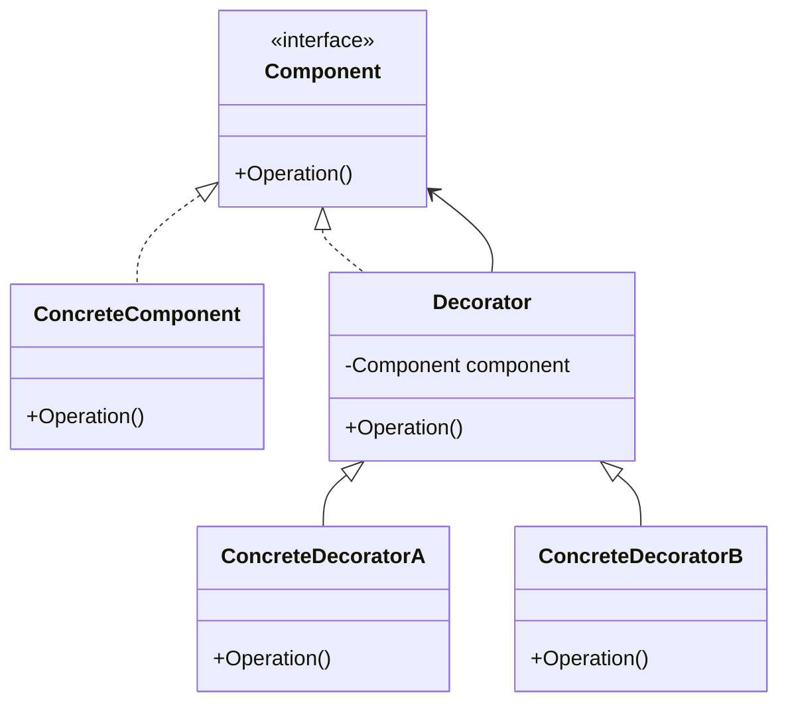
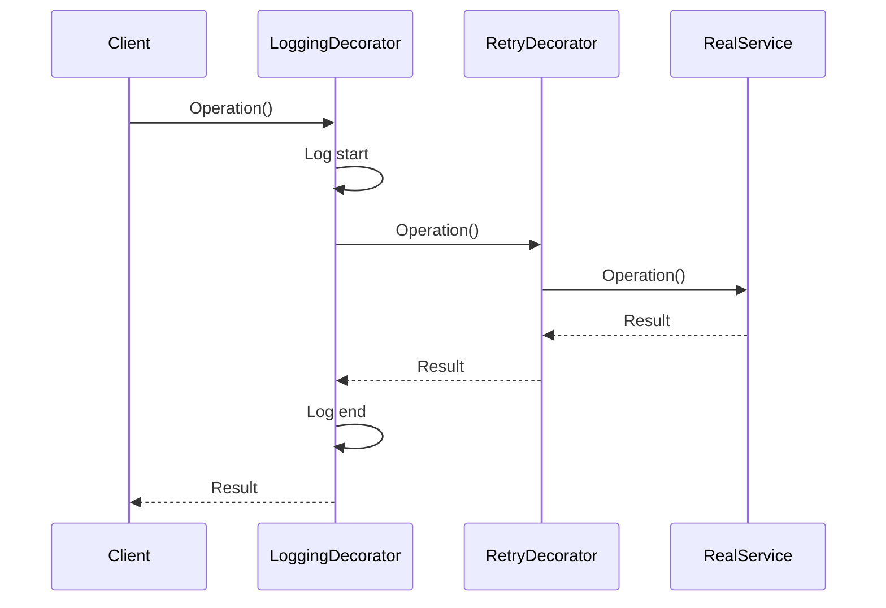

# Decorator Design Pattern in C# - Interview Preparation Notes

## 1. Topic Overview

### What is the Decorator Design Pattern?

The **Decorator Design Pattern** is a **structural design pattern** that allows behavior to be added to an object dynamically without changing the object's original class.

It wraps an existing object inside another object called a **decorator**.

### Simple Explanation

Think of a coffee order:

- Basic coffee costs `$2`
- Add milk: `+$0.50`
- Add sugar: `+$0.25`
- Add whipped cream: `+$1`

Instead of creating separate classes like:

- `MilkCoffee`
- `SugarCoffee`
- `MilkSugarCoffee`
- `MilkSugarWhippedCreamCoffee`

You create decorators that wrap the original coffee and add behavior.

### Why Is It Important?

The Decorator Pattern is important because it helps you:

- Add responsibilities dynamically
- Avoid large inheritance hierarchies
- Follow the **Open/Closed Principle**
- Compose behavior at runtime
- Keep classes focused and reusable

### What Problem Does It Solve?

It solves the problem of **class explosion** caused by inheritance.

Without decorators:

```text
BasicNotifier
EmailNotifier
SmsNotifier
EmailSmsNotifier
EmailSmsSlackNotifier
EmailSlackNotifier
SmsSlackNotifier
```

With decorators:

```text
Notifier
EmailDecorator
SmsDecorator
SlackDecorator
```

You can combine them dynamically.

### Where Is It Used in Real-World Projects?

Common examples include:

- Logging wrappers
- Caching layers
- Authentication/authorization wrappers
- Stream handling
- HTTP request/response pipelines
- Middleware
- Data compression
- Encryption
- Notification systems
- UI components

In .NET, common decorator-like examples include:

- `Stream`
- `BufferedStream`
- `CryptoStream`
- `GZipStream`
- ASP.NET Core middleware
- Dependency Injection decorators
- `HttpMessageHandler`

---

## 2. Core Concepts

## Must Know

### 2.1 Component

#### Definition

The **Component** defines the common interface or abstract class for both the original object and decorators.

#### Purpose

It ensures that decorators and real objects can be used interchangeably.

#### Why It Exists

Without a common abstraction, decorators cannot wrap and expose the same behavior as the original object.

#### How It Works

Both the concrete object and decorators implement the same interface.

#### Key Points

- Usually an interface or abstract class
- Defines the operation being decorated
- Allows substitutability

#### Simple Example

```csharp
public interface INotifier
{
    void Send(string message);
}
```

#### Real-World Example

```csharp
public interface IPaymentProcessor
{
    void ProcessPayment(decimal amount);
}
```

---

### 2.2 Concrete Component

#### Definition

The **Concrete Component** is the original object whose behavior can be extended.

#### Purpose

It provides the base functionality.

#### Why It Exists

It represents the core behavior before any decorators are applied.

#### How It Works

It implements the component interface directly.

#### Key Points

- Contains core business logic
- Does not know about decorators
- Should remain simple and focused

#### Simple Example

```csharp
public class EmailNotifier : INotifier
{
    public void Send(string message)
    {
        Console.WriteLine($"Email sent: {message}");
    }
}
```

#### Real-World Example

```csharp
public class BasicPaymentProcessor : IPaymentProcessor
{
    public void ProcessPayment(decimal amount)
    {
        Console.WriteLine($"Payment processed: {amount}");
    }
}
```

---

### 2.3 Decorator

#### Definition

A **Decorator** is a wrapper object that implements the same interface as the component and holds a reference to another component.

#### Purpose

It adds behavior before or after delegating work to the wrapped object.

#### Why It Exists

It allows behavior to be added without modifying the original class.

#### How It Works

The decorator:

1. Receives a component through constructor injection.
2. Implements the same interface.
3. Calls the wrapped component.
4. Adds extra behavior.

#### Key Points

- Wraps another component
- Implements the same interface
- Can be stacked with other decorators
- Adds behavior dynamically

#### Simple Example

```csharp
public class SmsNotifierDecorator : INotifier
{
    private readonly INotifier notifier;

    public SmsNotifierDecorator(INotifier notifier)
    {
        this.notifier = notifier;
    }

    public void Send(string message)
    {
        notifier.Send(message);
        Console.WriteLine($"SMS sent: {message}");
    }
}
```

#### Real-World Example

```csharp
public class LoggingPaymentProcessorDecorator : IPaymentProcessor
{
    private readonly IPaymentProcessor paymentProcessor;

    public LoggingPaymentProcessorDecorator(IPaymentProcessor paymentProcessor)
    {
        this.paymentProcessor = paymentProcessor;
    }

    public void ProcessPayment(decimal amount)
    {
        Console.WriteLine("Payment processing started.");
        paymentProcessor.ProcessPayment(amount);
        Console.WriteLine("Payment processing completed.");
    }
}
```

---

### 2.4 Concrete Decorator

#### Definition

A **Concrete Decorator** is a specific decorator that adds a specific behavior.

#### Purpose

It encapsulates one additional responsibility.

#### Why It Exists

It keeps additional behavior modular and reusable.

#### How It Works

It wraps another component and extends behavior.

#### Key Points

- Should focus on one responsibility
- Can be combined with other decorators
- Order may matter

#### Example

```csharp
public class RetryPaymentProcessorDecorator : IPaymentProcessor
{
    private readonly IPaymentProcessor paymentProcessor;

    public RetryPaymentProcessorDecorator(IPaymentProcessor paymentProcessor)
    {
        this.paymentProcessor = paymentProcessor;
    }

    public void ProcessPayment(decimal amount)
    {
        try
        {
            paymentProcessor.ProcessPayment(amount);
        }
        catch
        {
            Console.WriteLine("Retrying payment...");
            paymentProcessor.ProcessPayment(amount);
        }
    }
}
```

---

## Good to Know

### 2.5 Runtime Composition

#### Definition

Runtime composition means decorators can be combined while the application is running.

#### Purpose

It gives flexibility to add or remove behavior based on configuration or conditions.

#### Example

```csharp
INotifier notifier = new EmailNotifier();
notifier = new SmsNotifierDecorator(notifier);
notifier = new SlackNotifierDecorator(notifier);

notifier.Send("Order confirmed.");
```

#### Key Point

The final object is still used through the `INotifier` interface.

---

### 2.6 Open/Closed Principle

#### Definition

Classes should be **open for extension but closed for modification**.

#### Purpose

You can add new behavior without changing tested production code.

#### Example

Instead of editing `EmailNotifier`, create:

```csharp
public class PushNotifierDecorator : INotifier
{
    private readonly INotifier notifier;

    public PushNotifierDecorator(INotifier notifier)
    {
        this.notifier = notifier;
    }

    public void Send(string message)
    {
        notifier.Send(message);
        Console.WriteLine($"Push notification sent: {message}");
    }
}
```

---

## Advanced

### 2.7 Decorator Chains

#### Definition

A decorator chain is a sequence of decorators wrapping one another.

#### Example

```text
LoggingDecorator
    -> RetryDecorator
        -> CachingDecorator
            -> RealService
```

#### Key Point

Execution order depends on wrapping order.

---

### 2.8 Transparent vs Semi-Transparent Decorators

| Type | Meaning | Example |
|---|---|---|
| Transparent Decorator | Exposes only the component interface | `INotifier` |
| Semi-Transparent Decorator | Adds extra public methods | `CachedNotifier.ClearCache()` |

> Interview tip: Prefer **transparent decorators** because they preserve substitutability.

---

### 2.9 Decorator with Dependency Injection

Decorators are commonly used with dependency injection containers.

Example use cases:

- Logging service calls
- Adding caching
- Adding retry policies
- Adding validation
- Adding metrics

---

## 3. How It Works Internally

### Architecture



### Components

| Component | Responsibility |
|---|---|
| Component | Defines common contract |
| Concrete Component | Provides base behavior |
| Decorator | Holds reference to component |
| Concrete Decorator | Adds extra behavior |

### Execution Flow



### Step-by-Step Internal Working

1. Client depends on an abstraction such as `INotifier`.
2. A concrete object is created.
3. One or more decorators wrap the concrete object.
4. Client calls the method on the outermost decorator.
5. Each decorator adds behavior.
6. Each decorator delegates to the wrapped object.
7. Eventually, the concrete component executes.
8. Control returns back through the decorator chain.

### Behind the Scenes

If this object graph exists:

```csharp
INotifier notifier =
    new SlackNotifierDecorator(
        new SmsNotifierDecorator(
            new EmailNotifier()));
```

Calling:

```csharp
notifier.Send("Hello");
```

Executes like this:

```text
SlackNotifierDecorator.Send()
  SmsNotifierDecorator.Send()
    EmailNotifier.Send()
  SMS behavior
Slack behavior
```

Depending on where decorator logic is placed, additional behavior can happen before or after the wrapped call.

---

## 4. Important Terminology

| Term | Meaning | Example |
|---|---|---|
| Component | Common interface or base abstraction | `INotifier` |
| Concrete Component | Original class being decorated | `EmailNotifier` |
| Decorator | Wrapper implementing same interface | `NotifierDecorator` |
| Concrete Decorator | Specific behavior wrapper | `SmsNotifierDecorator` |
| Wrapper | Object that contains another object | `LoggingService` wrapping `IService` |
| Composition | Building behavior by combining objects | `new LoggingDecorator(service)` |
| Inheritance | Extending behavior using base classes | `class SmsNotifier : EmailNotifier` |
| Runtime Behavior | Behavior configured while running | Adding decorators based on config |
| Transparent Decorator | Decorator exposing the same contract only | `INotifier` |
| Class Explosion | Too many subclasses for combinations | `EmailSmsSlackNotifier` |
| Open/Closed Principle | Extend without modifying existing code | Add new decorator |
| Delegation | Passing work to wrapped object | `notifier.Send(message)` |
| Chain | Multiple decorators wrapped together | Logging -> Retry -> Service |
| Cross-Cutting Concern | Behavior used across many services | Logging, caching, validation |

---

## 5. Important Comparisons

| Concept A | Concept B | Key Difference | When to Use |
|---|---|---|---|
| Decorator | Inheritance | Decorator adds behavior dynamically; inheritance is static | Use Decorator for flexible combinations |
| Decorator | Proxy | Decorator adds behavior; Proxy controls access | Use Proxy for lazy loading, security, remote calls |
| Decorator | Adapter | Decorator keeps same interface; Adapter changes interface | Use Adapter for incompatible interfaces |
| Decorator | Strategy | Decorator adds responsibilities; Strategy swaps algorithms | Use Strategy for interchangeable algorithms |
| Decorator | Chain of Responsibility | Decorator usually calls wrapped object; Chain may stop processing | Use Chain for request handling pipelines |
| Decorator | Middleware | Middleware is often pipeline-based decorator-like behavior | Use middleware for HTTP/request pipelines |
| Decorator | Facade | Decorator wraps one component; Facade simplifies many subsystems | Use Facade for simplified API |
| Decorator | Extension Method | Decorator changes object behavior; extension method adds syntax-level helper | Use extension methods for utility operations |

### Decorator vs Inheritance

#### Inheritance Example Problem

```csharp
public class EmailSmsSlackNotifier
{
}
```

This does not scale because every combination needs a new class.

#### Decorator Solution

```csharp
INotifier notifier = new EmailNotifier();
notifier = new SmsNotifierDecorator(notifier);
notifier = new SlackNotifierDecorator(notifier);
```

### Trade-Off

| Decorator Advantage | Decorator Disadvantage |
|---|---|
| Flexible composition | More objects |
| Follows Open/Closed Principle | Debugging chain can be harder |
| Avoids subclass explosion | Order of decorators may matter |
| Reusable behavior | Can overcomplicate simple logic |

---

## 6. Practical Examples

## Example 1: Notification System

### Problem

An application needs to send notifications by:

- Email
- SMS
- Slack

Users may enable different combinations.

### Approach

Use `INotifier` as the component and add channels using decorators.

### Solution

```csharp
public interface INotifier
{
    void Send(string message);
}

public class EmailNotifier : INotifier
{
    public void Send(string message)
    {
        Console.WriteLine($"Email sent: {message}");
    }
}

public class SmsNotifierDecorator : INotifier
{
    private readonly INotifier notifier;

    public SmsNotifierDecorator(INotifier notifier)
    {
        this.notifier = notifier;
    }

    public void Send(string message)
    {
        notifier.Send(message);
        Console.WriteLine($"SMS sent: {message}");
    }
}

public class SlackNotifierDecorator : INotifier
{
    private readonly INotifier notifier;

    public SlackNotifierDecorator(INotifier notifier)
    {
        this.notifier = notifier;
    }

    public void Send(string message)
    {
        notifier.Send(message);
        Console.WriteLine($"Slack message sent: {message}");
    }
}

public class Program
{
    public static void Main()
    {
        INotifier notifier = new EmailNotifier();
        notifier = new SmsNotifierDecorator(notifier);
        notifier = new SlackNotifierDecorator(notifier);

        notifier.Send("Order placed successfully.");
    }
}
```

### Why This Approach Was Chosen

- Avoids many notification combination classes
- Easy to add new notification channels
- Behavior can be composed at runtime

### Alternatives

- Inheritance
- Strategy pattern
- Conditional logic inside one class

### Trade-Offs

- More classes
- More object wrapping
- Order may affect behavior

---

## Example 2: Payment Processing with Logging and Retry

### Problem

A payment service needs:

- Core payment processing
- Logging
- Retry on failure

### Approach

Use decorators for logging and retry.

### Solution

```csharp
public interface IPaymentProcessor
{
    void Process(decimal amount);
}

public class PaymentProcessor : IPaymentProcessor
{
    public void Process(decimal amount)
    {
        Console.WriteLine($"Processed payment: {amount}");
    }
}

public class LoggingPaymentProcessorDecorator : IPaymentProcessor
{
    private readonly IPaymentProcessor paymentProcessor;

    public LoggingPaymentProcessorDecorator(IPaymentProcessor paymentProcessor)
    {
        this.paymentProcessor = paymentProcessor;
    }

    public void Process(decimal amount)
    {
        Console.WriteLine("Payment processing started.");
        paymentProcessor.Process(amount);
        Console.WriteLine("Payment processing finished.");
    }
}

public class RetryPaymentProcessorDecorator : IPaymentProcessor
{
    private readonly IPaymentProcessor paymentProcessor;

    public RetryPaymentProcessorDecorator(IPaymentProcessor paymentProcessor)
    {
        this.paymentProcessor = paymentProcessor;
    }

    public void Process(decimal amount)
    {
        try
        {
            paymentProcessor.Process(amount);
        }
        catch
        {
            Console.WriteLine("Retrying payment...");
            paymentProcessor.Process(amount);
        }
    }
}
```

### Usage

```csharp
IPaymentProcessor processor = new PaymentProcessor();
processor = new RetryPaymentProcessorDecorator(processor);
processor = new LoggingPaymentProcessorDecorator(processor);

processor.Process(100);
```

### Why This Works

Each decorator adds one responsibility.

### Alternatives

- Add logging and retry directly inside `PaymentProcessor`
- Use AOP
- Use middleware/pipeline

### Trade-Offs

- Decorator order matters
- Retry should be carefully designed for idempotency

---

## Example 3: File Stream Decorators in .NET

### Problem

Need to write compressed data to a file.

### Approach

Wrap streams.

### Solution

```csharp
using System.IO;
using System.IO.Compression;
using System.Text;

public class Program
{
    public static void Main()
    {
        using (FileStream fileStream = File.Create("data.gz"))
        using (GZipStream gzipStream = new GZipStream(fileStream, CompressionMode.Compress))
        using (StreamWriter writer = new StreamWriter(gzipStream, Encoding.UTF8))
        {
            writer.Write("Hello Decorator Pattern");
        }
    }
}
```

### Why This Is Decorator-Like

- `GZipStream` wraps `FileStream`
- `StreamWriter` wraps another stream
- Each layer adds behavior

---

## 7. Interview Questions

# Beginner Questions

## Question 1

### Question

What is the Decorator Design Pattern?

### Short Interview Answer

The Decorator Pattern is a structural design pattern that adds behavior to an object dynamically by wrapping it with another object that implements the same interface.

### Detailed Explanation

Instead of modifying a class or creating many subclasses, decorators add functionality by composition. The decorator has the same interface as the original object, so the client can use it transparently.

### Example

```csharp
INotifier notifier = new SmsNotifierDecorator(new EmailNotifier());
```

### Possible Follow-up Question

Why not use inheritance instead?

---

## Question 2

### Question

Which design principle does the Decorator Pattern support?

### Short Interview Answer

It supports the **Open/Closed Principle**.

### Detailed Explanation

Existing classes remain closed for modification, while new behavior can be added through new decorators.

### Possible Follow-up Question

Can the Decorator Pattern violate Single Responsibility Principle?

---

## Question 3

### Question

What are the main participants in the Decorator Pattern?

### Short Interview Answer

The main participants are Component, Concrete Component, Decorator, and Concrete Decorator.

### Detailed Explanation

- Component defines the interface.
- Concrete Component provides original behavior.
- Decorator wraps a component.
- Concrete Decorator adds behavior.

### Possible Follow-up Question

Why must the decorator implement the same interface?

---

# Intermediate Questions

## Question 4

### Question

How does the Decorator Pattern avoid class explosion?

### Short Interview Answer

It avoids class explosion by composing behavior dynamically instead of creating subclasses for every feature combination.

### Detailed Explanation

If you have 5 optional features, inheritance may require many combinations. Decorators allow each feature to be implemented once and combined as needed.

### Example

```csharp
notifier = new SmsNotifierDecorator(new SlackNotifierDecorator(new EmailNotifier()));
```

### Possible Follow-up Question

What is the downside of this flexibility?

---

## Question 5

### Question

Does the order of decorators matter?

### Short Interview Answer

Yes, decorator order can matter because each decorator controls what happens before and after calling the wrapped object.

### Detailed Explanation

For example, logging outside retry logs the full retry process. Retry outside logging logs each retry attempt differently.

### Possible Follow-up Question

How would you decide the correct order?

---

## Question 6

### Question

How is Decorator different from Proxy?

### Short Interview Answer

Decorator adds behavior, while Proxy controls access to an object.

### Detailed Explanation

A proxy may perform lazy loading, access control, or remote communication. A decorator enhances the object's responsibilities.

### Possible Follow-up Question

Can a proxy and decorator look similar in code?

---

# Advanced Questions

## Question 7

### Question

How would you implement decorators using dependency injection?

### Short Interview Answer

Register the base service and then register decorators that wrap the service, often using DI container support or factory registration.

### Detailed Explanation

In DI, decorators are useful for cross-cutting concerns like logging, caching, validation, retries, and metrics.

### Possible Follow-up Question

What problems can occur with decorator registration order?

---

## Question 8

### Question

What are the risks of using too many decorators?

### Short Interview Answer

Too many decorators can make debugging harder, increase object creation, and make execution flow less obvious.

### Detailed Explanation

Although decorators improve modularity, long chains can hide behavior and complicate troubleshooting.

### Possible Follow-up Question

How can you reduce decorator complexity?

---

## Question 9

### Question

Can decorators change the return value?

### Short Interview Answer

Yes, decorators can modify input, output, or side effects, as long as they honor the component contract.

### Detailed Explanation

For example, a caching decorator may return a cached result instead of calling the wrapped service.

### Possible Follow-up Question

When can changing the return value be dangerous?

---

## 8. Tricky Interview Questions

## Question 1

### Question

If decorators implement the same interface as the component, how do we know whether we are using the original object or a decorated object?

### Answer

Usually, we do not need to know. That is the point of the pattern. The client depends on the abstraction, not the concrete object.

---

## Question 2

### Question

Can a decorator skip calling the wrapped object?

### Answer

Yes, but it should be intentional. For example, a caching decorator may return cached data without calling the wrapped service.

---

## Question 3

### Question

What happens if a decorator forgets to call the wrapped component?

### Answer

The original behavior may never execute. This can be valid for caching or authorization failure, but accidental omission is a serious bug.

---

## Question 4

### Question

Why is inheritance less flexible than decorators?

### Answer

Inheritance fixes behavior at compile time. Decorators allow behavior to be combined dynamically at runtime.

---

## Question 5

### Question

Can decorators violate the Liskov Substitution Principle?

### Answer

Yes. If a decorator changes expected behavior in a way that breaks the component contract, it violates substitutability.

---

## Question 6

### Question

Is middleware a decorator?

### Answer

Middleware is not always a textbook decorator, but it often uses decorator-like pipeline behavior by wrapping request processing with additional behavior.

---

## Question 7

### Question

Can decorators be stateful?

### Answer

Yes, but stateful decorators require care, especially in multithreaded or singleton scenarios.

---

## Question 8

### Question

What is the hidden cost of decorators?

### Answer

More objects, deeper call stacks, harder debugging, and possible ordering issues.

---

## 9. Scenario-Based Questions

## Scenario 1: Add Logging to Multiple Services

### Scenario

You have multiple services and need logging before and after each method call.

### Approach

Use decorators for each service abstraction.

### Why It Works

Logging is a cross-cutting concern and should not pollute business logic.

### Trade-Offs

- More classes
- Requires DI configuration
- May need generic decorators

### Alternatives

- AOP
- Middleware
- Manual logging inside services

### What the Interviewer Is Testing

- Separation of concerns
- Open/Closed Principle
- Practical architecture thinking

---

## Scenario 2: Add Caching to Product Lookup

### Scenario

A product service fetches data from a database. Frequently requested products should be cached.

### Approach

Create a caching decorator.

### Example

```csharp
public interface IProductService
{
    string GetProductName(int productId);
}

public class ProductService : IProductService
{
    public string GetProductName(int productId)
    {
        return $"Product {productId}";
    }
}

public class CachedProductServiceDecorator : IProductService
{
    private readonly IProductService productService;
    private readonly Dictionary<int, string> cache = new Dictionary<int, string>();

    public CachedProductServiceDecorator(IProductService productService)
    {
        this.productService = productService;
    }

    public string GetProductName(int productId)
    {
        if (cache.ContainsKey(productId))
        {
            return cache[productId];
        }

        string productName = productService.GetProductName(productId);
        cache[productId] = productName;
        return productName;
    }
}
```

### Trade-Offs

- Cache invalidation complexity
- Memory usage
- Thread safety concerns

### What the Interviewer Is Testing

- Practical decorator use
- Caching trade-offs
- Awareness of edge cases

---

## Scenario 3: Add Authorization Around a Service

### Scenario

Only authorized users should access a report service.

### Approach

Use an authorization decorator.

### Why It Works

Authorization is separate from report generation.

### Alternatives

- Attributes
- Middleware
- Policy-based authorization

### Trade-Offs

- Authorization must be consistently applied
- Incorrect DI registration can bypass security

### What the Interviewer Is Testing

- Security awareness
- Correct use of abstraction
- Centralized cross-cutting concerns

---

## 10. Real-World Usage

### Common Use Cases

- Logging
- Caching
- Retry handling
- Validation
- Authorization
- Metrics
- Compression
- Encryption
- Notification channels
- Stream processing

### When to Use It

Use Decorator when:

- You need to add behavior without modifying existing classes
- You need runtime behavior composition
- You want to avoid subclass explosion
- You have cross-cutting concerns
- You want reusable feature layers

### When NOT to Use It

Avoid Decorator when:

- The behavior is simple and unlikely to change
- Only one fixed variation exists
- The object graph becomes too complicated
- The order of behaviors is too difficult to reason about
- A simpler Strategy or Adapter would be clearer

### Design Considerations

- Keep decorators small
- Use interfaces
- Avoid hidden side effects
- Document ordering requirements
- Be careful with exceptions
- Avoid changing core contract behavior

### Scalability

Decorators scale well architecturally because new behavior can be added independently.

### Reliability

Reliability improves when decorators isolate concerns like retries and validation.

### Maintainability

Maintainability improves when decorators remain focused and composable.

---

## 11. Performance & Optimization

### Time Complexity

A decorated call usually has:

```text
O(n)
```

Where `n` is the number of decorators in the chain.

### Space Complexity

Each decorator adds one object.

```text
O(n)
```

### Performance Considerations

- Each decorator adds a method call
- Long chains increase call depth
- Logging decorators can add I/O overhead
- Caching decorators can improve performance
- Retry decorators can increase latency
- Synchronization in decorators can reduce throughput

### Bottlenecks

Common bottlenecks include:

- Expensive logging
- Inefficient cache lookup
- Excessive retries
- Blocking I/O
- Lock contention

### Optimization Techniques

- Keep decorators lightweight
- Use asynchronous APIs where appropriate
- Avoid unnecessary allocation
- Use structured logging
- Use bounded retries
- Use thread-safe caches
- Avoid very deep decorator chains

---

## 12. Common Mistakes

### Conceptual Mistakes

- Thinking Decorator is the same as inheritance
- Confusing Decorator with Proxy
- Assuming decorators must always call the wrapped object
- Believing decorator order never matters

### Implementation Mistakes

- Not implementing the same interface
- Forgetting to delegate to the wrapped object
- Creating decorators with too many responsibilities
- Adding unrelated behavior
- Breaking expected return values
- Making decorators tightly coupled to concrete classes

### Interview Mistakes

- Explaining only the coffee example
- Not mentioning Open/Closed Principle
- Not discussing trade-offs
- Not explaining runtime composition
- Not comparing with Proxy, Adapter, and Strategy
- Not mentioning order dependency

---

## 13. Best Practices

### 1. Depend on Abstractions

Use interfaces like `INotifier` or `IService`.

**Why it matters:** Decorators need substitutability.

---

### 2. Keep Decorators Focused

Each decorator should add one responsibility.

**Why it matters:** Improves readability and testability.

---

### 3. Preserve the Contract

A decorator should behave like the original component from the client's perspective.

**Why it matters:** Prevents Liskov Substitution Principle violations.

---

### 4. Be Careful with Ordering

Document decorator order if it affects behavior.

**Why it matters:** Logging, retry, caching, and authorization can behave differently based on order.

---

### 5. Avoid Overuse

Do not create decorators for trivial behavior.

**Why it matters:** Too many wrappers can make the code harder to debug.

---

### 6. Use Dependency Injection

Configure decorators centrally.

**Why it matters:** Keeps object construction clean and consistent.

---

### 7. Test Decorators Independently

Test each decorator with a fake component.

**Why it matters:** Ensures each behavior works in isolation.

---

## 14. Interview Cheat Sheet

### Key Definition

**Decorator Pattern** adds behavior dynamically by wrapping an object with another object that implements the same interface.

### Core Participants

- Component
- Concrete Component
- Decorator
- Concrete Decorator

### Must-Remember Points

- Structural design pattern
- Uses composition over inheritance
- Supports Open/Closed Principle
- Avoids subclass explosion
- Decorators can be stacked
- Order may matter
- Client uses the same abstraction
- Useful for cross-cutting concerns

### Common Real-World Examples

- `Stream`
- `BufferedStream`
- `GZipStream`
- Logging decorators
- Caching decorators
- Retry decorators
- Middleware-like pipelines

### Important Differences

| Pattern | Key Difference |
|---|---|
| Decorator | Adds behavior |
| Proxy | Controls access |
| Adapter | Converts interface |
| Strategy | Changes algorithm |
| Facade | Simplifies subsystem |

### Common Questions

- What problem does Decorator solve?
- How does it support Open/Closed Principle?
- How is it different from inheritance?
- How is it different from Proxy?
- Does decorator order matter?
- What are disadvantages?

---

## 15. Rapid-Fire Interview Questions

1. **What type of pattern is Decorator?**  
   Structural design pattern.

2. **What does Decorator add?**  
   Additional behavior or responsibility.

3. **Does Decorator use inheritance or composition?**  
   Primarily composition.

4. **Can decorators be stacked?**  
   Yes.

5. **Does decorator order matter?**  
   Yes, often.

6. **Which SOLID principle does it support?**  
   Open/Closed Principle.

7. **What is the base abstraction called?**  
   Component.

8. **What is the original object called?**  
   Concrete Component.

9. **What does a decorator hold internally?**  
   A reference to the component.

10. **Can a decorator skip calling the wrapped object?**  
    Yes, intentionally, such as in caching or authorization.

11. **Main advantage over inheritance?**  
    Runtime flexibility and fewer subclasses.

12. **Main disadvantage?**  
    More objects and harder debugging.

13. **Decorator vs Adapter?**  
    Decorator keeps the same interface; Adapter changes the interface.

14. **Decorator vs Proxy?**  
    Decorator adds behavior; Proxy controls access.

15. **Real .NET example?**  
    `Stream`, `BufferedStream`, `GZipStream`.

16. **Can decorators modify return values?**  
    Yes, if the contract is preserved.

17. **Can decorators be used with DI?**  
    Yes.

18. **What is class explosion?**  
    Too many subclasses for feature combinations.

19. **Is middleware related to Decorator?**  
    Middleware often uses decorator-like wrapping.

20. **When should Decorator be avoided?**  
    When simple direct logic is clearer.

---

## 16. Mock Interview

> Interview mode starts here. Answer the first question, and then the next question can be asked with feedback.

### Question 1 of 10

What is the Decorator Design Pattern, and what problem does it solve?

---

## 17. Final Interview Revision

### 20-30 Most Important Things to Remember

1. Decorator is a **structural design pattern**.
2. It adds behavior dynamically without modifying the original class.
3. It uses **composition over inheritance**.
4. It supports the **Open/Closed Principle**.
5. The decorator implements the same interface as the wrapped object.
6. The original object is called the **Concrete Component**.
7. The abstraction is called the **Component**.
8. A decorator holds a reference to another component.
9. Multiple decorators can be chained.
10. Decorator order can affect behavior.
11. It helps avoid subclass explosion.
12. It is useful for logging, caching, retry, validation, authorization, encryption, and compression.
13. Decorator differs from Proxy because Proxy controls access.
14. Decorator differs from Adapter because Adapter changes the interface.
15. Decorator differs from Strategy because Strategy changes algorithms.
16. Decorators should preserve the component contract.
17. Too many decorators can make debugging difficult.
18. Decorators are commonly used with dependency injection.
19. .NET streams are classic decorator-like examples.
20. Decorators are good for cross-cutting concerns.
21. A decorator can run logic before calling the wrapped object.
22. A decorator can run logic after calling the wrapped object.
23. A decorator can sometimes skip the wrapped object, such as in caching.
24. Decorators should usually have a single responsibility.
25. Avoid decorators when simple conditional logic is clearer.
26. Always mention trade-offs in interviews.
27. Always mention runtime composition.
28. Always explain why inheritance may cause class explosion.
29. Always use practical examples like notification, logging, caching, or streams.
30. The best interview summary: **Decorator wraps an object with another object of the same abstraction to add behavior dynamically and flexibly.**