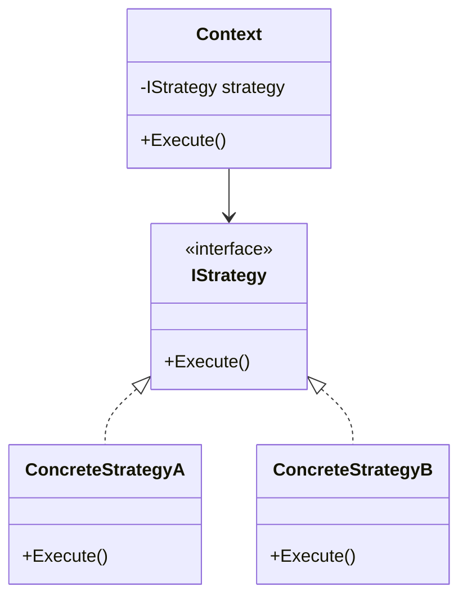
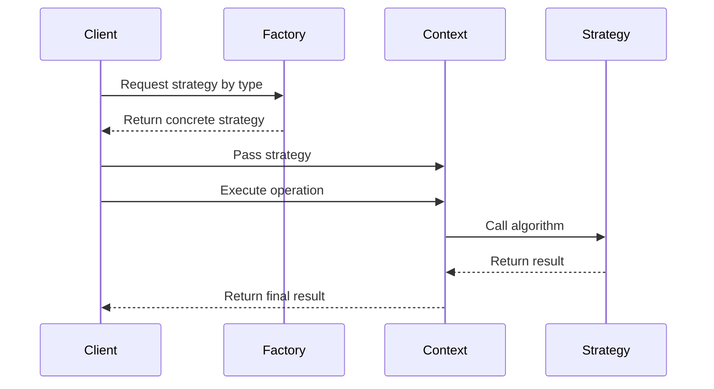

# Strategy Design Pattern in C# — Interview Preparation Notes

## 1. Topic Overview

### What is the Strategy Design Pattern?

The **Strategy Design Pattern** is a behavioral design pattern that lets you define a family of algorithms, put each algorithm into a separate class, and make them interchangeable at runtime.

In simple terms:

> Instead of writing many `if-else` or `switch` statements to choose behavior, Strategy moves each behavior into its own class and lets the main object use whichever behavior it needs.

### Very Simple Explanation

Imagine a payment system.

A customer can pay using:

- Credit Card
- UPI
- Wallet
- Net Banking

Instead of writing this:

```csharp
if (paymentType == "CreditCard")
{
    // credit card logic
}
else if (paymentType == "UPI")
{
    // UPI logic
}
else if (paymentType == "Wallet")
{
    // wallet logic
}
```

You create separate strategy classes:

- `CreditCardPaymentStrategy`
- `UpiPaymentStrategy`
- `WalletPaymentStrategy`

Then your payment service simply calls:

```csharp
paymentStrategy.Pay(amount);
```

The actual payment behavior depends on the selected strategy.

---

### Why is it important?

The Strategy Pattern is important because it helps you:

- Avoid large `if-else` or `switch` blocks
- Follow the **Open/Closed Principle**
- Make behavior easily replaceable
- Improve testability
- Keep code clean and maintainable
- Add new algorithms without changing existing business logic

---

### What problem does it solve?

It solves the problem of having multiple variations of an algorithm inside one class.

Without Strategy:

- One class becomes too large
- Adding new behavior requires modifying existing code
- Code becomes harder to test
- Code violates the Open/Closed Principle

With Strategy:

- Each behavior is isolated
- New behavior can be added as a new class
- Existing code remains mostly unchanged
- Runtime behavior can be changed easily

---

### Where is it used in real-world projects?

Common real-world examples:

- Payment processing
- Discount calculation
- Shipping cost calculation
- Authentication methods
- File export formats
- Logging providers
- Validation rules
- Sorting algorithms
- Tax calculation
- Notification sending
- Compression algorithms
- Encryption/decryption algorithms
- Pricing rules
- Retry policies

---

## 2. Core Concepts

## Must Know Concepts

### 2.1 Strategy Interface

#### Definition

A **Strategy Interface** defines the common contract that all concrete strategies must follow.

#### Purpose

It allows the context class to use different algorithms without knowing their internal details.

#### Why it exists

Without a common interface, the context class would need to know each concrete class directly.

#### How it works

All strategy classes implement the same interface.

```csharp
public interface IPaymentStrategy
{
    void Pay(decimal amount);
}
```

#### Key Points to Remember

- Defines common behavior
- Enables polymorphism
- Makes strategies interchangeable
- Context depends on abstraction, not implementation

#### Simple Example

```csharp
public interface ICompressionStrategy
{
    void Compress(string filePath);
}
```

#### Real-World Example

```csharp
public interface IDiscountStrategy
{
    decimal ApplyDiscount(decimal amount);
}
```

---

### 2.2 Concrete Strategy

#### Definition

A **Concrete Strategy** is a class that implements the strategy interface and contains one specific algorithm.

#### Purpose

It separates each algorithm into its own class.

#### Why it exists

Each algorithm can evolve independently without affecting others.

#### How it works

Each class implements the same method differently.

```csharp
public class CreditCardPaymentStrategy : IPaymentStrategy
{
    public void Pay(decimal amount)
    {
        Console.WriteLine("Paid " + amount + " using Credit Card.");
    }
}

public class UpiPaymentStrategy : IPaymentStrategy
{
    public void Pay(decimal amount)
    {
        Console.WriteLine("Paid " + amount + " using UPI.");
    }
}
```

#### Key Points to Remember

- One strategy class should represent one algorithm
- Avoid putting multiple unrelated behaviors in one strategy
- Strategies should be easy to test independently

#### Real-World Example

```csharp
public class PercentageDiscountStrategy : IDiscountStrategy
{
    private readonly decimal percentage;

    public PercentageDiscountStrategy(decimal percentage)
    {
        this.percentage = percentage;
    }

    public decimal ApplyDiscount(decimal amount)
    {
        return amount - (amount * percentage / 100);
    }
}
```

---

### 2.3 Context Class

#### Definition

The **Context** is the class that uses a strategy to perform behavior.

#### Purpose

It delegates algorithm-specific work to a strategy object.

#### Why it exists

The context should not contain algorithm-specific decision logic.

#### How it works

The context receives a strategy and calls its method.

```csharp
public class PaymentService
{
    private readonly IPaymentStrategy paymentStrategy;

    public PaymentService(IPaymentStrategy paymentStrategy)
    {
        this.paymentStrategy = paymentStrategy;
    }

    public void ProcessPayment(decimal amount)
    {
        paymentStrategy.Pay(amount);
    }
}
```

#### Key Points to Remember

- Context uses the strategy interface
- Context does not know concrete implementation details
- Strategy can be injected through constructor, method, or property

#### Real-World Example

```csharp
public class CheckoutService
{
    private readonly IDiscountStrategy discountStrategy;

    public CheckoutService(IDiscountStrategy discountStrategy)
    {
        this.discountStrategy = discountStrategy;
    }

    public decimal CalculateFinalAmount(decimal amount)
    {
        return discountStrategy.ApplyDiscount(amount);
    }
}
```

---

### 2.4 Runtime Algorithm Selection

#### Definition

Runtime selection means choosing the required strategy while the application is running.

#### Purpose

It allows flexible behavior based on user input, configuration, database values, or business rules.

#### How it works

A factory or dependency injection container can resolve the correct strategy.

```csharp
public class PaymentStrategyFactory
{
    public IPaymentStrategy GetStrategy(string paymentType)
    {
        if (paymentType == "CreditCard")
        {
            return new CreditCardPaymentStrategy();
        }

        if (paymentType == "UPI")
        {
            return new UpiPaymentStrategy();
        }

        throw new NotSupportedException("Unsupported payment type.");
    }
}
```

#### Key Points to Remember

- Strategy avoids algorithm-specific conditionals in business logic
- Some selection logic may still exist in a factory
- Factory + Strategy is a common combination

---

## Good to Know Concepts

### 2.5 Strategy vs Polymorphism

Strategy uses polymorphism, but it is more specific.

Polymorphism allows objects to behave differently through a common interface.

Strategy applies polymorphism to make algorithms interchangeable.

```csharp
IPaymentStrategy strategy = new UpiPaymentStrategy();
strategy.Pay(100);
```

---

### 2.6 Strategy with Dependency Injection

In modern C# applications, strategies are often injected using dependency injection.

Example:

```csharp
public class OrderService
{
    private readonly IDiscountStrategy discountStrategy;

    public OrderService(IDiscountStrategy discountStrategy)
    {
        this.discountStrategy = discountStrategy;
    }

    public decimal GetFinalAmount(decimal amount)
    {
        return discountStrategy.ApplyDiscount(amount);
    }
}
```

#### Why this is useful

- Improves testability
- Reduces tight coupling
- Makes configuration easier
- Supports runtime replacement

---

### 2.7 Strategy Factory

A **Strategy Factory** selects and returns the correct strategy.

```csharp
public class DiscountStrategyFactory
{
    public IDiscountStrategy GetStrategy(string customerType)
    {
        if (customerType == "Premium")
        {
            return new PremiumCustomerDiscountStrategy();
        }

        if (customerType == "Regular")
        {
            return new RegularCustomerDiscountStrategy();
        }

        return new NoDiscountStrategy();
    }
}
```

#### Why it exists

Strategy Pattern removes algorithm logic from the context, but something still needs to select the correct strategy.

That responsibility is often placed in a factory.

---

## Advanced Concepts

### 2.8 Strategy with Delegates

In C#, simple strategies can be implemented using delegates or `Func`.

```csharp
public class DiscountCalculator
{
    private readonly Func<decimal, decimal> discountStrategy;

    public DiscountCalculator(Func<decimal, decimal> discountStrategy)
    {
        this.discountStrategy = discountStrategy;
    }

    public decimal Calculate(decimal amount)
    {
        return discountStrategy(amount);
    }
}
```

Usage:

```csharp
var calculator = new DiscountCalculator(amount => amount * 0.9m);
decimal finalAmount = calculator.Calculate(1000);
```

#### When useful

- Small algorithms
- Simple behavior
- Less boilerplate code

#### When not ideal

- Complex logic
- Multiple dependencies
- Need for clear class names
- Need for unit testing each strategy separately

---

### 2.9 Strategy with Open/Closed Principle

The Strategy Pattern strongly supports the **Open/Closed Principle**.

> Classes should be open for extension but closed for modification.

Without Strategy:

```csharp
public decimal CalculateDiscount(string customerType, decimal amount)
{
    if (customerType == "Premium")
    {
        return amount * 0.8m;
    }

    if (customerType == "Regular")
    {
        return amount * 0.95m;
    }

    return amount;
}
```

Adding a new customer type requires modifying the method.

With Strategy:

```csharp
public class PremiumDiscountStrategy : IDiscountStrategy
{
    public decimal ApplyDiscount(decimal amount)
    {
        return amount * 0.8m;
    }
}
```

Adding a new discount means adding a new class, not changing existing calculation logic.

---

## 3. How It Works Internally

## Architecture

The Strategy Pattern usually has three main parts:

1. **Strategy Interface**
2. **Concrete Strategies**
3. **Context**



---

## Components

| Component | Responsibility |
| --------- | -------------- |
| Strategy Interface | Defines common algorithm contract |
| Concrete Strategy | Implements a specific algorithm |
| Context | Uses the strategy |
| Client | Chooses or provides the strategy |
| Factory | Optionally selects strategy based on input |

---

## Execution Flow



---

## Step-by-Step Internal Working

1. Client decides which behavior is needed.
2. Client creates or requests a concrete strategy.
3. Strategy is passed to the context.
4. Context stores the strategy using the interface type.
5. Context calls the strategy method.
6. Actual implementation is resolved through polymorphism.
7. Concrete strategy executes its algorithm.
8. Context receives the result and continues.

---

## Behind the Scenes

When this code runs:

```csharp
IDiscountStrategy strategy = new PremiumCustomerDiscountStrategy();
decimal result = strategy.ApplyDiscount(1000);
```

Internally:

- `strategy` is a reference of interface type.
- Actual object is `PremiumCustomerDiscountStrategy`.
- At runtime, CLR uses dynamic dispatch.
- The correct implementation of `ApplyDiscount` is called.
- The caller does not need to know the concrete class details.

---

## 4. Important Terminology

| Term | Meaning | Example |
| ---- | ------- | ------- |
| Strategy | An interchangeable algorithm | Discount calculation |
| Concrete Strategy | A specific implementation of a strategy | `PremiumDiscountStrategy` |
| Context | Class that uses the strategy | `CheckoutService` |
| Client | Code that selects or provides strategy | Controller, service, factory |
| Algorithm Family | Group of related algorithms | Payment methods |
| Polymorphism | Calling different behavior through common interface | `strategy.Pay()` |
| Composition | Using objects inside objects | Context has a strategy |
| Open/Closed Principle | Extend without modifying existing code | Add new strategy class |
| Dependency Injection | Supplying dependencies externally | Inject strategy into service |
| Factory | Object that creates/selects strategies | `PaymentStrategyFactory` |
| Runtime Selection | Choosing strategy while app is running | User chooses payment type |
| Encapsulation | Hiding algorithm details | Strategy hides payment logic |

---

## 5. Important Comparisons

| Concept A | Concept B | Key Difference | When to Use |
| --------- | --------- | -------------- | ----------- |
| Strategy | State | Strategy changes algorithm; State changes behavior based on internal state | Use Strategy for interchangeable algorithms; State for lifecycle/state transitions |
| Strategy | Factory | Strategy executes behavior; Factory creates/selects objects | Use both together when strategy selection is dynamic |
| Strategy | Template Method | Strategy uses composition; Template Method uses inheritance | Use Strategy when behavior must change at runtime |
| Strategy | Command | Strategy represents an algorithm; Command represents an action/request | Use Command for undo, queueing, logging actions |
| Strategy | Decorator | Strategy replaces behavior; Decorator adds behavior | Use Decorator to wrap and extend behavior |
| Strategy | Simple `if-else` | Strategy separates logic into classes; `if-else` keeps logic inline | Use Strategy when variations grow or change often |
| Interface | Abstract Class | Interface defines contract; abstract class can share base implementation | Use interface for pure strategy contracts |
| Delegate Strategy | Class Strategy | Delegate is lightweight; class is more structured | Use delegate for simple algorithms |

---

## 6. Practical Examples

# Example 1: Payment Processing

## Problem

An application supports multiple payment methods:

- Credit Card
- UPI
- Wallet

Using `if-else` makes payment logic hard to maintain.

## Approach

Create a payment strategy interface and separate classes for each payment method.

## Solution

```csharp
public interface IPaymentStrategy
{
    void Pay(decimal amount);
}

public class CreditCardPaymentStrategy : IPaymentStrategy
{
    public void Pay(decimal amount)
    {
        Console.WriteLine("Paid " + amount + " using Credit Card.");
    }
}

public class UpiPaymentStrategy : IPaymentStrategy
{
    public void Pay(decimal amount)
    {
        Console.WriteLine("Paid " + amount + " using UPI.");
    }
}

public class WalletPaymentStrategy : IPaymentStrategy
{
    public void Pay(decimal amount)
    {
        Console.WriteLine("Paid " + amount + " using Wallet.");
    }
}

public class PaymentService
{
    private readonly IPaymentStrategy paymentStrategy;

    public PaymentService(IPaymentStrategy paymentStrategy)
    {
        this.paymentStrategy = paymentStrategy;
    }

    public void ProcessPayment(decimal amount)
    {
        paymentStrategy.Pay(amount);
    }
}
```

Usage:

```csharp
IPaymentStrategy strategy = new UpiPaymentStrategy();
PaymentService paymentService = new PaymentService(strategy);

paymentService.ProcessPayment(500);
```

## Why this approach was chosen

- Payment methods are interchangeable
- New payment methods can be added easily
- Each payment method is independently testable

## Alternatives

- `if-else`
- `switch`
- Reflection-based loading
- Delegate-based strategy

## Trade-offs

| Benefit | Cost |
| ------- | ---- |
| Cleaner code | More classes |
| Better testability | Slightly more design overhead |
| Easy extension | Need strategy selection logic |

---

# Example 2: Discount Calculation

## Problem

Different customers get different discounts.

- Regular customer: 5%
- Premium customer: 20%
- No discount customer: 0%

## Solution

```csharp
public interface IDiscountStrategy
{
    decimal ApplyDiscount(decimal amount);
}

public class RegularCustomerDiscountStrategy : IDiscountStrategy
{
    public decimal ApplyDiscount(decimal amount)
    {
        return amount * 0.95m;
    }
}

public class PremiumCustomerDiscountStrategy : IDiscountStrategy
{
    public decimal ApplyDiscount(decimal amount)
    {
        return amount * 0.80m;
    }
}

public class NoDiscountStrategy : IDiscountStrategy
{
    public decimal ApplyDiscount(decimal amount)
    {
        return amount;
    }
}

public class BillingService
{
    private readonly IDiscountStrategy discountStrategy;

    public BillingService(IDiscountStrategy discountStrategy)
    {
        this.discountStrategy = discountStrategy;
    }

    public decimal GetFinalAmount(decimal amount)
    {
        return discountStrategy.ApplyDiscount(amount);
    }
}
```

## Why Strategy fits here

Discount logic changes often and varies by customer type.

---

# Example 3: File Export

## Problem

A reporting system exports reports in multiple formats:

- PDF
- Excel
- CSV

## Solution

```csharp
public interface IReportExportStrategy
{
    void Export(string reportContent);
}

public class PdfExportStrategy : IReportExportStrategy
{
    public void Export(string reportContent)
    {
        Console.WriteLine("Exporting report as PDF.");
    }
}

public class ExcelExportStrategy : IReportExportStrategy
{
    public void Export(string reportContent)
    {
        Console.WriteLine("Exporting report as Excel.");
    }
}

public class CsvExportStrategy : IReportExportStrategy
{
    public void Export(string reportContent)
    {
        Console.WriteLine("Exporting report as CSV.");
    }
}

public class ReportService
{
    private readonly IReportExportStrategy exportStrategy;

    public ReportService(IReportExportStrategy exportStrategy)
    {
        this.exportStrategy = exportStrategy;
    }

    public void ExportReport(string reportContent)
    {
        exportStrategy.Export(reportContent);
    }
}
```

## Trade-offs

- Strategy makes export logic extensible.
- However, if there are only one or two fixed formats, simple conditional logic may be enough.

---

## 7. Interview Questions

# Beginner Questions

## Question 1

**Question:** What is the Strategy Design Pattern?

**Short Interview Answer:**  
The Strategy Pattern is a behavioral design pattern that defines a family of algorithms, encapsulates each algorithm in a separate class, and makes them interchangeable at runtime.

**Detailed Explanation:**  
It allows a class to delegate behavior to another object instead of implementing multiple variations directly. This helps avoid large `if-else` blocks and improves maintainability.

**Example:**  
Payment methods such as Credit Card, UPI, and Wallet can each be implemented as separate strategies.

**Possible Follow-up Question:**  
How does Strategy Pattern improve code maintainability?

---

## Question 2

**Question:** What problem does Strategy Pattern solve?

**Short Interview Answer:**  
It solves the problem of having multiple algorithm variations inside one class.

**Detailed Explanation:**  
When a class contains many conditionals to choose behavior, it becomes difficult to maintain and extend. Strategy moves each behavior into its own class.

**Example:**  
Instead of writing `if paymentType == "UPI"`, create `UpiPaymentStrategy`.

**Possible Follow-up Question:**  
Can Strategy completely remove all conditionals?

---

## Question 3

**Question:** What are the main components of Strategy Pattern?

**Short Interview Answer:**  
The main components are Strategy Interface, Concrete Strategies, Context, and Client.

**Detailed Explanation:**  
The interface defines the common behavior. Concrete strategies implement specific algorithms. The context uses the strategy. The client selects the strategy.

**Possible Follow-up Question:**  
Which component is responsible for choosing the strategy?

---

# Intermediate Questions

## Question 4

**Question:** How does Strategy Pattern support the Open/Closed Principle?

**Short Interview Answer:**  
It allows new behavior to be added by creating new strategy classes without modifying existing context logic.

**Detailed Explanation:**  
Existing code remains closed for modification, while new algorithms can be added through new classes.

**Example:**  
Adding a new `CryptoPaymentStrategy` does not require changing `PaymentService`.

**Possible Follow-up Question:**  
Does the factory need modification when adding a new strategy?

---

## Question 5

**Question:** How is Strategy different from Factory Pattern?

**Short Interview Answer:**  
Factory creates objects, while Strategy defines interchangeable behavior.

**Detailed Explanation:**  
Factory is a creational pattern. Strategy is a behavioral pattern. They are often used together: Factory selects the appropriate strategy, and Strategy executes the behavior.

**Example:**  
`PaymentStrategyFactory` creates `UpiPaymentStrategy`.

**Possible Follow-up Question:**  
Can Strategy be used without Factory?

---

## Question 6

**Question:** How would you select a strategy at runtime?

**Short Interview Answer:**  
Use user input, configuration, database values, or a factory to choose the appropriate strategy.

**Detailed Explanation:**  
The selection logic can be placed in a factory or dependency injection setup.

**Example:**

```csharp
IDiscountStrategy strategy = factory.GetStrategy(customerType);
```

**Possible Follow-up Question:**  
Where should strategy selection logic be placed?

---

# Advanced Questions

## Question 7

**Question:** What are the disadvantages of Strategy Pattern?

**Short Interview Answer:**  
It can increase the number of classes and may add unnecessary complexity for simple logic.

**Detailed Explanation:**  
If the behavior rarely changes or there are only two simple branches, Strategy may be overengineering.

**Possible Follow-up Question:**  
When would you avoid using Strategy?

---

## Question 8

**Question:** How does Strategy Pattern work internally in C#?

**Short Interview Answer:**  
It works through interface-based polymorphism and dynamic dispatch.

**Detailed Explanation:**  
The context stores a reference to an interface. At runtime, the CLR calls the method implementation of the actual concrete object.

**Example:**

```csharp
IDiscountStrategy strategy = new PremiumCustomerDiscountStrategy();
strategy.ApplyDiscount(1000);
```

**Possible Follow-up Question:**  
Is this compile-time or runtime polymorphism?

---

## Question 9

**Question:** Can delegates replace Strategy Pattern in C#?

**Short Interview Answer:**  
Yes, for simple algorithms delegates can act as lightweight strategies.

**Detailed Explanation:**  
A `Func<T>` or `Action<T>` can represent behavior without creating separate classes. However, class-based strategies are better for complex logic, dependencies, and testability.

**Possible Follow-up Question:**  
When would you prefer class-based strategy over delegates?

---

## 8. Tricky Interview Questions

## Question 1

**Question:** Does Strategy Pattern completely eliminate `if-else`?

**Answer:**  
No. It removes conditional logic from the context, but some selection logic may still exist in a factory, configuration layer, or dependency injection setup.

---

## Question 2

**Question:** Is Strategy Pattern always better than `switch`?

**Answer:**  
No. For small, stable, simple conditions, a `switch` may be simpler. Strategy is better when behavior changes often, grows over time, or needs independent testing.

---

## Question 3

**Question:** Can Strategy Pattern cause overengineering?

**Answer:**  
Yes. If there are only one or two simple behaviors that rarely change, creating interfaces and multiple classes may be unnecessary.

---

## Question 4

**Question:** Who owns the strategy object?

**Answer:**  
It depends. The client, factory, context, or dependency injection container can create and manage the strategy.

---

## Question 5

**Question:** What happens if the wrong strategy is selected?

**Answer:**  
The system may execute incorrect business logic. Strategy selection should be validated, tested, and preferably centralized.

---

## Question 6

**Question:** Should strategies contain state?

**Answer:**  
They can, but stateless strategies are usually safer and easier to reuse. Stateful strategies need careful lifecycle management.

---

## Question 7

**Question:** Is Strategy Pattern inheritance-based or composition-based?

**Answer:**  
It is composition-based. The context contains a strategy object instead of inheriting behavior.

---

## Question 8

**Question:** Can one strategy call another strategy?

**Answer:**  
Yes, but it should be done carefully. If strategies depend heavily on each other, the design may need review.

---

## 9. Scenario-Based Questions

# Scenario 1: Payment Gateway Selection

## Scenario

An e-commerce application supports multiple payment gateways. New gateways are frequently added.

## Approach

Use Strategy Pattern for each payment gateway.

## Why it works

Each payment gateway has different processing logic but the same high-level operation: process payment.

## Trade-offs

- More classes
- Cleaner extensibility
- Easier testing

## Alternatives

- `switch` statement
- Factory-only approach
- Plugin architecture

## What the interviewer is testing

- Understanding of runtime behavior selection
- Open/Closed Principle
- Separation of concerns

---

# Scenario 2: Shipping Cost Calculation

## Scenario

Shipping cost depends on delivery provider:

- FedEx
- DHL
- Local courier
- Express delivery

## Approach

Create `IShippingCostStrategy`.

## Why it works

Each provider has different calculation rules.

## Trade-offs

- Strategy handles calculation cleanly
- Selection logic still required

## What the interviewer is testing

- Ability to identify algorithm families
- Practical application of design patterns

---

# Scenario 3: Report Export

## Scenario

A report module exports PDF, Excel, and CSV files.

## Approach

Use a separate export strategy for each format.

## Why it works

Export logic differs significantly by format.

## Alternatives

- Template Method if export steps are mostly same
- Strategy if export algorithms are mostly different

## What the interviewer is testing

- Choosing between Strategy and Template Method
- Understanding design trade-offs

---

## 10. Real-World Usage

## Common Use Cases

- Payment gateway selection
- Discount calculation
- Tax calculation
- File export
- Notification delivery
- Data validation
- Sorting
- Compression
- Encryption
- Authentication
- Authorization rules
- Retry policies

---

## When to Use Strategy Pattern

Use Strategy when:

- Multiple algorithms exist for the same task
- Algorithms change frequently
- You want to avoid large conditionals
- Behavior should be selected at runtime
- Each algorithm should be independently testable
- You want to follow Open/Closed Principle

---

## When NOT to Use Strategy Pattern

Avoid Strategy when:

- There is only one algorithm
- Logic is very simple
- Behavior rarely changes
- It makes the design harder to understand
- A simple `switch` is more readable
- Object creation overhead is unnecessary

---

## Design Considerations

- Keep strategy interface small
- Avoid leaking implementation details
- Use meaningful strategy names
- Centralize strategy selection
- Prefer stateless strategies when possible
- Use dependency injection for complex applications
- Unit test each strategy separately

---

## Scalability

Strategy scales well when new behavior is frequently added.

Example:

Adding a new payment method requires:

1. Create new strategy class
2. Register it
3. Update selection logic if needed

Existing payment strategies remain unchanged.

---

## Reliability

Strategy improves reliability because:

- Each algorithm is isolated
- Bugs are easier to locate
- Unit tests are simpler
- Changes have smaller impact

---

## Maintainability

Strategy improves maintainability by keeping business rules separated.

Instead of one large class with many branches, the system has focused classes with clear responsibilities.

---

## 11. Performance & Optimization

## Time Complexity

Strategy Pattern itself does not significantly change algorithmic complexity.

If the original algorithm is `O(n)`, the strategy implementation is still `O(n)`.

## Space Complexity

There may be small additional memory usage because of extra objects.

Usually this overhead is negligible.

## Performance Considerations

- Interface calls have minimal runtime overhead
- Object creation may matter in high-performance systems
- Stateless strategies can be reused as singleton instances
- Avoid creating strategies repeatedly inside tight loops

## Bottlenecks

Common bottlenecks are usually inside the strategy algorithm, not the pattern itself.

Example:

A slow database call inside a strategy is more important than the cost of polymorphism.

## Optimization Techniques

- Reuse stateless strategies
- Use dependency injection lifetimes correctly
- Cache expensive strategy dependencies
- Avoid reflection unless necessary
- Keep strategy methods focused

---

## 12. Common Mistakes

## Conceptual Mistakes

- Thinking Strategy removes all conditionals
- Confusing Strategy with Factory
- Confusing Strategy with State
- Using Strategy for every small condition
- Thinking Strategy must always use interfaces

## Implementation Mistakes

- Creating a very large strategy interface
- Putting selection logic inside the context
- Making strategies tightly coupled to the context
- Mixing multiple responsibilities in one strategy
- Not handling unsupported strategy types
- Not unit testing each strategy

## Interview Mistakes

- Only giving textbook definition
- Not explaining real-world usage
- Not mentioning trade-offs
- Not explaining Open/Closed Principle
- Not comparing with `if-else`, Factory, State, or Template Method

---

## 13. Best Practices

## 1. Keep Strategy Interface Focused

A strategy should represent one type of behavior.

Bad:

```csharp
public interface IPaymentStrategy
{
    void Pay(decimal amount);
    void SendEmail();
    void GenerateInvoice();
}
```

Good:

```csharp
public interface IPaymentStrategy
{
    void Pay(decimal amount);
}
```

---

## 2. Prefer Constructor Injection

Constructor injection makes dependencies explicit.

```csharp
public class PaymentService
{
    private readonly IPaymentStrategy paymentStrategy;

    public PaymentService(IPaymentStrategy paymentStrategy)
    {
        this.paymentStrategy = paymentStrategy;
    }
}
```

---

## 3. Keep Context Independent of Concrete Strategies

Bad:

```csharp
public class PaymentService
{
    public void Pay(string type, decimal amount)
    {
        if (type == "UPI")
        {
            new UpiPaymentStrategy().Pay(amount);
        }
    }
}
```

Good:

```csharp
public class PaymentService
{
    private readonly IPaymentStrategy paymentStrategy;

    public PaymentService(IPaymentStrategy paymentStrategy)
    {
        this.paymentStrategy = paymentStrategy;
    }

    public void Pay(decimal amount)
    {
        paymentStrategy.Pay(amount);
    }
}
```

---

## 4. Use Factory for Strategy Selection

Keep selection logic separate from execution logic.

---

## 5. Avoid Overengineering

Do not create strategies for trivial conditions that are unlikely to change.

---

## 6. Make Strategies Testable

Each strategy should be independently testable with unit tests.

---

## 7. Use Clear Names

Good names:

- `PremiumDiscountStrategy`
- `CreditCardPaymentStrategy`
- `PdfExportStrategy`

Bad names:

- `Strategy1`
- `PaymentLogic`
- `Processor`

---

## 14. Interview Cheat Sheet

## Key Definition

**Strategy Pattern** is a behavioral design pattern that encapsulates interchangeable algorithms behind a common interface.

## Core Components

- Strategy Interface
- Concrete Strategies
- Context
- Client
- Optional Factory

## Must-Remember Points

- Uses composition
- Uses polymorphism
- Avoids large conditionals
- Supports Open/Closed Principle
- Makes algorithms interchangeable
- Improves testability
- Can increase number of classes
- Selection logic may still exist elsewhere

## Important Differences

| Pattern | Main Idea |
| ------- | --------- |
| Strategy | Change algorithm |
| State | Change behavior based on object state |
| Factory | Create objects |
| Template Method | Define skeleton in base class |
| Command | Encapsulate request/action |

## Common Interview Answer

> The Strategy Pattern is useful when a class needs to use one of many algorithms. Instead of putting all algorithms inside the class using conditionals, each algorithm is placed in a separate strategy class that implements a common interface. The context class depends on the interface, so strategies can be changed without modifying the context.

---

## 15. Rapid-Fire Interview Questions

1. **What type of pattern is Strategy?**  
   Behavioral design pattern.

2. **What does Strategy Pattern encapsulate?**  
   Algorithms or behaviors.

3. **What principle does Strategy support?**  
   Open/Closed Principle.

4. **Does Strategy use inheritance or composition?**  
   Composition.

5. **Can Strategy be selected at runtime?**  
   Yes.

6. **What is the context class?**  
   The class that uses a strategy.

7. **What is a concrete strategy?**  
   A specific implementation of an algorithm.

8. **Can Strategy reduce `if-else`?**  
   Yes, especially in business logic.

9. **Does Strategy remove all conditionals?**  
   No, selection logic may still exist.

10. **What pattern is often used with Strategy?**  
    Factory Pattern.

11. **Can delegates be used as strategies in C#?**  
    Yes, for simple algorithms.

12. **When should Strategy be avoided?**  
    When logic is simple and unlikely to change.

13. **Is Strategy good for testing?**  
    Yes, each strategy can be tested independently.

14. **What is the main disadvantage?**  
    More classes and design overhead.

15. **Strategy vs State?**  
    Strategy changes algorithm; State changes behavior based on internal state.

16. **Strategy vs Factory?**  
    Strategy executes behavior; Factory creates/selects objects.

17. **Can strategies have dependencies?**  
    Yes, usually injected through constructors.

18. **Should strategies be stateless?**  
    Preferably, unless state is required.

19. **What happens if no valid strategy is found?**  
    Throw an exception or use a default strategy.

20. **Best real-world example?**  
    Payment processing, discount calculation, or shipping cost calculation.

---

## 16. Mock Interview

Use this section interactively.

I will ask one question at a time. After you answer, I will:

- Rate your answer from **1–10**
- Tell what you got right
- Tell what you missed
- Correct mistakes
- Give an ideal answer
- Ask the next question

### Mock Interview Question 1

**What is the Strategy Design Pattern, and what problem does it solve?**

> Reply with your answer, and the next response can continue the mock interview.

---

## 17. Final Interview Revision

## 20–30 Most Important Things to Remember

1. Strategy Pattern is a **behavioral design pattern**.
2. It defines a family of algorithms.
3. It encapsulates each algorithm in a separate class.
4. It makes algorithms interchangeable.
5. It uses **composition**, not inheritance.
6. It relies on **polymorphism**.
7. The context depends on an abstraction.
8. Concrete strategies implement the strategy interface.
9. The client usually selects the strategy.
10. A factory is often used to select strategies.
11. Strategy reduces large `if-else` or `switch` blocks.
12. Strategy supports the **Open/Closed Principle**.
13. New behavior can be added without changing the context.
14. Strategy improves testability.
15. Strategy improves maintainability.
16. Strategy can increase the number of classes.
17. Strategy may be overengineering for simple conditions.
18. Strategy does not always remove all conditionals.
19. Selection logic often moves to a factory or DI container.
20. Strategy is useful for payment methods, discounts, exports, sorting, and validation.
21. Strategy is different from Factory: Factory creates, Strategy executes.
22. Strategy is different from State: Strategy is chosen externally, State changes internally.
23. Strategy is different from Template Method: Strategy uses composition, Template Method uses inheritance.
24. Delegates can be lightweight strategies in C#.
25. Prefer class-based strategies for complex logic.
26. Keep strategy interfaces small and focused.
27. Avoid coupling strategies tightly to the context.
28. Prefer stateless strategies when possible.
29. Always explain Strategy with a practical example in interviews.
30. Mention both benefits and trade-offs for strong interview answers.